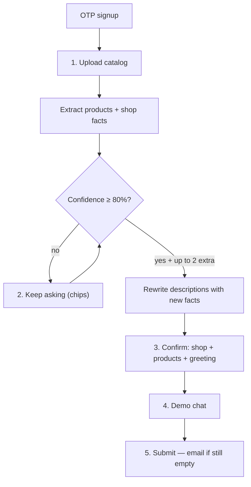

# Intake-first onboarding (P3) — Implementation Plan

**Problem:** The demo (step 4) is the conversion event, but today we ask vendors to type shop details first, allow skipping catalog, use generic greeting defaults, and enrich descriptions only from thin brochure text. Vendors will not feed enough detail. Generic replies lose the sale.

**Decision:** After OTP, **upload first**. We extract everything we can, then keep asking targeted follow-ups until we are **≥80% confident** we have store and product information. After that bar, we may ask **a few more** high-value questions. Auto-fill the rest; the vendor **corrects**. Product descriptions are rewritten from extracted facts (no invented claims). The demo runs in a **real WhatsApp mobile chat**, not a generic web form.

**Not this:** A free-form “agent chat until it feels done,” and not a hard 0–3 question cap. Questions stay **structured** (chips + short text) so they are cheap, resumable, and phone-friendly. The vendor can always tap “That’s enough.”

**Source of truth after this ships:** update [public-signup-onboarding.md](documentation/modules/features/vendor-onboarding/guides/public-signup-onboarding.md) in P3e (same change as the funnel).

**Delivery:** Phased P3a → P3e. **Stop for approval** after each phase.

---

## Locked product decisions

| Topic | Decision |
| --- | --- |
| First onboarding step after OTP | Catalog upload (photo / brochure / CSV / screenshots) |
| Intake stop rule | Keep asking while confidence **< 80%**. After ≥80%, ask **up to 2 more** remaining high-value gaps, then confirm |
| Intake style | Structured chips + short text (not a second chat product) |
| Hard safety | Vendor can skip remaining anytime. Engineering ceiling **10 questions** so we never trap; do not stop at 3 |
| Open-ended intake agent | **Out of scope** for P3 |
| Vendor job | Correct auto-filled fields; not fill a blank form first |
| Descriptions | Grounded rewrite + honest filler from name/unit; **never invent** ingredients, awards, health claims |
| Greeting / personality | Generated from shop + category + language; editable on confirm |
| Email / owner name | **Not** required before demo. Email required at **submit** (already enforced) |
| Skip catalog | Allowed, with honest copy. Optional **sample catalog** (labelled) so they can still try a demo |
| Demo UI | Customer-facing **WhatsApp mobile app** chrome (phone frame on desktop; full-screen on a real phone) |
| Demo chips | Built from **their** product names + delivery facts, shown as WhatsApp-style quick replies |
| Demo engine | Unchanged: production `conversation/pipeline.ts` with `sandbox: true` |
| Product cap | Keep **10** demo products (`ONBOARDING_DEMO_PRODUCT_LIMIT`) |
| In-flight vendors | Pre-launch: remap `onboardingStep` + old URLs; do not strand people on `/welcome` |

---

## Why the current demo is thin

Reply quality is whatever is in the LLM-1 static block ([`prompts.ts` `buildStaticBlock`](backend/src/conversation/llm/prompts.ts)): catalog `desc`, `businessName`, `aiGreeting` / `aiPersonality`, `aiDeliveryInstructions`, `aiPickupDeliveryAddress`.

Today:

- Step 1 is a blank form ([`OnboardingWelcome.tsx`](frontend_v2/apps/web-vendor/src/pages/onboarding/OnboardingWelcome.tsx)).
- Step 2 already extracts products + short descriptions ([`catalogExtractionService.ts`](backend/src/services/catalogExtractionService.ts) → [`catalogEnrichmentService.ts`](backend/src/services/catalogEnrichmentService.ts): max ~280 chars, “do not invent”).
- Vision returns **products only** ([`visionClient.ts`](backend/src/lib/visionClient.ts) / [`catalogExtraction/base.ts`](backend/src/services/prompts/catalogExtraction/base.ts)) — no shop name, hours, or delivery printed on the brochure.
- `autoGenerateAIConfig` exists on import options ([`catalogImport.ts` schema](backend/src/routes/schemas/catalogImport.ts)) but nothing generates it. Greeting defaults to *“Hello! Welcome to our shop…”* ([`OnboardingAiSetup.tsx`](frontend_v2/apps/web-vendor/src/pages/onboarding/OnboardingAiSetup.tsx)).
- Skip catalog is a first-class CTA; demo chips are generic ([`onboardingCopy.step4.suggestedPrompts`](frontend_v2/apps/web-vendor/src/components/onboarding/onboardingCopy.ts)).

---

## Target funnel



**Emotional beat:** Delight happens on step 4 with *their* prices and rules. Intake exists only to make that beat real.

### Route map (new vs old)

| New step | Route | Replaces |
| --- | --- | --- |
| 1 | `/onboarding/catalog` | Was step 2; now **first** after OTP |
| 2 | `/onboarding/clarify` | **New.** Auto-skip only if confidence already ≥80% |
| 3 | `/onboarding/confirm` | Merges old welcome + AI setup (pre-filled, editable) |
| 4 | `/onboarding/demo-chat` | WhatsApp mobile demo (sandbox pipeline unchanged) |
| 5 | `/onboarding/review` | Same submit; email field appears if empty |

**Redirects (keep old bookmarks working):**

- `/onboarding/` and `/onboarding/welcome` → catalog if no committed products, else confirm
- `/onboarding/ai-setup` → `/onboarding/confirm`

Update in lockstep:

- [`App.tsx`](frontend_v2/apps/web-vendor/src/App.tsx)
- [`OnboardingLayout.tsx`](frontend_v2/apps/web-vendor/src/components/onboarding/OnboardingLayout.tsx) stepper labels: Catalog / Details / Confirm / Demo / Submit. On `/demo-chat` **mobile**, hide the 5-step nav so the WhatsApp header is the chrome.
- [`onboarding.ts` `STEP_ROUTES`](frontend_v2/apps/web-vendor/src/lib/onboarding.ts)
- [`onboardingRedirect.ts`](backend/src/utils/onboardingRedirect.ts) + [`vendorOnboarding.ts` `stepPath`](backend/src/routes/vendorOnboarding.ts)
- [`vendorOnboardingService.ts` `STEP_PATHS`](backend/src/services/vendorOnboardingService.ts)

Default `Vendor.onboardingStep` stays `1`, but step 1 now means catalog.

---

## Completeness model (≥80% confidence, then a few more)

Rule engine, not an LLM, in a new module e.g. [`backend/src/services/onboardingIntakeService.ts`](backend/src/services/onboardingIntakeService.ts).

**Stop asking when `overallConfidence >= 0.80`.** Until then, keep serving the next highest-value unanswered question. After the bar is met, ask **up to 2 more** remaining nice-to-haves, then go to confirm.

Do **not** stop at 3 questions if we are still below 80%.

### Score (store 50% + products 50%)

Each field is 0–1 (extracted with confidence ≥ 0.75, or answered by the vendor). Missing = 0.

**Store (weights sum to 1.0)**

| Field | Weight | How we get it |
| --- | --- | --- |
| `businessName` | 0.22 | Brochure header / question |
| Category | 0.10 | Brochure / chips |
| Fulfillment (pickup / deliver / both) | 0.16 | Brochure notes / chips |
| Delivery area **if** they deliver | 0.14 | Address, city, or “which areas?” |
| Hours or lead time | 0.12 | Brochure / question |
| Address or city | 0.10 | Brochure / question |
| Language | 0.08 | Inferred from catalog / chip |
| Min order / payment note | 0.08 | Brochure / optional extra after 80% |

**Products (weights sum to 1.0)**

| Field | Weight | How we get it |
| --- | --- | --- |
| ≥1 named product | 0.15 | Extract; stay on catalog if zero |
| Share of products with price | 0.25 | Extract / inline price fill |
| Share with unit | 0.15 | Extract |
| Share with a real description (not empty / not name-only) | 0.25 | Extract + rewrite + “what do customers ask?” |
| ≥3 products **or** vendor says “that’s my full list” | 0.20 | Count / chip |

```
overall = 0.5 * storeScore + 0.5 * productScore
```

Show a plain line on clarify, e.g. “We know enough to try the demo” only after ≥80%. Below that: “A few more details make the replies accurate.”

### Question order

Always pick the unanswered field with the **largest remaining weight**. Typical order: name → prices → fulfillment → area → hours → product specials → language.

Product prices can be a compact list (“tap items missing ₹”) rather than one chat turn per SKU.

### After 80% — “a few more”

Priority extras (max 2):

1. Any product still without a description
2. Hours / lead time if still empty
3. “Anything customers always ask?” → `aiDeliveryInstructions`

Then confirm, even if extras remain.

### Explicitly **not** in the 80% score

Email, owner name, bot personality essay, closing message, WhatsApp number.

### Resume, skip, safety ceiling

- Persist `onboardingData.intake`: `{ answers, askedIds, scores, extraAfter80 }`
- Never re-ask an answered id
- **That’s enough** always visible → confirm with current score
- Engineering ceiling **10 questions** so a messy brochure cannot loop forever. If still <80% at 10: confirm with gaps marked (vendor can type on confirm)
- Clarify with no remaining questions **redirects** to confirm

Question UI: reuse [`ChoiceChips.tsx`](frontend_v2/apps/web-vendor/src/components/onboarding/ChoiceChips.tsx) + short text. Plain language in [`onboardingCopy.ts`](frontend_v2/apps/web-vendor/src/components/onboarding/onboardingCopy.ts). Not a second WhatsApp thread — that is reserved for the demo.

---

## Extraction: products **and** shop facts

### Vision contract

Extend [`VisionResponseSchema`](backend/src/lib/visionClient.ts) and [`BASE_EXTRACTION_PROMPT`](backend/src/services/prompts/catalogExtraction/base.ts):

```json
{
  "products": [ /* existing rows */ ],
  "vendorProfile": {
    "businessName": { "value": "Priya Home Bakery", "confidence": 0.9 },
    "category": { "value": "Food", "confidence": 0.8 },
    "address": { "value": null, "confidence": 0 },
    "city": { "value": "Coimbatore", "confidence": 0.7 },
    "hours": { "value": "10am–8pm", "confidence": 0.6 },
    "deliveryNotes": { "value": "City-wide delivery", "confidence": 0.5 },
    "languageHint": { "value": "ta", "confidence": 0.8 }
  }
}
```

Hard rules (prompt + schema):

- Copy only what is **printed**. Null + low confidence if absent.
- Do **not** treat a printed WhatsApp/phone as the login phone.
- Category must map to existing enum: Food, Retail, Services, Healthcare, Education, Other.
- Product rules unchanged (no invented prices/names).

### Merge across pages

New helper in extraction: pick highest-confidence non-null per field. Persist on the job:

```ts
// CatalogImportJob.result
{
  normalizedProducts,
  vendorProfile,      // merged
  warnings,
  pageProgress
}
```

CSV/XLSX: no shop header expected; `vendorProfile` stays empty; category may be inferred later from product names (optional, low confidence).

### Apply to vendor (on analyze ready, not only on commit)

When analyze finishes, copy high-confidence profile into `onboardingData.extractedProfile` **without overwriting** vendor-edited fields (`onboardingData.intake.lockedFields` or “only fill if Vendor.businessName is still empty”).

On catalog **commit**, if `businessName` is still empty and extracted name is present, write `Vendor.businessName` so LLM-1 is not “assistant for ” (blank).

Wire the unused `autoGenerateAIConfig` path: after confirm (or after extract if name+category exist), generate greeting/personality and pass `applyAIConfig` into [`catalogCommitService.commit`](backend/src/services/catalogCommitService.ts) (already supports it).

---

## Descriptions: expand, don’t invent

Keep [`enrichKeywordsBatch`](backend/src/services/catalogEnrichmentService.ts) as the single rewrite step. Change the prompt and inputs:

**Inputs:** product name, existing brochure desc, unit, plus **shop context** (category, delivery notes, intake answers, hours/lead time).

**Output:** 1–3 sentences, cap **~600 characters** (schema already allows 2000; compact catalog is fine at this size). Still no prices in the description body.

**Tiers:**

1. Brochure has flavour/ingredients/pack → rewrite clearly for WhatsApp.
2. Name + unit only → honest line, e.g. “Homemade almond cookies, sold by the box. Ask for today’s batch.”
3. After gap answers (“eggless”, “needs 1 day”) → **second enrichment pass** only for affected rows (or all ≤10). Bill as catalog import / new `onboarding_intake` wallet source.

Do **not** add a separate marketing-copy LLM. Do **not** claim organic/sugar-free/awards unless printed or the vendor typed it.

Category appendices already push custom-order notes into description ([`bakery.ts`](backend/src/services/prompts/catalogExtraction/bakery.ts)); keep that.

---

## Auto greeting (collapse old step 3)

New `generateOnboardingAiConfig()` (can live next to [`vendorAIConfigService.ts`](backend/src/services/vendorAIConfigService.ts)):

- `aiBotName`: `{businessName} assistant` or “Shop assistant”
- `aiGreeting`: one short line in inferred language, using shop name
- `aiPersonality`: 1–2 sentences from category (Food vs Tailor vs Retail), not a blank essay
- `aiDeliveryInstructions` / `aiPickupDeliveryAddress`: from extract + answers

Show on **confirm** as editable text (same fields as today’s AI setup). Preview mock can stay ([`WhatsAppPhoneMock.tsx`](frontend_v2/apps/web-vendor/src/components/onboarding/WhatsAppPhoneMock.tsx)).

If generation fails: keep current defaults; never block the funnel.

---

## Demo: real WhatsApp mobile chat

The aha only lands if this **looks and behaves like WhatsApp on a phone**, not a dashboard widget. Today [`OnboardingDemoChat.tsx`](frontend_v2/apps/web-vendor/src/pages/onboarding/OnboardingDemoChat.tsx) is a short web card: file-picker “Mic”, no typing indicator, no ticks, no hold-to-record. [`WhatsAppPhoneMock.tsx`](frontend_v2/apps/web-vendor/src/components/onboarding/WhatsAppPhoneMock.tsx) is a static 260px preview. The vendor inbox ([`ConversationView.tsx`](frontend_v2/apps/web-vendor/src/components/conversations/ConversationView.tsx)) is **staff-side** (gray header, AI pause) — do **not** reuse that shell.

Build a dedicated customer-phone demo: `WhatsAppDemoPhone` (new), used full-width on `/onboarding/demo-chat`.

### Layout

| Viewport | Treatment |
| --- | --- |
| Desktop / tablet | Centered **phone chassis** (~390×844, rounded bezel, fake status bar). Trial wallet + “Continue” sit **outside** the phone so the chat itself stays pure WhatsApp |
| Mobile (`< md`) | **Full-screen WhatsApp** (no fake bezel). Onboarding stepper collapses to a thin top strip or a back chevron so the chat fills the screen |

Wallpaper: WhatsApp default doodle / `#ECE5DD`. Header: `#075E54` (or current WA `#008069` — pick one shipped Android look and stick to it). Outgoing bubble: `#d9fdd3` / `#DCF8C6`. Incoming: white. Reuse [`bubbleChrome.ts`](frontend_v2/apps/web-vendor/src/components/conversations/bubbles/shared/bubbleChrome.ts) + [`StatusTick.tsx`](frontend_v2/apps/web-vendor/src/components/conversations/bubbles/shared/StatusTick.tsx) + [`AudioPlayer.tsx`](frontend_v2/apps/web-vendor/src/components/conversations/bubbles/shared/AudioPlayer.tsx).

### In scope (must feel like the real app)

| Feature | Behaviour |
| --- | --- |
| Chat header | Avatar, **shop assistant name**, subtitle `online` → `typing…` while the sandbox is running |
| Header icons | Video + voice call + menu: **visible, disabled**, with “Demo only” if tapped — no real calls |
| Date chip | `Today` separator |
| Text bubbles | Tails, max-width ~80%, timestamp `h:mm` on each bubble |
| Ticks on **customer** (outgoing) messages | Clock / sending → single tick (sent) → double gray (delivered) → double blue (read) as the reply arrives |
| Typing indicator | Incoming 3-dot bubble **and** header `typing…` within **1s** of send; hold until the reply is painted |
| Composer | Attach, growing text field, **mic** when empty, **green send** when there is text (WA morph) |
| Hold-to-record voice | `MediaRecorder` (not `<input type=file>`). Press-and-hold, duration, waveform; **slide left to cancel**; release to send |
| Voice bubbles | Waveform player like [`AudioBubble`](frontend_v2/apps/web-vendor/src/components/conversations/bubbles/AudioBubble.tsx); still call `POST /sandbox/voice` |
| Quick replies | Product-specific chips **above** the composer (WA suggestion row), not a webpage button row above the phone |
| Keyboard | Mobile: composer pinned above the virtual keyboard (`dvh` / visualViewport) |
| First open | Optional assistant greeting bubble (generated `aiGreeting`) so the thread is not empty |
| Demo honesty | One small “Demo — not sent to customers” in the header subtitle or **outside** the phone — not a banner over the wallpaper |

**Do not** put `This reply cost ₹0.42` inside the bubble. Show cost in the **trial bar outside** the phone (desktop) or a tiny caption under the composer that does not look like a WA system message.

### Nice-to-have (same slice if cheap)

- Long-press a bubble → Reply (quoted preview using [`QuotedReplyPreview.tsx`](frontend_v2/apps/web-vendor/src/components/conversations/bubbles/shared/QuotedReplyPreview.tsx))
- Attach image: outgoing image bubble; caption can hit sandbox as text. Skip vision-on-image in demo v1 if it blows the wallet

### Out of this demo (decorative or later)

Real calls, Status/channels, WhatsApp Pay, stickers/GIFs, disappearing messages, view-once, live location, contact cards. Camera/attach icons may be present but no-op with a toast if image send is not wired.

### Prompts and skip

- `demoPrompts` from committed products: `How much is {name}?`, `Do you have {name}?`, `Do you deliver to {city}?`
- Skip catalog: warning **outside** the phone; optional labelled sample catalog

### Backend

Sandbox APIs stay the same. Frontend adds a short **delay** so ticks and typing are visible (sent tick immediately, typing after ~400ms, reply when the API returns). If the API is faster than ~800ms, still show typing for a minimum ~600ms so it feels like WhatsApp.

---

## Wallet budget (₹100 trial)

Same wallet; more LLM work before the demo. Guardrails:

| Slice | Target |
| --- | --- |
| Vision + first enrichment | Existing catalog-import spend |
| Gap questions | **₹0 LLM** (chips/rules). More questions ≠ more model spend |
| Second description pass | Cheap `gpt-4o-mini` batch, ≤10 rows |
| Greeting generate | One small completion |
| Demo | Remainder — this is the aha |

If balance cannot cover a second enrichment, skip it and continue (descriptions stay at pass 1). Never block confirm/demo solely because enrichment failed.

Add breakdown source `onboarding_intake` if the second pass is not already rolled into `catalog_import`.

---

## Backend API sketch

Keep `PATCH /api/vendors/me/onboarding` but **stop requiring step-1 schema on step 1**.

| Step | Validation |
| --- | --- |
| 1 catalog | `{ catalogJobId?, skipped? }` — same as today |
| 2 clarify | `{ intake: { answers, askedIds } }` — apply to vendor fields |
| 3 confirm | Partial shop + AI fields; **email optional**; `businessName` min 3 if provided |
| 4 demo | advance only |
| 5 review/submit | Email required here if still empty |

New (small) read model on `GET /me/onboarding`:

```ts
{
  completeness: { store: number; products: number; overall: number; readyForDemo: boolean; missing: string[] },
  nextQuestions: Array<{ id: string; prompt: string; kind: 'chips' | 'text' | 'price_list'; options?: string[] }>,
  extractedProfile: VendorProfileDraft | null,
  demoPrompts: string[]
}
```

Alternatively `GET /api/vendors/me/onboarding/intake` so the profile payload stays small. Prefer one GET to avoid extra round-trips on mobile.

Submit ([`submitForApproval`](backend/src/services/vendorOnboardingService.ts)) already requires `businessName` + `email`. Keep that. Confirm UI must not be able to reach demo with a blank name if extract also failed — force a name field on confirm in that case only.

---

## Frontend pages

| Page | Work |
| --- | --- |
| [`OnboardingCatalog.tsx`](frontend_v2/apps/web-vendor/src/pages/onboarding/OnboardingCatalog.tsx) | Become step 1; after save → clarify (or confirm if no questions); keep extract progress + product editor |
| `OnboardingClarify.tsx` **new** | Next question from score; That’s enough; Continue |
| `OnboardingConfirm.tsx` **new** (or retarget Welcome) | Pre-filled name, category, address, delivery, greeting; product count summary + edit link back to catalog |
| [`OnboardingWelcome.tsx`](frontend_v2/apps/web-vendor/src/pages/onboarding/OnboardingWelcome.tsx) | Delete or turn into redirect |
| [`OnboardingAiSetup.tsx`](frontend_v2/apps/web-vendor/src/pages/onboarding/OnboardingAiSetup.tsx) | Fold into confirm; route redirect |
| [`OnboardingDemoChat.tsx`](frontend_v2/apps/web-vendor/src/pages/onboarding/OnboardingDemoChat.tsx) | Host `WhatsAppDemoPhone`; wallet/continue outside the device |
| `WhatsAppDemoPhone.tsx` **new** | Full WA mobile chrome: header, ticks, typing, hold-to-record, composer morph |
| [`OnboardingReview.tsx`](frontend_v2/apps/web-vendor/src/pages/onboarding/OnboardingReview.tsx) | Email/owner if missing; edit links to confirm/catalog |
| [`onboardingCopy.ts`](frontend_v2/apps/web-vendor/src/components/onboarding/onboardingCopy.ts) | All new strings; no jargon |

Signup marketing copy already says “upload your catalog” first — align stepper/explainer with that; no signup-page redesign in P3.

---

## In-flight vendor mapping

Assume few `registrationStatus=onboarding` rows (P2 landed 2026-09-05).

On first `GET /me/onboarding` after deploy:

| Old `onboardingStep` | New step / path |
| --- | --- |
| 1 (welcome, maybe partial form) | 1 catalog; keep `onboardingData.step1` to pre-fill confirm later |
| 2 catalog | 1 catalog (resume job id) |
| 3 AI setup | 3 confirm (pre-fill from AI columns) |
| 4 demo | 4 demo |
| 5 review | 5 review |

No schema migration required if we only remap paths in `stepPath` / `getOnboardingRedirectPath`. Persist new meaning of `onboardingStep` going forward.

---

## Phases (stop for review)

### P3a — Extract shop facts (backend, no funnel reorder)

**Goal:** Analyze jobs return `vendorProfile` without changing the wizard.

- Prompt + Zod + merge + persist on `CatalogImportJob.result`
- Tests: fixture brochure with header name/address; CSV-only → empty profile; multi-page merge
- Do not write Vendor columns yet except into job JSON

**Review gate:** One real bakery photo returns a plausible shop name; a price-only CSV does not hallucinate a name.

### P3b — Catalog-first wizard + confirm

**Goal:** OTP → catalog → confirm (pre-filled) → demo → submit. Email on submit.

- Route/stepper/redirects
- Prefill confirm from `extractedProfile` + existing Vendor columns
- Generate greeting if name+category present
- Welcome/AI-setup redirects
- PATCH step schemas updated

**Review gate:** New signup never sees a blank 6-field form before upload. Extracted name appears on confirm. Submit still blocks empty email.

### P3c — Gap questions (confidence, not a 3-cap)

**Goal:** Keep asking until `overall >= 0.80`, then up to 2 extras. Auto-skip only if extract already clears 80%.

- `onboardingIntakeService` score + next question
- Clarify page + That’s enough
- Apply answers to vendor + `onboardingData.intake`
- Resume `askedIds`; do not stop at 3 while below 80%

**Review gate:** Rich brochure (name, prices, delivery printed) skips or asks 0–1. Sparse price list keeps asking (name, fulfillment, area, hours…) until 80% or That’s enough. A fourth+ question is allowed when still below 80%.

### P3d — Descriptions + WhatsApp demo phone

**Goal:** Demo replies cite pack/flavour/delivery; the screen **is** WhatsApp on a phone.

- Enrichment prompt + shop/intake context; optional second pass after clarify
- `demoPrompts` from committed products
- `WhatsAppDemoPhone`: chassis / full-screen, typing, ticks, hold-to-record, composer mic→send
- Cost outside the bubble; greeting as first inbound message
- Sample-catalog option on skip (if we take that variant)

**Review gate:** On a phone, the demo is indistinguishable from a WA chat at a glance (header, wallpaper, bubbles, typing, mic). 10 sandbox turns on a real brochure: prices, pack size, delivery — no invented ingredients. Hold-to-record sends a voice note; slide-to-cancel does not send.

### P3e — Docs, funnel, QA

- Rewrite page-by-page section of `public-signup-onboarding.md` (emotional journey: understood = catalog+clarify, delighted = demo)
- Funnel events: keep `step_N_completed` but document new meanings; add `intake_question_answered`, `intake_skipped`
- Wallet breakdown check
- Update [vendor-onboarding README](documentation/modules/features/vendor-onboarding/README.md)
- Manual checklist below

**Review gate:** Doc matches UI; 10 staging runs; zero raw API errors.

---

## Tests

| Area | Cases |
| --- | --- |
| Vision schema | Profile present / missing / extra fields ignored |
| Merge | Page 1 name, page 2 address → both |
| Completeness | Rich extract → `overall >= 0.8` and `nextQuestions` empty or extras-only |
| Cap | Below 80%, 4th question **is** returned; at 10, no 11th |
| Extra after 80% | At most 2 extra ids |
| Redirect | Old `/welcome` → catalog; pending → submitted |
| PATCH | Step 1 no longer requires email |
| Submit | Still 400 without email/name |
| Enrichment | Follow-up “eggless” appears in desc; no “organic” invented |
| `onboardingRedirect.test.ts` | New step paths |

Frontend: keep pages thin; prefer service unit tests over UI snapshots.

---

## Risks

| Risk | Mitigation |
| --- | --- |
| Hallucinated shop name / claims | Confidence threshold; vendor confirm; prompt forbids invention |
| Trial spent before demo | Questions stay chips (₹0 LLM); skip second enrich at low balance |
| Clarify fatigue | That’s enough; show score in plain language; 10-question ceiling |
| Demo looks like a web form | Phone chrome + hold-to-record + typing; cost outside bubbles |
| Voice permissions | Fallback to file pick only if `getUserMedia` denied; copy in plain language |
| Confirm feels like the old form | Only show empty/low-confidence fields; collapse filled ones |
| Skip still yields a bad demo | Honest copy + optional sample catalog |
| Vision slower on step 1 | Keep existing progress UI (“Reading your menu…”) |
| Dual PATCH implementations | [`vendorOnboarding.ts`](backend/src/routes/vendorOnboarding.ts) vs [`vendorOnboardingService.ts`](backend/src/services/vendorOnboardingService.ts) — change the **route** that the frontend actually calls; delete or align the unused service path in this work if it is dead |

---

## Out of scope (P3)

- Unbounded **free-text** intake agent / tool-calling loop (structured questions until 80% is in scope)
- Real WhatsApp calls, Status, Pay, stickers
- Live WhatsApp / Embedded Signup
- Raising the 10-product demo cap
- Admin approval queue UI
- Signup marketing layout (already shipped)
- RAG/FAQ upload during trial
- Changing production pipeline quality (sandbox already uses it)

A free-form intake-agent UI is a **P4** candidate only if structured questions cannot reach 80% in staging.

---

## Success criteria

- Signup → first catalog upload without a blank shop form
- ≥1 committed product (or labelled sample) before demo, unless they explicitly skip
- Demo chips mention a real product name when catalog exists
- Sandbox reply uses price **and** at least one non-generic fact (desc or delivery) when that fact was extracted or answered
- Submit still requires email
- Vendor can finish on Android Chrome; clarify continues until ≥80% or That’s enough (not capped at 3)
- Demo chat matches WhatsApp mobile chrome (typing, ticks, hold-to-record) on phone and in the desktop frame
- In-flight `/onboarding/welcome` does not 404 or trap

---

## Manual QA (P3e)

1. New phone → OTP → **catalog**, not welcome form.
2. Bakery brochure with shop name → confirm shows that name; greeting uses it.
3. CSV prices only → clarify keeps going (name, fulfillment, area, …) until ≥80% or That’s enough — not stop after two questions.
4. Answer “deliver, within 5 km” → demo “Do you deliver?” is specific.
5. Re-login mid-clarify → same unanswered question, score preserved.
6. Skip catalog → warning; sample path if built; submit still needs email.
7. Empty email on confirm → demo allowed; submit blocked until email.
8. Brochure with “eggless” printed → demo can say eggless; no extra health claims.
9. ₹0 after import → demo disabled; submit works.
10. Old bookmark `/onboarding/ai-setup` → confirm.
11. Demo on a phone: typing dots + header `typing…`; mic hold records; slide cancel; ticks go blue when the reply lands.
12. Cost appears in the trial bar, not inside the WA bubble.

---

## Key files

| Area | Files |
| --- | --- |
| Vision | [`visionClient.ts`](backend/src/lib/visionClient.ts), [`prompts/catalogExtraction/base.ts`](backend/src/services/prompts/catalogExtraction/base.ts) |
| Extract/enrich | [`catalogExtractionService.ts`](backend/src/services/catalogExtractionService.ts), [`catalogEnrichmentService.ts`](backend/src/services/catalogEnrichmentService.ts), [`catalogImportService.ts`](backend/src/services/catalogImportService.ts) |
| Intake | **new** `onboardingIntakeService.ts`; [`vendorOnboarding.ts`](backend/src/routes/vendorOnboarding.ts) |
| AI fill | [`vendorAIConfigService.ts`](backend/src/services/vendorAIConfigService.ts), [`catalogCommitService.ts`](backend/src/services/catalogCommitService.ts) |
| Routes/UI | [`App.tsx`](frontend_v2/apps/web-vendor/src/App.tsx), layout, catalog/confirm/clarify/demo/review, **new** `WhatsAppDemoPhone.tsx`, [`onboardingCopy.ts`](frontend_v2/apps/web-vendor/src/components/onboarding/onboardingCopy.ts) |
| WA chrome reuse | [`bubbleChrome.ts`](frontend_v2/apps/web-vendor/src/components/conversations/bubbles/shared/bubbleChrome.ts), [`StatusTick.tsx`](frontend_v2/apps/web-vendor/src/components/conversations/bubbles/shared/StatusTick.tsx), [`AudioPlayer.tsx`](frontend_v2/apps/web-vendor/src/components/conversations/bubbles/shared/AudioPlayer.tsx) |
| Resume | [`onboardingRedirect.ts`](backend/src/utils/onboardingRedirect.ts), [`lib/onboarding.ts`](frontend_v2/apps/web-vendor/src/lib/onboarding.ts) |
| Docs | [`public-signup-onboarding.md`](documentation/modules/features/vendor-onboarding/guides/public-signup-onboarding.md) |

---

## Suggested first implementation slice

**P3a only** until you have seen one real brochure emit `vendorProfile` you trust. Then P3b (reorder) is the user-visible change. P3c is the 80% intake loop. P3d is descriptions **and** the WhatsApp phone demo.
