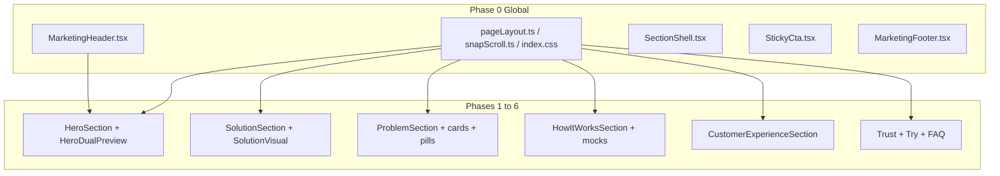

# Marketing website responsive implementation plan

App: [`frontend_v2/apps/web-marketing`](frontend_v2/apps/web-marketing) (Vite, port 3002). Homepage sections live in [`Home.tsx`](frontend_v2/apps/web-marketing/src/pages/Home.tsx).

This plan records the audit, the decisions from discussion, and the exact work to do after approval. **No copy rewrite, palette change, or motion rewrite** unless a line must shorten so it fits.

---

## How we got here

1. The marketing site was designed as a full-viewport snap-scroll page. It has many responsive issues.
2. First pass was **analysis only** (no code). Live screenshots were taken at 375, 390, 768, 1024x768, 1280x800, 1366x768, 1440x900, and 1920x1080.
3. Finding: the layout only matches the design around **1440x900 and up**. Narrower or shorter viewports clip, overlap, or hide pieces.
4. Follow-up decision: **do not try to fit below 400px**. Traditional / modern phones are treated as 390px and up. Skip 320 / 360 / 375 (iPhone SE, small Android) special cases.
5. Work is **section by section**, re-tested after each phase. Global chrome first, then hero, then the worst layout bug (solution callouts), then the rest.

---

## Locked decisions

| Decision | Choice |
| --- | --- |
| Mobile floor | **390px CSS width** (iPhone 14/15/16). Do not add 320–375 one-offs. |
| Why not a hard 400px floor | Most current iPhones are **390–393px**, not 400+. Pro Max / Plus are 430px. iPhone 16 Pro is 402px. Flooring at 400 would skip the most common iPhone width. |
| Out of scope widths | 320, 360, 375. Icon-only logo under 380px, stacking hero phones only for 375, hiding header Try Free only for SE. |
| Snap scroll | Keep the designed snap on large / tall desktops. Below `lg`, and on any section that needs internal scroll, **drop `snap-always` / switch that axis to `snap-proximity`**. Never leave an inner scroller inside a `snap-mandatory` parent (the parent snaps back mid-gesture on iOS Safari and Chrome Android). |
| Sticky Try Free | Keep on `max-lg`. Sections must pad above it. Do not cover last lines. **Measure the real bar height** instead of trusting the hardcoded `4.5rem` in `SNAP_SECTION_HEIGHT` (actual is ~`0.75rem + 48px + max(0.75rem, safe-area)`, so the current calc double-counts safe-area and over-subtracts on notched iPhones). |
| Header Try Free on 390+ | **Provisional.** Keep only if the header row measurably fits 390. Audit shots at 390 show the hamburger clipped, so if logo + CTA + hamburger exceed 390, drop the header CTA (the sticky bar already carries it) rather than clip the menu button. |
| Verification tooling | Headless Chrome `--screenshot` (already used for the audit) can capture but **cannot click, scroll, or open menus**. Interactive checks are done manually in a real browser device toolbar. Do not claim a phase verified from screenshots alone. |
| Brand | Navy `#072349` (`primary-500`) + WhatsApp green `#25D366` / `#128C7E`. Inter + Plus Jakarta Sans + Caveat. Light mode. |
| Copy / motion | Do not change marketing copy, colors, or animation unless a string must shorten to fit. |
| About / Privacy | Not the focus. They already use normal document flow (`MarketingLayout` without snap). Only fix if the shared header/sticky bar regresses them. |
| Verification | After each phase, check **390, 430, 768, 1024x768, 1280x800, 1366x768, 1440, 1920**. 1440x900 is the design reference and must not regress. |

---

## Target viewports

| Band | Size | Role |
| --- | --- | --- |
| Mobile floor | 390x844 | iPhone 14/15/16. Smallest we design for. |
| Large phone | 430x932 | iPhone Plus / Pro Max. |
| Tablet | 768x1024 | iPad portrait. Still uses mobile hero (`lg` is 1024). |
| Small / short laptop | 1024x768, 1280x800, 1366x768 | Desktop header + snap. Height is the main failure (annotations hidden below 860px; sections clip). |
| Design desktop | 1440x900 | Current intended look. Preserve. |
| Wide desktop | 1920x1080 | Confirm callouts and phones still sit in their columns. |

---

## Root cause

Every homepage block is a **one-viewport snap target**:

```2:9:frontend_v2/apps/web-marketing/src/lib/snapScroll.ts
export const SNAP_SECTION_HEIGHT =
  'h-[calc(100dvh-var(--marketing-header-h))] max-lg:h-[calc(100dvh-var(--marketing-header-h)-env(safe-area-inset-bottom)-4.5rem)]';

export const snapSectionClass = [
  SNAP_SECTION_HEIGHT,
  'box-border shrink-0 snap-start snap-always',
  'flex flex-col justify-center overflow-hidden',
```

**Overflow is invisible and unreachable, not scrollable.** Three layers clip on top of each other:

1. `html.marketing-snap-active { overflow: hidden; height: 100% }` ([`index.css`](frontend_v2/apps/web-marketing/src/index.css))
2. The app shell `div.flex.h-[100dvh].flex-col.overflow-hidden` ([`MarketingLayout.tsx`](frontend_v2/apps/web-marketing/src/components/MarketingLayout.tsx))
3. `overflow-hidden` on each snap section

So nothing overflows the document; it just disappears. That explains why the 390 audit shots show headlines cut mid-word with no scrollbar.

**P0 consequence — the mobile menu can be unreachable.** In the 390 capture the hamburger is not visible. The header sits inside the clipped shell, so if the header row (full wordmark + Try Free + hamburger) exceeds the viewport, the menu button is clipped away with no way to scroll to it. That is a functional navigation bug, not a cosmetic one, and it outranks every styling item in this plan. Phase 0 must measure it first.

Combined with:

- Sticky [`StickyCta`](frontend_v2/apps/web-marketing/src/components/StickyCta.tsx) on `max-lg` (~4.5rem)
- Headings that only get `max-w-[18ch]` from `sm` up ([`HeroSection.tsx`](frontend_v2/apps/web-marketing/src/components/sections/HeroSection.tsx))
- Solution callouts absolutely positioned **outside** the phone ([`SolutionVisual.tsx`](frontend_v2/apps/web-marketing/src/components/solution/SolutionVisual.tsx)) while the phone sits in a 2-column grid next to copy

Result: extra content is **clipped**, not wrapped or scrolled. Several sections already try `overflow-y-auto` with hidden scrollbars, which fights `snap-mandatory` and feels like the page is cut off.

**Snap strategy to implement**

- **`lg+` and tall enough:** keep `snap-y snap-mandatory` and one-section-per-view, but if a section still overflows, use `overflow-y-auto` on that section instead of `overflow-hidden`.
- **Below `lg`:** any section that scrolls internally loses `snap-always` (or the container drops to `snap-proximity` there). Prefer **visible inner scroll** over clipping. Always reserve space for the sticky CTA (already in `SNAP_SECTION_HEIGHT`, but re-derive the constant from the measured bar height; also pad last content).
- **Short laptop (`max-height: 860px` and `min-width: 1024px`):** stop using `hero-short-hide { display: none }`. Scale phones and notes instead of removing them.

---

## What the audit showed (by section)

### Header + sticky bar

- 375: Try Free clipped (“Try Fr”), hamburger off-screen. **Out of scope** after the 390px floor.
- 390: Try Free label reads in full, but the **hamburger is still not visible** in the capture. Treat header fit at 390 as unresolved until step 0.1 measures it. Dual phones and headlines also still fail here.
- 768: header OK (wordmark + Try Free + hamburger).
- 1024+: desktop nav + Login + Try Free fits.

### Hero

- 390: headlines clip (`Still typing the same WhatsApp re…` / `and the or…`). Demo snap: “With ChatLogi…” clipped, frames hang off the right.
- 768: headlines wrap (because `sm:max-w-[18ch]`). Demo still two-up under `lg`.
- 1024x768 / 1280x800 / 1366x768: `hero-short-hide` removes bullets, arrows, handwritten notes. Looks unfinished.
- 1440x900 / 1920: intended design. Trust chip only from `xl`.

### Problem

- `md:grid-cols-3` at 768 crushes three cards.
- Pills overlap chat text (Delivery? on “How much is it?”; “New inquiries keep coming” on names; handwritten note on pin code).
- Snap `overflow-hidden` slices card titles/bodies even at 1440.
- “That’s every busy day” arrow points into empty space on mid widths.

### Solution / Product (worst visual bug)

Absolute callouts (`right: calc(100% + …)`, `left: calc(100% + …)`) draw **on the left copy column**. Confirmed at 1024, 1280, 1366, 1440, and 1920:

- “Instant product answers” on **in seconds**
- “Helps turn chats into orders” on the benefit list
- “Real-time stock & pricing” clipped on the right
- Benefits + trust chip fall off the bottom on short laptops
- On phones, arrows stick out with missing labels

### How it works

- 4 columns from `lg` (1024). Copy truncated (`lg:truncate`, `lg:line-clamp-3`).
- Dashboard mock: “Conversati…”, “Dasho…”.
- Split header (headline | trust + highlights) is tight at 1024–1280.
- Taller than the snap viewport on phones (hidden inner scroll).

### Natural conversations

- One of the better desktop blocks at 1280.
- “Sweet Crumb B…” truncated in the phone chrome.
- Stats forced to 3 columns on all widths.
- Headlines clip on phones (same global type issue).
- Stats often below the snap fold on short height.

### Trust / Try / FAQ

- Trust: 4 columns at `xl`; 2x2 at 1024 is taller than a short laptop.
- Try: journey steps `w-[7rem]` x 4 wrap badly; offer glow `w-[130%]` can overflow-x; trust-row `border-l` looks wrong when wrapped.
- FAQ: answers are `position: absolute` while the section uses `lg:overflow-hidden`, so panels clip and cover neighbors. `lg:whitespace-nowrap` on the headline. 3 columns at `lg` is tight. Footer lives inside this snap section; sticky CTA covers it; copyright is `hidden` below `sm`.

---

## Implementation phases

Do these in order. After each phase, re-check the target viewports before starting the next.

### Phase 0 — Global chrome

**Files:** [`MarketingHeader.tsx`](frontend_v2/apps/web-marketing/src/components/MarketingHeader.tsx), [`pageLayout.ts`](frontend_v2/apps/web-marketing/src/lib/pageLayout.ts), [`snapScroll.ts`](frontend_v2/apps/web-marketing/src/lib/snapScroll.ts), [`index.css`](frontend_v2/apps/web-marketing/src/index.css), [`SectionShell.tsx`](frontend_v2/apps/web-marketing/src/components/SectionShell.tsx), [`StickyCta.tsx`](frontend_v2/apps/web-marketing/src/components/StickyCta.tsx), [`MarketingFooter.tsx`](frontend_v2/apps/web-marketing/src/components/MarketingFooter.tsx), [`MarketingLayout.tsx`](frontend_v2/apps/web-marketing/src/components/MarketingLayout.tsx), [`useSnapScrollAnchors.ts`](frontend_v2/apps/web-marketing/src/hooks/useSnapScrollAnchors.ts), [`HeroSection.tsx`](frontend_v2/apps/web-marketing/src/components/sections/HeroSection.tsx)

**Step 0.1 — Measure before editing (blocking)**

Run at 390 with the app shell's `overflow-hidden` temporarily disabled in devtools, and record the numbers in this file:

- Is the mobile hamburger inside the viewport? (`getBoundingClientRect().right <= innerWidth`)
- Header row natural width vs 390.
- Per section: `scrollWidth - clientWidth` and `scrollHeight - clientHeight`.
- Real `StickyCta` height vs the `4.5rem` assumed in `SNAP_SECTION_HEIGHT`.

This decides two provisional calls: whether the header CTA survives at 390, and how much vertical budget each section actually has.

**Step 0.2 — Reachable navigation (P0)**

- Guarantee the hamburger is inside the viewport at 390. If the row does not fit: drop the header Try Free below `lg` (sticky bar keeps it) or shrink the wordmark. Clipping the menu button is not acceptable.
- Consider trimming `--marketing-header-h` from `5rem` to ~`4rem` below `lg`. On a 390x844 phone the 80px header plus ~94px sticky bar leaves ~670px, and every section is budgeted from that.

**Heading wrap**

- Apply a wrap constraint at **all** widths, not only `sm+`. Today hero lines use `max-w-none sm:max-w-[18ch]`, which is why 390 clips and 768 wraps.
- Add `min-w-0` on flex ancestors (`hero-snap-inner`, section inners).
- Keep `sectionHeadingClass` scale; do not invent a sub-390 type size.

**Snap overflow**

- Replace blanket `overflow-hidden` on snap sections with `overflow-x-hidden overflow-y-auto` below `lg`, and on short `lg+` laptops.
- Keep `overflow-hidden` only where a section is proven to fit (hero on tall desktop).
- **Any section that scrolls internally must lose `snap-always` on its parent** (or the container switches to `snap-proximity` at that breakpoint). Mandatory snap plus a nested scroller fights the user's gesture.
- Do not hide the scrollbar on a region that genuinely scrolls. Several sections already use `[scrollbar-width:none]` with `overflow-y-auto`, which makes hidden content undiscoverable. Either the section fits, or its scroll is visible.
- Preserve sticky-CTA height subtraction on `max-lg`, using the measured bar height from step 0.1.
- Add content padding so the last line is not under the sticky bar.

**Coupled behavior — do not break these while changing snap**

- `MarketingLayout` adds `marketing-snap-active` to `<html>` unconditionally when `snapScroll` is on. If mobile moves toward document flow, that class must be media-gated, or mobile ends up with a locked `<html>` and no scroll.
- [`useSnapScrollAnchors`](frontend_v2/apps/web-marketing/src/hooks/useSnapScrollAnchors.ts) intercepts every same-page anchor and scrolls **inside** `#main-content`. If that element stops being the scroller at some breakpoint, `/#product`, `/#how-it-works`, `/#pricing`, `/#faq` and the header nav silently stop working. Re-test anchors after any snap change.
- `html { scroll-padding-top: calc(var(--marketing-header-h) + 1rem) }` only matters in document-flow mode; keep it consistent with whatever the mobile mode becomes.

**Header / footer**

- At 390+: keep wordmark + Try Free + hamburger. Do **not** drop header Try Free unless 390 still collides (sticky bar already duplicates it).
- Footer: show a compact copyright / Privacy on mobile; keep footer out from under the sticky bar (padding on FAQ inner, or footer not overlapped).

**Not in this phase:** icon-only logo under 380px, hiding header CTA for SE.

### Phase 1 — Hero

**Files:** [`HeroSection.tsx`](frontend_v2/apps/web-marketing/src/components/sections/HeroSection.tsx), [`HeroDualPreview.tsx`](frontend_v2/apps/web-marketing/src/components/hero/HeroDualPreview.tsx), [`WhatsAppPhoneShell.tsx`](frontend_v2/apps/web-marketing/src/components/hero/whatsapp/WhatsAppPhoneShell.tsx), [`snapScroll.ts`](frontend_v2/apps/web-marketing/src/lib/snapScroll.ts), [`index.css`](frontend_v2/apps/web-marketing/src/index.css) (hero phone media queries, `hero-short-hide`)

**Decide first: what happens to the two mobile hero panels.** Below `lg` the hero is split into two full-viewport snap panels, `#hero-mobile` (copy, plus a "Swipe up to see the demo" hint) and `#hero-preview` (phones). That split only reads correctly under mandatory snap. At 390 panel 1 is mostly empty space. Pick one and apply it consistently:

- **A. Keep the split** — keep mandatory snap below `lg` for the hero only, and fix by fitting content. Lowest churn, keeps the intended "before / after" reveal.
- **B. Merge into one mobile hero** — copy plus phones in one scrolling section, drop the "Swipe up" hint and the second `id`. Fixes the empty panel, but `#hero-preview` disappears as an anchor target.

Default to **A** unless step 0.1 shows the copy panel cannot be filled sensibly at 390.

- Headlines fully visible at 390+ (phase 0 wrap + any remaining `max-w` on the two `span.block` lines).
- Dual phones at 390–430: keep 2-up if both frames, labels, and chrome fit; if not, **slightly shrink** width/gap (do not stack just for 375). Labels must not clip (`With ChatLogix`, `Your day now`).
- Tablet (`md`–`lg`): same two-up, more room; keep phones in the second snap panel (`lg:hidden` preview section).
- Short laptop: **scale** phones, bullets, and handwritten arrows. Remove or narrowly scope `hero-short-hide` so 1024x768 / 1280x800 / 1366x768 still show the before/after story.
- Trust chip: show from `lg` (not only `xl`); allow wrap.
- Preserve 1440+ composition (split copy | phones, arrows, notes).

### Phase 2 — Solution / Product

**Files:** [`SolutionVisual.tsx`](frontend_v2/apps/web-marketing/src/components/solution/SolutionVisual.tsx), [`SolutionSection.tsx`](frontend_v2/apps/web-marketing/src/components/sections/SolutionSection.tsx), [`SolutionPhoneDemo.tsx`](frontend_v2/apps/web-marketing/src/components/solution/SolutionPhoneDemo.tsx)

This is the largest visual bug. Callouts must never paint on the headline or benefit list.

- **Below `xl`:** notes in **normal flow** under/beside the phone, or omit them (bullets already say the same thing). No `left/right: calc(100% + …)` into the copy column.
- **`xl+`:** keep handwritten notes, but **contain them in the phone column** (`overflow` on that column, or position relative to a wrapper that does not overlap `minmax(0, 0.9fr)` copy).
- Scale the phone on short viewports so bullets + trust chip stay on-screen.
- Phone chrome (`Classic Wear`) can truncate with a title tooltip; do not let arrows escape the viewport.

### Phase 3 — Problem

**Files:** [`ProblemSection.tsx`](frontend_v2/apps/web-marketing/src/components/sections/ProblemSection.tsx), [`ProblemCard.tsx`](frontend_v2/apps/web-marketing/src/components/problem/ProblemCard.tsx), [`ProblemMiniPreviews.tsx`](frontend_v2/apps/web-marketing/src/components/problem/ProblemMiniPreviews.tsx), [`ProblemWhatsAppIllustrations.tsx`](frontend_v2/apps/web-marketing/src/components/problem/ProblemWhatsAppIllustrations.tsx), [`ProblemBusyDayCallout.tsx`](frontend_v2/apps/web-marketing/src/components/problem/ProblemBusyDayCallout.tsx), [`index.css`](frontend_v2/apps/web-marketing/src/index.css) (`.problem-preview-frame` heights)

- Grid: 1 col on phone, **2 col at `md`, 3 col only at `lg+`** (today 3 col starts at `md` and crushes 768).
- Keep annotation pills **inside** the card. Smaller type, or hide pills below `lg` if they still cover messages.
- Shrink mini WhatsApp frames so title + body stay in the snap viewport (or inner-scroll the section instead of clipping).
- Re-aim or hide the “busy day” arrow on mid widths so it does not point at empty space / the headline.

### Phase 4 — How it works

**Files:** [`HowItWorksSection.tsx`](frontend_v2/apps/web-marketing/src/components/sections/HowItWorksSection.tsx), [`HowItWorksMocks.tsx`](frontend_v2/apps/web-marketing/src/components/how-it-works/HowItWorksMocks.tsx)

- Steps: **2x2 from `md` to `xl`; 4 columns only at `xl` / `2xl`.**
- Remove `lg:truncate` and `lg:line-clamp-3`. Let titles and bodies wrap.
- Stack trust + highlights under the headline below `xl` (drop the cramped two-column header).
- Shrink mocks so nav labels in the dashboard card remain readable (`Dashboard`, `Conversations`, `Orders`).

### Phase 5 — Natural conversations

**Files:** [`CustomerExperienceSection.tsx`](frontend_v2/apps/web-marketing/src/components/sections/CustomerExperienceSection.tsx), [`NaturalConversationDemo.tsx`](frontend_v2/apps/web-marketing/src/components/natural/NaturalConversationDemo.tsx)

- Reuse global heading wrap.
- Stats: 1 col on the 390 floor if 3-up overflows; 3 col from `sm`.
- Slightly smaller demo phone on short heights so stats stay on-screen.
- Phone name truncate is OK (`Sweet Crumb B…`) with `title` / `aria-label`.

### Phase 6 — Trust, Try, FAQ + footer

**Trust** — [`TrustSection.tsx`](frontend_v2/apps/web-marketing/src/components/sections/TrustSection.tsx), [`TrustStepCards.tsx`](frontend_v2/apps/web-marketing/src/components/trust/TrustStepCards.tsx)

- 1 col phone, 2 col tablet, 4 col only when width **and** height allow (likely `2xl`, or 2x2 + inner scroll on short laptops).
- Simplify the analyse “brain” chips below `md` so absolute chips do not overflow the card.
- Reduce handwritten note size/rotation so notes stay in the card.

**Try / Pricing** — [`TryWithProductsSection.tsx`](frontend_v2/apps/web-marketing/src/components/sections/TryWithProductsSection.tsx)

- Journey: 2x2 on 390–768, or a short horizontal snap row. Do not keep four `w-[7rem]` columns that wrap with missing chevrons.
- Contain offer-card glow (`overflow-hidden` on the wrapper; drop `w-[130%]` overflow).
- Trust row: wrap without leftover `border-l` on the first item of a new line.

**FAQ + footer** — [`FaqCtaSection.tsx`](frontend_v2/apps/web-marketing/src/components/sections/FaqCtaSection.tsx), [`FaqCategoryColumn.tsx`](frontend_v2/apps/web-marketing/src/components/faq/FaqCategoryColumn.tsx), [`MarketingFooter.tsx`](frontend_v2/apps/web-marketing/src/components/MarketingFooter.tsx)

- Accordion answers **in document flow** (not `position: absolute`).
- Remove `lg:overflow-hidden` on the FAQ inner (or overflow-x only).
- 1 column until `xl`.
- Drop `lg:whitespace-nowrap` on “Everything you need to know”.
- Footer: not covered by sticky CTA; show Privacy / copyright on 390+.

### Phase 7 — Verify

**Method.** Headless screenshots were enough to find these bugs but cannot open a menu, expand an FAQ item, or scroll a section. Final verification is manual, in a real browser device toolbar, at each size below. Screenshots are supporting evidence only.

**Per-breakpoint assertions** (run in the console, with the section in view):

- `document.documentElement.scrollWidth <= window.innerWidth` (no hidden horizontal overflow)
- For each `section[id]`: `el.scrollHeight - el.clientHeight` is either `0`, or the section is deliberately scrollable with a visible scrollbar
- Mobile menu button: `btn.getBoundingClientRect().right <= innerWidth`
- No text node clipped mid-word: spot-check every `h1`/`h2` against `scrollWidth > clientWidth`

**Walk the homepage as a user:**

1. 390x844 — copy, both hero snaps, menu, sticky CTA, no horizontal scroll.
2. 430x932 — same, dual phones should be more comfortable.
3. 768x1024 — tablet hero, problem 2-col, solution without overlapping notes.
4. 1024x768 — desktop nav; hero annotations visible (scaled); no clipped headlines.
5. 1280x800 and 1366x768 — short laptop; solution callouts contained; how-it-works 2x2 or readable 4-col.
6. 1440x900 — design reference, no regression.
7. 1920x1080 — callouts stay in the phone column.
8. Open FAQ items, hash links (`/#product`, `/#how-it-works`, `/#pricing`, `/#faq`), `/about` and `/privacy` with the shared header.
9. Mobile menu opens, every link works, and the panel closes.
10. Keyboard only: tab through header, hero CTAs, FAQ buttons; focus must never land in a clipped or unreachable region.
11. `prefers-reduced-motion: reduce` still disables the snap smooth-scroll and demo animation.

---

## Quality gates

Run before each phase is called done (`frontend_v2/`):

```bash
npm run type-check --workspace web-marketing
npm run lint --workspace web-marketing
npm run build --workspace web-marketing
```

Dev server for manual checks: `cd frontend_v2/apps/web-marketing && npm run dev` (http://127.0.0.1:3002).

There are no automated tests for this app, so the console assertions in Phase 7 plus the manual walk are the only regression net. Do not skip them.

---

## Risks and rollback

| Risk | Mitigation |
| --- | --- |
| Snap changes break in-page anchors | Re-test all four hash links plus header nav after every snap edit (`useSnapScrollAnchors` scrolls inside `#main-content`). |
| Relaxing snap below `lg` strands the two-panel mobile hero | Decide A vs B in Phase 1 before touching hero CSS. |
| Removing `hero-short-hide` re-introduces overlap on short laptops | Scale with `clamp()` / viewport-derived sizes, then re-check 1024x768 and 1366x768 specifically. |
| Solution callout rework changes the 1440 design | 1440x900 is the no-regression reference; compare against the audit shot before and after. |
| Fixing one section shifts the next (shared snap height) | One phase per commit, so any regression can be reverted independently. |

Commit strategy: one commit per phase, message naming the phase and the breakpoints verified.

---

## Open questions for the user

1. **Header CTA at 390** — if the row does not fit, is dropping the header Try Free below `lg` acceptable (sticky bar keeps it)?
2. **Mobile hero** — keep the two-panel swipe reveal (A) or merge into one scrolling hero (B)?
3. **Snap on tablet (768–1023)** — iPad currently gets the mobile treatment. Keep it snapped, or let tablets scroll normally?

---

## File map



Primary files (homepage only unless a shared token changes):

- [`src/pages/Home.tsx`](frontend_v2/apps/web-marketing/src/pages/Home.tsx) — section order unchanged
- [`src/components/sections/*.tsx`](frontend_v2/apps/web-marketing/src/components/sections)
- [`src/lib/snapScroll.ts`](frontend_v2/apps/web-marketing/src/lib/snapScroll.ts), [`src/lib/pageLayout.ts`](frontend_v2/apps/web-marketing/src/lib/pageLayout.ts), [`src/index.css`](frontend_v2/apps/web-marketing/src/index.css)

---

## Out of scope

- Fitting 320 / 360 / 375 layouts
- Rewriting marketing copy, FAQ answers, or brand colors
- Dark mode
- Rebuilding the WhatsApp demo scripts
- SEO / meta / About and Privacy content (unless header/sticky regression)
- Changing snap to a fully normal long-scroll page on large desktop (keep the designed snap where it already works)

---

## Done when

- The mobile menu button is reachable and functional at 390 (P0)
- No hidden horizontal overflow at 390+ (`scrollWidth <= innerWidth`)
- No headline or CTA clipped at 390+
- In-page anchors and the header nav still scroll to the right section at every breakpoint
- Solution handwritten notes do not overlap copy at any target width
- Sticky Try Free does not cover the last readable line
- FAQ answers expand in place and remain fully readable
- 1440x900 still matches the current designed hero (phones, arrows, notes, bullets, trust chip)
