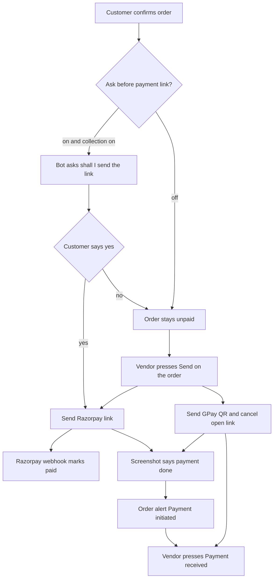

# Order pages and direct UPI revamp

The orders list and the order detail page are rebuilt around two jobs: see which orders need the vendor, and collect the full amount. Shipping stays as it is. No partial payments. No uploaded QR image. GPay is never sent by the bot on its own. The layout is section 7.

Money rules stay as they are in [docs/payments/01-business-flow.md](docs/payments/01-business-flow.md): a Razorpay capture writes settlement; `vendor_collected` and COD never do, and never touch `walletBalanceMilli`.



## 1. Shop settings

Add two columns on `Vendor` in [backend/prisma/schema.prisma](backend/prisma/schema.prisma): `upiVpa` and `upiPayeeName`. New migration under `backend/prisma/migrations`. These are saved even when ChatLogix collection is off, because a shop can send GPay either way.

Reuse `paymentLinkAutoSend`. Today, when it is on, [backend/src/conversation/orderPaymentPipeline.ts](backend/src/conversation/orderPaymentPipeline.ts) sends the Razorpay link as soon as the cart is confirmed. Change that meaning:

- On: after the customer confirms, the bot asks “Shall I send the payment link?” and sends the Razorpay link only after a clear yes.
- Off: the bot does not ask and does not send. The vendor sends from the order page.

Shops that already have the switch on move from immediate send to ask-first. That is the agreed behavior.

Extend `PATCH /api/vendors/:id/payments/settings` in [backend/src/routes/vendors.ts](backend/src/routes/vendors.ts) so UPI ID, payee name, and the switch can be saved independently. Validate the UPI ID as a VPA (`name@bank`). Reject an empty payee name when a VPA is set.

In [frontend_v2/apps/web-vendor/src/components/settings/tabs/PaymentCollectionTab.tsx](frontend_v2/apps/web-vendor/src/components/settings/tabs/PaymentCollectionTab.tsx), show the UPI fields above the collection opt-in, and relabel the checkbox to “Ask the customer before sending the payment link.”

## 2. Payment states

Do not set `paymentMethod` to `vendor_collected` when the QR is sent. [backend/src/conversation/prefetch.ts](backend/src/conversation/prefetch.ts) treats unpaid `vendor_collected` as `cod_unpaid`, which the bot describes as pay on delivery.

Record these as `OrderAuditLog` actions, which already exist:

- `upi_qr_sent` — QR went out. Order stays unpaid. `changes` holds the full amount in paise and the payee name. Do not store a needless copy of the image.
- `payment_link_offered` — bot asked the question and is waiting.
- `cash_collected` — already written by [backend/src/services/payments/codOrderService.ts](backend/src/services/payments/codOrderService.ts). Extend `changes` with an optional `reference` string. No amount field; the amount is always `Order.totalAmount`.

Add payment status `upi_pending` in prefetch for an order with `upi_qr_sent` and no `cash_collected` and no captured Razorpay payment. Update the status sentence in [backend/src/conversation/llm/prompts.ts](backend/src/conversation/llm/prompts.ts): the shop sent its UPI details and will confirm when the money arrives.

`attachPaymentSummary` in [backend/src/services/orderService.ts](backend/src/services/orderService.ts) today returns `payment: null` when there is no capture and no open link, so the detail page shows “Awaiting payment” for everything else. Extend it, and the vendor order list, with a compact badge: Unpaid, Link sent, Paid online, UPI sent, Paid to shop, Cash on delivery, Payment initiated.

## 3. Razorpay ask-then-send

In `handleOrderPaymentLinksAfterCartApply`, when collection is on, the order is `awaiting_payment`, and the switch is on: write `payment_link_offered` and do not call `createPaymentLinkForOrder`. Return that fact to [backend/src/conversation/pipeline.ts](backend/src/conversation/pipeline.ts) so the customer reply is the question, in the customer’s language, with the order number and amount. A deterministic line is appended so the model cannot skip the question.

Next turn, add a cart op `accept_payment_link` in [backend/src/conversation/types.ts](backend/src/conversation/types.ts). The prompt may emit it only when ORDER PAYMENT STATUS says an offer is waiting and the customer agreed (yes, ok, send, haan, and the same idea in the customer’s language). CartEngine sends the link only if `payment_link_offered` is the latest offer and it has not been accepted or declined. A no, or any other message, clears the offer and the normal reply continues. The model cannot create a link on its own.

`refreshLinkAfterCartChange` keeps using the switch: on means send the replacement link (the customer already agreed to pay by link); off means replace the link quietly and leave sending to the vendor.

Vendor “Send Razorpay link” on the order still calls the existing `POST /api/orders/:id/payment-link` with `sendWhatsApp: true`. Remove the `console.log` stub in [frontend_v2/apps/web-vendor/src/pages/OrderDetails.tsx](frontend_v2/apps/web-vendor/src/pages/OrderDetails.tsx).

## 4. Send GPay QR

New `POST /api/orders/:id/send-upi-qr`.

- Reject if the order is cancelled, already captured, or already `cash_collected`.
- Require `upiVpa` and `upiPayeeName`.
- Build `upi://pay?pa=&pn=&am=&cu=INR&tn=` for the full amount in rupees (two decimals) and the order number.
- Render a PNG with the `qrcode` package (add it; do not call `api.qrserver.com`, including the existing link QR in [PaymentLinkModal.tsx](frontend_v2/apps/web-vendor/src/components/orders/modals/PaymentLinkModal.tsx)).
- Cancel open Razorpay links through `PaymentLinkService.cancelOpenLinksForOrder` so the customer cannot pay both.
- Send with `uploadWhatsAppMedia` and `sendWhatsAppImage` in [backend/src/services/whatsappClient.ts](backend/src/services/whatsappClient.ts). Caption: payee name, UPI ID, amount, order number.
- Inside the 24-hour WhatsApp window, send the image. Outside it, return a clear error and do not mark the QR as sent. There is no approved image template for this.
- Write `upi_qr_sent` and a customer `Message` row for the image.

This endpoint works when `paymentsManagedByChatlogix` is on or off.

## 5. Payment received

Keep `POST /api/orders/:id/mark-cash-collected`. For GPay the body is `{ paymentMethod: 'vendor_collected', reference?: string }`. `reference` is optional and stored on the audit row.

Before writing the audit, cancel any open Razorpay link. Reject when a capture exists (already the case) or when the client sends an amount other than the order total. Success sets `paymentMethod` to `vendor_collected` and writes `cash_collected`. No `CustomerPayment`, no settlement, no wallet change.

COD stays on `POST /api/orders/:id/switch-to-cod`, then the same mark-collected call without `vendor_collected`.

## 6. Payment screenshot alert

Captionless images never reach the conversation pipeline. [backend/src/services/mediaFetchProcessor.ts](backend/src/services/mediaFetchProcessor.ts) replies with a template and returns. GPay screenshots usually have no caption, and the words are inside the picture.

On an inbound image, if that conversation has an unpaid order (`awaiting_payment`, an open payment link, or `upi_qr_sent` without `cash_collected`), send the image bytes to the vendor’s vision-capable model and ask for JSON: `{ claimsPaid: boolean }`. Run this only for those orders, so catalog photos in a new chat are not billed.

When `claimsPaid` is true, or a caption on that image matches a short paid-phrase list: write `OrderAlert` type `payment_initiated` (the Prisma column is already a string; extend the union in [backend/src/services/orderAlertService.ts](backend/src/services/orderAlertService.ts)). One unresolved alert per order. Do not set `cash_collected`. Do not change a Razorpay order. If a capture already exists, skip the alert.

Reply to the customer that the shop will confirm once they see the payment. Then stop. Do not run CartEngine on that image.

Surface the unresolved alert on the order payment card, with the time and a link to the conversation. Razorpay capture does not wait for the vendor. The alert is informational and can be dismissed. GPay still needs Payment received.

## 7. UI restructure

The screenshots are a stack of equal cards. Payment, shipping, notifications, and Cancel all look like the same kind of button, and on the list the order number collides with the status badge. This section is the page layout. Sections 1–6 are what the new controls call.

Stay on the existing navy and green tokens (`primary-500` `#072349`, `secondary-500` `#25D366`). Green is for paid, success, and WhatsApp. Navy is the one primary button. Cancel and other destructive actions are red text, never a green `secondary` button. That is why Cancel Order reads as the main action today.

Split the two pages so [OrderDetails.tsx](frontend_v2/apps/web-vendor/src/pages/OrderDetails.tsx) and [Orders.tsx](frontend_v2/apps/web-vendor/src/pages/Orders.tsx) become thin pages. New pieces live under `frontend_v2/apps/web-vendor/src/components/orders/`:

- `OrderWorkbar.tsx` — list toolbar
- `OrderTable.tsx` — list rows (replaces the table half of `OrderListItem.tsx`)
- `OrderDetailHeader.tsx`
- `OrderNextStep.tsx` — the single fulfillment action
- `OrderPaymentPanel.tsx` — collect, alert, mark received
- `CollectPaymentChoices.tsx` — the three choices, inline

`PaymentLinkModal.tsx` goes away. Generating or viewing a Razorpay link happens inside `OrderPaymentPanel`, not a second dialog. Shipping modal stays.

### Orders list

Current page, top to bottom: title, four large stat cards, a filter row whose Today / Week / Month buttons are solid green, a sort `<select>` that opens over the first rows, then a 7-column table (order, status, customer, a wall of item names, amount, date, a ⋯ menu).

New page:

```text
Orders
Manage and track all your orders

[ 7 orders ] [ 0 today ] [ 3 need attention ] [ ₹0 collected ]

[ Search orders          ] [ Status v ] [ Payment v ]
[ Today ] [ Week ] [ Month ]              [ Sort v ] [ table | cards ]

Order              Customer        Payment          Fulfillment    Amount      When
#ORD-...           +91 ...         Unpaid           Pending        ₹1,200     6 Oct
Iluppaipoo cookies, and 1 more                                 [ Collect payment ]
```

- Stat strip stays four numbers, shorter cards. The third card counts orders that still need the vendor (pending, awaiting payment, or a payment-initiated alert), label “Need attention”. The fourth card is labeled “Collected” and keeps today’s sum: confirmed through delivered only. Pending and cancelled stay out of it.
- One toolbar. Search, fulfillment status, and a new payment filter (Unpaid, Link sent, UPI sent, Paid, Cash). Today / Week / Month become a segmented control: white by default, navy text and a navy border when selected. They are filters, not the primary action on the page.
- Sort is a real menu (`absolute`, `z-30`, solid white panel, click-outside to close), anchored to the toolbar, not a native select painted on top of row 1.
- Table columns, in this order: Order, Customer, Payment, Fulfillment, Amount, When. The item summary moves onto a second line under the order number (`truncate`, two names, then “and N more”). That removes the Items column that was stretching the row until `#100001` sat on top of Pending. `table-fixed` plus `overflow-x-auto` and a minimum width so badges cannot overlap.
- The ⋯ column goes away. The row is the link to the detail page. The last cell is one text button for the next useful step: Collect payment, Confirm, Start preparing, Mark delivered. Cancel lives in a small overflow on that button’s menu, in red, and is not shown as a green button.
- Card view uses the same fields: order number and amount on the first line, payment and fulfillment badges, customer, one-line items, the same next-step button. Below `md`, card view is the default. The table / card toggle remains for desktop.
- Empty, loading, and pagination stay. Pagination buttons use the outline style, not a row of green pills.

### Order detail

Current page: a header with the total and one status badge, then a 2/3 column of items, delivery, and timeline, and a 1/3 rail of five equal cards (customer, payment, shipping, a notification checkbox that only writes `localStorage`, and an Actions card that repeats the payment buttons). Confirm is navy and Cancel is green.

New page, desktop (`lg` and up), still `max-w-7xl`:

```text
← Orders
Order ORD-ORDER-2026090007                         ₹2,198.00
Created 30 Sept 2026, 02:48 pm
[ Pending ]  [ Unpaid ]

Main column (8)                         Rail (4), sticky
┌ Items ─────────────────────┐          ┌ Next step ──────────────┐
│ product, qty, price, total │          │ Confirm order           │
└────────────────────────────┘          │ Cancel order  (red text)│
┌ Delivery and notes ────────┐          └─────────────────────────┘
│ address, requests          │          ┌ Payment ────────────────┐
└────────────────────────────┘          │ Unpaid · ₹2,198         │
┌ Timeline ──────────────────┐          │ ! Payment initiated     │
│ created, confirmed         │          │ ○ Razorpay link         │
└────────────────────────────┘          │ ○ GPay / UPI to shop    │
                                        │ ○ Cash on delivery      │
                                        │ [ Send ]                │
                                        └─────────────────────────┘
                                        ┌ Customer ───────────────┐
                                        │ phone                   │
                                        │ View conversation       │
                                        └─────────────────────────┘
                                        ┌ Shipping (unchanged) ───┐
                                        └─────────────────────────┘
```

- Header: back link to `/orders`, order number, created time, the amount on the right. Two badges, not one: fulfillment (`Pending`, `Confirmed`, …) and payment (`Unpaid`, `Link sent`, `UPI sent`, `Paid online`, `Paid to shop`, `Cash on delivery`).
- On small screens the rail renders first, so Collect payment and the next step are on screen before the item table. From `lg` up, the rail is `sticky top-4` and the main column scrolls beside it.
- `OrderNextStep` holds exactly one navy button for the fulfillment transition that already exists (Confirm, Start preparing, Mark ready, Out for delivery, Mark delivered). Cancel is a text button under it, with the confirm dialog that already exists. No second copy of the payment buttons.
- Remove the Actions card and the Notification Settings card. The checkbox does not call the API. `Order.sendNotifications` stays on the server and is left untouched.
- `OrderPaymentPanel` is the only place payment is operated. It is not a modal.

Payment panel contents, by state:

- Unpaid. A one-line status and the amount. If a `payment_initiated` alert is open, an amber banner sits above the choices: “Customer sent a payment screenshot” plus the time and “View conversation”. Dismiss resolves the alert. It does not mark the order paid.
- Three choices as rows, one selected at a time. Each row is a title, one sentence, and a disabled reason when it cannot be used.
  - Razorpay link. “Customer pays ChatLogix. The order marks itself paid.” Disabled, with a link to payment settings, until collection is active.
  - GPay / UPI. “Customer pays your UPI. You mark it received.” Disabled, with a link to payment settings, until UPI ID and payee name are saved.
  - Cash on delivery. “No link. You mark the cash collected.”
- One navy button under the selected row: “Send payment link”, “Send GPay QR”, or “Switch to cash”. After a link or QR is sent, the panel shows what went out (link with copy, or “GPay QR sent” with amount and payee) and the other choices stay available. Choosing the other one states that the open Razorpay link will be cancelled, then sends.
- GPay or cash, still unpaid: “Payment received” opens a short form in the panel. Amount is shown and not editable. Reference is an optional text field. Submit calls mark-collected.
- Paid online: status, settlement net, transfer status, and the refund buttons already on the page. No Payment received button.
- Paid to shop: “Paid to shop”, time, and the reference if the vendor entered one.

Customer card keeps phone and View Conversation. Shipping card stays where it is, including its current local-only status. Items, delivery, special requests, and the timeline stay in the main column, with the same data they show now.

### Settings page, only the payment tab

[PaymentCollectionTab.tsx](frontend_v2/apps/web-vendor/src/components/settings/tabs/PaymentCollectionTab.tsx) gains a “Customer pays you directly” block above the Razorpay opt-in: UPI ID, name shown in GPay, and save. The existing auto-send checkbox is relabeled “Ask the customer before sending the payment link” and stays in the Razorpay block. No new settings page.

## 8. Docs and tests

Update [docs/payments/01-business-flow.md](docs/payments/01-business-flow.md) sections 1, 2, and 8, the auto-send note in [docs/payments/02-implementation-plan.md](docs/payments/02-implementation-plan.md), and [docs/INCOMING_RESPONSE_GENERATOR_FLOW.md](docs/INCOMING_RESPONSE_GENERATOR_FLOW.md) for the offer, the accept op, `upi_pending`, and the screenshot short-circuit.

Tests:

- Ask-first does not create a link; a yes does; a no does not.
- Send UPI cancels an open link, writes `upi_qr_sent`, writes no settlement.
- Mark received stores an optional reference, rejects a captured order, rejects a mismatched amount.
- Vision claim writes one `payment_initiated` alert and leaves the order unpaid.
- Prefetch reports `upi_pending` instead of `cod_unpaid` after a QR send.

## Out of scope

Shipping persistence, partial payments, a static uploaded QR, the bot offering GPay by itself, and a restyle of any vendor page other than Orders, Order detail, and the payment settings tab.
