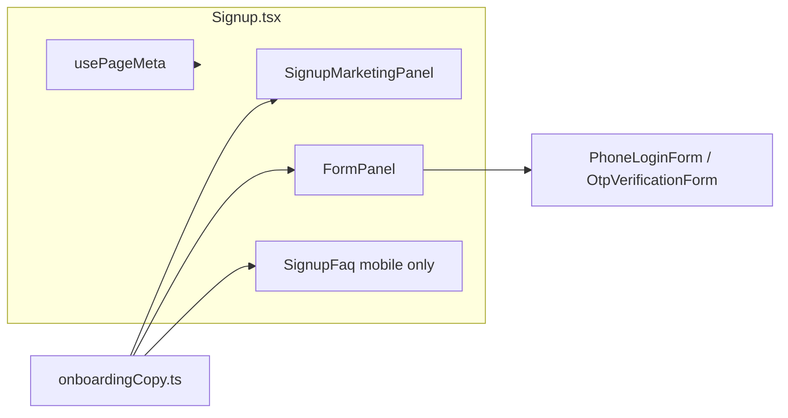

# Signup Page Marketing Layout Implementation

## Scope

**In scope:** Frontend UI/copy only in `web-vendor`. No backend, auth API, or onboarding flow changes.

**Source of truth:** [documentation/modules/features/vendor-onboarding/guides/signup-page-marketing-copy.md](documentation/modules/features/vendor-onboarding/guides/signup-page-marketing-copy.md)

**Out of scope (defer):** Refactoring `Login.tsx` to a shared layout; static WhatsApp chat mockup; new npm dependencies (`react-helmet-async` not in project today).

---

## Architecture



| File | Role |
| --- | --- |
| [`onboardingCopy.ts`](frontend_v2/apps/web-vendor/src/components/onboarding/onboardingCopy.ts) | All new strings: `signup.marketing`, `signup.form`, `signup.meta`, `signup.faq` |
| `SignupMarketingPanel.tsx` (new) | 65% left panel: H1, problem, solution, ₹100 box, trust strip, desktop FAQ |
| `SignupFaq.tsx` (new) | Collapsible FAQ accordion (desktop inside panel; mobile below form) |
| [`Signup.tsx`](frontend_v2/apps/web-vendor/src/pages/onboarding/Signup.tsx) | Split layout shell + form logic (unchanged handlers) |
| `usePageMeta.ts` (new) | Set/restore `document.title` + `meta[name=description]` on mount/unmount |
| [`Login.tsx`](frontend_v2/apps/web-vendor/src/pages/Login.tsx) | One-line footer anchor text update only |

---

## Step 1 — Extend copy in `onboardingCopy.ts`

Replace/extend the flat `signup` block with structured keys matching the doc:

```ts
signup: {
  success: '...', // keep existing
  form: {
    phone: { title, subtext },
    otp: { title, subtext },
    footerLogin: 'Already have an account?',
    footerLoginLink: 'Log in to your shop',
    mobileTrialPill: '₹100 free · No card · Safe demo — real customers not messaged',
  },
  meta: {
    title: 'Free WhatsApp Shop Assistant for Small Business | ChatLogix',
    description: 'Automate WhatsApp customer replies & orders...',
  },
  marketing: {
    hero: { h1, subhead },
    problem: { h2, bullets: [{ title, body }] },
    solution: { h2, bullets: [{ title, body }] },
    offer: { h2, body, reassurance, microLine },
    trust: string[],
  },
  faq: { h2, items: [{ question, answer }] },
}
```

Copy text: paste verbatim from the marketing doc (hero, problem, solution, offer, trust, FAQ, form steps).

---

## Step 2 — Create `SignupMarketingPanel.tsx`

Location: [`frontend_v2/apps/web-vendor/src/components/onboarding/SignupMarketingPanel.tsx`](frontend_v2/apps/web-vendor/src/components/onboarding/SignupMarketingPanel.tsx)

- Read all strings from `onboardingCopy.signup.marketing` and `onboardingCopy.signup.faq`
- Match Login left-panel styling:

```tsx
<div className="hidden lg:flex lg:flex-[0.65] lg:flex-col lg:justify-center lg:px-8 xl:px-12 bg-primary-500 text-white">
```

- **Semantic HTML:** one `<h1>` (hero), `<h2>` per section, `<h3>` for bullet titles
- **Offer box:** `rounded-xl border border-white/20 bg-white/10 p-5 xl:p-6`
- **Bullet rows:** reuse Login’s icon + text row pattern (inline SVG, no new assets)
- **Trust strip:** `border-t border-white/20` footer with small `text-white/70` lines
- **Desktop FAQ:** render `<SignupFaq />` at bottom of panel

---

## Step 3 — Create `SignupFaq.tsx`

Location: [`frontend_v2/apps/web-vendor/src/components/onboarding/SignupFaq.tsx`](frontend_v2/apps/web-vendor/src/components/onboarding/SignupFaq.tsx)

- Simple accordion: one open item at a time (or all collapsible — keep minimal)
- Props: optional `variant: 'light' | 'dark'` for marketing panel vs mobile form area
- Map `onboardingCopy.signup.faq.items` to `<h3>` questions + answer paragraphs

---

## Step 4 — Create `usePageMeta.ts`

Location: [`frontend_v2/apps/web-vendor/src/hooks/usePageMeta.ts`](frontend_v2/apps/web-vendor/src/hooks/usePageMeta.ts)

Lightweight alternative to adding `react-helmet-async`:

```ts
usePageMeta({ title, description })
```

- On mount: set `document.title`; find or create `<meta name="description">`
- On unmount: restore previous title/description (store refs in closure)
- Call from `Signup.tsx` with `onboardingCopy.signup.meta`

---

## Step 5 — Refactor `Signup.tsx` layout

Replace centered single-column JSX with Login-style split shell:

**Left:** `<SignupMarketingPanel />`

**Right** (`flex-1 lg:flex-[0.35] … bg-gray-50`):

| Element | Behavior |
| --- | --- |
| Mobile header | Logo + `mobileTrialPill` (`lg:hidden`) |
| Step heading | `<h2>` from `signup.form.phone` or `signup.form.otp` |
| Error block | Keep existing; match Login error styling (icon + red box) |
| Form card | White card; reuse `PhoneLoginForm` / `OtpVerificationForm` unchanged |
| Footer | `Link to="/login"` with updated anchor text |
| Mobile FAQ | `<SignupFaq variant="light" />` below footer (`lg:hidden`) |

**Preserve unchanged:**
- All state, `useEffect` redirect, `handleSendCode`, `handleVerify`, reCAPTCHA, dev OTP hint, `mapOnboardingError`, toast on success

---

## Step 6 — Minor Login footer update

In [`Login.tsx`](frontend_v2/apps/web-vendor/src/pages/Login.tsx) line ~292:

- Change `"Start free trial"` → `"Start free WhatsApp trial"` (per SEO doc internal linking)
- Prefer `<Link to="/signup">` over `<a href="/signup">` for SPA consistency (small fix while touching file)

---

## Step 7 — Verify and update docs

1. Run `npm run type-check` in `frontend_v2/apps/web-vendor`
2. Manual QA checklist:
   - Desktop ≥1024px: 65/35 split, scrollable marketing panel if content overflows
   - Mobile: marketing hidden, trial pill visible, FAQ accordion works
   - Phone → OTP → signup redirect still works
   - View source / devtools: correct `<title>` and meta description on `/signup`
   - Only one H1 on page (in left panel; hidden on mobile — acceptable for SEO since H1 is still in DOM)
3. Update [signup-page-marketing-copy.md](documentation/modules/features/vendor-onboarding/guides/signup-page-marketing-copy.md) status to **Implemented** and check off implementation checklist items

---

## Mobile H1 note

On mobile the marketing H1 is `hidden lg:flex` (not visible). The form uses `<h2>`. This is acceptable for v1; if SEO strictness is required later, add a visually hidden `<h1>` on mobile (`sr-only`) duplicating the hero text — optional polish, not required for initial ship.

---

## Risk / non-goals

- **No auth logic changes** — CORS/cookie issues are separate from this UI work
- **No Login left-panel rewrite** — Login keeps generic SaaS copy; signup gets vendor-focused copy
- **No new dependencies** — `usePageMeta` avoids `react-helmet-async`
