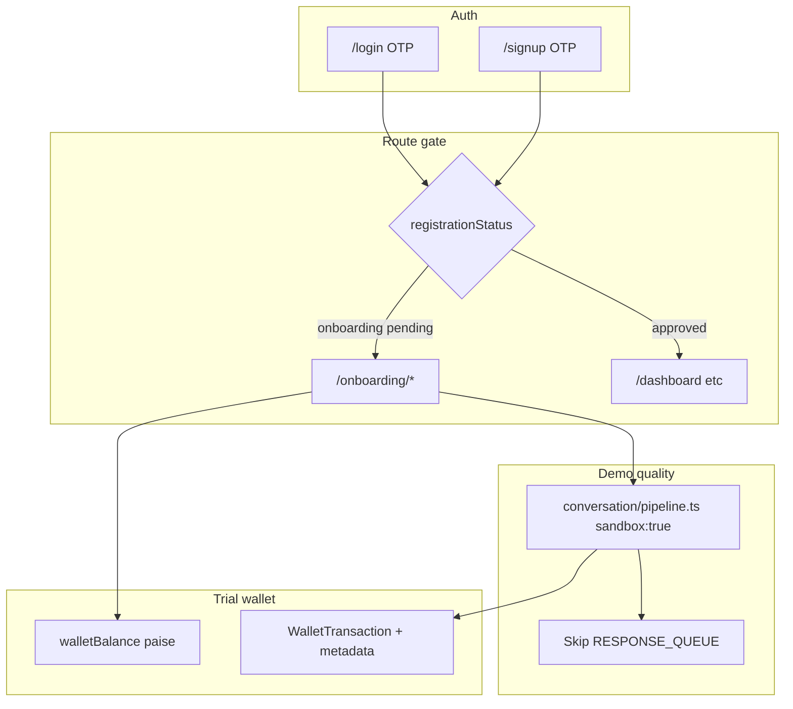

# Vendor Onboarding P2 — Implementation Plan

**Source of truth:** [public-signup-onboarding.md](documentation/modules/features/vendor-onboarding/guides/public-signup-onboarding.md) (product + trust plan)

**Delivery:** Phased (P2a → P2h). **Stop for your approval** after each phase before starting the next.

**Your choices locked in:** Text **and** voice in sandbox v1; phased delivery.

---

## Architecture overview



---

## Cross-cutting requirements (every phase)

These are non-negotiable across all UI and API work:

| Requirement | Implementation |
|-------------|----------------|
| Plain language | Central copy file `onboardingCopy.ts`; no tech jargon in UI |
| Human errors | `mapOnboardingError()` — never show HTTP codes, stack traces, or JSON |
| Autosave + resume | Server-side `onboardingStep` + `onboardingData`; re-login restores step |
| Help escape hatch | Sticky footer: WhatsApp support link via `VITE_SUPPORT_WHATSAPP` |
| Mobile-first | Single column, large taps, sticky Continue, numeric OTP keyboard |
| Trust panels | Each step: headline + collapsible "Why we ask this" |
| Wallet widget | Sticky `TrialWalletBar`: ₹ remaining, breakdown, expiry date |
| Sandbox quality | **Production** [`pipeline.ts`](backend/src/conversation/pipeline.ts) only — deprecate orchestrator path in [`catalogImportSandboxService.ts`](backend/src/services/catalogImportSandboxService.ts) |

---

## Phase P2a — Backend foundation + signup/login routing

**Goal:** A new phone can sign up, get ₹100 trial, log in again, and be routed by status. No onboarding UI yet (API-testable).

### Database

Add to [`schema.prisma`](backend/prisma/schema.prisma) + migration:

- `trialGrantedPaise Int?`, `trialExpiresAt DateTime?`
- `onboardingStep Int @default(1)`, `onboardingData Json?`
- `submittedAt DateTime?`, `rejectionReason String?`
- `registrationStatus String @default("onboarding")` (backfill existing vendors → `approved`)
- Unique index on `Vendor.phone` (normalize E.164 before insert)

Env in [`env.ts`](backend/src/config/env.ts) + [`.env.example`](backend/.env.example):

- `TRIAL_GRANT_PAISE=10000`, `TRIAL_EXPIRY_DAYS=30`

### Signup API

New routes in [`auth.ts`](backend/src/routes/auth.ts) (or `authSignup.ts`):

- `POST /api/auth/signup/verify` — verify OTP, **reject if phone exists**, create vendor:
  - `walletBalance=10000`, `trialGrantedPaise=10000`, `trialExpiresAt`, `registrationStatus=onboarding`
  - `catalogImportEnabled=true` (required today by [`catalogImport.ts`](backend/src/routes/catalogImport.ts) gate)
  - Issue JWT + refresh cookie (same as login)

Login path unchanged for existing vendors; unknown phone on `/verify-code` returns friendly error directing to `/signup`.

### Vendor profile API

New [`vendorOnboarding.ts`](backend/src/routes/vendorOnboarding.ts) mounted on `/api/vendors` (authenticated):

- `GET /me/onboarding` — status, step, trial wallet summary
- `PATCH /me/onboarding` — save step payload, advance step

Extend [`tokenService.ts`](backend/src/services/tokenService.ts) JWT optional `registrationStatus` + `vendorId` (or always fetch from `/me/onboarding` on app load).

### Tests

- Signup creates vendor with ₹100; duplicate phone blocked
- Login routes by `registrationStatus` (unit tests on redirect helper)

**Your review gate:** Postman/curl signup + login; confirm DB row and wallet.

---

## Phase P2b — Onboarding shell + Steps 1–2 (trust UI)

**Goal:** Beautiful, explanatory UI for signup, login, business basics, catalog — gated from main portal.

### Frontend structure

New under `frontend_v2/apps/web-vendor/src/`:

```
pages/onboarding/
  Signup.tsx, OnboardingWelcome.tsx, OnboardingCatalog.tsx, OnboardingSubmitted.tsx
components/onboarding/
  OnboardingLayout.tsx      # stepper, TrialWalletBar, TrustPanel, NeedHelpFooter
  onboardingCopy.ts         # all vendor-facing strings
  mapOnboardingError.ts
lib/onboarding.ts           # API client
```

### Routing ([`App.tsx`](frontend_v2/apps/web-vendor/src/App.tsx))

- Public: `/signup`, `/login`
- Onboarding layout (auth required, **not** approved): `/onboarding/*`
- [`ProtectedRoute.tsx`](frontend_v2/apps/web-vendor/src/components/auth/ProtectedRoute.tsx):
  - `approved` → block `/onboarding/*`, allow portal
  - non-`approved` → block `/dashboard`, `/orders`, etc. → redirect to last onboarding step

Update [`Login.tsx`](frontend_v2/apps/web-vendor/src/pages/Login.tsx): status-based redirect after OTP.

### Step 1 — Business basics

Fields per spec; "Why we ask this" panel; optimistic save + toast "Saved"; validation messages in plain English.

### Step 2 — Catalog

Embed simplified catalog import (reuse [`CatalogImport.tsx`](frontend_v2/apps/web-vendor/src/pages/CatalogImport.tsx) upload paths) inside onboarding layout:

- CSV + photo/brochure + Skip
- Progress: "Reading your menu…"
- Gate: wallet > 0 (show friendly message at ₹0)
- Auto-enable `catalogImportEnabled` already set at signup

**Your review gate:** Walk through signup → step 1 → step 2 on mobile Chrome; copy feels trustworthy; no raw errors.

---

## Phase P2c — Steps 3–4 + production sandbox (text + voice)

**Goal:** The "aha moment" — demo chat uses **live-quality AI**; voice notes work; paise deducted transparently.

### Backend — pipeline sandbox mode

Modify [`pipeline.ts`](backend/src/conversation/pipeline.ts):

- Add `sandbox?: boolean` to `ProcessMessageInput`
- When `sandbox: true`:
  - Skip `publishToQueue(RESPONSE_QUEUE_URL)` in [`finalizeTurn`](backend/src/conversation/pipeline.ts)
  - Skip typing indicator + vendor order notify (non-critical for demo)
  - Return `{ finalText, intent, costPaise, tokenMeta }` synchronously
  - Credit guard at ₹0: return friendly in-chat message (not WhatsApp template publish)

New [`onboardingSandboxService.ts`](backend/src/services/onboardingSandboxService.ts):

- Ensure customer `sandbox:{vendorId}` + conversation (reuse pattern from [`catalogImportSandboxService.ts`](backend/src/services/catalogImportSandboxService.ts))
- **Text:** `processMessage({ sandbox: true, content, ... })`
- **Voice:** accept audio upload → Whisper transcribe (reuse media path) → `processMessage({ sandbox: true, sourceMessageType: 'audio', content: transcript })`

New routes:

- `POST /api/vendors/me/sandbox/chat` — `{ text }` → reply + costPaise
- `POST /api/vendors/me/sandbox/voice` — multipart audio → transcript + reply + costPaise

Billing: deduct **actual paise** from token usage (extend [`billingService.ts`](backend/src/services/billingService.ts) / [`conversation/billing.ts`](backend/src/conversation/billing.ts)); write `WalletTransaction` with metadata `{ source: 'sandbox_chat' | 'sandbox_voice' }`.

`GET /api/vendors/me/trial-wallet` — balance, granted, expiresAt, breakdown array.

### Frontend — Step 3 AI setup

Fields map to existing vendor AI columns; live greeting preview; sensible defaults pre-filled.

### Frontend — Step 4 Demo chat

- Chat UI with suggested prompt chips ("What are your prices?", "I want to order 2 kg")
- Text input + **voice record/upload** button
- Bot bubble + line: "This reply cost ₹0.42"
- Loading: "Your assistant is thinking…" within 1s
- Trust banner: "Same AI as live WhatsApp — your real customers are not messaged"
- At ₹0: disable input; link to submit

Deprecate onboarding use of orchestrator [`catalogImportSandboxService.runSandboxTest`](backend/src/services/catalogImportSandboxService.ts).

**Your review gate:** 10 consecutive sandbox messages (text + voice) — quality matches production; costs show; no WhatsApp sends; p95 latency under 12s.

---

## Phase P2d — Step 5 + submit + waiting state

**Goal:** Complete funnel to `pending_approval`; re-login lands on submitted screen; edit while pending.

### Backend

- `POST /api/vendors/me/submit-for-approval` → `registrationStatus=pending_approval`, `submittedAt`

### Frontend

- **Step 5 Review** — summary cards with Edit links; submit CTA even at ₹0
- **`/onboarding/submitted`** — "We're reviewing your shop"; edit application; anxiety-reducing "What happens next"
- Optional **`/onboarding/rejected`** — reason + support link

**Your review gate:** Full funnel signup → submit; close browser; re-login → submitted; edit step 1 while pending.

---

## Phase P2e — Billing hardening + observability

**Goal:** OpenAI-style wallet everywhere; ops can see failures before vendors complain.

- Unify sandbox + catalog import deductions as paise with metadata
- Funnel analytics events (frontend + backend logs): `signup_started`, `otp_verified`, `step_N_completed`, `sandbox_message_sent`, `submitted`
- Alert thresholds: sandbox error rate > 2%, p95 > 20s
- Pre-launch checklist from spec (50 manual runs, zero raw errors)

**Your review gate:** Wallet breakdown accurate across catalog + text + voice; metrics visible in logs.

---

## Phase P2f — Ops: manual approval + notification

**Goal:** Ops can approve; vendor gets WhatsApp/SMS.

- SQL runbook in doc (already drafted)
- On approve: `registrationStatus=approved`, `walletBalance=0`, `approvedAt/By`
- Notification template to login phone (reuse [`whatsappTemplateService.ts`](backend/src/services/whatsappTemplateService.ts) or SMS stub)
- First login after approve → dashboard (not onboarding)

**Your review gate:** End-to-end approve → notify → login → dashboard.

---

## Phase P2g–h — Out of P2 scope (follow-ups)

| Phase | Scope |
|-------|--------|
| P2g | Razorpay wallet top-up (pay ₹1000 → balance ₹1000) |
| P2h | WhatsApp Embedded Signup in settings (post-approval) |

Document in spec; do not block P2 launch.

---

## Key files touched (summary)

| Area | Files |
|------|--------|
| Schema | [`backend/prisma/schema.prisma`](backend/prisma/schema.prisma) |
| Auth/signup | [`backend/src/routes/auth.ts`](backend/src/routes/auth.ts) |
| Onboarding API | new `backend/src/routes/vendorOnboarding.ts` |
| Sandbox | [`backend/src/conversation/pipeline.ts`](backend/src/conversation/pipeline.ts), new `onboardingSandboxService.ts` |
| Billing | [`backend/src/services/billingService.ts`](backend/src/services/billingService.ts) |
| Frontend | [`App.tsx`](frontend_v2/apps/web-vendor/src/App.tsx), `ProtectedRoute`, new `pages/onboarding/*`, `components/onboarding/*` |
| Docs | Update [`public-signup-onboarding.md`](documentation/modules/features/vendor-onboarding/guides/public-signup-onboarding.md) status as phases land |

---

## Risks and mitigations

| Risk | Mitigation |
|------|------------|
| Sandbox quality ≠ production | Mandatory `pipeline.ts` path; side-by-side QA vs webhook |
| Firebase OTP rate limits | Reuse [`sendCodeRateLimit.ts`](backend/src/utils/sendCodeRateLimit.ts); countdown UI |
| Catalog import fails mid-onboarding | Partial success copy; skip always available |
| Slow sandbox on 4G | Typing indicator at 1s; 45s timeout with retry |
| `catalogImportEnabled` gate | Auto-set `true` on trial vendor create |
| Existing vendors | Migration sets `registrationStatus=approved` |

---

## Success criteria (launch)

- Signup → sandbox message ≥ 70% of step-1 completers (tracked post-launch)
- Zero raw API errors in 50 staging runs
- Vendor can complete full flow on Android Chrome without support
- Demo reply quality indistinguishable from live WhatsApp path
