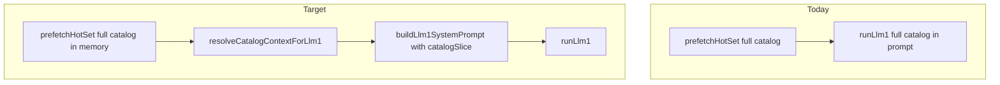

# Conversation catalog context slicing & model migration (design & implementation)

<!-- DOC_SYNC
  last_verified_commit: b54bbdcc56cda764213d334c9e39dfb5f410ae69
  last_verified_at: 2026-09-20
  scope: Implemented — per-turn catalog subset + turn routing before LLM-1; fleet default **gpt-5.6-luna** in code (OpenAI short-context rates in BILLING §2). Tuned for **20–50 active SKUs**; **no new environment variables**. Slicing master switch off until fleet rollout (§17).
-->

**Status:** **Implemented** in `backend/src/conversation/` (2026-09-20). **`CATALOG_SLICING_ENABLED = false`** in `catalogContextConfig.ts` until shadow → sandbox → fleet phases in [§17](#17-rollout-operational-after-pr1-merge). [INCOMING_RESPONSE_GENERATOR_FLOW.md](./INCOMING_RESPONSE_GENERATOR_FLOW.md) describes the live pipeline wiring.

| | |
|---|---|
| **Problem** | LLM-1 prompt tokens (~5k p50 today) driven mostly by **full vendor catalog** on every turn; cost worsens as large vendors grow toward **20–50 SKUs** (variants + descriptions multiply rows) |
| **Goal** | Keep product-turn prompts near **Q9 top 8–15 rows** at scale; cut fleet AI cost; move LLM-1 + LLM-2 to **`gpt-5.6-luna`** (Q10); stay under **$0.0022/message** all-in |
| **Aligns with** | [CONVERSATION_PROCESSOR_LAMBDA.md](./CONVERSATION_PROCESSOR_LAMBDA.md) **Q9** (catalog slice) · **Q10** (model = `Vendor.aiModel`, default → **gpt-5.6-luna**) |
| **Does not replace** | CartEngine DB pricing, burst merge, LLM-2 rules, wallet debit path — formula and **OpenAI rates:** [BILLING_AND_PRICING.md](./BILLING_AND_PRICING.md) §2 |
| **Living pipeline doc** | [INCOMING_RESPONSE_GENERATOR_FLOW.md](./INCOMING_RESPONSE_GENERATOR_FLOW.md) (as-implemented today) |

---

## Table of contents

1. [Executive summary](#1-executive-summary)
2. [Evidence from production data](#2-evidence-from-production-data)
3. [Current as-implemented behavior](#3-current-as-implemented-behavior)
4. [Gap vs locked spec (Q9)](#4-gap-vs-locked-spec-q9)
5. [Target architecture](#5-target-architecture)
6. [Turn context plan](#6-turn-context-plan)
7. [Product retrieval](#7-product-retrieval)
8. [Catalog slice builder](#8-catalog-slice-builder)
9. [Prompt layout refactor](#9-prompt-layout-refactor)
10. [Pipeline integration](#10-pipeline-integration)
11. [Downstream consistency (LLM-1, LLM-2, CartEngine)](#11-downstream-consistency-llm-1-llm-2-cartengine)
12. [Billing, persistence, and token accounting](#12-billing-persistence-and-token-accounting)
13. [Configuration (code constants)](#13-configuration-code-constants)
14. [Observability and quality gates](#14-observability-and-quality-gates)
15. [Expected cost impact](#15-expected-cost-impact)
16. [Risks and mitigations](#16-risks-and-mitigations)
17. [Rollout plan](#17-rollout-plan)
18. [Test plan](#18-test-plan)
19. [File checklist](#19-file-checklist)
20. [Explicit non-goals (v1)](#20-explicit-non-goals-v1)
21. [Open questions](#21-open-questions)
22. [Conversation model migration (`gpt-5.6-luna`)](#22-conversation-model-migration-gpt-56-luna)

---

## 1. Executive summary

Today, **every** customer message triggers LLM-1 with the **entire** active `compactCatalog` embedded in the system prompt’s **static** block (for OpenAI prompt-cache prefix reuse). That made sense for cache hit rate but contradicts spec **Q9**, which calls for **keyword retrieval** and only **top 8–15** catalog rows in the prompt.

We will add a **deterministic pre–LLM-1 step** that:

1. **Classifies turn context** (order status vs checkout vs product vs browse vs general) from the merged customer message + hot-set signals — **without** a second large LLM call by default.
2. **Retrieves candidate product IDs** using existing `Product.keywords`, names, and `productMatcher.findBestProductMatch` (via `cart/candidateSearch.ts`).
3. **Builds a catalog slice** (full TOON rows + variant sub-table **only** for selected IDs, plus mandatory cart/order products).
4. **Refactors prompts** so vendor rules stay cache-friendly static text; **catalog moves to a per-turn block** sized to the slice.
5. **Migrates the conversation processor default model** from **`gpt-4.1-mini` → `gpt-5.6-luna`** for LLM-1 and LLM-2 (via existing `Vendor.aiModel` / prefetch resolution — [§22](#22-conversation-model-migration-gpt-56-luna)).

Prefetch continues to load the **full** catalog into memory (Redis `vendor:{id}:catalog_compact`); slicing is **in-process only** so product cache invalidation and CartEngine writes stay unchanged.

**Scale assumption (large vendors):** plan for **20–50 active products**, each with variants and prompt-visible descriptions. At **50 SKUs**, a full catalog block can exceed **~3.5–4.5k tokens** by itself (rows + variant sub-table), pushing total prompts toward **6–8k** if left unchanged. Slicing keeps typical **product** turns near **12–15 rows** (~25–35% of a 50-SKU catalog). Vendors with **≤12 active SKUs** use a **full-catalog fast path** ([§13](#13-configuration-code-constants)) — retrieval adds latency without meaningful token savings.

**Configuration:** tunables are **exported constants** in `backend/src/conversation/context/catalogContextConfig.ts` (slicing + **`DEFAULT_CONVERSATION_MODEL`**). **No new environment variables.** Rollback = redeploy with `CATALOG_SLICING_ENABLED = false` and/or revert `DEFAULT_CONVERSATION_MODEL` in that module ([§22.4](#224-rollback)).

---

## 2. Evidence from production data

Analysis run against the connected production Postgres (2026-09-20). Use the same queries when validating post-ship impact.

### 2.1 Token distribution (conversation processor)

| Source | Metric | Value |
|--------|--------|-------|
| `MessageProcessing` (`status = 'queued'`, `wamid.%`, tokens &gt; 0) | Turns | **148** |
| Same | Avg prompt / completion | **4,826 / ~106** |
| Same | p50 / p90 / p99 prompt | **5,016 / 5,515 / 5,868** |
| Same | Max prompt | **6,135** |
| `Message` assistant rows (`aiTokensUsed` &gt; 0) | Count (30d) | **217** |
| Same | Total stored `aiCostUsd` | **~$0.40** |
| `CreditUsage` (`source = conversation_turn`) | Total charged | **3,535 milli** (₹3.54) |
| Same | Median / p90 / max per turn | **10 / 20 / 730 milli** |

**Interpretation:**

- **Input tokens dominate** cost (~92% of LLM-1 $ at **gpt-4.1-mini** rates in the baseline sample). After cutover, re-baseline using **`gpt-5.6-luna`** rates in `costCalculator.ts` ([§22.2](#222-billing-and-wallet-guard)).
- **Completion** is small (~100 tokens) — shrinking the catalog helps more than capping `draftReply`.
- Fleet is **at or above** the **$0.0022/message** target on LLM-1 alone; p90 and LLM-2 tails go higher. **Without slicing**, vendors approaching **50 SKUs** risk **6–8k** prompts ([§2.5](#25-forward-projection-20-50-sku-large-vendors)).
- Sandbox traffic in DB often uses `sandbox-*` `whatsappMessageId`s; production uses `wamid.*`. `MessageProcessing.status` is **`applied`** for sandbox token rows and **`queued`** for many production rows (status reflects debit/publish lifecycle, not “missing tokens”).

### 2.2 Top conversations by cumulative tokens

Largest threads (assistant message sums): **Ibell Creations** and **Isha Bakers** — long multi-turn chats with **~5k prompt tokens per reply**, compounding to **hundreds of thousands** of tokens per conversation.

### 2.3 What is *not* driving cost

| Component | Notes |
|-----------|--------|
| `StageExecutionLog` | **0** rows in 30d — legacy multi-stage pipeline inactive |
| FAQ block | Already **query-scoped** (embedding + lexical in `prefetch.ts`) |
| LLM-2 | Conditional; adds cost on mutating / low-confidence turns but smaller than LLM-1 prompt |

### 2.4 Known accounting gap (existing)

`pipeline.ts` bills **LLM-1 + LLM-2** for `chargeVendor`, but `persistTurn` stores `tokenMeta` from **LLM-1 only** on `Message` / `MessageProcessing`. Fix **in the same implementation** as slicing so post-ship SQL in [§2](#2-evidence-from-production-data) reflects true per-turn usage (see [§12](#12-billing-persistence-and-token-accounting)).

### 2.5 Forward projection (20–50 SKU large vendors)

Production p50 ~5k prompts today reflects **current** catalog breadth (descriptions, variants, and rules — not necessarily 50 rows yet). As large vendors grow toward **20–50 active SKUs**:

| Active SKUs | Full catalog in prompt (order of magnitude) | Slicing behavior |
|-------------|-----------------------------------------------|------------------|
| ≤12 | ~1.2–2.0k catalog tokens | **Fast path:** full catalog in prompt (except `order_status` / `general` omit) |
| 13–20 | ~2.0–3.0k | Product turns: **12–15 rows** (~40–60% catalog savings) |
| 21–50 | ~3.5–4.5k+ | Same product slice; **browse** uses `min(K_browse, n)`; at **n ≤ 20** browse may use **full** catalog |
| Up to 50 + variants | Variant sub-table scales with **sliced product ids** only — largest win at upper bound |

Re-validate [§15](#15-expected-cost-impact) after the first production vendor stabilizes at **30+ SKUs** with long descriptions.

---

## 3. Current as-implemented behavior

### 3.1 Pipeline order (`pipeline.ts`)

After guards, burst merge, and typing:

1. `prefetchHotSet(vendorId, conversationId, customerId, mergedContent)` → `HotSet`
2. `runLlm1({ hotSet, mergedContent, ... })`
3. `CartEngine.apply`
4. Optional `runLlm2` + `selectFinalReply`
5. `persistTurn` → response queue → `debitAfterEnqueue`

There is **no** step between prefetch and LLM-1 today.

### 3.2 Hot set (`prefetch.ts` + `types.ts`)

`HotSet` fields:

| Field | Purpose |
|-------|---------|
| `vendorConfig` | Business name, `aiModel`, vendor AI prompts, delivery copy |
| `compactCatalog` | **All** active products (compact rows + variants + descriptions up to product cap) |
| `memory` | Conversation stage, key facts, language hint |
| `pendingOrder` | Draft cart snapshot (prompt only) |
| `orderHistory` | Up to 10 orders (customer+vendor scoped) |
| `faqs` | Top-K FAQs similar to **current** `messageText` |
| `insights` | Customer name, address, language |
| `recentMessages` | Last 6 turns |

Catalog is cached at `vendor:{vendorId}:catalog_compact` (1h TTL, invalidated on product writes).

### 3.3 LLM-1 prompt (`llm/prompts.ts`)

`buildLlm1SystemPrompt` = `buildStaticBlock(hotSet)` + `buildDynamicBlock(hotSet)`.

**Static block includes:**

- Vendor identity and **full** `aiSystemPrompt` / rules
- **Entire** `buildCatalogTable(hotSet.compactCatalog)` and **entire** `buildVariantsTable(hotSet.compactCatalog)`
- Long op rules (confirm, cancel, knowledge_gap, send_product_media, order status, etc.)

**Dynamic block includes:**

- CURRENT CART, CUSTOMER, RECENT ORDERS, RELEVANT FAQs, RECENT CONVERSATION
- Optional VOICE NOTE block when `sourceMessageType === 'audio'`

Catalog table columns today: `id,name,price,unit,baseQty,minQty,maxQty,baseOrderable,keywords,fulfillment,inStock,stockQty,desc,media` (TOON-style CSV rows).

### 3.4 Product ID guard (`llm/llm1.ts`)

Today: `validateProductIds(parsed.ops, hotSet.compactCatalog)` — same list as the full prompt catalog.

After implementation: pass **`catalogSlice`** explicitly into `runLlm1` / `validateProductIds`. **`hotSet.compactCatalog` remains the full prefetch list** ([§10.1](#101-insertion-point)).

### 3.5 Retrieval code exists but is unwired

`cart/candidateSearch.ts` → `searchCandidateProducts` wraps `findBestProductMatch` and returns **one** `CandidateMatch`. Spec and implementation plan Step 4 describe **top 8–15** rows; **pipeline does not call it today**.

### 3.6 Order-status handling (post–LLM-1)

`orderStatusGuard.ts` → `isOrderStatusTurn` runs **after** LLM-1 (uses `intent`, `ops`, `orderHistory`). Pre–LLM-1 routing should reuse **phrase lists** from this module (or extract shared helpers) so order-status turns can **omit catalog** before the model runs.

### 3.7 Model selection (Q10)

| Step | Model source |
|------|----------------|
| Prefetch | `hotSet.vendorConfig.aiModel` = `Vendor.aiModel \|\| 'gpt-4.1-mini'` in `prefetch.ts` today |
| LLM-1 | `runLlm1` uses `hotSet.vendorConfig.aiModel` |
| LLM-2 | Reuses LLM-1’s resolved model string (`llm1Result.model`) |

Prisma `Vendor.aiModel` defaults to **`gpt-4.1-mini`**. This project moves the **runtime fallback** and **schema default** to **`gpt-5.6-luna`** without changing Q10’s rule (“model = `Vendor.aiModel`”). See [§22](#22-conversation-model-migration-gpt-56-luna).

---

## 4. Gap vs locked spec (Q9)

| Spec ([CONVERSATION_PROCESSOR_LAMBDA.md](./CONVERSATION_PROCESSOR_LAMBDA.md) §11, Q9) | As-implemented today |
|----------------------------------------------------------------------------------------|----------------------|
| Keyword / matcher; **top 8–15** catalog rows in prompt | **Full** catalog in static block every turn |
| “After LLM-1, fetch extra if needed” | **v1:** pre–LLM-1 slice only (see [§5.1](#51-q9-post-llm-1-expansion-deferred-v11)) |
| No vector DB for products in v1 | Correct — still no product vectors in v1 of this design |
| FAQ snippets query-dependent | **Done** (embedding + lexical) |

This design **closes the Q9 gap** without changing Q3–Q4 (LLM-2), Q6 (burst merge), or Q8 (debit after enqueue).

---

## 5. Target architecture



**Invariants (unchanged):**

- CartEngine prices from **Postgres `Product`**, never from prompt tables.
- LLM-2 never mutates cart after `apply`.
- Wallet debit remains idempotent on `whatsappMessageId` / `externalId`.
- FAQs remain message-scoped in prefetch (no change).

### 5.1 Q9 “post–LLM-1 expansion” (deferred v1.1)

Locked spec allows a **second catalog fetch** after LLM-1 when the model needs SKUs not in the first slice. **v1 does not implement** a re-prompt or second LLM-1 call. Mitigations in v1:

- Ambiguous text → **`product`** mode + retrieval (not empty catalog).
- **`validateProductIds`** drops unknown ids; CartEngine still validates against DB.
- Prompt rule: unmatched product names → `noop` + clarify / `knowledge_gap`, not invented ids.

**v1.1 (optional):** if LLM-1 ops were dropped solely because `productId ∉ slice` but `resolveProduct` would succeed in DB, log `SliceExpansionCandidate` and consider expanding K on the **next** turn via recent-message pin — not an inline retry in v1.

---

## 6. Turn context plan

### 6.1 New module

**File:** `backend/src/conversation/context/turnContext.ts`

**Output type:** `TurnContextPlan`

```ts
export type TurnContextMode =
  | 'order_status'      // tracking, last order, cancel/refund phrasing
  | 'checkout_fields'   // name / address / delivery date / confirm chatter
  | 'product'           // add, change qty, specific SKU, media for one product
  | 'browse'            // menu, rate list, “what do you sell”
  | 'general';          // greeting, thanks, opaque text

export interface TurnContextPlan {
  mode: TurnContextMode;
  /** Text passed to product retrieval (usually mergedContent). */
  retrievalQuery: string;
  /** How many retrieval hits to merge into slice (mode-dependent). */
  retrievalTopK: number;
  /** When true, slice may omit catalog table entirely. */
  omitCatalogTable: boolean;
  /** Product IDs that must appear in slice if they exist in full catalog. */
  pinnedProductIds: string[];
  /** Reason codes for logs/metrics only. */
  reasons: string[];
}
```

### 6.2 Inputs to `planTurnContext`

| Input | Use |
|-------|-----|
| `mergedContent` | Primary text for regex + retrieval |
| `hotSet.pendingOrder` | Non-empty cart → pin cart `productId`s; may imply `checkout_fields` |
| `hotSet.orderHistory` | Order-status / reorder detection |
| `hotSet.memory?.stage` | e.g. `confirming` → bias `checkout_fields` |
| `hotSet.recentMessages` | Optional: last customer line if merge is long |
| `hotSet.insights` | Weak signal only |

**Do not** call OpenAI for turn classification in v1 (deterministic rules only).

### 6.3 Classification rules (deterministic v1)

Apply in **strict priority order** (first match wins). **`general` before `product` default** so greetings do not trigger retrieval.

#### A. `order_status`

**Triggers (extend shared list with `orderStatusGuard.ts`):**

- Regex / phrases: `order status`, `where is my order`, `tracking`, `last order`, `already ordered`, `eappo kidaikum`, `eppo kidaikum`, Tamil/Hindi patterns already in `ORDER_STATUS_PHRASES`
- **Also:** customer message clearly asks to **cancel** or **refund** an existing order (phrasing, not ops — ops do not exist yet)

**Plan:**

- `omitCatalogTable: true` (or empty slice)
- `retrievalTopK: 0`
- `pinnedProductIds`: **empty by default** — only when reorder phrases match ([§6.4](#64-reorder-on-order-status-turns))

**Exception:** If message is **hypothetical prep time** with **empty** `orderHistory`, use `general` / `product`, not `order_status` (mirror `HYPOTHETICAL_PREP_PHRASES` in `orderStatusGuard.ts`).

#### B. `checkout_fields`

**Triggers:**

- Cart has items **and** message matches address/name/date/confirm patterns **without** new product names
- OR `memory.stage === 'confirming'` and message is short acknowledgment

**Plan:**

- `omitCatalogTable: false` but **only** pinned cart product IDs (no retrieval K)
- `retrievalTopK: 0`

#### C. `general`

**Triggers:** greeting-only, thanks, sticker-equivalent short text (use shared `isGreetingOrThanksOnly(mergedContent)` helper in tests)

**Plan:**

- `omitCatalogTable: true`
- `retrievalTopK: 0`
- No mini index in v1 (saves tokens on 20–50 SKU vendors where even `id,name,keywords` × 50 adds ~400–800 tokens)

#### D. `browse`

**Triggers:**

- `menu`, `catalog`, `what do you have`, `rate list`, `price list`, `show all`, Tamil/Hindi equivalents (maintain phrase table in tests)

**Plan:**

- If `fullCatalog.length ≤ FULL_CATALOG_FAST_PATH_MAX` ([§13](#13-configuration-code-constants)): slice = **full catalog** (customer expects completeness)
- Else if `fullCatalog.length ≤ 20`: slice = **full catalog** (browse at 13–20 SKUs is cheaper than a partial menu that feels broken)
- Else (`21–50` SKUs): `retrievalTopK = min(K_BROWSE, fullCatalog.length)` — rank by weak lexical overlap with message or alphabetical tie-break for stable prompts; prefer **full catalog** when message is generic “menu” with no category hint

#### E. `product` (default)

**Triggers:** everything else that might add/change items or ask product-specific questions

**Plan:**

- If `fullCatalog.length ≤ FULL_CATALOG_FAST_PATH_MAX`: slice = **full catalog** (no retrieval call)
- Else: `retrievalTopK = K_PRODUCT` (default **12**; within Q9 **8–15**)
- Run `searchCandidateProductsMany` (async — see [§8](#8-catalog-slice-builder))

### 6.4 Reorder on order-status turns

Prompt rules already tell LLM-1 to emit `add` ops from **RECENT ORDERS** line items. **Do not** pin all historical `productId`s on every order-status turn (at 50 SKUs × repeat customers, that would recreate a large catalog slice).

**Pin order-history product ids only when** `mergedContent` matches reorder phrases (`same as last time`, `repeat`, `again`, Tamil/Hindi equivalents — share list with tests):

- Pin items from the **last 1–2 orders** (same scope as RECENT ORDERS in the dynamic block).
- Include `variantSku` in dynamic order lines so LLM-1 can emit correct ops without full catalog.

Pure tracking questions (“where is my order”) → **no pins**, `omitCatalogTable: true`.

---

## 7. Product retrieval

### 7.1 Extend `candidateSearch.ts`

Add:

```ts
export async function searchCandidateProductsMany(
  vendorId: string,
  query: string,
  catalog: CompactCatalogEntry[],
  options?: {
    language?: string | null;
    topK?: number;
    minConfidence?: 'high' | 'medium' | 'low';
  }
): Promise<CandidateMatch[]>;
```

**Algorithm v1:**

1. Split `query` on simple delimiters for multi-item: ` and `, ` & `, `,`, ` + `, Tamil/Hindi “மற்றும்” / “और” where cheap to add.
2. For each segment + full query, call `findBestProductMatch` with `{ enableFuzzy: true, vendorId }`.
3. **`enableAIMatching` (pre–LLM-1 cost guard):** default **off** for English. For non-English, run **lexical + fuzzy first**; call AI matcher **only if** both fail **and** segment length ≥ 2 graphemes. Never invoke AI matcher on `general`, `order_status`, or `checkout_fields` modes (planner skips retrieval entirely).
4. Merge by `productId`, keep best confidence per id.
5. Sort by confidence, take `topK` (cap at `fullCatalog.length`).
6. Emit `ProductMatchMiss` when language ≠ `en` and no match (existing behavior).

At **20–50 SKUs**, uncontrolled AI matching before LLM-1 could erase token savings. Monitor `ProductMatchMiss` and multilingual `keywords` before adding embeddings ([§7.3](#73-future-not-v1)).

**Do not** import `candidateSearch` from `cart/engine.ts` or `productResolve.ts` (Redis leak pattern — see implementation plan Step 4).

### 7.2 Language

Use `hotSet.memory?.language` or `insights.language` as hint only; LLM-1 still sets `language` on output. Matcher already supports AI fallback for non-English.

### 7.3 Future (not v1)

- Product embedding index (like FAQs) if `ProductMatchMiss` rate stays high
- Trigram index in Postgres for name search at scale

---

## 8. Catalog slice builder

### 8.1 Orchestrator (async)

Retrieval is async; keep slice assembly **pure** after matches are known.

**File:** `backend/src/conversation/context/resolveCatalogContext.ts`

```ts
export interface CatalogContextForLlm1 {
  plan: TurnContextPlan;
  catalogSlice: CompactCatalogEntry[];
}

export async function resolveCatalogContextForLlm1(input: {
  vendorId: string;
  mergedContent: string;
  hotSet: HotSet;
  traceId: string;
}): Promise<CatalogContextForLlm1>;
```

**Steps inside:**

1. `plan = planTurnContext(...)` (sync).
2. If `CATALOG_SLICING_ENABLED === false` ([§13](#13-configuration-code-constants)): return `{ plan, catalogSlice: hotSet.compactCatalog }`.
3. If fast path (`compactCatalog.length ≤ FULL_CATALOG_FAST_PATH_MAX`) and mode allows full catalog: return full list (still apply `omitCatalogTable` for `order_status` / `general`).
4. Else `matches = await searchCandidateProductsMany(...)` when `plan.retrievalTopK > 0`.
5. `catalogSlice = buildPromptCatalogSlice(fullCatalog, plan, hotSet, matches)` (sync).

### 8.2 Slice builder module

**File:** `backend/src/conversation/context/catalogSlice.ts`

```ts
export function buildPromptCatalogSlice(
  fullCatalog: CompactCatalogEntry[],
  plan: TurnContextPlan,
  hotSet: Pick<HotSet, 'pendingOrder' | 'orderHistory'>,
  retrievalMatches: CandidateMatch[]
): CompactCatalogEntry[];
```

### 8.3 ID union rules (quality guardrails)

Start with `pinnedProductIds` from plan, then add:

| Source | IDs |
|--------|-----|
| `plan.pinnedProductIds` | From turn planner |
| Cart | `pendingOrder.items[].productId` |
| Retrieval | Top-K from `retrievalMatches` |
| Order history | When reorder phrases match ([§6.4](#64-reorder-on-order-status-turns)): items from last 1–2 orders |
| Recent mention (optional v1.1) | Scan last 2 customer messages for token overlap with `name` / `keywords` |

**Dedupe** → map to full catalog rows → **drop inactive** (should not happen if catalog is active-only).

**Order:** cart lines first, then retrieval rank, then history — stable sort for prompt diffs.

### 8.4 Row shape in prompt

For each ID in slice, include **full** `CompactCatalogEntry` fields used today, with **prompt-only** description cap ([§9.4](#94-prompt-only-description-cap)). **Variant sub-table** includes **only variants for sliced product IDs** (`buildVariantsTable(slice)`).

When `omitCatalogTable === true` and no pinned IDs:

- Pass **empty slice** to prompt builder
- Vendor rules must still say: order questions use RECENT ORDERS; do not invent products

### 8.5 Shadow logging (rollout, no env vars)

When `CATALOG_SLICING_SHADOW_LOG === true` and `CATALOG_SLICING_ENABLED === false`, `resolveCatalogContextForLlm1` still computes `plan` + `catalogSlice`, emits metrics/logs (`context_plan_done`), but **`buildLlm1SystemPrompt` uses the legacy full-catalog layout** until slicing is enabled. Used for one deploy cycle before fleet cutover.

---

## 9. Prompt layout refactor

### 9.1 Split `buildStaticBlock`

| Block | Contents | OpenAI cache |
|-------|----------|--------------|
| `buildVendorRulesBlock(vendorConfig)` | Identity, personality, `aiSystemPrompt`, responsibilities, delivery/pickup copy, **op rules** that do not reference specific product ids | **Stable per vendor** — good cache prefix |
| `buildCatalogBlock(slice)` | Catalog + variant tables + catalog-specific rule bullets | **Per turn** — changes with slice |
| `buildDynamicBlock(hotSet)` | Unchanged: cart, customer, orders, FAQs, recent messages, voice note | Per turn |

`buildLlm1SystemPrompt(hotSet, { catalogSlice, sourceMessageType })` concatenates all three. **`hotSet.compactCatalog` stays the full prefetch list** for logging and future expansion; the prompt and guards use **`catalogSlice` only**.

### 9.2 Rule text updates

Any instruction that says “catalog above” must tolerate:

- Empty catalog (order-status)
- Partial catalog (“only listed products are in context; if customer asks for something else, noop + clarify or knowledge_gap”)

Keep existing rules for:

- `productId` must be in catalog table
- Variant SKU discipline
- knowledge_gap vs order status (D6)
- send_product_media

### 9.3 Prompt caching tradeoff

Moving catalog out of the static prefix **reduces cached input discount** on catalog bytes but **reduces total input tokens** more than enough at **21–50 SKUs**. At **≤12 SKUs**, fast path may send full catalog in the per-turn block — net cache behavior changes but absolute cost stays low. Re-measure after ship with OpenAI usage dashboard.

### 9.4 Prompt-only description cap

Long descriptions dominate token growth at **20–50 SKUs**. When building TOON rows for the **slice** (not Redis cache):

- Truncate `description` to **`PROMPT_CATALOG_DESC_MAX_CHARS` (default 280)** at a word boundary, append `…` if truncated.
- Never truncate `name`, `keywords`, price/stock fields, or variant rows.
- Golden tests: preserve lines that mention tin size / allergen disclaimers in the **first** 280 chars; if vendors routinely exceed, raise the constant in `catalogContextConfig.ts`.

---

## 10. Pipeline integration

### 10.1 Insertion point

In `processMessage` (`pipeline.ts`), **after** `prefetchHotSet`, **before** `runLlm1`:

```ts
const { plan, catalogSlice } = await resolveCatalogContextForLlm1({
  vendorId,
  mergedContent,
  hotSet,
  traceId
});

logStage('context_plan_done', { traceId, vendorId, conversationId }, {
  mode: plan.mode,
  fullCatalogSize: hotSet.compactCatalog.length,
  sliceSize: catalogSlice.length,
  omitCatalogTable: plan.omitCatalogTable,
  reasons: plan.reasons
});

const llm1Result = await runLlm1({
  vendorId,
  hotSet,
  catalogSlice,
  mergedContent,
  traceId,
  ...
});
```

**Do not** overwrite `hotSet.compactCatalog` with the slice. Thread **`catalogSlice`** explicitly through:

| Call site | Catalog argument |
|-----------|------------------|
| `buildLlm1SystemPrompt` | `catalogSlice` |
| `validateProductIds` | `catalogSlice` |
| `selectFinalReply` / `isPhantomMutation` | `catalogSlice` |

Extend `runLlm1` (and prompt builder) to accept `catalogSlice: CompactCatalogEntry[]` while `hotSet.compactCatalog` remains the **full** prefetch list for metrics and v1.1 expansion hooks.

### 10.2 Coalesced siblings / sandbox

No change to burst merge or sandbox short-circuit paths; slicing runs whenever LLM-1 runs.

### 10.3 `prefetchHotSet`

**No change** to Redis keys or loaders in v1. Optional later: skip loading descriptions for non-sliced IDs — not worth complexity until profiling shows DB/Redis pressure.

---

## 11. Downstream consistency (LLM-1, LLM-2, CartEngine)

| Component | Requirement |
|-----------|-------------|
| `validateProductIds` | **`catalogSlice`** argument to `runLlm1`, not full `hotSet.compactCatalog` |
| `CartEngine.apply` | Unchanged; resolves `Product` in DB |
| `resolveProduct` / variants | Unchanged |
| `selectFinalReply` / `isPhantomMutation` | **`catalogSlice`** (same reference as LLM-1) |
| `isOrderStatusTurn` | Still runs **after** LLM-1 for D6 stripping; pre-plan uses shared phrases only |
| `persistKnowledgeGapIfNeeded` | Unchanged |
| Product media resolve | If `send_product_media` op references id **not** in slice but valid in DB, CartEngine/pipeline already resolve media from DB — ensure LLM-1 is not encouraged to emit ids outside slice (prompt rule) |

---

## 12. Billing, persistence, and token accounting

| Topic | Behavior |
|-------|----------|
| `Message.aiPrimaryModel` | Resolved model string (**`gpt-5.6-luna`** after cutover) |
| `chargeVendor` | Still uses LLM-1 + LLM-2 token-derived `aiCostMilli` on **`llm1Result.model`** — must match `MODEL_PRICING` row for luna |
| LLM-2 not in `Message` | **Fix in same PR:** extend `tokenMeta` / `persistTurn` to store LLM-1 + LLM-2 prompt/completion totals (or `aiModelBreakdown`) so [§2](#2-evidence-from-production-data) SQL stays trustworthy |
| `reconcileStuckDebits` | Unchanged; worst-case estimate when usage lost |

Log at `llm1_done`: `fullCatalogSize`, `sliceSize`, `plan.mode` for cost attribution. Log `ValidateProductIdDropped` count when ops removed before CartEngine ([§14](#14-observability-and-quality-gates)).

---

## 13. Configuration (code constants)

All tunables live in **`backend/src/conversation/context/catalogContextConfig.ts`**. **Do not add** new entries to `backend/src/config/env.ts` or `.env.example` for this feature.

| Constant | Default | Meaning |
|----------|---------|---------|
| `CATALOG_SLICING_ENABLED` | `true` at fleet cutover; `false` during initial merge + shadow deploy | Master switch — revert via redeploy |
| `CATALOG_SLICING_SHADOW_LOG` | `true` for one release while `CATALOG_SLICING_ENABLED === false` | Compute/log slice; prompt stays legacy until enabled |
| `FULL_CATALOG_FAST_PATH_MAX` | `12` | At or below this active SKU count, skip retrieval (except omit-catalog modes) |
| `K_PRODUCT` | `12` | Product-mode retrieval cap (Q9: 8–15) |
| `K_BROWSE` | `25` | Browse-mode cap when `n > 20`; use `min(K_BROWSE, n)` |
| `PROMPT_CATALOG_DESC_MAX_CHARS` | `280` | Prompt-only description truncation ([§9.4](#94-prompt-only-description-cap)) |
| `DEFAULT_CONVERSATION_MODEL` | `'gpt-5.6-luna'` | Q10 fallback when `Vendor.aiModel` is null; import from here in `prefetch.ts` ([§22](#22-conversation-model-migration-gpt-56-luna)) |

**Per-vendor overrides:** non-null `Vendor.aiModel` wins over `DEFAULT_CONVERSATION_MODEL`. If a single vendor outgrows 50 SKUs, prefer catalog hygiene before raising `K_*` globally.

**Rollback (slicing):** set `CATALOG_SLICING_ENABLED = false` and redeploy processor Lambda — restores full-catalog-in-static-block behavior only if shadow path kept legacy prompt builder branch until cutover; after cutover, false should still use full catalog in the new 3-block layout (slice = full list).

---

## 14. Observability and quality gates

### 14.1 Metrics (namespace `ChatLogix/ConversationParity` or existing processor metrics)

| Metric | Dimensions | Purpose |
|--------|------------|---------|
| `CatalogSliceSize` | vendorId, mode | Token reduction proof |
| `CatalogFullSize` | vendorId | Catalog growth |
| `TurnContextMode` | mode | Traffic mix |
| `RetrievalHitCount` | vendorId | Avg candidates returned |
| `RetrievalZeroHit` | vendorId, mode | Routing risk (especially 21–50 SKU vendors) |
| `ValidateProductIdDropped` | vendorId | Count of ops removed in `validateProductIds` because `productId ∉ catalogSlice` — should not spike vs baseline |
| `ProductMatchMiss` | language | Already emitted |

### 14.2 Logs

Structured log at `context_plan_done` with `reasons[]` from plan.

### 14.3 Ship gates

| Gate | Target |
|------|--------|
| p90 `promptTokens` (wamid) | Drop from ~5.5k → ~3.0–4.0k at **21–50 SKU** vendors; smaller absolute drop at ≤12 SKU (fast path) |
| `ValidateProductIdDropped` | No sustained increase vs 7-day baseline |
| Sandbox regression scripts | Ibell / Isha flows: order status, add, variant, confirm, **50-SKU fixture** browse |
| Cart parity tests | All existing `cartEngine` / `pipeline` tests green |
| LLM-1 on **`gpt-5.6-luna`** | Sandbox golden transcripts + JSON schema parse rate ≥ baseline ([§22.5](#225-api-compatibility-checklist-pre-fleet-cutover)) |
| Wallet debit sanity | Sample turns: `CreditUsage.chargedMilli` matches `aiCostMilliForTokens('gpt-5.6-luna', …)` — no silent fallback to mini pricing |

---

## 15. Expected cost impact

Assumptions: baseline measured on **gpt-4.1-mini**; post-cutover costs use **`gpt-5.6-luna`** rates from `MODEL_PRICING` ([§22.2](#222-billing-and-wallet-guard)). **Today** ~4.8k avg prompt with current catalogs; **target large vendor** = **30–50 active SKUs** with descriptions + variants.

| Scenario | Catalog rows in prompt (typical) | LLM-1 prompt Δ vs full-catalog @ 50 SKUs |
|----------|-----------------------------------|----------------------------------------|
| `order_status` / `general` | 0 | **−3.5k+** catalog tokens |
| `checkout_fields` (cart pins only) | 1–5 | **−85–95%** catalog vs full |
| `product` @ 50 SKUs | 12–15 | **−70–75%** catalog vs full |
| `browse` @ 50 SKUs | 25 or full if ≤20 SKUs | **−40–50%** or neutral |
| Vendor ≤12 SKUs (fast path) | full (except omit modes) | **~0%** vs today — acceptable |

**Fleet blend (illustrative):** if 35% of turns omit or slice heavily and large vendors move to 40 SKUs, expect **~25–40%** LLM-1 prompt reduction vs **counterfactual full catalog at 50 SKUs**; **~15–30%** vs today’s measured ~5k if catalogs were already medium-sized.

**Per-message USD (LLM-1 only, illustrative):**

| Case | Prompt / completion tokens | Model | LLM-1 API $ |
|------|----------------------------|-------|------------:|
| Today p50 | 5,016 / 106 | gpt-4.1-mini | **~$0.00218** |
| Same tokens | 5,016 / 106 | gpt-5.6-luna | **~$0.00113** |
| Sliced product turn @ 40 SKUs | ~3,200 / 106 | gpt-5.6-luna | **~$0.00077** |
| Order status / general | ~1,500 / 80 | gpt-5.6-luna | **~$0.00039** |

Figures use OpenAI **list** input/output rates ([§22.2](#222-billing-and-wallet-guard)); wallet **`chargeMilli`** still adds markup, platform fee, and LLM-2. Combined slicing + luna should keep fleet **well under** the **$0.0022/message** AI target with room for LLM-2 tails.

**Wallet (INR):** median ~10 milli/turn may fall toward ~7–9 milli depending on mode mix; outliers (730 milli) should shrink when prompts no longer peg 6k+.

Re-run SQL aggregates from [§2](#2-evidence-from-production-data) 30 days post-ship; segment by `CatalogFullSize` metric dimension.

---

## 16. Risks and mitigations

| Risk | Mitigation |
|------|------------|
| Wrong mode → catalog omitted on product turn | **`general` before `product`**; ambiguous → `product` + retrieval; log `mode` |
| Retrieval miss (Tamil name) | Gated AI matcher; multilingual `keywords`; monitor `ProductMatchMiss` |
| Pre–LLM-1 matcher erodes savings | AI matcher only after fuzzy fail ([§7.1](#71-extend-candidatesearchts)) |
| Multi-item message only matches one product | Multi-segment retrieval in `searchCandidateProductsMany` |
| Variant product not in slice | Cart pins + reorder pins; variants for all sliced ids |
| Browse feels incomplete at 50 SKUs | Full catalog when **n ≤ 20**; at 21–50 use `K_BROWSE` + clarify in prompt rules |
| Order-status pins bloat slice | Pin history **only** on reorder phrases ([§6.4](#64-reorder-on-order-status-turns)) |
| `hotSet.compactCatalog` overwritten by mistake | Explicit `catalogSlice` param ([§10.1](#101-insertion-point)) |
| Prompt cache hit rate drops | Accept; measure net $ not cache % |
| `validateProductIds` drops valid op | Tune retrieval; log `ValidateProductIdDropped`; v1.1 expansion hook ([§5.1](#51-q9-post-llm-1-expansion-deferred-v11)) |
| Spec vs static-block docs | Update flow doc when implemented |
| **`gpt-5.6-luna` missing from `MODEL_PRICING`** | Ship blocker — use **$0.20 / $1.20** per 1M in/out ([§22.2](#222-billing-and-wallet-guard)) |
| Luna JSON / ops regressions | Sandbox golden tests; keep mini on one vendor until luna passes ([§22.5](#225-api-compatibility-checklist-pre-fleet-cutover)) |

---

## 17. Rollout plan

| Phase | Action |
|-------|--------|
| **0** | Land modules + tests; `CATALOG_SLICING_ENABLED = false`, `CATALOG_SLICING_SHADOW_LOG = false` |
| **1** | One deploy: `CATALOG_SLICING_SHADOW_LOG = true`, still `CATALOG_SLICING_ENABLED = false` — log slice sizes/modes, prompt unchanged |
| **2** | Enable slicing in sandbox (`sandbox-*` wamids) via `CATALOG_SLICING_ENABLED = true` on staging processor only **or** temporary vendor-id allowlist constant in `catalogContextConfig.ts` (no env) |
| **3** | Fleet cutover: `CATALOG_SLICING_ENABLED = true`, shadow off; watch metrics 48h |
| **4** | Tune `K_*` / `PROMPT_CATALOG_DESC_MAX_CHARS` from metrics if `ValidateProductIdDropped` or `ProductMatchMiss` drift |
| **5** | **Model cutover:** ship `DEFAULT_CONVERSATION_MODEL = gpt-5.6-luna` + Prisma default + `MODEL_PRICING` ([§22](#22-conversation-model-migration-gpt-56-luna)) — **after** slicing metrics stable, or in sandbox first with slicing enabled |

Rollback: redeploy with `CATALOG_SLICING_ENABLED = false` (full catalog slice list = prefetch) and/or revert `DEFAULT_CONVERSATION_MODEL` ([§22.4](#224-rollback)).

---

## 18. Test plan

### 18.1 Unit tests

| File | Cases |
|------|-------|
| `context/turnContext.test.ts` | Priority **A→E**; greetings → `general`; Tamil/Hindi order phrases; hypothetical prep; reorder pins only |
| `context/catalogSlice.test.ts` | Cart pins; reorder history pins; dedupe; **n=45 browse vs n=18 full** |
| `context/resolveCatalogContext.test.ts` | Async retrieval mocked; fast path @ 12 SKUs; shadow vs enabled |
| `cart/candidateSearch.test.ts` | Multi-match; delimiter split; AI matcher gated |
| `llm/prompts.test.ts` | Empty slice order-status; desc truncation at 280 chars; 3-block layout |
| `pipeline.test.ts` | Assert `runLlm1` receives **`catalogSlice`**; `hotSet.compactCatalog` still full length |
| `persist.test.ts` / pipeline | LLM-1 + LLM-2 tokens persisted ([§12](#12-billing-persistence-and-token-accounting)) |
| `costCalculator.test.ts` / `pricingService.test.ts` | **`gpt-5.6-luna`** pricing row; estimate fallback uses `DEFAULT_CONVERSATION_MODEL` |
| `prefetch.test.ts` | Null `Vendor.aiModel` → **`gpt-5.6-luna`** |
| `llm1.test.ts` / `llm2.test.ts` | Mock or live API: model param **`gpt-5.6-luna`**; structured output still valid |

### 18.2 Integration / manual

- **Fixture: 45 active SKUs** — “menu” → slice size 25; “where is my order” → 0; “2 kg chocolate cake” → ≤15 rows with variants
- Vendor with growing catalog (Ibell): order status, add, variant, confirm at **≥30 SKUs** on **`gpt-5.6-luna`**

### 18.3 Non-regression

- `orderStatusGuard.test.ts`
- `billing.test.ts` (debit unchanged)
- `llm2.test.ts` / `selectFinalReply` phantom paths with small slice

---

## 19. File checklist

| Path | Action |
|------|--------|
| `backend/src/conversation/context/turnContext.ts` | **Create** |
| `backend/src/conversation/context/catalogSlice.ts` | **Create** |
| `backend/src/conversation/context/__tests__/turnContext.test.ts` | **Create** |
| `backend/src/conversation/context/__tests__/catalogSlice.test.ts` | **Create** |
| `backend/src/conversation/context/resolveCatalogContext.ts` | **Create** |
| `backend/src/conversation/context/catalogContextConfig.ts` | **Create** |
| `backend/src/conversation/context/__tests__/resolveCatalogContext.test.ts` | **Create** |
| `backend/src/conversation/cart/candidateSearch.ts` | **Extend** (`searchCandidateProductsMany`) |
| `backend/src/conversation/llm/prompts.ts` | **Refactor** vendor / catalog / dynamic blocks + desc cap |
| `backend/src/conversation/llm/llm1.ts` | **Require** `catalogSlice` param (do not rely on mutating `hotSet`) |
| `backend/src/conversation/pipeline.ts` | **Wire** `resolveCatalogContextForLlm1` + metrics |
| `backend/src/conversation/persist.ts` | **Extend** tokenMeta for LLM-1 + LLM-2 |
| `backend/src/utils/costCalculator.ts` | **Add** `gpt-5.6-luna` to `MODEL_PRICING` ([§22.2](#222-billing-and-wallet-guard)) |
| `backend/src/services/pricing/pricingService.ts` | **Use** `DEFAULT_CONVERSATION_MODEL` in `computeTurnEstimate` fallback |
| `backend/src/conversation/prefetch.ts` | **Import** `DEFAULT_CONVERSATION_MODEL`; invalidate config cache on deploy |
| `backend/prisma/schema.prisma` | **`Vendor.aiModel` @default** → `gpt-5.6-luna` + migration |
| `backend/prisma/migrations/...` | **Optional** backfill: set `aiModel = 'gpt-5.6-luna'` where `aiModel = 'gpt-4.1-mini'` (fleet uniform cutover) |
| `backend/src/conversation/orderStatusGuard.ts` | **Extract** shared phrase helpers for pre-LLM-1 use |
| `docs/INCOMING_RESPONSE_GENERATOR_FLOW.md` | **Update** when implemented |
| `docs/CONVERSATION_CATALOG_CONTEXT_SLICING.md` | **This file** — set status Implemented |
| `docs/DOC_SYNC_INDEX.md` | **Update** on implementation |

---

## 20. Explicit non-goals (v1)

- Vector database / product embeddings index
- Second full LLM “intent” call before LLM-1
- New **environment variables** for slicing or model (constants only — [§13](#13-configuration-code-constants))
- Changing the **quality-evaluation judge** model in `CONVERSATION_PROCESSOR_LAMBDA.md` §23.1 (stays **gpt-4.1-mini** unless separately decided)
- Mini catalog index in `general` mode (deferred; costly at 20–50 SKUs)
- Changing `loadCompactCatalog` schema or Redis invalidation
- Changing CartEngine op semantics or Order write path
- Audio/image processors (text queue only)
- Reducing FAQ embedding usage

---

## 21. Open questions

1. **Browse ranking at 21–50 SKUs** — Lexical overlap vs stable alphabetical default when the customer sends a generic “menu”?
2. **Sandbox-only cutover** — Use dedicated staging Lambda artifact vs temporary `SANDBOX_VENDOR_IDS` constant in `catalogContextConfig.ts` for phase 2?
3. **`PROMPT_CATALOG_DESC_MAX_CHARS`** — Start at 280 or 320 after golden transcript review on Ibell/Isha?

Resolved in this revision: token persistence (**same PR** — [§12](#12-billing-persistence-and-token-accounting)); shadow duration (**one deploy** — [§17](#17-rollout-plan)); per-vendor K (**global constants only in v1**); model selection (**Q10** + `DEFAULT_CONVERSATION_MODEL`); **`gpt-5.6-luna` pricing** — input **$0.20**, output **$1.20** per 1M tokens, short context ([§22.2](#222-billing-and-wallet-guard)).

---

## 22. Conversation model migration (`gpt-5.6-luna`)

### 22.1 Scope

Move **LLM-1** and **LLM-2** on the conversation processor hot path from **`gpt-4.1-mini`** to **`gpt-5.6-luna`**, using the existing Q10 wiring:

- **No new env vars** — single exported constant `DEFAULT_CONVERSATION_MODEL = 'gpt-5.6-luna'` in `catalogContextConfig.ts` (same module as slicing tunables).
- **Per-vendor override** — any non-null `Vendor.aiModel` continues to win (admin/vendor dashboard).
- **Out of scope** — `productMatcher` AI fallback, FAQ embeddings, Whisper/transcribe, catalog-import sandbox, and the §23.1 **judge** model (unless explicitly changed elsewhere).

### 22.2 Billing and wallet guard

**Authoritative rate table for wallet debits:** [BILLING_AND_PRICING.md](./BILLING_AND_PRICING.md) §2 (*OpenAI model rates*). The table below matches that doc (OpenAI **short context**, verified 2026-09-20).

| Model | Input | Cached input | Cache writes | Output |
|-------|------:|-------------:|-------------:|-------:|
| **gpt-5.6-luna** (fleet default) | **$0.20** | $0.02 | $0.25 | **$1.20** |
| gpt-4.1-mini (baseline today) | $0.40 | — | — | $1.60 |

**Implementation in `costCalculator.ts` (v1 wallet debit):** bill **`input` + `output` list rates** only — same pattern as existing models. Use the **`input`** column for all non-cached prompt tokens returned in API usage today.

```ts
'gpt-5.6-luna': { input: 0.20 / 1_000_000, output: 1.20 / 1_000_000 },
```

**Cached input ($0.02/1M)** and **cache writes ($0.25/1M)** are not modeled in `calculateCost` until the pipeline reads OpenAI **`usage.prompt_tokens_details.cached_tokens`** (or equivalent) and splits cached vs uncached prompt tokens. Until then, treat vendor-rules prefix caching as **upside** on real invoices, not in `CreditUsage` simulation. After the catalog moves to a per-turn block ([§9](#9-prompt-layout-refactor)), most cache benefit shifts to the **stable vendor-rules prefix** — worth a follow-up billing pass if cache % is material.

**Relative to mini @ same token counts:** luna input is **½** the mini rate; luna output is **¾** of mini ($1.20 vs $1.60). Example LLM-1-only turn (production p50: **5,016** prompt + **106** completion):

| Model | LLM-1 API $ (tokens only) |
|-------|---------------------------:|
| gpt-4.1-mini | **~$0.00218** |
| gpt-5.6-luna | **~$0.00113** (~**48%** lower before slicing) |

All money paths must recognize **`gpt-5.6-luna`** before production cutover:

| File | Change |
|------|--------|
| `backend/src/utils/costCalculator.ts` | Add row above; **ship blocker** if missing (falls back to `gpt-4.1-mini` pricing today). |
| `backend/src/services/pricing/pricingService.ts` | `computeTurnEstimate`: replace hardcoded `'gpt-4.1-mini'` fallback with **`DEFAULT_CONVERSATION_MODEL`** imported from `catalogContextConfig.ts`. |
| `backend/src/conversation/pipeline.ts` | No change to charge formula — already uses `aiCostMilliForTokens(llm1Result.model, …)` per call. |
| `docs/BILLING_AND_PRICING.md` | **Verify §2** unchanged at ship (authoritative rates; updated 2026-09-20) |

**Wallet pre-check:** worst-case turn estimate ([CONVERSATION_PROCESSOR_LAMBDA.md](./CONVERSATION_PROCESSOR_LAMBDA.md) §7) must use the vendor’s resolved model. After backfill, most vendors will estimate on **luna** rates — confirm trial/low-balance warnings still feel fair.

### 22.3 Code and schema changes

| Location | Action |
|----------|--------|
| `catalogContextConfig.ts` | `export const DEFAULT_CONVERSATION_MODEL = 'gpt-5.6-luna' as const` |
| `prefetch.ts` | `aiModel: vendor.aiModel \|\| DEFAULT_CONVERSATION_MODEL` (replace inline `'gpt-4.1-mini'`) |
| `types.ts` comment | Update Q10 doc comment to reference `DEFAULT_CONVERSATION_MODEL` |
| `prisma/schema.prisma` | `@default("gpt-5.6-luna")` on `Vendor.aiModel` |
| Migration SQL (optional fleet uniform) | `UPDATE "Vendor" SET "aiModel" = 'gpt-5.6-luna' WHERE "aiModel" IS NULL OR "aiModel" = 'gpt-4.1-mini';` — run once at cutover so existing rows match new defaults |
| Redis `vendor:{id}:config` | Existing TTL; config refetch picks up DB value after migration |

### 22.4 Rollback

Redeploy with `DEFAULT_CONVERSATION_MODEL = 'gpt-4.1-mini'` and revert Prisma default if needed. Vendors explicitly set to **`gpt-5.6-luna`** in DB keep that value until edited — rollback constant only affects **null** / fallback reads unless a reverse migration is run.

### 22.5 API compatibility checklist (pre–fleet cutover)

Validate in **sandbox** with slicing enabled ([§17](#17-rollout-plan) phase 2):

| Check | Why |
|-------|-----|
| LLM-1 **JSON schema** / structured output (`llm/prompts.ts` `llm1JsonSchema`) | Luna must return parseable ops; run golden + `llm1.test.ts` against live API once |
| Tamil/Hindi **naturalness** + cart accuracy | Compare sandbox transcripts vs **gpt-4.1-mini** baseline on Ibell/Isha flows |
| Latency p90 | Luna + smaller prompts should still meet processor Lambda budget; watch cold starts |
| `Message.aiPrimaryModel` / `tokenMeta.model` | Stored model string reads **`gpt-5.6-luna`** after cutover |
| Cost per message vs **$0.0022** target | Luna list rates are **~48%** cheaper than mini at equal tokens ([§22.2](#222-billing-and-wallet-guard)); slicing adds further headroom ([§15](#15-expected-cost-impact)) |

### 22.6 Interaction with catalog slicing

| Order | Recommendation |
|-------|----------------|
| **Preferred** | Enable **slicing** first (phases 1–4), then **model** (phase 5) — isolates quality regressions |
| **Acceptable** | Sandbox validates **both** together before production |
| **Required either way** | `MODEL_PRICING['gpt-5.6-luna']` before any production luna traffic |

Slicing reduces **input tokens**; **gpt-5.6-luna** reduces **$/token** vs mini on both input and output. Fleet success = `(lower tokens) × (luna list rates in MODEL_PRICING) × (stable ops JSON)`.

---

## Appendix A — Reference SQL (token/cost audit)

Reusable ad-hoc analysis (run from `backend/` with Prisma or `psql`):

```sql
-- Production WhatsApp turns with tokens (MessageProcessing)
SELECT
  COUNT(*)::int AS cnt,
  AVG("promptTokens")::float AS avg_prompt,
  PERCENTILE_CONT(0.9) WITHIN GROUP (ORDER BY "promptTokens")::float AS p90_prompt,
  MAX("promptTokens")::int AS max_prompt
FROM "MessageProcessing"
WHERE status = 'queued'
  AND "whatsappMessageId" LIKE 'wamid.%'
  AND "promptTokens" > 0;

-- Wallet debits per conversation turn
SELECT
  COUNT(*)::int,
  AVG("chargedMilli")::float,
  PERCENTILE_CONT(0.5) WITHIN GROUP (ORDER BY "chargedMilli")::float AS p50_milli
FROM "CreditUsage"
WHERE source = 'conversation_turn';
```

---

## Appendix B — Related code references

| Topic | Location |
|-------|----------|
| Full catalog in static prompt | `backend/src/conversation/llm/prompts.ts` — `buildStaticBlock` |
| Prefetch catalog load | `backend/src/conversation/prefetch.ts` — `loadCompactCatalog` |
| Single-match retrieval | `backend/src/conversation/cart/candidateSearch.ts` |
| Catalog context orchestrator | `backend/src/conversation/context/resolveCatalogContext.ts` |
| Tunables (no env) | `backend/src/conversation/context/catalogContextConfig.ts` |
| Pipeline prefetch → LLM-1 | `backend/src/conversation/pipeline.ts` |
| Product ID hallucination guard | `backend/src/conversation/llm/llm1.ts` — `validateProductIds` |
| Order status (post-LLM) | `backend/src/conversation/orderStatusGuard.ts` |
| `docs/BILLING_AND_PRICING.md` | **Keep §2 model table in sync** when implementing (rates already documented 2026-09-20) |
| Spec Q10 | `docs/CONVERSATION_PROCESSOR_LAMBDA.md` — model = `Vendor.aiModel` (default becomes luna via schema + constant) |
| Token / USD authority | `backend/src/utils/costCalculator.ts` — `MODEL_PRICING` |
| Q10 prefetch fallback | `backend/src/conversation/prefetch.ts` — `vendorConfig.aiModel` |
| Spec Q9 | `docs/CONVERSATION_PROCESSOR_LAMBDA.md` §11 |
| Implementation plan Step 4 | `docs/CONVERSATION_PROCESSOR_IMPLEMENTATION_PLAN.md` (prefetch + candidateSearch) |
