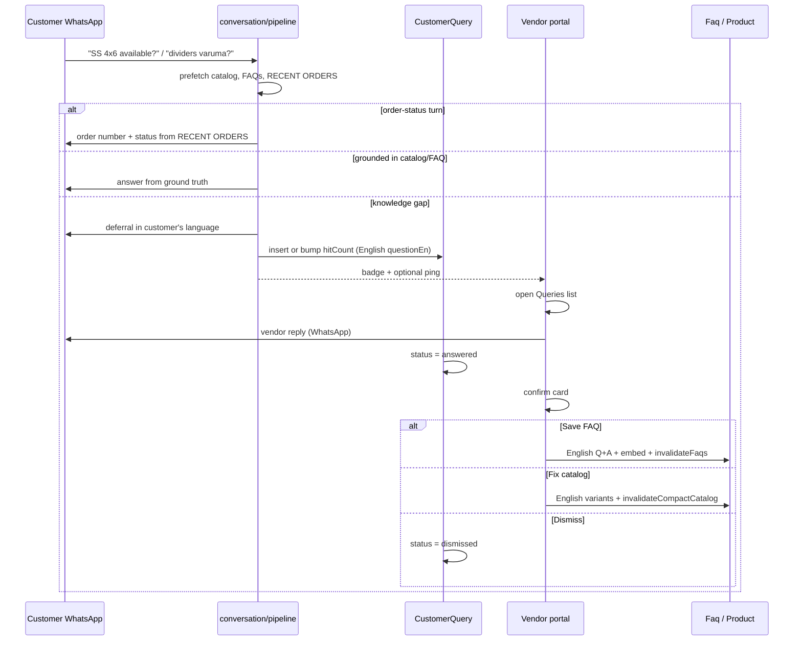

# Customer Queries (knowledge inbox → FAQ / catalog)

<!-- DOC_SYNC
  last_verified_commit: 6797be1dcc141df16144a5ef8373e935ed14722a
  last_verified_at: 2026-09-14
  scope: Implemented v1 — knowledge-gap capture, vendor inbox, English FAQ/variant promotion
-->

**Status:** Implemented (v1) — D6 rewrite, persist, vendor inbox + reply, FAQ/catalog promotion, English write gates, throttled vendor ping.  
**Audience:** Product, vendor portal frontend, conversation pipeline, backend API  
**Apps:** `frontend_v2/apps/web-vendor` (vendor portal)  
**Runtime:** Conversation pipeline Lambda (`chatlogix-incoming-response-generator`) + Express API on PM2 (`chatlogix-backend`)  

---

## Table of contents

1. [Purpose and business goal](#1-purpose-and-business-goal)
2. [Locked product decisions](#2-locked-product-decisions)
3. [Motivating conversation (9790690170)](#3-motivating-conversation-9790690170)
4. [What exists today and why it is not enough](#4-what-exists-today-and-why-it-is-not-enough)
5. [Failure-type taxonomy](#5-failure-type-taxonomy)
6. [Relationship to customer WhatsApp AI](#6-relationship-to-customer-whatsapp-ai)
7. [Scope](#7-scope)
8. [End-to-end flow](#8-end-to-end-flow)
9. [Detection (`knowledge_gap` op)](#9-detection-knowledge_gap-op)
10. [Order queries — never defer](#10-order-queries--never-defer)
11. [English-only storage](#11-english-only-storage)
12. [Customer-facing deferral copy](#12-customer-facing-deferral-copy)
13. [Vendor user experience](#13-vendor-user-experience)
14. [Reply from the list or from the conversation](#14-reply-from-the-list-or-from-the-conversation)
15. [Promotion after vendor reply](#15-promotion-after-vendor-reply)
16. [Catalog / variant fork](#16-catalog--variant-fork)
17. [Dedup and clustering](#17-dedup-and-clustering)
18. [Notifications](#18-notifications)
19. [Data model](#19-data-model)
20. [API contract](#20-api-contract)
21. [Pipeline changes](#21-pipeline-changes)
22. [Prompt and vendor-config changes](#22-prompt-and-vendor-config-changes)
23. [English enforcement on existing write paths](#23-english-enforcement-on-existing-write-paths)
24. [Billing](#24-billing)
25. [Security, auth, and rate limits](#25-security-auth-and-rate-limits)
26. [Frontend integration points](#26-frontend-integration-points)
27. [Observability](#27-observability)
28. [Test plan](#28-test-plan)
29. [Implementation phases](#29-implementation-phases)
30. [Open questions](#30-open-questions)
31. [Related code and docs](#31-related-code-and-docs)

---

## 1. Purpose and business goal

ChatLogix’s primary goal is **chat-based order assistance via WhatsApp**: the AI should answer ~90% of repetitive customer questions so the vendor only handles exceptions.

Today, when the model does not have a fact (size availability, “does it include dividers?”, bulk/catering policy), it often replies *“I’ll check with Kanmani and let you know.”* That message is a normal assistant bubble. **Nothing is created for the vendor.** The question dies in the conversation thread. The next customer asks the same thing and gets the same stall.

**Customer Queries** is a dedicated inbox of those knowledge gaps:

1. Customer asks something not grounded in catalog, variants, FAQs, or recent orders.
2. AI tells the customer it will check with the vendor (conversation stays *unpaused*).
3. A **Customer Query** row appears on a vendor list, linked to the chat.
4. Vendor answers once (from the list or from the conversation).
5. After confirm, the system stores an **English** FAQ (or routes the vendor to fix **English** product variants).
6. The next similar WhatsApp question is answered from FAQ / catalog — no Kanmani round-trip.

**Success criteria:**

- Open knowledge-gap questions are visible without hunting through chats.
- A vendor answer given once is reused for later customers.
- FAQ and product-variant **storage** is English/Latin only (customer WhatsApp replies stay in the customer’s language).
- Order-status / “where is my order” **never** uses “we’ll check and get back” and **never** creates a Customer Query.

---

## 2. Locked product decisions

These are **fixed for v1** unless explicitly revised.

| ID | Decision |
|----|----------|
| D1 | **Knowledge inbox, not handoff.** A knowledge gap does **not** set `Conversation.aiPaused`. Handoff (`handoff` op) stays for complaints / returns / in-progress cancel. |
| D2 | **Explicit LLM-1 op** `knowledge_gap` is the primary detector. Phrase-matching “I’ll check with…” is a **fallback only**, and never for order turns (D6). |
| D3 | **Vendor must confirm FAQ promotion.** Auto-save of FAQ from a vendor reply is forbidden. The vendor picks: save FAQ, fix catalog/variants, or dismiss (one-off). |
| D4 | **FAQ `question` and `answer` are English only.** Native-script text is translated/transliterated before persist (reuse `toVendorEnglish`). Embeddings are built from the English question. |
| D5 | **Product variant `label`, `attributes`, and `sku` are English/Latin only.** Product `name` and `description` follow the same rule. Keywords may still include Tamil/Hindi synonyms for matching (retrieval, not quoted answers). |
| D6 | **Order-related turns never defer.** If the customer asks about order status, ETA, “did I already order”, “last order”, “eappo kidaikum” in an order context: answer from `RECENT ORDERS` (or say none on file). Never emit `knowledge_gap`. Never say “I’ll check / get back to you.” Never create a Customer Query. Never promote to FAQ. |
| D7 | **Customer WhatsApp language is unchanged.** Deferral and later answers are in the customer’s language/script. English is **storage** (FAQ, variants, query `questionEn`). |
| D8 | **The vendor’s WhatsApp/dashboard reply is the customer’s answer.** FAQ promotion is for the *next* customer, not a second auto-message to this one. |
| D9 | **Dedup by vendor + embedding similarity** against open queries. Repeat of the same gap increments `hitCount` instead of spawning a new open row. |
| D10 | **Notify is fire-and-forget** after the customer deferral is queued (same I5 as handoff notify). Dashboard badge is the primary surface; optional vendor WhatsApp is a light ping, not “AI paused, take over.” |
| D11 | **Do not reuse `OrderAlert`.** Alerts are order-scoped. Knowledge gaps often have no order. New `CustomerQuery` model. |
| D12 | **Promotion summarizer writes English Q+A only**, then the vendor edits/confirms. Character limits match FAQ: question ≤ 300, answer ≤ 1500. |

---

## 3. Motivating conversation (9790690170)

Source: `backend/exports/customer-9790690170-conversations-orders.json`  
Customer: Murali, phone stored as `919790690170`  
Vendor: Ibell Creations (`vendor_ibell_001`)  
Conversation: `eb800114-2fb1-4b83-8357-60c2c4579972` (2026-09-02 → 2026-09-03)

| Turn | Customer | Assistant | Correct v1 handling |
|------|----------|-----------|---------------------|
| 1 | Hi mam good evening | Greeting + brownies | No query |
| 2 | Do you have baking tins? | Names Premium Baking Tin | No query (catalog hit) |
| 3 | I need SS 4x6 size is that available? | **Kanmani will confirm availability** | **Customer Query** — catalog/variant gap (4x6 is not a real variant). After vendor reply → **fix variants**, not FAQ |
| 4 | Yes, evlo varum? | Asks availability vs price | No new query (clarification) |
| 5 | Yes | Cart dump ₹1299 (wrong — guessed a non-existent size) | Cart bug; not this feature |
| 6 | Ithuku dividers varuma?? | Yes, adjustable divider included | If grounded in `desc`, no query; if not, **FAQ** after vendor confirm |
| 7–10 | Vera eanns size / list all sizes | Loops “multiple sizes”, then **Kanmani will confirm exact sizes** | Same as turn 3 — **variant** work, not FAQ |
| 11 | Hi mam (6h later) | Fresh greeting; open size question forgotten | Query still **open** on the list |
| 12 | Na order pannen. Eappo kidaikum? | Asks name/product/address as if new order | **D6** — answer from RECENT ORDERS. **No query.** |
| 13–16 | Already ordered / Murali / address | **I will check the current status and get back to you** | **D6 violation.** Orders were already in the prompt. |
| 17 | Are you still checking my order status?? | **I’m still checking…** | **D6.** Must never happen. |

An earlier thread (April 2026, conversation `0b6baec5-0a1c-4508-a26b-cbc98cb07fca`) has the same pattern: “10x10 size?” → “Let me check with the vendor.” See `docs/troubleshooting/ibell-baking-tin-ai-grounding-case-study.md`.

This feature exists so turns 3, 7–10 (and similar policy/product facts) become a **vendor work item + reusable English ground truth**. Turns 12–17 are **out of scope** and must be fixed in the order-status path, not by filing queries.

---

## 4. What exists today and why it is not enough

| System | What it does | Gap |
|--------|----------------|-----|
| Conversations page (`/conversations`) | WhatsApp-style inbox; vendor can pause AI and type a reply | No “unanswered questions” queue. After “I’ll check with Kanmani,” the thread looks handled. |
| `handoff` op + `triggerHandoff` | Pauses AI (`aiPaused = true`) and notifies vendor | Reserved for complaints/returns. LLM-1 is told **not** to use it for unknown product facts. Pausing would kill auto-reply for the whole chat. |
| `Faq` + `loadFaqs` | Vendor-authored Q&A; embed question; inject top 3 with cosine ≥ 0.75 into LLM-1 | Destination exists. **No capture path** from live chat. |
| Catalog / variants | Compact catalog + `PRODUCT VARIANTS` table in the LLM-1 prompt | Missing or incomplete variants cause “Kanmani will confirm sizes.” That is a **catalog fix**, not an FAQ. |
| `RECENT ORDERS` in the hot set | Grounding for status / reorder / cancel | Prompt already says never “I’m checking.” The 9790690170 chat still deferred. Prompt-only is insufficient. |
| Ibell `aiContentConversationRules` | Explicitly: for out-of-scope questions, say “I’ll check with Kanmani and let you know” | Teaches deferral **without creating a ticket**. |
| `OrderAlert` / post-sales notify | Order-scoped vendor WhatsApp | Knowledge gaps often have no order. Do not overload this table (D11). |
| `Message.contentEn` / `toVendorEnglish` | English for **vendor display** of chat; original WhatsApp text unchanged | Reuse for query `questionEn` and FAQ promotion. Does **not** currently gate FAQ or variant writes. |

There is no `knowledge_gap` CartOp today. `intent: "query"` is **telemetry only** (`docs/CONVERSATION_PROCESSOR_LAMBDA.md` §13) and must not drive writes.

---

## 5. Failure-type taxonomy

Every “I don’t know” is **not** a Customer Query, and every Customer Query is **not** an FAQ.

| Type | Example from 9790690170 | Create query? | After vendor answers |
|------|-------------------------|---------------|----------------------|
| **A. Repeatable product/policy fact** | “Does the tin come with dividers?” / Sunday delivery / shelf life | Yes | Confirm → **English FAQ** |
| **B. Missing/wrong catalog variant** | “SS 4x6 available?” / “list all sizes” | Yes | Confirm → **English variants** on the product (optional FAQ only if the vendor insists on a policy sentence) |
| **C. Order status / ETA / “did I order”** | “Eappo kidaikum?” / “still checking my order?” | **Never (D6)** | Answer from `RECENT ORDERS` or “no order on file” |
| **D. Complaint / return / cancel in progress** | Wrong item, damaged, want refund after prep | No (use existing `handoff`) | Vendor takes over paused chat |
| **E. One-off / personal** | “Can you hold this until my cousin arrives Thursday?” | Yes (optional) | **Dismiss** — do not FAQ |
| **F. Clarification / cart mutation** | “Yes” after “availability or price?” | No | Normal pipeline |

Promotion UI must offer **Save as FAQ**, **Update product / variants**, and **Dismiss**. Default suggestion can be inferred from `category` on the query (`policy` → FAQ, `product` → catalog fork).

---

## 6. Relationship to customer WhatsApp AI

```
Customer WhatsApp
    → webhook → text queue
    → conversation/pipeline.ts (LLM-1 + CartEngine + optional LLM-2)
         ├─ RECENT ORDERS     → answer now (D6)
         ├─ compact catalog / variants → answer or clarify
         ├─ RELEVANT FAQs     → answer verbatim facts
         ├─ handoff           → pause AI + notify (complaints)
         └─ knowledge_gap     → deferral copy + CustomerQuery row (this feature)
                ↓
         vendor portal list → vendor reply to customer
                ↓
         confirm → Faq row (English) + embedAndStore + invalidateFaqs
                or Product.variants update + invalidateCompactCatalog
```

After FAQ accept, the next turn’s `prefetch.ts` `loadFaqs` can retrieve it. After variant accept, `invalidateCompactCatalog` already exists on product writes.

**Do not** change LLM-1’s rule that it **applies** catalog `desc` (compatibility, confirm-before-order), not only quotes it.

---

## 7. Scope

### In scope (v1)

- `knowledge_gap` CartOp + pipeline persist of `CustomerQuery`.
- Hard block: order-related turns cannot defer or open a query (D6).
- Vendor portal: Queries list + detail, open-count badge, deep link into Conversations.
- Reply from list (sends WhatsApp as `senderType: vendor`, same as conversation composer) or detect a vendor reply in-thread and mark the query answered.
- Confirm card: Save English FAQ / Update variants / Dismiss.
- English-only persist for FAQ Q+A and product name/description/variant label+attributes+sku.
- Dedup open queries by embedding similarity (D9).
- Dashboard badge + optional light vendor WhatsApp ping (D10).
- Align catalog-enhancer FAQ prompt with English-only answers (today it says “match the language of the original”).

### Out of scope (v1)

- Pausing AI on knowledge gap (D1).
- Auto-writing FAQ without vendor confirm (D3).
- Using Customer Queries for order status (D6).
- Bulk “promote all answered queries.”
- Changing complaint handoff.
- Public/marketing FAQ site (`web-marketing`).
- Translating historical FAQ/product rows in a one-shot migration (call out as a follow-up if production data has native script).

---

## 8. End-to-end flow



Worked example (dividers, type A):

1. Customer: *“Ithuku dividers varuma??”*
2. No FAQ/desc fact → LLM-1 `knowledge_gap` + Tamil deferral.
3. Query stored: `questionOriginal` = Tamil, `questionEn` = *Does the baking tin come with dividers?*
4. Vendor replies on WhatsApp: *“Yes, adjustable divider is included.”*
5. Confirm card draft: Q *Does the baking tin come with dividers?* A *Yes. The Premium Baking Tin includes an adjustable divider set.*
6. Vendor taps **Save as FAQ**. Next customer asking the same thing in any language retrieves that English FAQ; LLM-1 answers in *their* language.

Worked example (sizes, type B): same capture, but vendor chooses **Update product** and adds English variant rows (`SS 8x8`, `Kadai 10x10`, …) instead of an FAQ that would go stale.

Worked example (order, type C): *“Na order pannen. Eappo kidaikum?”* → pipeline answers from RECENT ORDERS. No query. No FAQ.

---

## 9. Detection (`knowledge_gap` op)

### 9.1 New CartOp

Add to `backend/src/conversation/types.ts` `CartOp` and to `llm1JsonSchema` / `cartOpSchema` in `prompts.ts`:

```ts
{
  type: 'knowledge_gap';
  question: string;          // one-line English summary of what is unknown
  category?: 'product' | 'policy' | 'other' | null;
}
```

Same strict-schema constraint as other ops: fields present and nullable rather than omitted.

`CartEngine.apply` treats `knowledge_gap` as a **no-op** (same as `handoff` / `noop` inside the engine). The pipeline handles it **after** apply, like handoff — but **does not** pause AI.

### 9.2 When LLM-1 should emit it

Emit `knowledge_gap` **only if all** are true:

- The customer asked for a **fact** (availability of a specific undocumented size, policy, ingredient, packaging, lead time that is **not** the vendor prep-time policy, customization outside catalog).
- That fact is **not** in PRODUCT CATALOG, PRODUCT VARIANTS, RELEVANT FAQs, or vendor system prompt / conversation rules as a concrete answer.
- The turn is **not** order-status / reorder / cancel / refund / complaint (those have their own ops).

`draftReply` must be a short deferral in the customer’s language (D7), not an invented fact.

`needsVerify`: false (no cart claim). `intent`: `query` (telemetry).

### 9.3 When it must not emit

- Any order-status / “where is it” / “did I order” / last-order (D6).
- Product match is uncertain but a **clarifying question** will do (`noop` + ask size/material from the **real** variant table).
- The variant table **has** the size: answer from the table, do not gap.
- The variant table **does not** have the asked size: say so and list **real** options. That is a grounded “no”, not a gap — **unless** the catalog says “multiple sizes” with **zero** variant rows, in which case it **is** a gap (9790690170 sizes).
- Complaints → `handoff`.

### 9.4 Fallback detector (secondary)

If LLM-1 does **not** emit `knowledge_gap` but `draftReply` matches deferral phrasing (I’ll check with / Kanmani will confirm / get back to you / still checking) **and** the turn is **not** order-related (D6):

- Still open a Customer Query.
- Prefer this over silently dropping the vendor work item.

If the turn **is** order-related, the fallback must **not** open a query; instead rewrite the reply (see §10).

### 9.5 Pipeline persist

After CartEngine apply, if a `knowledge_gap` op exists (or fallback fired):

1. Normalize `question` to English (`toVendorEnglish` on the customer message + model `question`).
2. Dedup (§17). Insert or `hitCount += 1`, `lastSeenAt = now()`.
3. Customer still gets `draftReply` (or canned deferral if draft invented a fact — prefer model copy if it is clearly a check-with-vendor line).
4. Fire-and-forget vendor notify (§18).
5. Do **not** set `aiPaused`.

---

## 10. Order queries — never defer

### 10.1 Why prompt-only failed

LLM-1 already contains:

> If the customer asks about an order … answer directly from RECENT ORDERS … NEVER say "I'm checking" or "I'll get back to you" … If RECENT ORDERS is empty, say plainly that you don't see any order on file …

The 9790690170 thread still asked for name/address “to check status” and then said it was still checking. `RECENT ORDERS` was in the hot set (pending + cancelled baking-tin orders).

### 10.2 Hard pipeline rule (v1)

After LLM-1, **before** persist/send, if the turn is classified as **order-related**:

1. Strip any `knowledge_gap` op.
2. If `draftReply` (or LLM-2 output) matches deferral phrasing, **replace** it with a deterministic renderer from `hotSet.orderHistory`:
   - ≥1 row: order number, status label (same map as `ORDER_STATUS_LABELS` in `prompts.ts`), items summary, vendor prep-time policy for “how long”. Never invent a delivery date.
   - 0 rows: “I don’t see an order on file. Would you like to place one?”
3. Never create a `CustomerQuery`.
4. Never offer FAQ promotion later for that turn.

**Order-related** means any of:

- `intent` in `order_status`, `query` **and** the merged customer text matches order-status language (status, where is it, last order, already ordered, eappo kidaikum, tracking), or
- `ops` contain `cancel` / `refund_request` (those have their own post-sales templates — still not a knowledge gap), or
- `hotSet.orderHistory` is non-empty **and** the customer is asking when/whether an existing order will arrive.

Prefer a small deterministic classifier (keywords + `orderHistory.length`) over a second LLM call, to keep p90.

### 10.3 Not order-related

“How long to bake a custom 3-tier cake if I order today?” with **no** existing order is **policy/prep** — may be a knowledge gap if prep-time config does not cover it. “How long for **my** order?” is D6.

---

## 11. English-only storage

### 11.1 Split: store English, speak the customer’s language

| Layer | Language |
|-------|----------|
| Customer WhatsApp `Message.content` | Customer’s language (unchanged) |
| `Message.contentEn` | English for vendor **display** of chat (existing) |
| `CustomerQuery.questionOriginal` | Customer’s words |
| `CustomerQuery.questionEn` | English (required) |
| `CustomerQuery.vendorAnswerOriginal` | What the vendor typed (may be Tanglish) |
| `CustomerQuery.vendorAnswerEn` | English (required before FAQ promotion) |
| `Faq.question`, `Faq.answer` | **English only** (D4) |
| `Product.name`, `description` | **English only** (D5) |
| `Product.variants[].label`, `attributes` values, `sku` | **English / Latin only** (D5) |
| `Product.keywords` / `tags` | May include ta/hi synonyms for matching |
| LLM-1 `draftReply` to customer | Customer’s language (existing) |

LLM-1 already: “Keep catalog product names exactly as written — do not translate brand/product names.” English catalog + Tamil reply is the intended split.

### 11.2 How to enforce

Reuse `needsEnglish` + `toVendorEnglish` from `backend/src/utils/vendorEnglish.ts` (same as `normalizeSetFieldOps` for name/address).

On write of FAQ / product name+description+variant strings:

1. If `needsEnglish(text)` (non-Latin letters) → translate/transliterate.
2. Persist **only** the English result (or 400 with a preview for the vendor to confirm — v1: auto-translate then persist, log original in query metadata when coming from promotion).
3. FAQ `embedAndStore` always embeds the English question.

Latin-script Tanglish (“Ithuku dividers varuma”) is **not** caught by `needsEnglish` (Latin letters only). Promotion summarizer **must** still rewrite into proper English. Manual FAQ form: helper text “Write in English”; optional lint if the text looks code-mixed (v1: summarizer + helper copy; strict Tanglish detector is v1.1).

### 11.3 Examples

| Source | Do not store | Store |
|--------|----------------|-------|
| Customer: இதுக்கு dividers வருமா? | That Tamil as `Faq.question` | `Does the baking tin come with dividers?` |
| Vendor reply: “Yes da, divider set included 😊” | Raw chat as FAQ answer | `Yes. The tin includes an adjustable divider set.` |
| Variant | `எஸ்எஸ் 8x8` | `SS 8x8` |
| Order status chat | FAQ “we will get back to you shortly” | **Nothing** — D6 |

---

## 12. Customer-facing deferral copy

Keep short, in the customer’s language, no invented facts, no promised ETA.

English reference (model translates):

> I’ll check with the team and get back to you shortly.

Do **not** ask for name/address “so we can check.” Do **not** add the item to the cart. Do **not** say the vendor is confirming a size that is not in the variant table as if the order is valid.

Vendor conversation rules that currently say “I’ll check with Kanmani and let you know” for out-of-scope questions stay valid **only** together with `knowledge_gap` (so a ticket is created). They must **not** apply to order status.

---

## 13. Vendor user experience

### 13.1 Navigation

Add **Queries** to `web-vendor` sidebar (near Conversations / FAQs), with an open-count badge.

Routes:

| Path | Page |
|------|------|
| `/queries` | List: open first, then answered awaiting promotion, then dismissed |
| `/queries/:id` | Detail: original + English question, customer, conversation excerpt, actions |
| `/conversations?conversationId=&queryId=` | Existing chat, optional highlight of the source message |

v1 may implement detail as a panel on `/queries` instead of a separate route; deep link into Conversations is required.

### 13.2 List columns

- Customer display name / phone
- `questionEn` (primary); original as secondary line if different
- Category (`product` / `policy` / `other`)
- Status (`open` / `answered` / `promoted_to_faq` / `needs_catalog_fix` / `dismissed`)
- `hitCount` if > 1
- Age / last seen
- Link to conversation

Filters: status, category, search on `questionEn`. Default filter: `open`.

### 13.3 Detail actions

- **Reply** — composer; sends via existing `POST /conversations/:id/messages` (or a wrapper that also marks the query answered).
- **Open chat** — Conversations with this thread selected.
- After answered: **Save as FAQ** / **Update product** / **Dismiss**.
- Save as FAQ: editable English Q+A (pre-filled by summarizer), then existing FAQ create + embed. Optional “Enhance with AI” after save (catalog enhancer D1 requires persisted `faqId`).

### 13.4 Conversations page

- Badge or filter “Has open query.”
- Optional inline chip on the customer message that opened the query.
- Vendor send in that thread marks linked **open** queries **answered** (same conversation, still `open`).

Do not add a second composer. Reuse `MessageInput`.

---

## 14. Reply from the list or from the conversation

Both paths must:

1. Create `Message` with `senderType: 'vendor'` and enqueue WhatsApp (`conversations.ts` already does this).
2. Run `ensureMessageContentEn` on the vendor message (existing).
3. Set query `status = answered`, store `vendorAnswerOriginal`, `vendorAnswerEn` (`toVendorEnglish`), `answeredAt`, `answeredByVendorId`.
4. **Not** auto-create FAQ (D3).
5. Show the confirm card on the next Queries view (and optionally a toast in Conversations: “Save this as an FAQ?”).

If the vendor replies in chat **without** going through the list, a conversation-message hook (same POST handler) finds open queries for that `conversationId` and marks them answered. If several are open, mark the most recent, or all from that conversation — v1: **all open queries on that conversation** (vendors rarely have two unrelated gaps in one thread; simpler than a picker).

### 14.1 WhatsApp quoted replies (v1.1 — implemented)

**Problem (v1):** Outbound vendor replies are plain text bubbles with no link to the customer’s question, so answers can look random when they arrive long after the deferral.

**Spec:** [CUSTOMER_QUERY_QUOTED_REPLIES.md](./CUSTOMER_QUERY_QUOTED_REPLIES.md)

Summary of locked behavior:

| Path | Quote target |
|------|----------------|
| `POST /api/customer-queries/:id/reply` | `CustomerQuery.quoteMessageId` (fallback `sourceMessageId`) → customer message wamid; Graph fallback uses stored `questionOriginal`. |
| `POST /api/conversations/:id/messages` | **Unquoted by default.** Optional body `replyToMessageId` when the vendor uses Reply in Conversations. |

Send uses Graph `context.message_id`. If quoting fails (invalid/expired wamid), send one message with inline context: connector + customer question text + vendor reply; update outbound `Message.content` to match. Do not retry unquoted on auth/rate-limit errors.

---

## 15. Promotion after vendor reply

### 15.1 Summarizer

One cheap model call (`gpt-4.1-mini`), vendor-dashboard English, **not** billed as a customer WhatsApp credit (see §24).

Input: `questionOriginal`, `questionEn`, `vendorAnswerOriginal`, product name if `category = product`.

Output JSON:

```json
{
  "question": "Does the baking tin come with dividers?",
  "answer": "Yes. The Premium Baking Tin includes an adjustable divider set.",
  "suggestedAction": "faq" | "catalog" | "dismiss"
}
```

Rules:

- English only; transliterate names/places (same as `VENDOR_ENGLISH_SYSTEM_PROMPT`).
- Do not invent prices, ETAs, or policies not in the vendor reply.
- `question` ≤ 300, `answer` ≤ 1500.
- If the answer is a size/price matrix, prefer `suggestedAction: "catalog"`.

### 15.2 Save as FAQ

1. Show draft; vendor may edit.
2. `POST /api/faqs` with English Q+A, `isActive: true`.
3. `embedAndStore` + `invalidateFaqs`.
4. Query `status = promoted_to_faq`, `faqId` set.

If a similar FAQ already exists (question embedding ≥ threshold vs existing FAQs), offer **Update existing** instead of create (v1: warn + link to FAQ edit; auto-merge is v1.1).

### 15.3 Dismiss

`status = dismissed`, optional `dismissReason`. No FAQ write.

---

## 16. Catalog / variant fork

When `suggestedAction === "catalog"` or the vendor picks **Update product**:

1. Deep-link to product edit (`/catalog/:productId/edit`) when `productId` was stored on the query (from `knowledge_gap` context or last discussed catalog id in the turn).
2. Prefill helper: “Customer asked: {questionEn}. Vendor said: {vendorAnswerEn}. Add English variant rows; do not paste this as description-only if it is a size/price.”
3. On save, existing product route validates variants and calls `invalidateCompactCatalog`.
4. Query `status = needs_catalog_fix` until product save, then `status = dismissed` or a dedicated `resolved_in_catalog` (v1: `needs_catalog_fix` → `dismissed` with reason `catalog_updated` is enough).

Variant rows must pass English/Latin checks (D5) on `POST/PUT /api/products`.

Do **not** FAQ a full price grid. FAQs go stale; variants are the source of truth for LLM-1’s VARIANTS table.

---

## 17. Dedup and clustering

On insert:

1. Embed `questionEn` with `text-embedding-3-small` (same as FAQ).
2. Among this vendor’s rows with `status = open`, if cosine similarity ≥ **0.85** (configurable `CUSTOMER_QUERY_DEDUP_THRESHOLD`), increment `hitCount`, set `lastSeenAt`, append `sourceMessageId` to `relatedMessageIds` (JSON array, cap 20).
3. Else insert a new row.

Answered/dismissed queries are **not** merged into; a new open row is correct if the vendor already resolved the old one but the catalog/FAQ still does not cover it (signals promotion failed or catalog still thin).

---

## 18. Notifications

Mirror post-sales notify **shape**, not **severity**.

| Channel | v1 |
|---------|-----|
| Dashboard | Open-count on sidebar + Queries list |
| Vendor WhatsApp | Optional, fire-and-forget **after** customer deferral enqueue. Copy: customer first name/phone, one-line `questionEn`, “AI is still on; answer from Queries or the chat when you can.” **Do not** say AI is paused. |
| `OrderAlert` | **Do not write** (D11) |

Throttle: at most **one** WhatsApp ping per vendor per **15 minutes** (Redis), even if many queries open. Dashboard always shows truth.

If vendor has no phone, skip WhatsApp (same as `notifyVendorOfPostSalesEvent`).

---

## 19. Data model

New Prisma model (table `"CustomerQuery"`):

```prisma
model CustomerQuery {
  id                    String    @id @default(uuid())
  vendorId              String
  conversationId        String
  customerId            String
  sourceMessageId       String?
  relatedMessageIds     Json      @default("[]")
  productId             String?

  questionOriginal      String    @db.VarChar(1000)
  questionEn            String    @db.VarChar(1000)
  category              String    // product | policy | other
  status                String    // open | answered | promoted_to_faq | needs_catalog_fix | dismissed
  hitCount              Int       @default(1)

  vendorAnswerOriginal  String?   @db.VarChar(2000)
  vendorAnswerEn        String?   @db.VarChar(2000)
  faqId                 String?
  dismissReason         String?

  embedding             Unsupported("vector(1536)")?
  embeddingModel        String?   @db.VarChar(64)

  answeredAt            DateTime?
  answeredByVendorId    String?
  lastSeenAt            DateTime  @default(now())
  createdAt             DateTime  @default(now())
  updatedAt             DateTime  @updatedAt

  vendor                Vendor       @relation(fields: [vendorId], references: [id], onDelete: Cascade)
  conversation          Conversation @relation(fields: [conversationId], references: [id], onDelete: Cascade)
  customer              Customer     @relation(fields: [customerId], references: [id], onDelete: Cascade)
  sourceMessage         Message?     @relation(fields: [sourceMessageId], references: [id], onDelete: SetNull)
  faq                   Faq?         @relation(fields: [faqId], references: [id], onDelete: SetNull)
  product               Product?     @relation(fields: [productId], references: [id], onDelete: SetNull)

  @@index([vendorId, status, lastSeenAt])
  @@index([conversationId, status])
  @@index([vendorId, status])
  @@map("CustomerQuery")
}
```

`embedding` is `Unsupported("vector(1536)")` for the same Prisma 5.17 reason as `Faq.embedding` — read/write via `$queryRaw` / `$executeRaw`.

Add reverse relations on `Vendor`, `Conversation`, `Customer`, `Message`, `Faq`, `Product`.

Statuses:

| status | Meaning |
|--------|---------|
| `open` | Waiting on vendor |
| `answered` | Vendor replied; confirm card pending |
| `promoted_to_faq` | FAQ written |
| `needs_catalog_fix` | Vendor chose catalog path, product not saved yet |
| `dismissed` | One-off, or catalog updated, or duplicate closed |

---

## 20. API contract

Base: `/api/customer-queries` (or `/api/queries`). Authenticated vendor (same `requireRole('vendor', 'admin')` as FAQs). Admin may pass `vendorId`.

| Method | Path | Purpose |
|--------|------|---------|
| GET | `/` | List. Query: `status`, `category`, `search`, `page`, `pageSize`. Default `status=open`. |
| GET | `/summary` | `{ openCount }` for sidebar badge (cheap count). |
| GET | `/:id` | Detail including conversation snippet (last N messages) and promotion draft if `answered`. |
| POST | `/:id/reply` | `{ content }` — send WhatsApp + mark answered. Alternatively reuse conversation messages POST and document the hook. |
| POST | `/:id/promote` | `{ action: 'faq' \| 'catalog' \| 'dismiss', question?, answer?, productId?, dismissReason? }` |
| POST | `/:id/promotion-draft` | Run summarizer; return English Q+A + `suggestedAction`. |

List item DTO:

```ts
{
  id: string;
  customerName: string | null;
  customerPhone: string;
  conversationId: string;
  questionEn: string;
  questionOriginal: string;
  category: 'product' | 'policy' | 'other';
  status: string;
  hitCount: number;
  lastSeenAt: string;
  createdAt: string;
}
```

Promote `action: 'faq'` body uses FAQ limits; server runs English normalization before `prisma.faq.create`.

Errors: 400 validation, 403 wrong vendor, 404, 409 if promote on `open` (must be `answered`) or FAQ create duplicate warning.

---

## 21. Pipeline changes

Files (same change must update `docs/INCOMING_RESPONSE_GENERATOR_FLOW.md` per `.cursor/rules/incoming-response-generator-flow.mdc`):

| File | Change |
|------|--------|
| `conversation/types.ts` | Add `knowledge_gap` to `CartOp` |
| `conversation/llm/prompts.ts` | Schema + when to emit; strengthen D6; vendor-rules interaction |
| `conversation/cart/engine.ts` | Ignore `knowledge_gap` in apply (no-op) |
| `conversation/pipeline.ts` | After apply: D6 strip/rewrite; persist query; notify; do not pause |
| `conversation/__tests__/pipeline.test.ts` | Cases in §28 |
| New `conversation/customerQuery.ts` (or `services/customerQueryService.ts`) | Insert/dedup/notify |

Ordering vs handoff: if both `handoff` and `knowledge_gap` appear, **handoff wins** (pause + complaint path). Do not also open a knowledge query.

LLM-2: `knowledge_gap` alone should **not** force LLM-2 (`shouldRunLlm2` already skips noop-like turns when confidence is high). Keep it that way — deferral copy does not need a cart verifier.

`selectFinalReply`: customer sees LLM-1 `draftReply` (or D6 renderer), not a cart dump.

---

## 22. Prompt and vendor-config changes

### 22.1 LLM-1 static rules (add)

- Emit `knowledge_gap` when a product/policy fact is not in catalog, variants, or RELEVANT FAQs. Put an **English** one-line `question`. Category `product` or `policy`.
- `draftReply`: deferral in the customer’s language; no invented sizes/prices.
- **Never** `knowledge_gap` and **never** “I’ll check / get back” for order status, last order, or “did I order” — use RECENT ORDERS (repeat existing rule; this feature makes it a **code** rule too).
- If VARIANTS has rows, list those sizes; do not say Kanmani will confirm sizes that are already in the table.
- If VARIANTS is empty but the catalog says “multiple sizes,” that **is** a `knowledge_gap` (`product`).

### 22.2 Vendor `aiContentConversationRules`

Ibell (and similar) text:

> For questions outside scope: “I’ll check with Kanmani and let you know”

Keep for **true** unknowns, but ops/docs should tell implementers: the pipeline **must** create a Customer Query when that line is used. Add to default onboarding copy: do not use that line for order tracking.

Do not rewrite every vendor’s prompt in v1 by migration; new defaults + Ibell as the first manual update.

### 22.3 Catalog enhancer FAQ prompt

`backend/src/services/catalogEnhancePrompts.ts` currently:

> Match the language of the original question/answer.

**Change to:** always write FAQ question and answer in **English**. Vendor chat `assistantMessage` may match the vendor’s language. Preview Q+A is English (D4). Align `docs/VENDOR_CATALOG_ENHANCER.md` §11 when implementing.

---

## 23. English enforcement on existing write paths

Customer Queries promotion is not enough if vendors can still type Tamil into `/faqs` and product variants.

| Write path | v1 enforcement |
|------------|----------------|
| `POST/PUT /api/faqs` | Normalize question+answer with `toVendorEnglish` when `needsEnglish`; document English-only in the FAQ form helper. |
| `POST/PUT /api/products` | Normalize `name`, `description`, each variant `label`, attribute values, `sku` (sku: ASCII/Latin, uppercase existing transform may stay). |
| Catalog import / enrichment | Prefer English name+description+variant labels; keep ta/hi **keywords**. |
| Catalog enhancer product | Descriptions English (update enrichment “match product name language” where it would write Tamil description). |
| Catalog enhancer FAQ | §22.3 |

Helper copy on FAQ form and variant editor: “Stored in English so WhatsApp AI can reuse this for every language.”

---

## 24. Billing

| Call | Who pays |
|------|----------|
| LLM-1 / LLM-2 on the customer turn | Existing per-message credits |
| Embed for query dedup | Vendor wallet **or** absorb as platform cost — **recommend absorb** (tiny `text-embedding-3-small`, same as FAQ retrieval already paid on customer turns) |
| `toVendorEnglish` on query insert | Absorb or fold into the customer turn (already used for `contentEn`) |
| Promotion summarizer | **2× OpenAI USD → wallet**, same as catalog enhancer (D12 there), **or** free in v1 to encourage FAQ fill. **Recommend: free in v1** (one small completion per answered query; the payoff is fewer future customer tokens). Revisit if abused. |
| FAQ embed on promote | Same as manual FAQ create (already unpaid beyond FAQ route) |

Do **not** debit a second customer-message credit when the vendor replies.

---

## 25. Security, auth, and rate limits

- All query APIs scoped to `req.user.vendorId` (admin override).
- Reply endpoint must use the same conversation ownership check as `POST /conversations/:id/messages`.
- Rate-limit promote/summarizer per vendor (e.g. 30/min) to protect the model.
- Do not expose other customers’ queries.
- `questionOriginal` may contain PII (address). List UI shows `questionEn` which must **not** turn a one-off address into an FAQ — summarizer + dismiss path; never auto-FAQ `set_field` address turns.

---

## 26. Frontend integration points

| Area | Files (expected) |
|------|------------------|
| Sidebar + badge | `frontend_v2/apps/web-vendor/src/components/layout/Sidebar.tsx` |
| Routes | `App.tsx` — `/queries`, `/queries/:id` |
| Pages | `pages/Queries.tsx`, `pages/QueryDetail.tsx` (or one page + panel) |
| API client | `lib/customerQueries.ts` + hook `hooks/queries/useCustomerQueries.ts` |
| Conversations | `pages/Conversations.tsx` — open-query chip; after send, toast to promote |
| FAQ form | Helper: English only (`FaqForm.tsx`) |
| Product variants editor | Helper: English labels |
| SEO titles | `lib/seo.ts` |

Reuse `@chatlogix/ui` Button/Modal. Design tokens: `.21st/design.json` / 21st MCP if new layout work is non-trivial.

---

## 27. Observability

EMF / existing `logCount` namespace `ChatLogix/ConversationParity` (or a sibling):

| Metric | When |
|--------|------|
| `CustomerQueryOpened` | Insert (not hitCount bump) |
| `CustomerQueryDeduped` | hitCount increment |
| `CustomerQueryBlockedOrder` | D6 strip of knowledge_gap / deferral rewrite |
| `CustomerQueryAnswered` | Vendor reply linked |
| `CustomerQueryPromotedFaq` | FAQ created |
| `CustomerQueryCatalogFork` | Vendor chose catalog |
| `CustomerQueryDismissed` | Dismiss |
| `CustomerQueryNotifyFail` | Vendor ping failed (never fail customer send) |

Logs: `traceId`, `vendorId`, `conversationId`, `queryId`, `category`. Do not log full customer PII at info.

---

## 28. Test plan

### Pipeline (Vitest)

- `knowledge_gap` persist: creates row, does not set `aiPaused`, customer deferral sent.
- Handoff + knowledge_gap: handoff wins, no query.
- D6: order-status + `knowledge_gap` in ops → no row, reply contains order number/status from fixture history, no “get back to you.”
- D6: empty history → “no order on file,” no query.
- D6 fallback: draftReply “still checking your order” rewritten.
- Dedup: second similar question bumps `hitCount`.
- CartEngine: `knowledge_gap` does not mutate cart.

### API

- List scoped to vendor.
- Promote FAQ writes English (Tamil input → English stored) and calls embed + `invalidateFaqs`.
- Promote on `open` → 409.
- Products PUT with Tamil variant label → stored Latin/English.

### Frontend (Playwright or component)

- Badge count.
- Reply from list sends and moves status to answered.
- Confirm card three actions.
- Conversations toast after vendor send when open query exists.

### Golden transcript

Replay 9790690170-style turns:

1. “SS 4x6 available?” → query opened, deferral, **not** ₹1299 add unless a real variant exists.
2. “List all sizes” with empty variants → query (or same deduped row).
3. “Na order pannen. Eappo kidaikum?” with pending order in history → status answer, **zero** queries.

---

## 29. Implementation phases

| Phase | Deliverable |
|-------|-------------|
| **0. Spec** | This document. No code. |
| **1. D6 hard rule** | Pipeline rewrite of order deferrals + tests. Immediate quality win; does not need the inbox. |
| **2. Model + persist** | Prisma `CustomerQuery`, `knowledge_gap` op, insert/dedup, no UI yet (admin SQL / log). |
| **3. Vendor list + reply** | `/queries`, badge, reply, conversation hook. |
| **4. Promotion** | Summarizer, FAQ save, catalog deep-link, English gates on FAQ/product writes. |
| **5. Notify + enhancer prompt** | Throttled vendor ping; catalog-enhancer FAQ English. |
| **6. Flow doc** | Update `docs/INCOMING_RESPONSE_GENERATOR_FLOW.md` in the same PRs as pipeline edits. |

Phase 1 can ship **before** the inbox. It fixes Murali’s “still checking my order” without waiting on UI.

---

## 30. Open questions

| ID | Question | Default if unset |
|----|----------|------------------|
| Q1 | Vendor WhatsApp ping on every new query vs dashboard-only in v1? | Dashboard + throttled ping (D10) |
| Q2 | Free summarizer vs 2× wallet debit? | Free in v1 (§24) |
| Q3 | Mark **all** open queries on a conversation when the vendor sends, or only the latest? | All open on that conversation (§14) |
| Q4 | Backfill English for existing Tamil FAQs/products? | Not v1; optional script later |
| Q5 | Similarity threshold 0.85 for query dedup vs 0.75 for FAQ retrieval — confirm on real Ibell questions | 0.85 dedup / keep 0.75 FAQ |
| Q6 | Should `knowledge_gap` store `productId` when the last catalog mention is unambiguous? | Yes when LLM-1 supplies it; optional field. `validateProductIds` nulls it when the id is absent from this turn's vendor-scoped compact catalog (the FK alone does not enforce vendor scoping), so the insert never has to fail-and-retry on a hallucinated id. |
| Q7 | Should vendor answers quote the customer’s question on WhatsApp? | **Yes (v1.1).** See [CUSTOMER_QUERY_QUOTED_REPLIES.md](./CUSTOMER_QUERY_QUOTED_REPLIES.md). |

---

## 31. Related code and docs

| Resource | Role |
|----------|------|
| `backend/src/conversation/pipeline.ts` | Turn orchestration; insert D6 + query persist |
| `backend/src/conversation/llm/prompts.ts` | LLM-1 rules, FAQ block, order-status rule, CartOp schema |
| `backend/src/conversation/prefetch.ts` | `loadFaqs`, `invalidateFaqs`, `invalidateCompactCatalog` |
| `backend/src/conversation/handoff.ts` | Contrast: pauses AI; this feature must not |
| `backend/src/conversation/faq/embedding.ts` | Shared embed model `text-embedding-3-small` |
| `backend/src/utils/vendorEnglish.ts` | `toVendorEnglish`, `needsEnglish`, `normalizeSetFieldOps` |
| `backend/src/routes/faqs.ts` | FAQ CRUD + embed; add English normalize |
| `backend/src/routes/products.ts` | Variant schema; add English normalize |
| `backend/src/routes/conversations.ts` | Vendor reply send; hook to mark queries answered |
| `docs/CUSTOMER_QUERY_QUOTED_REPLIES.md` | v1.1 spec: WhatsApp quoted replies + fallback prefix |
| `backend/src/services/catalogEnhancePrompts.ts` | Flip FAQ enhance to English |
| `frontend_v2/apps/web-vendor/src/pages/Conversations.tsx` | Inbox + composer |
| `frontend_v2/apps/web-vendor/src/pages/Faqs.tsx` | FAQ destination UI |
| `docs/INCOMING_RESPONSE_GENERATOR_FLOW.md` | Living pipeline walkthrough — update with implementation |
| `docs/CONVERSATION_PROCESSOR_LAMBDA.md` | Locked processor spec; Q7 handoff stays; this feature is additive |
| `docs/VENDOR_CATALOG_ENHANCER.md` | FAQ polish after promotion |
| `docs/troubleshooting/ibell-baking-tin-ai-grounding-case-study.md` | Historical “check with vendor” on sizes |
| `backend/exports/customer-9790690170-conversations-orders.json` | Motivating transcript |

Short index: `documentation/modules/features/customer-queries/README.md`.
