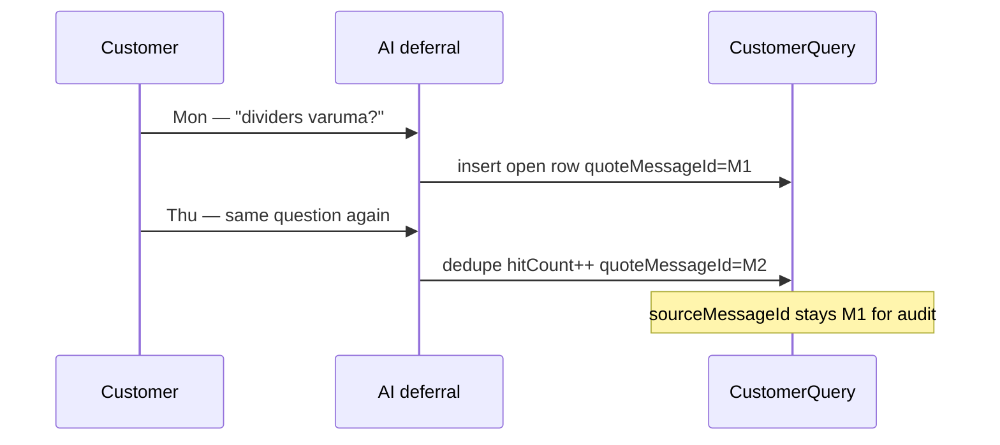
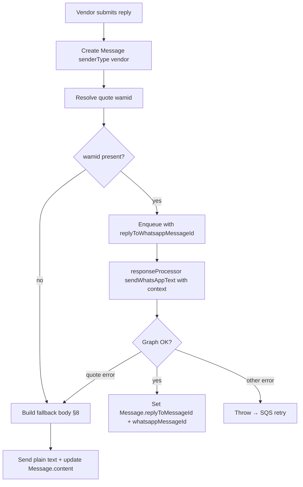

# Customer Query replies — WhatsApp quoted context (v1.1)

<!-- DOC_SYNC
  last_verified_commit: 0151f3a814f9d583e34b4f543c27a31dbbd35dce
  last_verified_at: 2026-09-21
  scope: Implemented v1.1 — WhatsApp quoted vendor replies; unquoted retry even when fallbackQuestionText is empty
-->

**Status:** Implemented (v1.1) — extends Customer Queries v1  
**Audience:** Product, backend (API + response dispatcher), vendor portal  
**Parent feature:** [CUSTOMER_QUERIES.md](./CUSTOMER_QUERIES.md)  
**Motivation:** Vendor answers sent as plain text bubbles look random when they arrive long after the customer’s question (see §2).

---

## Table of contents

1. [Problem](#1-problem)
2. [Goals and non-goals](#2-goals-and-non-goals)
3. [Locked product decisions](#3-locked-product-decisions)
4. [WhatsApp mechanics](#4-whatsapp-mechanics)
5. [Which message to quote](#5-which-message-to-quote)
6. [Two vendor reply entry points](#6-two-vendor-reply-entry-points)
7. [Send pipeline (happy path)](#7-send-pipeline-happy-path)
8. [Failure and fallback copy](#8-failure-and-fallback-copy)
9. [Data model changes](#9-data-model-changes)
10. [API and queue contract](#10-api-and-queue-contract)
11. [Dashboard / audit](#11-dashboard--audit)
12. [Edge cases](#12-edge-cases)
13. [Observability](#13-observability)
14. [Test plan](#14-test-plan)
15. [Implementation checklist](#15-implementation-checklist)
16. [Related code and docs](#16-related-code-and-docs)

---

## 1. Problem

Customer Queries v1 sends the vendor’s answer through the same path as any other dashboard message: create a `Message`, enqueue `RESPONSE_QUEUE_URL`, `sendWhatsAppText` posts `{ type: 'text', text: { body } }` with **no** `context.message_id`.

On the customer’s phone:

- The AI may have deferred hours earlier (“Kanmani will check…”).
- The vendor reply appears as a **new, unattached bubble** (e.g. “Yes, the Premium Baking Tin ships with an adjustable divider set.” at 9:04 pm).
- The customer cannot tell which question was answered unless they scroll and guess.

WhatsApp supports **quoted replies** via the Cloud API `context` object. ChatLogix already stores inbound `Message.whatsappMessageId` and resolves inbound quotes into `Message.replyToMessageId` in `webhookEventProcessor.ts`. Outbound vendor/assistant sends do not use quoting today.

---

## 2. Goals and non-goals

### Goals

- When a vendor answers a **specific** Customer Query from `/queries/:id`, the WhatsApp send should **quote the customer message that triggered that query identification** (including on dedupe hits).
- When a vendor answers from **Conversations** and the hook marks open queries answered, quote the **last inbound customer message** in that thread (one quote for one outbound send).
- If Graph rejects the quote (`context.message_id` invalid/expired), **still deliver** the answer using **inline context**: customer’s original question text + vendor reply (see §8).
- Persist outbound `Message.replyToMessageId` when quoting succeeds so the vendor dashboard can render the thread consistently.

### Non-goals

- Changing **which** queries get marked `answered` in v1.1 (still: Queries reply marks via that query’s conversation; Conversations POST still marks **all** open queries on the conversation — see [CUSTOMER_QUERIES.md §14](./CUSTOMER_QUERIES.md#14-reply-from-the-list-or-from-the-conversation)).
- Quoting AI assistant deferral messages instead of the **customer’s question** (always quote the customer turn that opened/re-opened the gap).
- Multi-quote when one send closes multiple open queries (WhatsApp allows one `context.message_id` per message).
- Customer-language generation for fallback **connectors** beyond a small template set (English default + optional `preferredLanguage` from `CustomerInsights`).

---

## 3. Locked product decisions

| ID | Decision |
|----|----------|
| Q1 | **Quote target is always a customer inbound message**, identified at knowledge-gap persist time. Never quote the AI’s “I’ll check…” bubble. |
| Q2 | **Store the quote anchor on the `CustomerQuery` row** as `quoteMessageId` (FK → `Message.id`). Set on **create** to the inbound message for that turn. On **dedupe** (`hitCount++`), **overwrite** `quoteMessageId` with the inbound message for the turn that re-identified the gap (the message we “identified the query from” on that occurrence). `sourceMessageId` remains the **first** opener for audit; `relatedMessageIds` remains the append-only list (cap 20). |
| Q3 | **`POST /api/customer-queries/:id/reply`** resolves `quoteMessageId` → `Message.whatsappMessageId` and passes it through the send pipeline. |
| Q4 | **`POST /api/conversations/:id/messages`** (vendor send) resolves the **latest** `senderType = 'customer'` message in the conversation with a non-null `whatsappMessageId` and uses that wamid for quoting. |
| Q5 | **Primary send:** WhatsApp `context: { message_id: <wamid> }` on the text payload. **Fallback send** only when Graph returns a **quote-specific** error (see §8.3). Auth failures, rate limits, and network errors **do not** trigger an unquoted retry (SQS retry as today). |
| Q6 | **Fallback body** uses `questionOriginal` (customer’s script) verbatim in the prefix, then the vendor’s reply. The stored `Message.content` and the text actually sent must match (update row if fallback rewrites body). |
| Q7 | **English-only storage** rules unchanged (D4–D5 in parent spec). Fallback prefix connectors may be localized; quoted bubble shows the customer’s original text without translation. |

---

## 4. WhatsApp mechanics

### 4.1 Cloud API (outbound text with quote)

```http
POST /{phone-number-id}/messages
{
  "messaging_product": "whatsapp",
  "to": "<customer_e164>",
  "type": "text",
  "text": { "body": "<vendor reply>" },
  "context": { "message_id": "<wamid_of_quoted_message>" }
}
```

Reference: [Meta — Send messages](https://developers.facebook.com/docs/whatsapp/cloud-api/guides/send-messages) (`context.message_id`).

### 4.2 What we store today

| Field | Model | Usage |
|-------|--------|--------|
| `whatsappMessageId` | `Message` | Inbound wamid from webhook; unique. Outbound assistant/vendor wamid after send (when marked sent). |
| `replyToMessageId` | `Message` | Internal FK to parent `Message.id` for **inbound** quotes only today. |
| `sourceMessageId` | `CustomerQuery` | First customer message that opened the row. |
| `relatedMessageIds` | `CustomerQuery` | JSON array of additional inbound message ids on dedupe. |

### 4.3 Code touchpoints (as of v1)

| Layer | File | Current behavior |
|-------|------|------------------|
| Send | `backend/src/services/whatsappClient.ts` `sendWhatsAppText` | No `context` |
| Queue consumer | `backend/src/workers/responseProcessor.ts` | Calls `sendWhatsAppText(to, text, phoneNumberId)` |
| Vendor reply | `backend/src/services/vendorConversationReply.ts` | Publishes queue payload without quote fields |
| Query reply route | `backend/src/routes/customerQueries.ts` `POST /:id/reply` | Does not load `sourceMessageId` / `quoteMessageId` |
| Inbound quote | `backend/src/services/webhookEventProcessor.ts` `resolveReplyToMessageId` | Maps wamid → internal id for customer messages |

---

## 5. Which message to quote

### 5.1 At persist time (`upsertKnowledgeGap`)

When the pipeline calls `persistKnowledgeGapIfNeeded` / `upsertKnowledgeGap`:

- **New row:** set `quoteMessageId = sourceMessageId` (both point at the inbound `Message.id` for `inboundMessageId` from the pipeline).
- **Dedupe hit:** append `sourceMessageId` of **this** turn to `relatedMessageIds` (existing), increment `hitCount`, and set **`quoteMessageId` to this turn’s inbound message id** (overwrite). Rationale: the vendor is answering the **latest** time the customer asked; the quote should attach to that bubble.



### 5.2 Resolving wamid for send

```
quoteMessageId (Message.id)
  → SELECT whatsappMessageId FROM Message WHERE id = quoteMessageId
  → if null (old row / missing wamid): skip quote, use fallback prefix (§8) without attempting context
```

Only `senderType = 'customer'` messages are valid quote targets. If the id points at a non-customer row, treat as missing wamid.

### 5.3 Conversations composer (no query id)

When `sendVendorConversationReply` is invoked from `POST /conversations/:id/messages`:

- **Default:** no quote (`context` omitted) — plain vendor bubble.
- **Optional:** request body `replyToMessageId` (internal `Message.id`) when the vendor uses **Reply** on a customer bubble in Conversations. Resolve that row (must be `senderType = 'customer'` in the same conversation) for `context.message_id`; fallback prefix uses that message’s `content` when wamid is missing or Graph rejects the quote.

---

## 6. Two vendor reply entry points

| Entry | Route | Quote source | Marks answered |
|-------|--------|--------------|----------------|
| Queries detail | `POST /api/customer-queries/:id/reply` | `CustomerQuery.quoteMessageId` → wamid | All open on conversation (existing `markOpenQueriesAnswered`) |
| Conversations | `POST /api/conversations/:id/messages` | Optional `replyToMessageId` → customer message wamid; otherwise unquoted | Same hook |

Both call `sendVendorConversationReply` after this change, with optional `replyToWhatsappMessageId` and optional `fallbackQuestionOriginal` (for Graph fallback — from `questionOriginal` on query path, or last customer `content` on conversation path).

**UX note:** Quoting one question while marking **all** open queries answered can leave some gaps “answered” in the inbox without a quote that matches their text. v1.1 accepts that; v1.2 may mark only the query whose `quoteMessageId` was used when replying from `/queries/:id/reply`.

---

## 7. Send pipeline (happy path)



### 7.1 `sendWhatsAppText` signature (proposed)

```ts
sendWhatsAppText(
  to: string,
  text: string,
  phoneNumberId?: string,
  options?: { replyToWhatsappMessageId?: string }
): Promise<WhatsAppSendResult | undefined>
```

When `replyToWhatsappMessageId` is set, include `context: { message_id }` in the Graph body.

### 7.2 Queue payload (proposed fields on text messages)

Extend `ResponseQueueMessage` text variant:

| Field | Type | Description |
|-------|------|-------------|
| `replyToWhatsappMessageId` | `string?` | wamid for `context.message_id` |
| `fallbackQuestionText` | `string?` | Customer original question if quote fails |
| `replyToInternalMessageId` | `string?` | Set `Message.replyToMessageId` on success |

`messageId` (existing) remains the **outbound** vendor/assistant row to mark sent/failed.

### 7.3 `sendVendorConversationReply` (proposed)

Add optional input:

```ts
replyTo?: {
  whatsappMessageId: string;
  internalMessageId: string;
  fallbackQuestionOriginal: string;
};
```

Publish all quote fields on the queue message. Do **not** set `replyToMessageId` on create unless send succeeds (or set on success in processor).

---

## 8. Failure and fallback copy

### 8.1 User-visible fallback shape

When quoting is impossible or Graph rejects the wamid, send **one** text message:

```
{connector}

"{questionOriginal}"

{vendorReply}
```

Example (customer asked in Tanglish):

```
Regarding your earlier message:

"Baking tins custom size kidaikuma??"

Yes, the Premium Baking Tin ships with an adjustable divider set.
```

- `questionOriginal` is **not** translated (D7 — customer sees their own words).
- `vendorReply` is exactly what the vendor typed (may be Tanglish/English).

### 8.2 Connector templates (v1.1)

Default English (`preferredLanguage` null or `en`):

| Key | Text |
|-----|------|
| `quoted_reply_fallback_intro` | `Regarding your earlier message:` |

Optional later: `ta`, `hi`, `ml` connectors from `CustomerInsights.preferredLanguage` (same pattern as conversation `CustomerLanguage`).

Implement in `backend/src/conversation/templates.ts` or a small `quotedReplyTemplates.ts` helper.

### 8.3 Graph errors — quote-specific retry only

Today `postToGraph` throws `Error('WhatsApp send failed: ${status}')` and discards the JSON body. For this feature:

1. Parse Graph error payload on `!res.ok`.
2. Throw a typed error, e.g. `WhatsAppSendError { status, graphCode?, graphSubcode?, isInvalidQuoteContext: boolean }`.
3. In `responseProcessor`, if `isInvalidQuoteContext` (quote-specific Graph error):
   - If `fallbackQuestionText` is present, build fallback body (§8.1) and `UPDATE Message SET content = :fallbackBody` for the outbound row.
   - If `fallbackQuestionText` is empty (media-only customer bubble), **resend the original vendor text** with no `context` — still deliver the answer.
   - Call `sendWhatsAppText` **without** `context`.
4. Otherwise rethrow (token expired, 429, 5xx) — **no** second send attempt.

**Do not** retry unquoted on generic 400/500 — avoids duplicate customer messages when WhatsApp accepted the first request but the client timed out.

Invalid quote indicators (verify against live Graph responses during implementation): message not found, message expired for reply context, invalid parameter on `context.message_id`. Document exact codes in code comments once confirmed.

### 8.4 Missing wamid (no Graph call with context)

If the customer message predates wamid storage or webhook never delivered an id:

- Skip `context` entirely.
- Send fallback body (§8.1) on the first attempt (not an error path).

---

## 9. Data model changes

### 9.1 `CustomerQuery.quoteMessageId`

| Column | Type | FK | Notes |
|--------|------|-----|--------|
| `quoteMessageId` | `TEXT NULL` | `Message(id) ON DELETE SET NULL` | Canonical quote target for `/queries/:id/reply` |

Migration SQL (manual apply, same convention as `add_customer_query_table.sql`):

```sql
ALTER TABLE "CustomerQuery"
  ADD COLUMN IF NOT EXISTS "quoteMessageId" TEXT,
  ADD CONSTRAINT "CustomerQuery_quoteMessageId_fkey"
    FOREIGN KEY ("quoteMessageId") REFERENCES "Message"("id") ON DELETE SET NULL;

-- Backfill: use sourceMessageId where still present
UPDATE "CustomerQuery"
SET "quoteMessageId" = "sourceMessageId"
WHERE "quoteMessageId" IS NULL AND "sourceMessageId" IS NOT NULL;
```

Prisma: add optional relation `quoteMessage Message?` and field on `CustomerQuery`.

### 9.2 Outbound `Message.replyToMessageId`

On successful quoted send, set:

```ts
replyToMessageId: replyToInternalMessageId
```

Aligns vendor outbound rows with inbound quote behavior for future UI.

No change to `Message` schema required (column exists).

---

## 10. API and queue contract

### 10.1 `POST /api/customer-queries/:id/reply`

**Behavior change (implementation):**

1. Load query: `id`, `conversationId`, `vendorId`, `quoteMessageId`, `questionOriginal`.
2. Resolve wamid via `quoteMessageId` (§5.2).
3. Call `sendVendorConversationReply({ ..., replyTo: { ... } })`.
4. Existing `markOpenQueriesAnswered` unchanged.

Response shape unchanged: `{ message, markedOpenQueries }`.

### 10.2 `POST /api/conversations/:id/messages`

**Behavior change:**

1. Before or after send, resolve last customer wamid (§5.3).
2. Pass `fallbackQuestionOriginal` = that message’s `content` (trimmed, max length guard e.g. 500 chars in prefix).
3. If multiple open queries, quote still uses **last customer message** only.

### 10.3 Idempotency

Quoted vs fallback send must use the same outbound `Message.id` for status updates. Fallback rewrite updates `content` once before marking sent.

---

## 11. Dashboard / audit

| Surface | v1.1 expectation |
|---------|------------------|
| Customer WhatsApp | Quoted bubble when possible; otherwise prefixed fallback text |
| Vendor Conversations thread | Show vendor message; optional future: render quote chip if `replyToMessageId` set |
| Queries detail | No UI change required; quote is automatic |
| `Message.content` | Must equal text delivered to customer (including fallback prefix) |

---

## 12. Edge cases

| Case | Handling |
|------|----------|
| Customer message deleted (`ON DELETE SET NULL` on quote FK) | `quoteMessageId` null → fallback prefix using stored `questionOriginal` |
| Sandbox / local without Graph | Skip context; log `CustomerQueryQuoteSkipped` |
| Vendor reply while `aiPaused` | Same quote rules (manual takeover) |
| Reply to query in wrong conversation | Prevented by `findFirst({ id, vendorId })` + conversation check on send |
| Very long `questionOriginal` | Truncate in fallback prefix only (e.g. 400 chars + ellipsis); full text remains in DB |
| Audio/image gap turn | `sourceMessageId` may point at media message; quote still works if wamid exists |
| Dedupe across conversations | Not supported — dedup is per `vendorId` on open rows; each row has its own `quoteMessageId` |

---

## 13. Observability

| Metric / log | When |
|--------------|------|
| `CustomerQueryReplyQuoted` | Graph send with `context` succeeded |
| `CustomerQueryReplyFallback` | Quote skipped or Graph quote error → prefixed send |
| `CustomerQueryReplyQuoteMissingWamid` | No wamid on quote target |
| Log fields | `queryId`, `conversationId`, `quoteMessageId`, `whatsappMessageId` (no PII in info logs beyond ids) |

---

## 14. Test plan

### Unit

- `buildQuotedReplyFallbackBody(intro, questionOriginal, vendorReply)` — formatting, truncation.
- `resolveQuoteWamid(quoteMessageId)` — customer vs vendor row, null wamid.
- `validateProductIds` / knowledge_gap unchanged (out of scope).

### Integration (mock Graph)

- `sendWhatsAppText` includes `context` when option set.
- `postToGraph` maps sample Graph 400 quote error → `isInvalidQuoteContext`.
- `responseProcessor`: quote error → second call without context + `Message.content` updated.

### `customerQuery.test.ts`

- Dedupe updates `quoteMessageId` to latest inbound id; `sourceMessageId` unchanged.

### Manual

- Reproduce Ibell thread: defer on custom size → vendor answers from Queries → customer sees quote on correct bubble.
- Revoke/invalid wamid in staging → customer receives prefixed fallback.

---

## 15. Implementation checklist

- [x] Migration: `quoteMessageId` + backfill (`backend/prisma/migrations/add_customer_query_quote_message_id.sql`)
- [x] Prisma schema + `upsertKnowledgeGap` set/overwrite `quoteMessageId`
- [x] `sendWhatsAppText` + typed Graph errors
- [x] `ResponseQueueMessage` + `responseProcessor` quote + fallback branch
- [x] `sendVendorConversationReply` + both API entry points
- [x] Set outbound `replyToMessageId` on quoted success
- [x] Templates for fallback intro
- [x] Metrics (`CustomerQueryReplyQuoted`, `CustomerQueryReplyFallback`, `CustomerQueryReplyQuoteMissingWamid`)
- [x] Update [CUSTOMER_QUERIES.md §14](./CUSTOMER_QUERIES.md#14-reply-from-the-list-or-from-the-conversation) (no `INCOMING_RESPONSE_GENERATOR_FLOW` change — persist-only field)
- [x] Vitest coverage per §14

---

## 16. Related code and docs

| Item | Path |
|------|------|
| Parent feature spec | `docs/CUSTOMER_QUERIES.md` |
| Knowledge gap persist | `backend/src/conversation/customerQuery.ts` |
| Vendor send | `backend/src/services/vendorConversationReply.ts` |
| Query reply route | `backend/src/routes/customerQueries.ts` |
| Conversation POST | `backend/src/routes/conversations.ts` |
| WhatsApp client | `backend/src/services/whatsappClient.ts` |
| Dispatcher | `backend/src/workers/responseProcessor.ts` (Lambda shares handler) |
| Inbound quote resolution | `backend/src/services/webhookEventProcessor.ts` |
| Feature index | `documentation/modules/features/customer-queries/README.md` |

---

## Revision history

| Date | Change |
|------|--------|
| 2026-09-14 | Initial spec from product review (9790690170 screenshot): quote customer question, dedupe updates quote anchor, conversation path uses last customer message, Graph fallback with `questionOriginal` prefix. |
