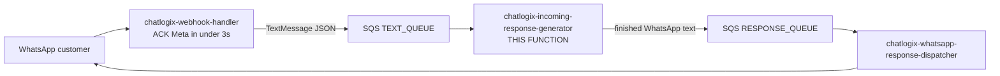
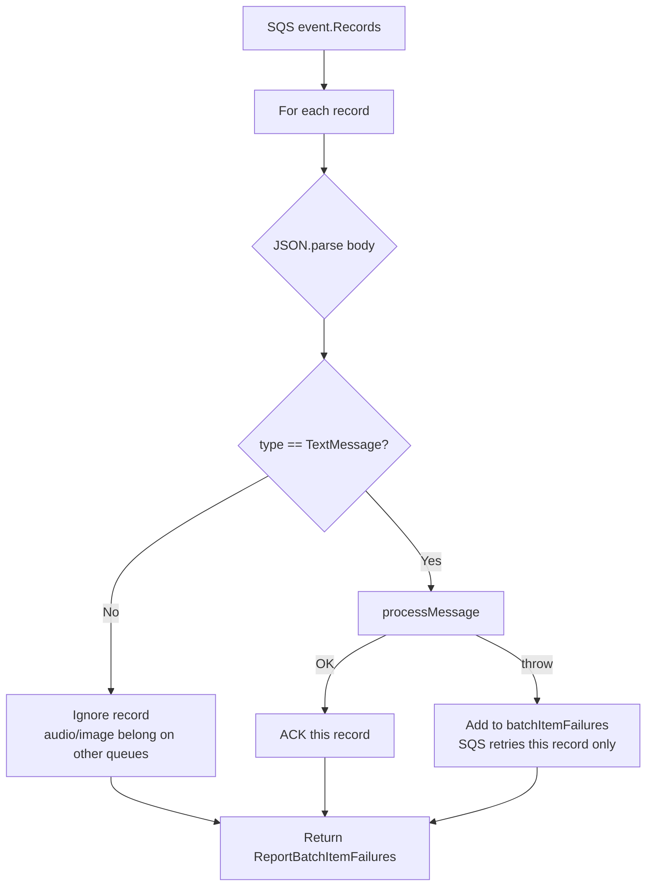
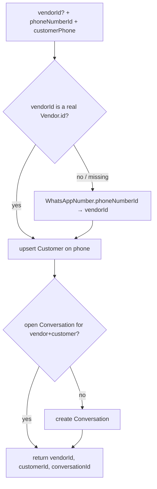
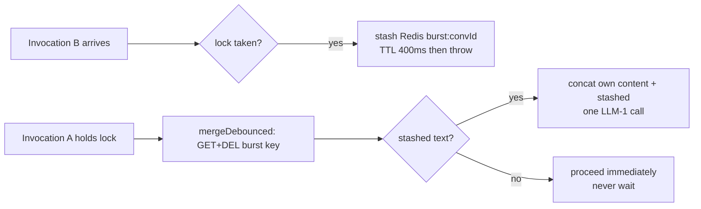
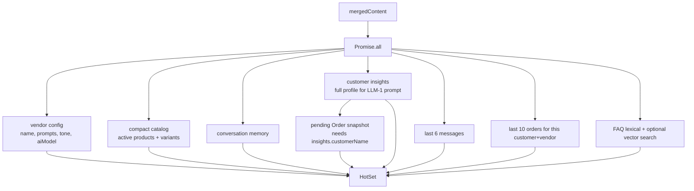
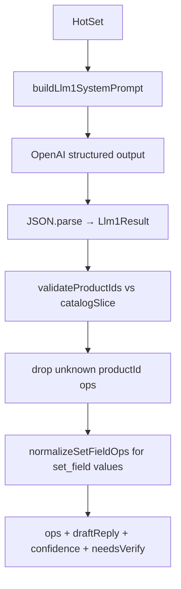
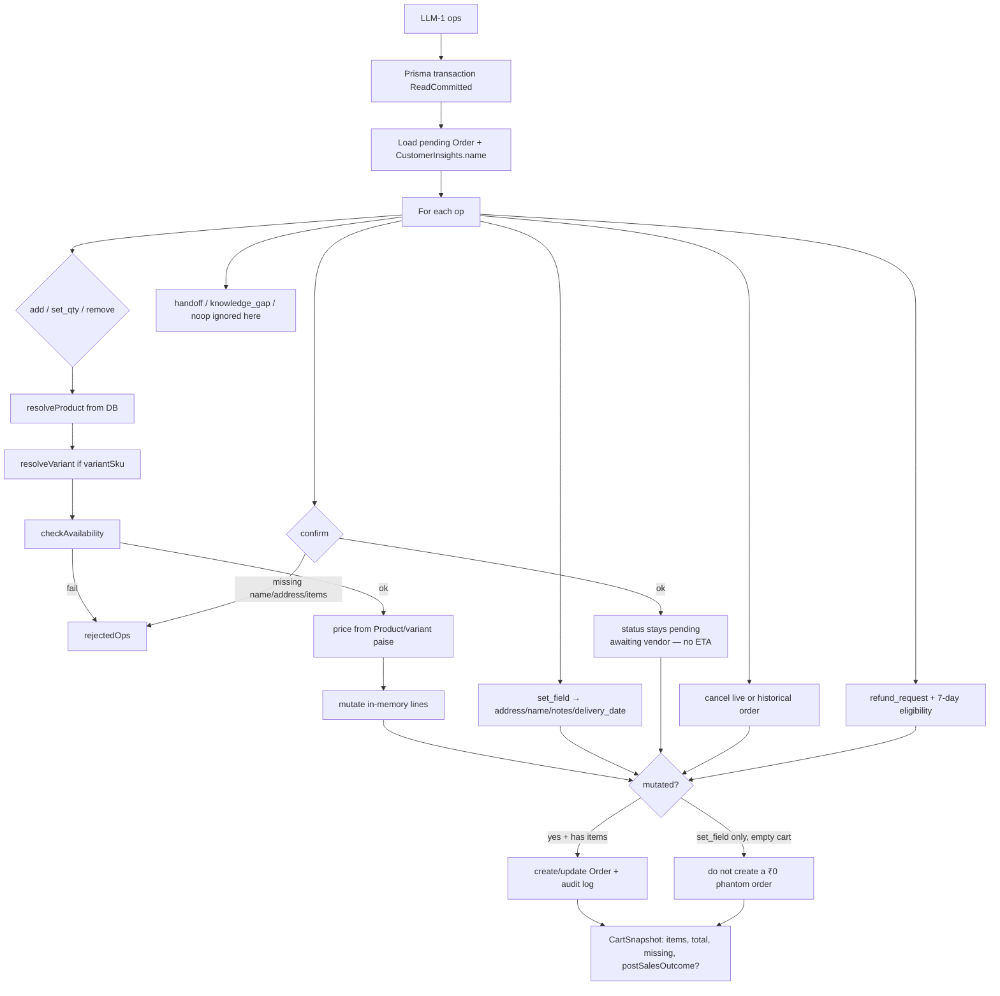
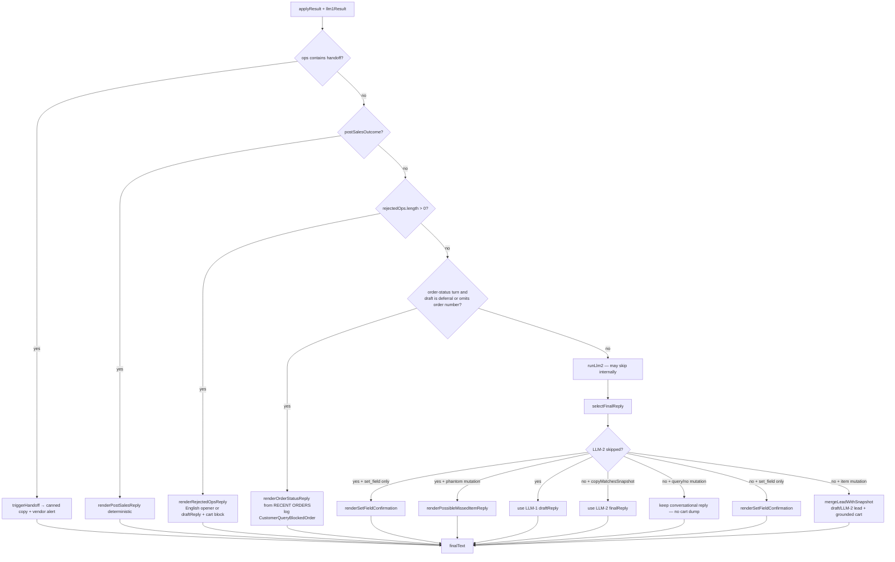
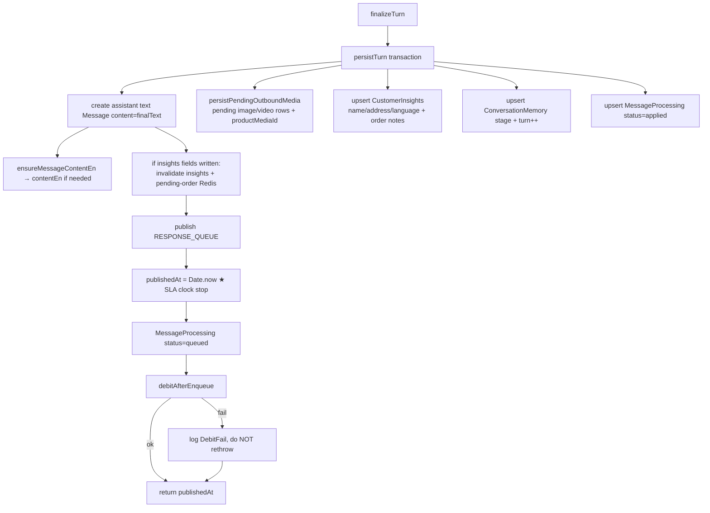

# Incoming Response Generator — How We Prepare a WhatsApp Reply

<!-- DOC_SYNC
  last_verified_commit: 0151f3a814f9d583e34b4f543c27a31dbbd35dce
  last_verified_at: 2026-09-21
  scope: As-implemented incoming-response-generator pipeline; customer insights read/enrich; gpt-5/o* temperature omit + empty-content retry; orderNumber allocation
-->

**Living document.** This describes the **as-implemented** text path in `chatlogix-incoming-response-generator`, not the locked design spec. When the pipeline in `backend/src/conversation/` changes, update this file in the same change (see `.cursor/rules/incoming-response-generator-flow.mdc`).

| | |
|---|---|
| **AWS function** | `chatlogix-incoming-response-generator` |
| **Handler** | `backend/src/lambdas/handlers/conversationProcessor.ts` → `backend/src/conversation/handler.ts` |
| **Pipeline** | `backend/src/conversation/pipeline.ts` (`processMessage`) |
| **Consumes** | `TEXT_QUEUE_URL` (`type: TextMessage` only) |
| **Publishes** | `RESPONSE_QUEUE_URL` (finished customer text) |
| **Design spec** | `docs/CONVERSATION_PROCESSOR_LAMBDA.md` (locked design; this file follows the **code**) |
| **Catalog slicing** | `docs/CONVERSATION_CATALOG_CONTEXT_SLICING.md` — implemented; `CATALOG_SLICING_ENABLED=false` until rollout |
| **Doc sync index** | `docs/DOC_SYNC_INDEX.md` |

**SLA clock:** Lambda start → successful `publishToQueue(RESPONSE_QUEUE_URL)`. Targets: p90 ≤ 5s, p95 ≤ 10s, p99 ≤ 15s. Meta delivery time is out of scope.

---

## Source files

| Step | File |
|---|---|
| SQS batch handler | `backend/src/conversation/handler.ts` |
| End-to-end orchestration | `backend/src/conversation/pipeline.ts` |
| Vendor / customer / conversation | `backend/src/conversation/identity.ts` |
| Redis conversation lock | `backend/src/conversation/lock.ts` |
| Inbound idempotency | `backend/src/conversation/idempotency.ts` |
| Burst merge | `backend/src/conversation/burstMerge.ts` |
| Hot-set prefetch | `backend/src/conversation/prefetch.ts` |
| Catalog context plan + slice | `backend/src/conversation/context/resolveCatalogContext.ts`, `turnContext.ts`, `catalogSlice.ts`, `catalogContextConfig.ts` |
| Product retrieval (slice) | `backend/src/conversation/cart/candidateSearch.ts` |
| LLM-1 prompt + schema | `backend/src/conversation/llm/prompts.ts` |
| LLM-1 call | `backend/src/conversation/llm/llm1.ts` |
| Cart apply | `backend/src/conversation/cart/engine.ts` |
| Availability | `backend/src/conversation/cart/availability.ts` |
| Refund eligibility | `backend/src/conversation/cart/refund.ts` |
| LLM-2 + final-text selection | `backend/src/conversation/llm/llm2.ts` |
| Language helpers (English vs regional) | `backend/src/conversation/language.ts` |
| D6 order-status rewrite | `backend/src/conversation/orderStatusGuard.ts` |
| Knowledge-gap persist | `backend/src/conversation/customerQuery.ts` |
| Handoff | `backend/src/conversation/handoff.ts` |
| Post-sales vendor alert | `backend/src/conversation/postSalesAlert.ts` |
| Persist turn | `backend/src/conversation/persist.ts` |
| Product media resolve (PM6) | `backend/src/conversation/productMediaAttachments.ts` |
| Debit after enqueue | `backend/src/conversation/billing.ts` |
| Charge arithmetic + the single wallet debit | `backend/src/services/pricing/pricingService.ts` |
| Guard templates | `backend/src/conversation/templates.ts` |
| Shared types | `backend/src/conversation/types.ts` |
| Vendor English display | `backend/src/utils/vendorEnglish.ts` |
| Webhook enqueue | `backend/src/lambdas/handlers/webhookHandler.ts` |

---

## 0. Place in the fleet

This Lambda never talks to WhatsApp. The webhook ACKs Meta in &lt; 3s; the dispatcher sends the finished text.



Webhook (`webhookHandler.ts`) for `type: text` only:

1. Resolve `phoneNumberId` → `vendorId` via `WhatsAppNumber`.
2. Publish `{ type: 'TextMessage', vendorId, customerPhone, content, phoneNumberId, whatsappMessageId }`.
3. Return HTTP 200 to Meta.

Audio/image are dropped at the webhook today (known gap). They must not land on this queue.

---

## 1. SQS handler

`handler.ts` implements `ReportBatchItemFailures`. All step 0–11 logic lives in `processMessage`; the handler only parses and delegates.

When the body is `type: TextMessage` and `sourceMessageType` is `audio` or `image` (media-fetch handoff of a voice transcript or caption), that field is forwarded to `processMessage` → LLM-1. Typed WhatsApp text omits it.



---

## 2. Full `processMessage` pipeline

Actual code order (identity **before** lock — the spec’s “step 0 lock first” is not what shipped):

```mermaid
flowchart TD
  START([SQS TextMessage]) --> ID[1. resolveIdentity<br/>vendor + customer + open conversation]
  ID --> LOCK{2. acquire Redis lock<br/>lock:conv:conversationId TTL 300s}

  LOCK -->|LockContention| STASH[stashForBurstMerge<br/>Redis list TTL 300s]
  STASH -->|stash ok| ACK[ACK SQS — lock-holder will coalesce]
  STASH -->|Redis down| RETRY[throw → SQS retry]
  LOCK -->|LockUnavailable Redis down| RETRY
  LOCK -->|OK| INB[3. upsertInboundMessage<br/>unique whatsappMessageId]
  INB --> EN[3b. ensureMessageContentEn<br/>fire-and-forget → Message.contentEn]

  EN -->|already exists| DUP[Success exit<br/>already processed, no second reply]
  EN -->|new row| PAUSED{4. conversation.aiPaused?}

  PAUSED -->|yes| STORE[Inbound stored, no LLM, no debit, no reply<br/>vendor answers in dashboard]
  PAUSED -->|no| CREDIT{5. canProcessMessage wallet?}

  CREDIT -->|blocked| EMPTY[Publish WALLET_EMPTY_TEMPLATE<br/>no LLM, no debit]
  CREDIT -->|allowed| BURST[6. collectCoalescedInbound<br/>merge unprocessed customer inbounds since last assistant reply]

  BURST --> TYPING[7. sendTypingIndicator fire-and-forget]
  TYPING --> PRE[8. prefetchHotSet in parallel]
  PRE --> CTX[8b. resolveCatalogContextForLlm1<br/>planTurnContext + optional retrieval + slice]
  CTX --> LLM1[9. LLM-1: ops + draftReply<br/>prompt uses catalogSlice]
  LLM1 --> NORM[9b. normalizeSetFieldOps<br/>name/address/notes → English/Latin]
  NORM --> CART[10. CartEngine.apply in one Postgres txn]
  CART --> BRANCH{11. Which reply path?}

  BRANCH -->|ops contains handoff| HO[triggerHandoff<br/>pause AI + canned customer copy]
  BRANCH -->|postSalesOutcome set| PS[renderPostSalesReply<br/>deterministic money copy]
  BRANCH -->|rejectedOps.length > 0| REJ[renderRejectedOpsReply<br/>skip LLM-2]
  BRANCH -->|order-status + deferral or no order number| D6[renderOrderStatusReply<br/>skip LLM-2, no CustomerQuery]
  BRANCH -->|normal turn| LLM2[LLM-2 maybe, then selectFinalReply]

  HO --> FIN[12. finalizeTurn]
  PS --> FIN
  REJ --> FIN
  D6 --> FIN
  LLM2 --> MEDIA[11b. resolve send_product_media<br/>PM6 caps + pending image/video Messages]
  MEDIA --> FIN

  FIN --> PERSIST[persistTurn: assistant text Message,<br/>insights, memory, MessageProcessing]
  PERSIST --> PMEDIA[persistPendingOutboundMedia if any]
  PMEDIA --> PUB[publish RESPONSE_QUEUE text + attachments[] ★ SLA stop]
  PUB --> DEBIT["debitAfterEnqueue → pricingService.chargeVendor<br/>ceil((LLM-1 + LLM-2 + upstream transcription + fee) × markup)<br/>fail here does NOT retry the LLM"]
  DEBIT --> KG[12b. persistKnowledgeGapIfNeeded<br/>after publish; no aiPaused]
  KG --> ENRICH[12c. enrichCustomerInsightsIfNeeded<br/>extractKeyFacts → CustomerInsights; absorbed cost]
  ENRICH --> NOTIFY[13. if confirm succeeded:<br/>notifyVendorNewOrder fire-and-forget]
  NOTIFY --> UNLOCK[finally: releaseLock]
  DUP --> UNLOCK
  STORE --> UNLOCK
  EMPTY --> UNLOCK
```

Lock is always released in `finally`. TTL (300s, matches processor Lambda timeout) is only a backstop.

---

## 3. Identity

`resolveIdentity()`:



If webhook copied Meta’s `phone_number_id` into `vendorId`, and that is not a UUID vendor row, lookup falls through to `WhatsAppNumber` instead of failing the record.

---

## 4. Guards (before any paid LLM call)

| Guard | Action |
|---|---|
| Duplicate `whatsappMessageId` | ACK. No second reply, no second debit. |
| `conversation.aiPaused` | Store inbound. Silent. Vendor replies in the dashboard. |
| Wallet insufficient (`canProcessMessage`: balance must cover a worst-case turn estimate, LLM-1 + LLM-2 at the vendor's markup, plus worst-case product media) — or `trial_expired` for an unapproved vendor past `trialExpiresAt` | Send `WALLET_EMPTY_TEMPLATE`. No LLM, no debit. |
| Redis lock held | `stashForBurstMerge`, then throw → SQS retry. |
| Redis down | Fail closed. Throw. SQS retry. Never mutate the cart unlocked. |

The wallet is **checked** here and **charged only after** the reply is queued (`billing.ts`). Because the gate uses an estimate and the charge uses actual token usage, a balance can end up slightly negative when a turn overruns the estimate; the next turn's gate is what stops it.

---

## 5. Burst merge

Customers often send two bubbles a second apart. Merge into one LLM turn without waiting.



If a second message arrives *during* LLM-1, the lock forces an SQS retry; the next run sees the updated cart plus the new text.

`mergeSameBatch` exists for when SQS batch size &gt; 1; launch batch size is 1, so the active mechanism is the 400ms Redis stash.

---

## 6. Prefetch (hot set) and catalog context

`prefetchHotSet` always loads the **full** compact catalog into `hotSet.compactCatalog` (CartEngine and DB pricing still use the full vendor catalog). Before LLM-1, `resolveCatalogContextForLlm1` runs:

1. **`planTurnContext`** — deterministic mode (order_status → checkout_fields → general → browse → product) and optional retrieval query.
2. **`searchCandidateProductsMany`** when `retrievalTopK > 0` (gated AI matcher for non-English).
3. **`buildPromptCatalogSlice`** — union pins, cart lines, retrieval hits; stable sort.

It returns `catalogSlice` (validation + phantom checks) and `promptCatalogSlice` (may stay full catalog when **`CATALOG_SLICING_SHADOW_LOG`** is on and **`CATALOG_SLICING_ENABLED`** is off). Pipeline logs **`context_plan_done`** and EMF counts (`CatalogSliceSize`, `TurnContextMode`, …).

**Rollout:** constants in `catalogContextConfig.ts` only — no new env vars. Shipped with **`CATALOG_SLICING_ENABLED = false`**; enable per [CONVERSATION_CATALOG_CONTEXT_SLICING.md](./CONVERSATION_CATALOG_CONTEXT_SLICING.md) §17.

Redis first, Postgres on miss. Redis outage here degrades to cache-miss (unlike the lock).

Compact catalog is loaded by `loadCompactCatalog` (its own cache, not the generic `cacheAside` helper). Cached compact prices that look like a 100× double conversion — every priced item ≥ ₹5,000 and a round hundred rupees (`paise >= 500_000` and `paise % 10_000 === 0`) — are ignored. Matching Postgres `Product.basePrice` rows are divided by 100 and persisted before the cache is rewritten. Prompt-only repair is not enough: CartEngine re-resolves prices from Postgres.



FAQ path:

1. Cached count of active FAQs. Zero → skip.
2. Lexical token overlap against the vendor's FAQ questions (always; works even if embeddings are missing).
3. Embed the customer text (`faq/embedding.ts`) and Postgres cosine search when pgvector is available.
4. Merge vector + lexical, top-K (default 3). Vector hits still need similarity ≥ threshold (default 0.75); lexical needs ≥ 0.34 token overlap.

`POST /api/faqs/reindex` backfills null embeddings. Create/update swallows embedding failures so the FAQ row still saves — the list API sets `embeddingPending` when `embedding IS NULL`.

Pending cart is **prompt context only**. `CartEngine.apply` always re-reads Postgres. The 60s pending-order cache must never be trusted for a write.

After persist writes name/address (or order-level specialRequests/deliveryInstructions), `invalidateCustomerContext` drops the insights + pending-order caches so the next turn does not re-ask.

LLM-1's dynamic prompt includes a **CUSTOMER INSIGHTS** block (`CustomerInsightsService.formatInsightsForAI`, long text fields capped at 400 chars) when the profile is not empty — in addition to the short CUSTOMER name/address lines.

Post-publish, `enrichCustomerInsightsIfNeeded` may call `extractKeyFacts` (same helper as legacy memory extraction) and merge into `CustomerInsights` via `updateInsights`. Skipped for sandbox, handoff, and order-status-only turns; idempotent on `whatsappMessageId` (Redis). **Not billed separately** — absorbed platform cost, same as knowledge-gap persist timing (after WhatsApp queue publish).

---

## 7. LLM-1 — ops + draft, never the cart

One OpenAI call with strict structured output (`llm1JsonSchema`). Model = `Vendor.aiModel` (fallback **`gpt-5.6-luna`** via `DEFAULT_CONVERSATION_MODEL` in `catalogContextConfig.ts` — [BILLING_AND_PRICING.md](./BILLING_AND_PRICING.md) §2). Temperature **0.3** when supported; **`gpt-5.*` / `o*` models omit `temperature`** (`openaiSampling.ts`). `max_completion_tokens` is 400 on classic models and 2500 on gpt-5.* / o*. If OpenAI still returns 400 `unsupported_value` on `temperature`, LLM-1 retries once without it. If `message.content` is empty (`finish_reason=length` is the usual gpt-5 reasoning case), it retries once at 4000 completion tokens instead of failing the SQS record immediately.

System prompt (`buildLlm1SystemPrompt`):

- **Vendor rules** (prompt-cache prefix): bot identity, vendor rules, op bullets — **no catalog table**.
- **Catalog block** (per turn): compact catalog table from **`catalogSlice`** / `promptCatalogSlice` only (`id,name,price,unit,baseQty,…`; descriptions capped at **280** chars in the table).
- **Dynamic**: current cart, customer name/address, recent orders, matched FAQs, last 6 turns. When `sourceMessageType` is `audio`, a **VOICE NOTE** block is appended: treat the user text as ASR, ask a clarifying question if it is garbled or off-catalog, and prefer CURRENT CART / RECENT ORDERS when the transcript is close (cake, brownie, kg).

User message: merged customer text.

Required JSON (`Llm1Result`):

```ts
{
  language: string,        // free-form ISO 639-1 (en, hi, ta, ml, kn, te, bn, gu, …) or "mixed"
  intent: string,          // telemetry only — never used to write the cart
  ops: CartOp[],
  draftReply: string,      // ~120 words, same language/script as the customer
  confidence: number,      // 0–1
  needsVerify: boolean
}
```

The JSON schema in `prompts.ts` uses `language: { type: 'string' }` — not a fixed enum. `conversation/language.ts` provides `isEnglishLanguage()` (pipeline branches on English vs non-English only) and `detectLanguageFromText()` (Unicode script detection: hi, ta, te, ml, kn, bn, gu, pa, or, si → en fallback). LLM-1 sets `language` from the customer message; insights/memory language is prompt context only.

Ops:

| Op | Meaning |
|---|---|
| `add` | Sum qty onto that `productId` (+ `variantSku`) |
| `set_qty` | Absolute qty; `0` removes |
| `remove` | Drop the line |
| `set_field` | `name` / `address` / `notes` / `delivery_date` (advisory only; never a promised ETA). **Values must be English/Latin script** — LLM-1 is prompted accordingly, and `normalizeSetFieldOps` transliterates before CartEngine so `CustomerInsights` / `Order` stay English-only for the vendor portal. |
| `confirm` | Customer confirmed — engine still requires name + address + items |
| `cancel` | Live cart, or a past order via `orderNumber` |
| `refund_request` | Engine decides eligibility |
| `handoff` | Escalate to vendor |
| `knowledge_gap` | Ungrounded product/policy fact — persist `CustomerQuery`, do **not** pause AI |
| `send_product_media` | Customer asked for photo/video — CartEngine no-op; pipeline resolves `ProductMedia` and enqueues native WA attachments (not on D6 order-status turns) |
| `noop` | Question / greeting / unclear product match |

After parse, ops whose `productId` is not in this turn’s **`catalogSlice`** are **dropped** (`validateProductIds`; metric **`ValidateProductIdDropped`**) — including `send_product_media`. CartEngine still re-resolves every product from Postgres.

`knowledge_gap` is the one exception: its `productId` is advisory (it only links the `CustomerQuery` row to a catalog item), so an unknown id nulls the field instead of dropping the op — dropping it would lose the gap itself. Because the compact catalog is vendor-scoped, this is also what keeps a *real but other-vendor* product id out of `CustomerQuery.productId`; the `Product` FK on that column would happily accept one.

`validateProductIds` also drops an `add`/`set_qty` op for a product that has variants when `variantSku` is missing or names a variant not on that product — *unless* the compact catalog entry’s `isDivisible` is `true`, in which case a missing `variantSku` is a legitimate “add by base unit” op (e.g. a product sold both loose by weight and as fixed variants), not a hallucination. An explicitly wrong/invented `variantSku` is still always dropped regardless of `isDivisible`. (Fixed 2026-09-04: before this, `isDivisible` wasn’t in the compact catalog at all, so the prompt could never tell the model a divisible product’s base id was directly orderable, and this guard silently dropped every base-unit `add` for any variant-bearing product — see `prompts.ts`’s `baseOrderable` catalog column and its variant-table rules.)



The model must not emit a full cart JSON list. It proposes **deltas**. Postgres is the only source of truth (I1).

---

## 8. CartEngine

`apply()` runs one Prisma transaction (`ReadCommitted`). Prices come from `Product` (and variants), never from the model.

**New-order numbers:** `Order.orderNumber` is globally unique (`ORD-{prefix}-YYYYMM####`). Allocation looks up the latest number with that prefix+month **across all vendors** (not this vendor’s monthly row count) and takes max+1. Two vendors sharing the default `ORDER` prefix, or two first-item carts racing, used to throw Prisma `P2002` Unique constraint failed on `orderNumber` and fail the whole `processMessage` turn. A `P2002` on `orderNumber` now retries the whole `apply()` transaction (up to 5 times) — Postgres aborts the transaction on unique violation, so the retry cannot happen inside it.



**Availability:** `stock` products reject when `inStock=false` or qty &gt; stock. `made_to_order` is never blocked on stock. Both enforce min/max order quantity.

**Confirm:** requires name + address + ≥1 item. Status stays `pending`. AI never sets `estimatedDelivery`.

**Cancel / refund:** `orderNumber` is scoped to `customerId` + `vendorId`. Refund auto-approves only if status is `pending`/`confirmed` **and** placed within 7 days. Otherwise `postSalesOutcome: refund_denied`. CartEngine never sends messages; it only reports state.

`handoff` / `knowledge_gap` / `noop` are no-ops inside the engine. Handoff and knowledge-gap persist are handled in `pipeline.ts` after apply.

---

## 9. Choosing the customer-facing text

Five mutually exclusive paths after `CartEngine.apply`. Money, handoff, rejection copy, and D6 order-status rewrites never go through a free-text rewriter.



### When LLM-2 runs (`shouldRunLlm2`)

Runs when **any** of: mutating ops present (and not **set_field-only**), `needsVerify === true`, or `confidence < VERIFY_THRESHOLD` (default 0.75).

Mutating op types: `add`, `set_qty`, `remove`, `set_field`, `confirm`, `cancel`. **`set_field`-only turns skip LLM-2** — `shouldRunLlm2` returns false when every mutating op is `set_field`.

LLM-2 (when it runs): same vendor model, temperature 0.2 (omitted on gpt-5.* / o*), 300 tokens classic / 1200 on reasoning models. Same temperature-400 and empty-content retries as LLM-1 (empty retry budget 2000). Rewrites wording only; drops claims about items absent from CART SNAPSHOT. Cart is frozen after `apply`. Prompt includes the LLM-1 `language` string and tells the model to answer the customer's question first, listing cart lines only when items changed or they asked to review the order.

### `selectFinalReply` branches (after LLM-2)

| Condition | Reply |
|---|---|
| LLM-2 skipped + `set_field` only | `renderSetFieldConfirmation` — English deterministic strings, or LLM-1 `draftReply` for non-English |
| LLM-2 skipped + phantom mutation (`intent` add/remove/set_qty, `ops` empty, draft names catalog item not in snapshot) | `renderPossibleMissedItemReply` — English prompt + true cart |
| LLM-2 skipped (otherwise) | LLM-1 `draftReply` as-is |
| LLM-2 ran + `copyMatchesSnapshot` | LLM-2 `finalReply` |
| LLM-2 ran + disagree + `query`/noop (no mutating ops) | Conversational LLM-2 or draft text — **no cart dump** |
| LLM-2 ran + disagree + `set_field` only | `renderSetFieldConfirmation` |
| LLM-2 ran + disagree + item mutation or `cartMutated` | `mergeLeadWithSnapshot` — conversational lead from draft or LLM-2, plus grounded cart block |

### `copyMatchesSnapshot` (English vs non-English)

- **English** (`isEnglishLanguage`): every catalog product name must appear in the reply text.
- **Non-English**: relaxed — snapshot total amount **and** all line quantities must appear (catalog names stay English in the product table, so name matching alone would false-reject valid regional replies).

### Deterministic renderers (no per-language string tables)

`renderSnapshotReply`, rejection openers, and phantom-mutation prompts use **English-only** deterministic strings. Non-English conversational prose always comes from LLM-1/LLM-2 `draftReply`. Pipeline logic uses `isEnglishLanguage()` only — not separate Tamil/Hindi/etc. template tables.

`renderSnapshotReply` always uses catalog English product names + `Total: Rs…`. For non-English customers, `mergeLeadWithSnapshot` appends the cart block without an English header; English customers get `Here's your updated order:` before the lines.

### D6 order-status path (`orderStatusGuard.ts`)

After apply, **before** LLM-2, if the turn is order-status (keywords such as status / where is it / last order / already ordered / eappo kidaikum / tracking, or cancel/refund ops) **and** `draftReply` looks like a deferral (“I’ll check / get back / still checking / Kanmani will confirm”) **or** does not cite an order number from `hotSet.orderHistory`:

1. Strip any `knowledge_gap` op (no-op until that CartOp exists).
2. Replace `finalText` with `renderOrderStatusReply` (order number + `ORDER_STATUS_LABELS` + English item names, or “no order on file”).
3. Skip LLM-2. Never create a Customer Query. Metric: `CustomerQueryBlockedOrder`.

Handoff still wins. Hypothetical prep (“how long if I order today”) with empty history is **not** D6.

### Knowledge-gap persist (`customerQuery.ts`)

After finalize (customer reply already queued), if there is **no** handoff and the turn is **not** D6 order-status:

- LLM-1 emitted `knowledge_gap`, **or** `draftReply` matches deferral phrasing (fallback).
- `toVendorEnglish` on the model question / customer text → `questionEn`. Dedup open rows for this vendor at cosine ≥ 0.85 (`hitCount++`); else insert.
- Never sets `Conversation.aiPaused`. Sandbox skips DB writes. After a new insert (not a hitCount bump), fire-and-forget WhatsApp ping to the vendor (Redis throttle: 1 / 15 min / vendor). Does **not** write `OrderAlert`.

Handoff + `knowledge_gap` on the same turn: handoff wins, no query.

### Rejected ops path (`renderRejectedOpsReply`)

When CartEngine rejects part or all of what was asked, the pipeline **never** runs LLM-2. Non-English customers with a usable `draftReply` get that lead plus a grounded cart block; English customers get a deterministic rejection opener plus cart lines.

**Phantom-mutation backstop** (defense-in-depth when LLM-1 claims an add in `draftReply` but emits zero ops): `buildLlm1SystemPrompt` requires ops to back every cart claim and sets `needsVerify: true` when uncertain. `selectFinalReply` also runs `isPhantomMutation` on the LLM-2-skipped path when `intent` is `add`/`remove`/`set_qty` and `ops` is empty.

---

## 10. Finalize — persist, queue, then debit

Order rows are already written by CartEngine. `finalizeTurn` is the back half.



Response payload includes `phoneNumberId` and `messageId` (assistant text row) so the dispatcher uses the right WABA number and can mark delivery. Optional `attachments[]` (`messageId`, `productMediaId`, `kind`, `caption?`) — one pre-created `Message` per attachment; `chatlogix-whatsapp-response-dispatcher` presigns S3 and sends native image/video (see `docs/PRODUCT_MEDIA.md`). **`contentEn` is never sent to the customer** — only `finalText` (original language) goes on `RESPONSE_QUEUE` for the text bubble.

### Vendor portal English (`Message.contentEn`)

- **Inbound customer text:** after `upsertInboundMessage`, `ensureMessageContentEn` writes `contentEn` asynchronously (including when `aiPaused` — inbound is stored but no LLM runs). Original stays in `content`; LLM-1 and the response queue always use the original.
- **Assistant replies:** `persistTurn` sets `content` to `finalText` (customer language), then `ensureMessageContentEn` for the vendor thread.
- **Media:** `mediaFetchProcessor` transcribes voice notes with `gpt-4o-transcribe` (retry with a domain prompt if the transcript is implausibly short for the audio size; otherwise a typed-reply template and no AI enqueue). It sets `contentEn` from the transcript with the audio translation prompt (do not invent addresses/medical facts from garbled ASR) and from image/video/document captions (captions often never hit `TEXT_QUEUE`).
- **Vendor typed send:** `POST /api/conversations/:id/messages` triggers the same helper after creating the row.

Debit failure must not throw: the customer already has a reply on the way; SQS retry would re-run LLM-1/CartEngine. `reconcileStuckDebits` retries `MessageProcessing` rows that are `queued` with `debitedAt = null` — those retries charge the worst-case turn estimate, since the original token usage is no longer available. Outbound product media uses separate idempotent `debitOutboundMessage(messageId)` in the response dispatcher after each successful image/video send (`CreditUsage.externalId` = `outbound-msg:{messageId}`).

### What a turn costs

Every wallet debit in the codebase — this pipeline, the outbound dispatcher, catalog import/enhance, the onboarding sandbox — goes through `pricingService.chargeVendor`, which is the only writer of `Vendor.walletBalanceMilli`:

```
chargeMilli = ceil((aiCostMilli + whatsappCostMilli + platformFeeMilli) × (1 + Vendor.markupPercent / 100))
```

All amounts are **millirupees** (1 rupee = 1000). One `Math.ceil`, applied after markup, so a sub-millirupee turn still costs 1 milli instead of nothing. Components for a conversation turn:

| Component | Source |
|---|---|
| `aiCostMilli` | LLM-1 tokens + LLM-2 tokens (LLM-2 was previously never costed anywhere) + `upstreamCostMilli` |
| `upstreamCostMilli` | Whisper transcription of an inbound voice note, computed in `mediaFetchProcessor` and carried on the `TextMessage` SQS payload so the vendor sees one charge, not two |
| `whatsappCostMilli` | Always 0 until the Meta per-message rate card lands (P2h) |
| `platformFeeMilli` | `PlatformSettings.platformFeePerTurnPaise` (×10), default 0 — env `PLATFORM_FEE_PER_TURN_MILLI` is fallback only |
| markup | `Vendor.markupPercent`, default 50 |

The ledger row (`WalletTransaction.metadata`) carries the full breakdown plus the `markupPercent` snapshot the charge was computed with. `CreditUsage.chargedMilli` + its unique `externalId` (= `whatsappMessageId`) is what makes the charge idempotent, and `CreditUsage.source` (`conversation_turn` here, `outbound_media` for attachments) is what the dashboard groups spend by.

Full pricing model, the other charge sources, and the env vars: **[BILLING_AND_PRICING.md](./BILLING_AND_PRICING.md)**.

After finalize, if a `confirm` op was not rejected and the snapshot has an `orderId`, `notifyVendorNewOrder` runs fire-and-forget. Handoff already notified the vendor inside `triggerHandoff`.

---

## 11. What the customer receives, by scenario

| Customer said | LLM-1 ops | Engine | Reply source |
|---|---|---|---|
| “Hi” | `noop` | no mutation | LLM-1 draft (LLM-2 skipped) |
| “2 brownies” | `add` | new/updated line, priced from Product | LLM-2 polish, or engine list if copy disagrees |
| “Make it 5” | `set_qty` | overwrite qty | same |
| Name + address | `set_field` | insights later in persist | `renderSetFieldConfirmation` or draft (LLM-2 skipped) |
| “Yes, place it” but missing address | `confirm` **rejected** | cart unchanged | `renderRejectedOpsReply` — explains rejection + true cart |
| “Yes, place it” complete | `confirm` accepted | still `pending` | confirmation copy, **no delivery date** |
| “Where is my order?” / “Eappo kidaikum?” with a pending order | `noop` | none | `renderOrderStatusReply` if draft deferred or omitted the order number; otherwise LLM-1 draft |
| “Cancel ORD-…” | `cancel` | cancel if pending/confirmed | canned `Order … has been cancelled` |
| “Refund please” ineligible | `refund_request` | `refund_denied` | canned denial + vendor alert, AI stays on |
| “Does it include dividers?” (not in FAQ/desc) | `knowledge_gap` | ignored in engine | customer deferral + `CustomerQuery` row (AI stays on) |
| Complaint / return | `handoff` | ignored in engine | canned handoff + `aiPaused` + vendor alert |
| Wallet empty | — | — | `WALLET_EMPTY_TEMPLATE` |
| Vendor paused AI | — | — | **no reply** |

---

## 12. Latency budget

| Step | Budget |
|---|---|
| Identity, lock, guards, prefetch | ≤ 200ms |
| Burst merge | 0ms wait (400ms stash window only) |
| LLM-1 | ≤ 3.5s |
| Cart apply + persist | ≤ 150ms |
| LLM-2 when it runs | ≤ 1.2s |
| Enqueue | ≤ 100ms |
| Typical (LLM-2 skipped) | ~4s |

Skipping LLM-2 on greetings / thanks / high-confidence `noop` is required for p90 ≤ 5s.

---

## 13. Invariants

| # | Rule |
|---|---|
| I1 | Postgres cart is the only source of truth. Model proposes ops; code applies; WhatsApp text is built from the snapshot (or a canned template). |
| I2 | Idempotency key = `whatsappMessageId`. Redelivery must not create a second customer message, debit, or send. |
| I3 | One in-flight processor per conversation. Redis lock. Fail closed if Redis is down. |
| I4 | Fail closed on money and cart. No lock / no product match → no silent rewrite. |
| I5 | Customer send is not blocked on vendor notify or metrics. Those are fire-and-forget after enqueue. |
| I6 | Webhook returns to Meta in &lt; 3s. Never run the LLM on API Gateway. |
| I7 | Never drop a message silently. Retry, business-ACK (wallet template), or DLQ. |

---

## Catalog context slicing rollout (constants only)

Master switch **`CATALOG_SLICING_ENABLED`** is **`false`** in production until you deliberately roll out ([CONVERSATION_CATALOG_CONTEXT_SLICING.md](./CONVERSATION_CATALOG_CONTEXT_SLICING.md) §17): shadow log → sandbox vendors (`SANDBOX_VENDOR_IDS`) → fleet enable. **`gpt-5.6-luna`** is already the code default for new/null `Vendor.aiModel` rows; existing vendors were backfilled by migration `20250920120000_vendor_ai_model_luna_default`.

**Persisted tokens:** `tokenMeta.promptTokens` / `completionTokens` on `Message` and `MessageProcessing` sum **LLM-1 + LLM-2** for the turn; `chargeVendor` uses the same totals.

---

## How to keep this doc current

Update this file in the **same change** as any behavioral edit to the files listed under [Source files](#source-files). Refresh:

1. Mermaid diagrams whose nodes/edges no longer match the code.
2. Step order in §2 if `processMessage` is reordered.
3. Tables in §4, §7, §9, §11 if guards, ops, or reply sources change.
4. The `DOC_SYNC` HTML comment at the top (`last_verified_commit`, `last_verified_at`) and the matching row in `docs/DOC_SYNC_INDEX.md`.

Do **not** rewrite `docs/CONVERSATION_PROCESSOR_LAMBDA.md` for implementation drift — that is the locked design. If code diverges from the spec, this flow doc follows the **code** and should note the divergence (as §2 already does for lock-vs-identity order).
