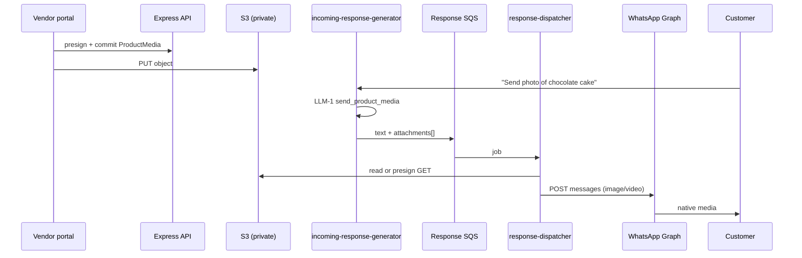

# Product media (catalog images & videos → WhatsApp)

<!-- DOC_SYNC
  last_verified_commit: 7eaa45e002b22fb78c126387e27e039f80d3a01b
  last_verified_at: 2026-09-15
  scope: Planning spec — WA media bucket layout (conversation + catalog prefixes), vendor upload, WhatsApp image/video send (not implemented)
-->

**Status:** Planning — no `ProductMedia` model or outbound media path in production yet.  
**Audience:** Product, vendor portal frontend, conversation pipeline, backend API, DevOps  
**Apps:** `frontend_v2/apps/web-vendor` (vendor portal)  
**Runtime:** Express API on PM2 (`chatlogix-backend`) + conversation Lambda (`chatlogix-incoming-response-generator`) + response dispatcher Lambda (`chatlogix-whatsapp-response-dispatcher`)

---

## Table of contents

1. [Purpose and business goal](#1-purpose-and-business-goal)
2. [Locked product decisions](#2-locked-product-decisions)
3. [What exists today](#3-what-exists-today)
4. [WhatsApp delivery model (S3 is not sent directly)](#4-whatsapp-delivery-model-s3-is-not-sent-directly)
5. [Scope](#5-scope)
6. [End-to-end flows](#6-end-to-end-flows)
7. [Vendor portal experience](#7-vendor-portal-experience)
8. [Data model](#8-data-model)
9. [Storage and S3 layout](#9-storage-and-s3-layout)
10. [API contract](#10-api-contract)
11. [Conversation pipeline changes](#11-conversation-pipeline-changes)
12. [Response queue and dispatcher](#12-response-queue-and-dispatcher)
13. [WhatsApp Graph integration](#13-whatsapp-graph-integration)
14. [Billing and wallet](#14-billing-and-wallet)
15. [Security, auth, and abuse](#15-security-auth-and-abuse)
16. [Performance and reliability](#16-performance-and-reliability)
17. [WhatsApp platform limits and policy](#17-whatsapp-platform-limits-and-policy)
18. [Cost model](#18-cost-model)
19. [Observability](#19-observability)
20. [Test plan](#20-test-plan)
21. [Implementation phases](#21-implementation-phases)
22. [Open questions](#22-open-questions)
23. [Related code and docs](#23-related-code-and-docs)

---

## 1. Purpose and business goal

ChatLogix customers often ask for **product photos or demo videos** on WhatsApp (“show me the cake”, “video irukka?”, “packaging photo”). Today the AI can only reply with **text** (and may file a **Customer Query** if facts are missing). Vendors may paste a single **Image URL** on the product form, but:

- There is no **upload** flow, no **video**, and no **library** of assets per product.
- The conversation pipeline **never sends** native WhatsApp image/video messages.
- Customers should **not** receive a chat line containing a raw HTTPS link; they should see **native media bubbles**.

**Product media** is structured catalog knowledge: vendors upload images and videos in the portal; files are stored in **private S3**; when a customer asks for visual media for a product the AI has matched, the system sends **real WhatsApp image/video messages** sourced from that library.

**Success criteria:**

- Vendors manage product photos/videos without hosting URLs elsewhere.
- Customer requests for media are answered in-session with native WhatsApp media when assets exist.
- When no media exists, the AI defers honestly (and may still open a **Customer Query** for non-visual facts).
- Sends are **tenant-safe**, **rate-bounded**, and **billed** per outbound message type.
- No duplicate media storms from SQS retries without idempotent `Message` rows.

---

## 2. Locked product decisions

Fixed for **v1** unless explicitly revised.

| ID | Decision |
|----|----------|
| PM1 | **S3 is the system of record** for vendor-uploaded product media. Objects are **private**; customers never receive S3 URLs in **text** messages. |
| PM2 | **Native WhatsApp send only** — use Graph API `type: image` / `type: video` via existing `sendWhatsAppImage` / `sendWhatsAppVideo` (`backend/src/services/whatsappClient.ts`). |
| PM3 | **Upload in vendor portal** on product edit (and optionally at create-after-save). Reuse the **presigned PUT** pattern from catalog import (`importStorageService.ts`, `POST /api/catalog-import/upload-url`). |
| PM4 | **New `ProductMedia` table** (many rows per product). Deprecate reliance on `Product.imageUrl` for AI sends; keep `imageUrl` temporarily for list thumbnails / migration. |
| PM5 | **LLM-1 signals intent only** — new op `send_product_media` with `productId` and optional `kind` hint (`image` \| `video` \| null). Pipeline resolves **which files** from DB (`sortOrder`, caps). Model must **not** emit S3 keys or arbitrary URLs. |
| PM6 | **Caps (v1):** max **10** active media rows per product; max **3** images **or** **1** video sent per customer turn (not both video + 3 images in one turn unless product revises). |
| PM7 | **Customer-initiated session only** — media is sent as a **service reply** inside an open customer-care window. No broadcast of product videos to cold leads via this feature (templates are a separate product). |
| PM8 | **MIME and size** validated at upload and again before send per [Meta media limits](#17-whatsapp-platform-limits-and-policy). |
| PM9 | **Billing:** debit **per outbound WhatsApp message** using existing `creditsForKind` (`text`, `image`, `video`) — not a single text debit for a turn that included media. |
| PM10 | **One SQS response payload per turn** with optional `attachments[]`; dispatcher sends text then media sequentially. Each attachment gets its own `Message` row for history and idempotency. |
| PM11 | **Multi-WABA:** `phoneNumberId` from the conversation must be passed on every send. Cached Graph `media_id` (phase 1.1) is keyed by `(productMediaId, phoneNumberId)`. |
| PM12 | **Compact catalog invalidation** on any `ProductMedia` CRUD — same as product description updates (`invalidateCompactCatalog(vendorId)`). |
| PM13 | **English/Latin `label` optional** on each asset (for prompt + optional caption). Customer-facing captions follow **customer language** from LLM `draftReply` snippet, kept short. |
| PM14 | **One S3 bucket for all WhatsApp-related media:** `chatlogix-wa-media` via `WA_MEDIA_S3_BUCKET` / `WA_MEDIA_S3_REGION`. Keys: `vendor/{vendorId}/conversations/…` (inbound) and `vendor/{vendorId}/catalog/…` (product uploads). Do **not** use `CATALOG_IMPORT_S3_BUCKET` for product media. |

---

## 3. What exists today

| Layer | Current state | Gap |
|-------|----------------|-----|
| **Prisma** | `Product.imageUrl` optional `VarChar(255)` | No videos, no multiple assets, no S3 metadata |
| **Vendor UI** | `ProductForm` — single “Image URL” text field | No upload, no gallery |
| **S3 upload pattern** | Catalog import presign + commit | Reuse with new prefix and video MIME types |
| **Inbound WA media** | `MessageMedia` + `mediaFetchProcessor` → `WA_MEDIA_S3_BUCKET`, keys `vendor/{vendorId}/conversations/{customerId}/{YYYY-MM}/{messageId}.{ext}`; vendor streams via `GET /api/messages/:id/media` (auth) | Inbound only; pattern **not** usable for Meta fetch (no Bearer token) |
| **Catalog product media** | Not implemented | Keys `vendor/{vendorId}/catalog/{productId}/{uuid}-{filename}`; `ProductMedia` + presign upload (planned) |
| **WhatsApp client** | `sendWhatsAppImage`, `sendWhatsAppVideo`, … implemented | Unused on outbound hot path |
| **Response queue** | `ResponseQueueMessage` = `text` \| `template` only (`responseProcessor.ts`) | No media branch |
| **Pipeline** | `finalizeTurn` publishes `type: 'text'` only | No attachments |
| **LLM-1** | `CartOp` includes cart, handoff, `knowledge_gap`, … | No `send_product_media`; catalog table has no media hint |
| **Billing** | `debitAfterEnqueue` uses `creditsForKind('text')` only | Must extend for outbound image/video messages |

**Authoritative send path in production:** webhook → text queue → `chatlogix-incoming-response-generator` → `RESPONSE_QUEUE_URL` → `chatlogix-whatsapp-response-dispatcher`. Any media feature must wire through that chain (and update `docs/INCOMING_RESPONSE_GENERATOR_FLOW.md` when `backend/src/conversation/` changes).

---

## 4. WhatsApp delivery model (S3 is not sent directly)

Meta’s Cloud API does not read private S3 credentials. ChatLogix stores bytes in S3; at send time the dispatcher must use one of:

| Mode | Mechanism | Customer experience | When to use |
|------|-----------|---------------------|-------------|
| **A — `link`** | Presigned **HTTPS GET** (or CloudFront signed URL) passed as `image.link` / `video.link` | Native media bubble; Meta fetches URL once per send | **v1** — fastest to ship |
| **B — `id`** | Backend reads S3 → **upload** to Graph `/{phone-number-id}/media` → send with `media_id` | Native media bubble; Meta uses cached media | **v1.1** — repeat sends, less egress |

**Wrong:** `sendWhatsAppText` with an S3 or website URL in the body — customer sees a **link**, not media.

**Right:** Short text (optional) + one or more separate Graph media messages.



---

## 5. Scope

### In scope (v1)

- Image + video upload per product (portal).
- AI-triggered send when customer asks for photos/videos of a **matched** product.
- Outbound media in conversation history (`Message.type` = `image` \| `video`).
- Wallet debits per message kind.
- Security: tenant isolation, private bucket, upload rate limits.

### Out of scope (v1)

- Marketing broadcasts / catalog blasts without customer message.
- Customer sending product media **to** the vendor (already handled by inbound pipeline).
- Automatic video transcoding (reject bad codecs at upload; transcoding backlog).
- AI picking **which** of ten photos by semantic “front vs back” beyond `sortOrder` + optional `label` (v2).
- Admin bulk import of media ZIP.
- Public CDN product pages for end customers.

### Relationship to other features

| Feature | Interaction |
|---------|-------------|
| **Customer Queries** | Visual request with **no** uploaded media → short deferral + optional `knowledge_gap` (“please upload photos in catalog”). Not a substitute for media send. |
| **Catalog enhancer** | Improves `description` text only; does not upload media. |
| **FAQ** | Policy questions stay FAQ; “show me the product” is `send_product_media`. |
| **Order status (D6)** | Order tracking never uses media ops; unchanged. |

---

## 6. End-to-end flows

### 6.1 Vendor uploads media

1. Vendor opens **Catalog → Edit product** (product must exist — same pattern as catalog enhancer D1).
2. **Media** section: add files (drag-drop or file picker).
3. Frontend requests `POST /api/products/:productId/media/upload-url` with `filename`, `contentType`, `sizeBytes`.
4. Backend validates MIME/size, returns presigned PUT URL + `s3Key` + `uploadId` (opaque).
5. Browser PUTs to S3.
6. Frontend calls `POST /api/products/:productId/media/commit` with `uploadId`, `kind`, optional `label`, `sortOrder`.
7. Backend verifies object exists (HeadObject), writes `ProductMedia`, invalidates compact catalog cache.
8. Portal shows thumbnails via **authenticated** preview URL (presigned GET or `GET /api/products/:productId/media/:id/preview` streaming from S3).

### 6.2 Customer asks for media

1. Inbound text (or transcribed audio) enters conversation pipeline as today.
2. Prefetch loads hot set including compact catalog rows with **media summary** (e.g. `media: 2 img, 1 vid`).
3. LLM-1 emits e.g. `{ type: 'send_product_media', productId: '...', kind: 'image' }` plus `draftReply` (“Here are photos of the chocolate cake.”).
4. CartEngine treats op as **no-op** (like `handoff` / `knowledge_gap`).
5. Pipeline resolves attachments:
   - Load active `ProductMedia` for `productId`, filter by `kind` if set.
   - Apply PM6 caps.
   - Build `attachments[]` with `productMediaId`, `kind`, optional `caption` (truncated from draft).
6. `persistTurn` creates assistant **text** `Message` as today; create **pending** `Message` rows per attachment (`type: image` \| `video`, `status: pending`).
7. Publish **one** response queue message: `{ type: 'text', text, attachments, messageId, ... }`.
8. Dispatcher: send text; for each attachment, if `Message` not already `sent`, presign S3 → `sendWhatsAppImage` / `sendWhatsAppVideo` → update `Message` with `whatsappMessageId`, `status: sent`.
9. Debit credits: 1× text + N× image or 1× video per PM9.

### 6.3 No media on product

1. LLM-1 should **not** emit `send_product_media`.
2. `draftReply`: product exists but no photos uploaded yet.
3. Optional `knowledge_gap` if vendor must add assets (category `product`) — vendor uploads in portal; next customer gets media.

---

## 7. Vendor portal experience

### 7.1 Placement

- **Product edit** (`/catalog/:id/edit`) — new **Product media** card below description or in a side column.
- **Product create** — disabled until first save (PM1 / enhancer D1 pattern); then same section.

### 7.2 Controls

| Control | Behavior |
|---------|----------|
| Upload | Multi-select images/videos; show per-file progress |
| Label | Optional short text (“Front”, “Packaging”, “Demo”) |
| Reorder | Drag handle → `PATCH .../media/reorder` |
| Delete | Soft-delete or hard-delete + S3 lifecycle (v1: hard delete object + row) |
| Preview | Thumbnail / video poster; click opens modal player |

### 7.3 Validation (client + server)

| Kind | Allowed MIME (v1) | Max size |
|------|-------------------|----------|
| Image | `image/jpeg`, `image/png`, `image/webp` | 5 MB (WhatsApp image limit) |
| Video | `video/mp4`, `video/3gpp` | 16 MB (WhatsApp video limit) |

Reject executables, `image/svg+xml` (XSS in some clients), and unknown types.

### 7.4 List / card thumbnail

- Prefer first `ProductMedia` image by `sortOrder`.
- Fallback: legacy `Product.imageUrl` until migration complete.
- `ProductCard` / `ProductRow` may show placeholder when none.

---

## 8. Data model

### 8.1 `ProductMedia` (new)

**Implemented** in `backend/prisma/schema.prisma`; apply `backend/prisma/migrations/add_product_media_table.sql` by hand (same convention as `add_customer_query_table.sql`). `s3Key` is `@unique`, which is what makes `POST /commit` idempotent.

```prisma
enum ProductMediaKind {
  image
  video
}

model ProductMedia {
  id                        String           @id @default(uuid())
  vendorId                  String
  productId                 String
  kind                      ProductMediaKind
  s3Bucket                  String
  s3Key                     String           @unique
  mimeType                  String           @db.VarChar(127)
  fileSizeBytes             Int
  width                     Int?
  height                    Int?
  durationSec               Int?
  label                     String?          @db.VarChar(120)
  sortOrder                 Int              @default(0)
  isActive                  Boolean          @default(true)
  // Phase 1.1: Graph media cache (per WABA phone number)
  whatsappMediaId           String?          @db.VarChar(255)
  whatsappMediaIdExpiresAt  DateTime?
  uploadedForPhoneNumberId  String?          @db.VarChar(64)
  createdAt                 DateTime         @default(now())
  updatedAt                 DateTime         @updatedAt

  product                   Product          @relation(fields: [productId], references: [id], onDelete: Cascade)
  vendor                    Vendor           @relation(fields: [vendorId], references: [id], onDelete: Cascade)
  messages                  Message[]

  @@index([productId, isActive, sortOrder])
  @@index([vendorId])
  @@map("ProductMedia")
}
```

`Product.media` and `Vendor.productMedia` back-relations are on the schema. `Product.imageUrl` is untouched (legacy list thumbnails).

### 8.2 Link outbound messages to source asset

**Implemented:** `Message.productMediaId` is a nullable FK with `ON DELETE SET NULL` — which catalog asset was sent (analytics, support). Deleting an asset therefore does not delete conversation history.

No separate `MessageMedia` row required for **outbound** vendor-origin media if `Message` stores enough; inbound customer media continues using `MessageMedia`.

### 8.3 Migration from `imageUrl`

- One-time script or lazy: if `imageUrl` is HTTPS and product has zero `ProductMedia`, optional import job (out of v1) or manual re-upload.
- v1: dual-read — send path prefers `ProductMedia`, falls back to **nothing** (do not fetch arbitrary vendor URLs server-side without SSRF controls).

---

## 9. Storage and S3 layout

All WhatsApp-related binary media (inbound conversation files and outbound/catalog product files) lives in **one private bucket** per environment.

### 9.1 Bucket and configuration

| Item | Value |
|------|--------|
| **Production bucket name** | `chatlogix-wa-media` (typical) |
| **Env vars** | `WA_MEDIA_S3_BUCKET`, `WA_MEDIA_S3_REGION` (often `us-east-1`; see `backend/.env.example`) |
| **SDK client** | `getWaMediaS3Client()` in `backend/src/utils/waMediaS3.ts` — use for conversation media **and** catalog product media (region + `followRegionRedirects`) |
| **Not used for product media** | `CATALOG_IMPORT_S3_BUCKET` — Smart Catalog Import tabular/image **import jobs** only |

Objects **must not** be public-read. Access is presigned PUT/GET or authenticated API streaming.

### 9.2 Folder structure

All objects live under **`vendor/{vendorId}/`**, split by purpose into **`conversations/`** (inbound WhatsApp) and **`catalog/`** (vendor product assets).

```
chatlogix-wa-media/
└── vendor/
    └── {vendorId}/
        ├── conversations/              ← inbound customer media (voice, image, video, …)
        │   └── {customerId}/
        │       └── {YYYY-MM}/
        │           └── {messageId}.{ext}
        │
        └── catalog/                    ← vendor-uploaded product photos & videos
            └── {productId}/
                └── {uuid}-{sanitizedFilename}
```

| Path segment | Owner feature | Written by | DB pointer | Retention (intended) |
|--------------|---------------|------------|------------|----------------------|
| **`vendor/{vendorId}/conversations/`** | WhatsApp conversation parity | `mediaFetchProcessor.ts` (`buildS3Key`) after Meta download | `MessageMedia.s3Bucket` + `s3Key` | **Expire** per `WA_MEDIA_RETENTION_MONTHS` (default 12) — see §9.5 |
| **`vendor/{vendorId}/catalog/`** | Product media for portal + AI WhatsApp send | Vendor presigned PUT + commit (planned) | `ProductMedia.s3Bucket` + `s3Key` | **No auto-expiry** with conversation media |

**Canonical key templates**

| Kind | Template |
|------|----------|
| Conversation | `vendor/{vendorId}/conversations/{customerId}/{YYYY-MM}/{messageId}.{ext}` |
| Catalog | `vendor/{vendorId}/catalog/{productId}/{uuid}-{filename}` |

**Examples**

```text
# Inbound: customer voice note, March 2026
vendor/vendor_ibell_001/conversations/cust_abc123/2026-03/msg-uuid-789.opus

# Catalog: cake photo for a product
vendor/vendor_ibell_001/catalog/prod_chocolate_01/a1b2c3d4-cake-front.jpg
```

**Legacy keys:** Older inbound objects may use `vendor/{vendorId}/{customerId}/{YYYY-MM}/…` (no `conversations/` segment). `MessageMedia` stores the full key — **do not rename** in S3; the media proxy reads whatever key is on the row. **New** inbound uploads use the `conversations/` path only.

### 9.3 Key construction rules

**Conversation (implemented)** — `backend/src/services/mediaFetchProcessor.ts`:

```ts
`vendor/${vendorId}/conversations/${customerId}/${yyyymm}/${messageId}.${ext}`
```

- `yyyymm` = `YYYY-MM` from upload time  
- `ext` from MIME via `extensionForMime()`  
- Original filename (if any) stays on `MessageMedia.filename`, not in the key  

**Catalog (planned)** — product media service:

```ts
`vendor/${vendorId}/catalog/${productId}/${randomUUID()}-${sanitizeFilename(filename)}`
```

- Reuse `sanitizeFilename` from `importStorageService.ts`  
- Store `s3Bucket` = `env.WA_MEDIA_S3_BUCKET` on every `ProductMedia` row

### 9.4 IAM (single bucket, prefix-scoped)

| Principal | Permissions |
|-----------|-------------|
| Media fetcher Lambda / `chatlogix-media-worker` | `s3:PutObject` on `vendor/*/conversations/*` |
| Express API (vendor catalog upload presign) | `s3:PutObject` on `vendor/{vendorId}/catalog/*` |
| Express API (preview / HeadObject on commit) | `s3:GetObject` on `vendor/{vendorId}/catalog/*` |
| Express API (re-tag on commit, delete) | `s3:PutObjectTagging` + `s3:DeleteObject` on `vendor/{vendorId}/catalog/*` |
| Response dispatcher / Lambda (outbound WhatsApp send) | `s3:GetObject` on `vendor/*/catalog/*` |
| Express API (conversation media proxy) | `s3:GetObject` on `vendor/*` (existing `/api/messages/:id/media`) |

Optional: abort incomplete multipart uploads under `vendor/*/catalog/` after N days.

### 9.5 S3 lifecycle (required ops check)

Conversation and catalog keys share the `vendor/{vendorId}/` prefix, so a **single lifecycle rule on `vendor/`** would delete **both**. Before catalog media ships:

1. **Preferred:** tag inbound objects at `PutObject` (e.g. `ChatLogixMediaClass=conversation`) and lifecycle-expire on that tag after `WA_MEDIA_RETENTION_MONTHS`. Catalog uploads use `ChatLogixMediaClass=catalog` or no expiry tag.  
2. **Legacy inbound** without tags: optional one-off prefix rule only for old layout `vendor/{vendorId}/{customerId}/` (no `conversations/` segment) if still present.

Do **not** expire `vendor/*/catalog/*` with conversation retention.

See `documentation/modules/whatsapp-integration/guides/conversation-parity-rollout-runbook.md`.

### 9.6 Portal preview vs WhatsApp send

| Use case | Key path | Access |
|----------|----------|--------|
| Vendor conversation thread (customer media) | `vendor/…/conversations/…` | `GET /api/messages/:id/media` — auth stream from S3 |
| Vendor product edit preview | `vendor/…/catalog/…` | Authenticated stream or short presigned GET (`vendorId` match) |
| Meta outbound `link` send | `vendor/…/catalog/…` | Presigned GET TTL **≥ 5 minutes** |

---


## 10. API contract

**Implemented** in `backend/src/routes/productMedia.ts` → `backend/src/services/productMediaStorage.ts`.

Base path: `/api/products/:productId/media` (the router is mounted on `/api/products` **before** `productsRouter`, so `/:id/media/*` never falls into the generic `/:id` handlers).  
Auth: vendor JWT; `product.vendorId` must equal `req.user.vendorId` (admins excepted per existing routes). A product owned by another vendor answers **404 `PRODUCT_NOT_FOUND`**, never 403, so the API does not confirm that someone else's product id exists.

Errors are `{ "error": "<CODE>", "message": "..." }`; Zod failures are `{ "error": "invalid_input", "details": ... }` with 400.

### `POST /upload-url`

**Body:**

```json
{
  "filename": "cake-front.jpg",
  "contentType": "image/jpeg",
  "sizeBytes": 204800
}
```

**Response 200:**

```json
{
  "uploadId": "uuid",
  "s3Key": "vendor/vendor-1/catalog/prod-1/uuid-cake-front.jpg",
  "presignedUrl": "https://...",
  "expiresAt": "ISO-8601",
  "kind": "image",
  "requiredHeaders": { "Content-Type": "image/jpeg" }
}
```

The PUT is signed with `ContentType`, `ContentLength` and `Tagging=ChatLogixMediaClass=catalog`. The client **must** send the headers listed in `requiredHeaders` (and exactly `sizeBytes` bytes) or S3 returns `SignatureDoesNotMatch`. The tag is re-applied server-side on commit as a safety net for the lifecycle rule in §9.5.

**Errors:** `415 UNSUPPORTED_MEDIA_TYPE`, `413 PAYLOAD_TOO_LARGE`, `409 MEDIA_LIMIT_REACHED`, `404 PRODUCT_NOT_FOUND`, `403 VENDOR_CONTEXT_REQUIRED`, `503` S3 misconfig (same codes as catalog import).

### `POST /commit`

**Body:**

```json
{
  "s3Key": "vendor/vendor-1/catalog/prod-1/uuid-cake-front.jpg",
  "label": "Front view",
  "sortOrder": 0,
  "width": 1200,
  "height": 1200,
  "durationSec": 12
}
```

Only `s3Key` is required; `label`, `sortOrder`, `width`, `height` and `durationSec` are optional. `kind`, `mimeType` and `fileSizeBytes` are **not** accepted from the client — they are read from HeadObject, so a vendor cannot register a 200 MB object by claiming it is 2 KB. `sortOrder` defaults to `max(sortOrder) + 1`.

**Response 201:** `ProductMedia` DTO — `{ id, productId, kind, mimeType, fileSizeBytes, width, height, durationSec, label, sortOrder, isActive, previewUrl, createdAt, updatedAt }`. `s3Bucket` / `s3Key` are deliberately not exposed.

**Server:** key-prefix check → HeadObject → MIME allowlist → size cap → PM6 count cap → row → `invalidateCompactCatalog`. Re-committing the same `s3Key` is idempotent and returns the existing row.

**Errors:** `400 INVALID_S3_KEY`, `404 UPLOAD_NOT_FOUND` (object absent), `415`, `413`, `409 MEDIA_LIMIT_REACHED`, `409 MEDIA_ALREADY_COMMITTED` (key already attached to another product).

### `GET /`

Active media for the product ordered by `sortOrder`, then `createdAt`. `?includeInactive=true` returns everything. Response: `{ "media": [ProductMediaDto, ...] }`.

The same list is embedded (active only) on `GET /api/products/:id` as `media`, so the edit form does not need a second round trip.

### `PATCH /:mediaId`

Update `label`, `sortOrder`, `isActive` (at least one). Reactivating an asset re-checks the PM6 cap. Response: the updated DTO.

### `POST /reorder`

**Body:** `{ "orderedIds": ["id1", "id2", ...] }`

`orderedIds` must be a permutation of **every** media row on the product (active and inactive), otherwise `400 INVALID_ORDER`. Writes a dense `sortOrder` 0..n-1 in one transaction. Response: `{ "media": [...] }` including inactive rows.

### `DELETE /:mediaId`

Hard delete (OQ1): S3 object then row, `204 No Content`. A failing S3 delete is logged and the row is still removed — an orphaned object is cheaper than a row pointing at bytes we can no longer send. `Message.productMediaId` is `ON DELETE SET NULL`, so outbound history survives.

### `GET /:mediaId/preview`

Stream bytes (same pattern as `GET /api/messages/:id/media`) for vendor UI — authenticated, same-origin, `Cross-Origin-Resource-Policy: cross-origin`, `Cache-Control: private, max-age=60`.

---

## 11. Conversation pipeline changes

Files primarily under `backend/src/conversation/`.

### 11.1 Types (`types.ts`)

Add to `CartOp`:

```ts
| {
    type: 'send_product_media';
    productId: string;
    kind?: 'image' | 'video' | null;
  }
```

Add `mediaSummary` to `CompactCatalogEntry` (e.g. `imageCount`, `videoCount`, `labels: string[]` truncated).

### 11.2 Prefetch (`prefetch.ts`)

When building compact catalog, aggregate `ProductMedia` per product (counts + first labels). Cache invalidation on product media CRUD.

### 11.3 Prompts (`llm/prompts.ts`)

- Catalog table column or footnote: `media` summary.
- Rules:
  - Customer asks for photo/pic/image/video/show → `send_product_media` with resolved `productId`.
  - If `media` empty for that product → noop + honest reply; optional `knowledge_gap`.
  - Never `send_product_media` for order status (D6).
  - `needsVerify: false` when only sending media + short ack (product decision).
- Extend `llm1JsonSchema` / `cartOpSchema` with strict `send_product_media` object.

### 11.4 Product ID guard (`llm/llm1.ts`)

Reuse `validateProductIds` pattern for `send_product_media.productId`.

### 11.5 Cart engine (`cart/engine.ts`)

No-op for `send_product_media`.

### 11.6 Pipeline (`pipeline.ts`)

After LLM-1 / LLM-2 finalize text:

1. Collect `send_product_media` ops (dedupe by productId).
2. Resolve `attachments` from DB with PM6 caps.
3. `persistTurn` extended or companion `persistOutboundMedia` creates pending messages.
4. `publishToQueue` payload includes `attachments`.

Update **`docs/INCOMING_RESPONSE_GENERATOR_FLOW.md`** in the same PR.

### 11.7 Intent telemetry

Set `intent` e.g. `send_media` when media ops present (logging only).

---

## 12. Response queue and dispatcher

### 12.1 Extended `ResponseQueueMessage`

```ts
type MediaAttachment = {
  messageId: string;       // pre-created Message.id
  productMediaId: string;
  kind: 'image' | 'video';
  caption?: string;
};

// text branch extended:
{
  type: 'text';
  to: string;
  text: string;
  attachments?: MediaAttachment[];
  // ... existing fields
}
```

### 12.2 `responseProcessor.ts` behavior

1. Send text (existing path + quote fallback).
2. For each attachment in order:
   - Load `ProductMedia` + `Message` by id; skip if `Message.status === 'sent'`.
   - Resolve URL: presign GET or `ensureWhatsAppMediaId()` (phase 1.1).
   - Call `sendWhatsAppImage` / `sendWhatsAppVideo`.
   - `markAssistantMessageSent(messageId, whatsappMessageId)`.
3. On failure: mark attachment message `failed`; **rethrow** only if policy is all-or-nothing (recommend: partial send allowed, failed items retry via SQS — document behavior).

### 12.3 SQS idempotency

Production response queue may use batch size 10 **without** `ReportBatchItemFailures` — duplicate sends are a known risk. Per-attachment `Message.status` is **mandatory**.

Longer term: enable partial batch failure on response queue mapping.

---

## 13. WhatsApp Graph integration

### 13.1 Existing client

`backend/src/services/whatsappClient.ts` — `MediaSendInput` supports `link`, `mediaId`, `caption` (image/video/document).

### 13.2 Phase 1.1 — Upload to Graph (new service)

`productMediaWhatsAppService.ts` (proposed):

1. `GetObject` from S3 (stream).
2. `POST https://graph.facebook.com/v18.0/{phone-number-id}/media` with `messaging_product=whatsapp`, `type`, multipart file.
3. Store returned `id` on `ProductMedia` with expiry ~30 days and `uploadedForPhoneNumberId`.
4. On send, if id valid for this `phoneNumberId`, use `mediaId`; else refresh.

Reference Meta docs for current upload endpoint and field names.

### 13.3 Captions

- Max length per Meta (typically 1024); truncate server-side.
- Optional: product name + label only, not full `draftReply`.

---

## 14. Billing and wallet

### 14.1 Credit weights (env defaults)

From `backend/src/config/env.ts`:

| Kind | Default credits |
|------|-----------------|
| text | 1 |
| image | 2 |
| video | 10 |

### 14.2 Required behavior

| Today | Target |
|-------|--------|
| `debitAfterEnqueue` → `creditsForKind('text')` once per inbound turn | Debit **text** for assistant text message + **each** outbound image/video `Message` |

**Options:**

- **A:** Single transaction after dispatcher success (requires dispatcher callback or billing queue) — accurate but async.
- **B:** Pipeline debits **estimated** max credits before enqueue; reconcile on dispatcher (complex).
- **C (recommended v1):** Extend `finalizeTurn` to debit text; dispatcher debits each media message on successful send (new `debitOutboundMessage(messageId)` idempotent on `Message.id`).

**Pre-check:** Before enqueue, `canProcessMessage` should consider **worst-case** turn cost (1 text + 3× image or 1× video) to avoid wallet empty mid-send.

### 14.3 `CreditUsage.conversationType`

Record `image` / `video` for outbound media rows separately for analytics.

---

## 15. Security, auth, and abuse

| Threat | Mitigation |
|--------|------------|
| Cross-tenant read/write | Every query filters `vendorId` from JWT; product ownership check on all media routes |
| Public bucket leak | Block public ACLs; no permanent public URLs |
| SSRF via legacy `imageUrl` | Outbound send **does not** fetch arbitrary URLs; S3 keys only |
| Malware upload | MIME allowlist + size cap; optional future ClamAV on S3 put |
| Upload flood | Per-vendor rate limit (Redis), max assets per product (PM6), optional daily upload bytes cap |
| Customer spam “send all photos” | PM6 per turn; prompt discipline; optional cooldown key `conv:{id}:media_sent_at` |
| Presigned URL leakage | Short TTL; object keys unguessable (uuid) |
| Caption injection | Sanitize/truncate caption; no HTML |

Admin routes: same patterns as `products.ts` / `catalogImport.ts`.

---

## 16. Performance and reliability

| Concern | Mitigation |
|---------|------------|
| Dispatcher latency (N Graph calls) | Cap N; sequential send; Lambda timeout ≥ 60s if video upload added |
| S3 egress on every `link` send | Phase 1.1 media_id cache |
| Large video read memory | Stream S3 → Graph multipart |
| Compact catalog size | Media summary is counts/labels only, not URLs |
| Redis catalog cache | Invalidate on media CRUD |
| Cold start | No change to processor; heavier work in dispatcher |

---

## 17. WhatsApp platform limits and policy

Verify against [Meta WhatsApp Cloud API media documentation](https://developers.facebook.com/docs/whatsapp/cloud-api/reference/media/) before release; limits below are typical as of planning.

| Constraint | Implication |
|------------|-------------|
| Image ≤ ~5 MB, JPEG/PNG | Enforce at upload |
| Video ≤ ~16 MB, MP4/3GPP | Enforce at upload |
| No album API | 3 images = 3 messages |
| Customer care window | Only send free-form media when customer recently messaged |
| Messaging tier / throughput | Backoff on HTTP 429; monitor quality rating |
| Media id scoped to phone number | Cache per `phoneNumberId` (PM11) |

**Policy:** Product media replies are **service** responses to user questions, not unsolicited marketing.

---

## 18. Cost model

| Cost driver | Notes |
|-------------|-------|
| **ChatLogix credits** | Primary vendor-facing meter (image 2×, video 10× vs text) |
| **S3 storage** | Low; lifecycle delete orphaned uploads |
| **S3 egress** | Each `link` send = Meta download; cache reduces repeat |
| **Lambda** | Extra dispatcher time << LLM cost |
| **Meta** | Conversation-based pricing by category/region — not per MB; confirm for India WABA |

Optional: **storage quota** per vendor tier (product lever).

---

## 19. Observability

| Signal | Where |
|--------|--------|
| `ProductMediaUpload` count/fail | CloudWatch / Pino |
| `OutboundMediaSend` success/fail by kind | Dispatcher |
| `MediaSendSkippedNoAssets` | Pipeline |
| `WhatsAppMediaLinkPresign` / `GraphMediaUpload` latency | Dispatcher service |
| Trace | `traceId` = inbound `whatsappMessageId` on queue metadata |

Alerts: spike in `failed` outbound media; S3 403 on presign.

---

## 20. Test plan

### 20.1 Backend unit

- MIME/size validation on upload-url.
- Tenant isolation on commit/list/delete.
- `validateProductIds` for `send_product_media`.
- Attachment resolution respects PM6 caps and `sortOrder`.
- Idempotent dispatcher skip when `Message.status === 'sent'`.

### 20.2 Integration

- Presign PUT + commit + HeadObject path (LocalStack or mock S3).
- Pipeline publishes `attachments` when LLM-1 returns op (mock LLM).
- Dispatcher mock Graph → marks messages sent.

### 20.3 E2E (staging WABA)

- Vendor uploads 2 images → customer asks “photo” → receives 2 image bubbles + text.
- Video upload → customer asks “video” → one video bubble.
- No media → text only, no Graph media calls.
- Wallet debits match message count.

### 20.4 Regression

- Order status (D6) still never emits `send_product_media`.
- `knowledge_gap` + media op same turn — define precedence (media wins if grounded product).

---

## 21. Implementation phases

| Phase | Deliverable | Depends on |
|-------|-------------|------------|
| **1** | Prisma `ProductMedia`, migration, S3 presign/commit/delete/list, env vars | — |
| **2** | Vendor portal media UI on product edit | Phase 1 |
| **3** | Response queue + dispatcher `link` send + outbound `Message` rows | Phase 1 |
| **4** | LLM-1 op + prefetch summary + pipeline attachments | Phases 1, 3 |
| **5** | Billing per outbound kind + wallet pre-check | Phase 3 |
| **6** | Graph `media_id` cache (1.1) | Phase 3 |
| **7** | SQS partial batch failure on response queue | DevOps |

**Suggested first PR:** Phase 1 + 2 (vendor can upload; no AI yet).  
**Second PR:** Phase 3 + manual test hook (internal API to send media for a conversation).  
**Third PR:** Phase 4 + 5 (full AI path).

---

## 22. Open questions

| # | Question | Default if unresolved |
|---|----------|------------------------|
| OQ1 | Soft-delete media vs immediate S3 delete? | Hard delete v1 |
| OQ2 | Allow both 1 video + images same turn? | No (PM6) |
| OQ3 | Sync first image to `Product.imageUrl` for cards? | Yes, optional convenience |
| OQ4 | Separate bucket vs shared WA media bucket? | **Resolved (PM14):** same `WA_MEDIA_S3_BUCKET`, paths under `vendor/{vendorId}/catalog/` |
| OQ5 | Debit on enqueue vs on dispatcher success? | Dispatcher success for media |
| OQ6 | Vendor manual “send media” from conversation UI? | P2 portal feature, reuse dispatcher payload |

---

## 23. Related code and docs

**Backend (current)**

- WhatsApp send: `backend/src/services/whatsappClient.ts`
- Response dispatcher: `backend/src/workers/responseProcessor.ts` (Lambda handler wraps same logic)
- Conversation pipeline: `backend/src/conversation/pipeline.ts`, `llm/prompts.ts`, `types.ts`
- Billing: `backend/src/conversation/billing.ts`, `backend/src/services/billingService.ts` (`creditsForKind`)
- S3 presign pattern (upload flow): `backend/src/services/importStorageService.ts` — bucket env for **catalog import** only; product media presign should target `WA_MEDIA_S3_BUCKET` + `vendor/{vendorId}/catalog/` keys
- WA media S3 client: `backend/src/utils/waMediaS3.ts`
- Inbound conversation keys: `backend/src/services/mediaFetchProcessor.ts` (`buildS3Key`), `backend/src/routes/messages.ts`
- Products API: `backend/src/routes/products.ts`
- Schema: `backend/prisma/schema.prisma` (`Product`, `Message`, `MessageType`)

**Frontend (current)**

- Product form: `frontend_v2/apps/web-vendor/src/components/products/ProductForm.tsx`
- Catalog import upload UX (reference): catalog import pages + API client

**Docs**

- Pipeline walkthrough (update when implementing): `docs/INCOMING_RESPONSE_GENERATOR_FLOW.md`
- Knowledge gaps when facts missing: `docs/CUSTOMER_QUERIES.md`
- Vendor portal roadmap: `docs/VENDOR_PORTAL_ROADMAP.md`
- Doc sync index: `docs/DOC_SYNC_INDEX.md`

**Meta**

- [Cloud API — Messages](https://developers.facebook.com/docs/whatsapp/cloud-api/guides/send-messages/)
- [Cloud API — Media](https://developers.facebook.com/docs/whatsapp/cloud-api/reference/media/)
