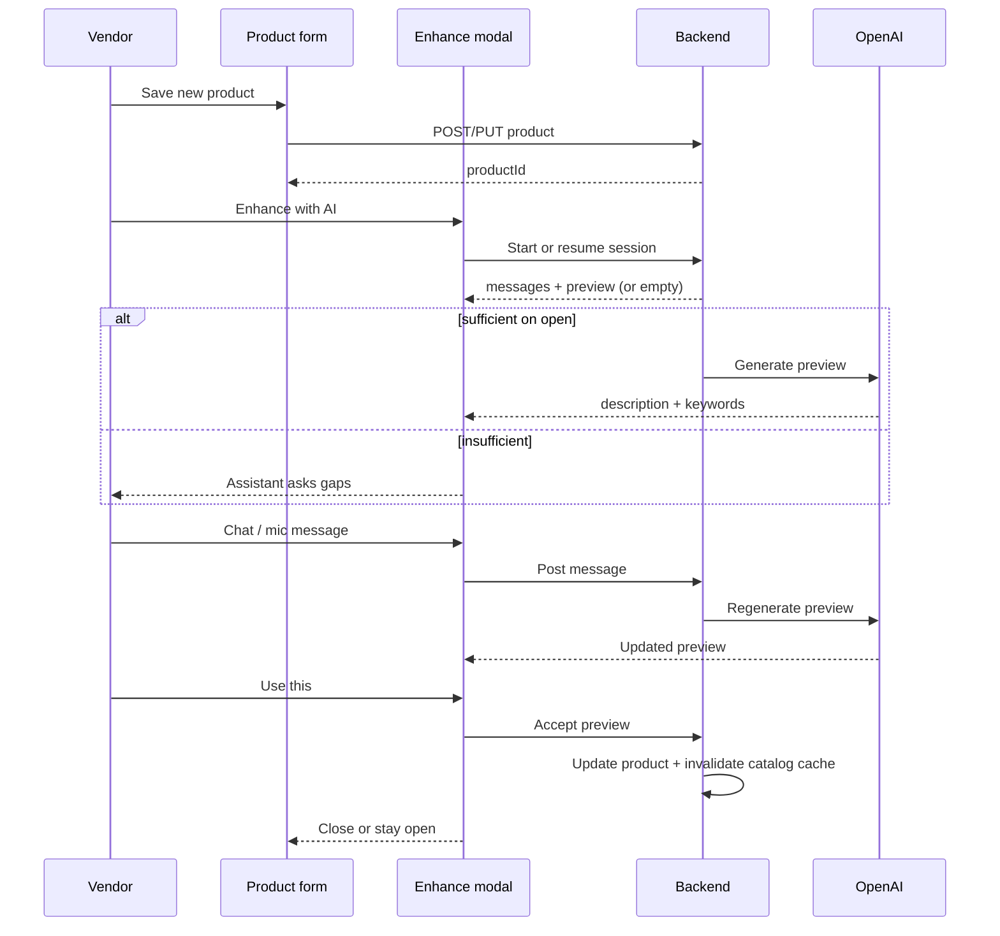

# Vendor catalog enhancer (“Enhance with AI”)

<!-- DOC_SYNC
  last_verified_commit: 562f37f7ad464e6646938e5c6c792af3be9a42c2
  last_verified_at: 2026-09-14
  scope: Product/FAQ description enhancement — implemented; API base /api/catalog-enhance
-->

**Status:** Implemented (Express `/api/catalog-enhance`, vendor portal modal)  
**Audience:** Product, vendor portal frontend, backend API  
**Apps:** `frontend_v2/apps/web-vendor` (vendor portal)  
**Runtime:** Express API on PM2 (`chatlogix-backend`) — same deployment path as catalog import and FAQ CRUD  

---

## Table of contents

1. [Purpose and business goal](#1-purpose-and-business-goal)
2. [Locked product decisions](#2-locked-product-decisions)
3. [Relationship to customer WhatsApp AI](#3-relationship-to-customer-whatsapp-ai)
4. [Scope](#4-scope)
5. [User experience](#5-user-experience)
6. [Modal layout and states](#6-modal-layout-and-states)
7. [Opening behavior (sufficiency gate)](#7-opening-behavior-sufficiency-gate)
8. [Chat and auto-update preview](#8-chat-and-auto-update-preview)
9. [Voice input (mic)](#9-voice-input-mic)
10. [Accept, auto-save, and cache invalidation](#10-accept-auto-save-and-cache-invalidation)
11. [FAQ variant](#11-faq-variant)
12. [Session model (24-hour resume)](#12-session-model-24-hour-resume)
13. [Billing and credits](#13-billing-and-credits)
14. [Backend architecture](#14-backend-architecture)
15. [API contract (proposed)](#15-api-contract-proposed)
16. [Data model (proposed)](#16-data-model-proposed)
17. [Generation rules (reuse catalog enrichment)](#17-generation-rules-reuse-catalog-enrichment)
18. [Security, auth, and rate limits](#18-security-auth-and-rate-limits)
19. [Frontend integration points](#19-frontend-integration-points)
20. [Observability and support](#20-observability-and-support)
21. [Test plan](#21-test-plan)
22. [Implementation phases](#22-implementation-phases)
23. [Open questions](#23-open-questions)
24. [Related code and docs](#24-related-code-and-docs)

---

## 1. Purpose and business goal

ChatLogix customer AI uses **stored product descriptions** and **FAQ answers** as ground truth during WhatsApp conversations. Empty or thin catalog text forces the model to guess; rich, vendor-accurate text improves product matching, clarifying questions, and policy answers.

**Vendor catalog enhancer** lets vendors improve descriptions through a **chat-style assistant** with a **live preview pane**, without requiring marketing copy skills. Output is tuned for how LLM-1 reads the catalog (`desc` column and FAQ injection), not for a public website.

**Success criteria:**

- Vendors with minimal input can produce WhatsApp-ready descriptions.
- Enhanced text respects vendor facts (no invented ingredients, prices, or delivery promises).
- Accepted descriptions measurably reduce “I don’t know” / wrong-product replies in sandbox or production evals (future metric).

---

## 2. Locked product decisions

These decisions are **fixed** for v1 unless explicitly revised.

| ID | Decision |
|----|----------|
| D1 | **Enhance with AI** is **disabled** until the entity is **persisted** (saved `productId` or `faqId`). Create flows must save once before the button is enabled. |
| D2 | **Per item only** — no bulk enhance from product list or FAQ list. |
| D3 | **Modal UX** — clicking Enhance opens a **popup** with **chat (left)** and **preview (right)** on desktop; responsive stack/tabs on small screens. |
| D4 | **Opening strategy (9-B)** — on open, run a **sufficiency check**. If enough data exists, **generate immediately** and fill the preview. If not, the assistant **asks for missing facts** and keeps preview empty until a generation succeeds. |
| D5 | **Auto-update preview (2)** — after the modal is open, **each vendor chat message** (including text produced from voice) triggers a **full regeneration** of preview content (description/answer + keywords where applicable). |
| D6 | **Keywords** — product preview includes **suggested keywords**; accepting applies merged keywords to the product. |
| D7 | **FAQ** — same modal pattern; entity has **one question and one answer**; preview focuses on **enhanced answer** (optional light question polish — see §11). |
| D8 | **Session resume** — conversation state and last preview are **resumable for 24 hours** per vendor + entity. |
| D9 | **Cost UI** — do **not** show token/rupee breakdown in the modal. Show a static note that enhancement **uses credits / wallet balance**. |
| D10 | **Mic** — voice recording is available **in the chat composer** (transcribe → insert as user message → same auto-update path). |
| D11 | **Auto-save on accept** — **Use this** writes preview fields to the database via existing product/FAQ APIs without requiring a separate Save on the parent form. |
| D12 | **Pricing** — charge vendor **2× actual OpenAI USD cost** converted to paise (100% ChatLogix markup on API cost). Debit per generation (and per transcription call). |

**Engineering guardrails (recommended with D5):**

- Debounce rapid sends (1–2 s) so one paste does not enqueue five generations.
- Skip regeneration on empty messages.
- Optional: skip regeneration on pure acknowledgments (`ok`, `thanks`) **only when preview is already non-empty** — product owner may choose strict “every message” vs this save; default **strict** unless credit complaints appear.

---

## 3. Relationship to customer WhatsApp AI

| Customer path | Vendor enhancer |
|---------------|-----------------|
| `chatlogix-incoming-response-generator` / `backend/src/conversation/*` | Express routes under `/api/v1/...` (or `/api/products/...`, `/api/faqs/...`) |
| Debits **CreditUsage** per WhatsApp message | Debits **wallet** (same pattern as catalog import) |
| Reads `Product.description` via compact catalog prefetch | **Writes** `Product.description` (and keywords) on accept |
| Reads FAQ via embedding on **question** | **Writes** FAQ **answer** (and rarely question) on accept |

After accept, product updates must call **`invalidateCompactCatalog(vendorId)`** (already done in `backend/src/routes/products.ts`). FAQ updates must call **`invalidateFaqs(vendorId)`** (already done in `backend/src/routes/faqs.ts`). **Do not** invalidate on every preview generation — only on accept.

LLM-1 explicitly instructs the model to **apply** `desc` content (compatibility, confirm-before-order), not only quote it — see `backend/src/conversation/llm/prompts.ts`.

---

## 4. Scope

### In scope (v1)

- Product edit page: Enhance with AI modal.
- FAQ create/edit (after save): same modal.
- Chat + preview + mic + 24h session + accept + wallet debit at 2× API cost.
- Reuse enrichment prompts and models from catalog import where possible.

### Out of scope (v1)

- Bulk enhance all products / all FAQs.
- Enhance on unsaved drafts (button disabled until id exists).
- Showing detailed cost meters in UI (D9).
- Changing WhatsApp conversation pipeline behavior (consumer of better catalog data only).
- Auto-writing preview text to `Product` / `Faq` rows before **Use this** (preview is session-only until accept).

---

## 5. User experience

### 5.1 Product flow



### 5.2 Entry points

| Location | Control | Enabled when |
|----------|---------|--------------|
| `ProductForm` / `ProductEdit` | **Enhance with AI** | `mode === 'edit'` and `product.id` present (or after first successful create redirect to edit) |
| `FaqForm` / `FaqEdit` | **Enhance with AI** | `faq.id` present |

On **Product create**, show disabled button with helper text: *Save the product first to use AI enhancement.*

### 5.3 Primary actions inside modal

| Action | Behavior |
|--------|----------|
| **Send** (chat) | Append user message; trigger generation (D5); show assistant reply + update preview when ready. |
| **Mic** | Record → upload → transcript as user message → same as Send. |
| **Use this** | Persist preview to entity (D11); toast success; optional close modal. |
| **Close / X** | Persist session to Redis/DB for 24h; do not change live catalog text. |

### 5.4 Credits note (copy)

Static footer text (exact wording TBD by product):

> AI enhancement uses credits from your account balance.

No rupee amounts, token counts, or per-message estimates in v1.

---

## 6. Modal layout and states

### 6.1 Desktop (≥ lg breakpoint)

```
┌─────────────────────────────────────────────────────────────┐
│  Enhance description — {product name}                  [X] │
├──────────────────────────┬──────────────────────────────────┤
│  Chat                    │  Preview                         │
│  ┌────────────────────┐  │  ┌────────────────────────────┐  │
│  │ assistant / user   │  │  │ Enhanced description       │  │
│  │ bubbles            │  │  │ (read-only, scroll)        │  │
│  └────────────────────┘  │  └────────────────────────────┘  │
│  [ textarea........... ] │  Keywords (chips)                │
│  [ 🎤 ] [ Send ]         │  char count: n / 2000            │
├──────────────────────────┴──────────────────────────────────┤
│  AI enhancement uses credits from your balance.              │
│                    [ Cancel ]  [ Use this description ]      │
└─────────────────────────────────────────────────────────────┘
```

### 6.2 Mobile

- Tabbed **Chat** | **Preview**, or vertical stack with sticky composer.
- Badge on Preview tab when preview updates while user is on Chat.

### 6.3 Loading states

| State | UX |
|-------|-----|
| Generating preview | Right pane: skeleton or spinner; keep **previous** preview visible until new payload arrives (avoid flicker to empty). |
| Transcribing | Composer disabled or mic shows “Processing…” |
| Insufficient wallet | Block Send with inline message; link to billing/wallet if available. |

### 6.4 Empty preview

- Before first successful generation: right pane shows placeholder (*Preview will appear here once we have enough detail*).
- After sufficiency pass on open: first generation should run automatically (D4).

---

## 7. Opening behavior (sufficiency gate)

### 7.1 Inputs to the gate

Load **latest saved** entity from DB when session starts (not unsaved form-only state unless product auto-save-on-open is added later).

**Product fields used:**

- `name` (required for any generation)
- `description`, `category`, `tags`, `keywords`
- `baseUnit`, `baseQuantity`, `variants` (JSON), `fulfillmentType`, `inStock`
- Vendor shop context (same as catalog enrichment): business name, category, hours, delivery notes, city — from vendor profile / AI config fields

**FAQ fields used:**

- `question`, `answer`
- Same shop context for tone and policy consistency

### 7.2 Sufficiency rules (deterministic, v1)

**Product — sufficient** if:

- `name` is non-empty **and**
- at least one of:
  - `description` trimmed length ≥ **40** characters, or
  - ≥ **2** non-empty keywords/tags combined, or
  - `category` set, or
  - `variants` JSON has ≥ **1** variant with label, or
  - session already contains ≥ **1** user message with ≥ **20** characters (resume or early chat)

**Product — insufficient** otherwise.

**FAQ — sufficient** if:

- `question` and `answer` both non-empty **and**
- `answer` trimmed length ≥ **30** characters, or session user text ≥ **20** characters

Tune thresholds during QA; document changes in this file.

### 7.3 Opening assistant behavior

| Gate | First assistant message | Preview |
|------|-------------------------|---------|
| Sufficient | Brief summary of what will be enhanced; invite corrections in chat | **Immediate generation** (one LLM call) |
| Insufficient | Numbered list of missing info (2–4 bullets max) | Empty until first successful generation after chat |

Do **not** force a fixed questionnaire when sufficient (locked 9-B).

---

## 8. Chat and auto-update preview

### 8.1 Message loop

For each **user** message (text or transcribed voice):

1. Append to session history.
2. Optionally call a **lightweight** model turn for assistant **reply** only, or combine reply + generation in one structured call (implementation choice — prefer **one** chat completion that returns `{ assistantMessage, description, keywords }` to control cost).
3. Update session `preview` fields.
4. Debit wallet (2× API cost) for that generation.
5. Return to client: `{ messages[], preview, walletOk }`.

### 8.2 Context passed to the model

Each generation includes:

- Full **chat history** (cap last N turns or tokens — suggest **20** messages or **8k** input tokens max).
- **Structured product/FAQ snapshot** from DB (TOON or JSON — match `catalogEnrichmentService` style).
- **Shop context** block from `shopContextFromVendorProfile`.
- **Current preview** (if any) as “draft to revise” when user asks for edits.

### 8.3 Assistant tone

- Short WhatsApp-friendly replies in chat (≤ **120 words**).
- Same languages as customer AI: match product name / vendor locale (English, Tamil, Hindi, code-mixed).
- Never promise credit amounts or API details (D9).

### 8.4 Corrections

User messages such as “shorter”, “remove delivery paragraph”, “add eggless” are handled by **regenerating** preview with full thread context — no separate “edit mode”.

---

## 9. Voice input (mic)

### 9.1 Client

Reuse patterns from `frontend_v2/apps/web-vendor/src/components/onboarding/WhatsAppDemoPhone.tsx`:

- `MediaRecorder` with supported MIME (`audio/webm`, etc.).
- Max duration (suggest **90 s** per clip).
- Visual recording indicator and cancel.

### 9.2 Server

Reuse transcription path from `backend/src/services/onboardingSandboxService.ts` (`transcribeAudioBuffer`, Whisper model, thin-transcript retry).

**New route** (authenticated vendor, not sandbox-only):

- `POST /api/vendors/me/enhance/sessions/:sessionId/voice`
- Body: raw audio bytes (`Content-Type: audio/webm` or similar)
- Response: `{ transcript, transcribePaiseCharged }` — client then posts transcript as a **user message** (or server appends and runs full generation in one request).

Debit transcription at **2×** Whisper API cost (D12).

### 9.3 Failure

If transcript empty: assistant message in chat — *Couldn’t hear that clearly — please try again or type.*

---

## 10. Accept, auto-save, and cache invalidation

### 10.1 Use this — product

**Request:** `POST .../sessions/:id/accept` with optional overrides:

```json
{
  "description": "...",
  "keywords": ["...", "..."]
}
```

Default: use session’s latest preview.

**Server:**

1. Validate lengths: `description` ≤ **2000** (`products` route schema).
2. Merge keywords: union of existing + suggested, dedupe, cap **50** (align with enrichment merge in `catalogEnrichmentService.ts`).
3. `prisma.product.update` for vendor’s row.
4. `invalidateCompactCatalog(vendorId)`.
5. Mark session `acceptedAt` (optional); may keep session read-only or delete.

**Do not** include `basePrice` or prices in generated description (enrichment rule).

### 10.2 Use this — FAQ

1. Validate: `question` ≤ **300**, `answer` ≤ **1500**.
2. Update row; if `question` changed, run `embedAndStore` (`faqs.ts` pattern).
3. `invalidateFaqs(vendorId)`.

### 10.3 Preview vs live data

| Data | Stored when |
|------|-------------|
| Chat messages | Each send (session store) |
| Preview description/keywords | Session only |
| Product.description / Faq.answer | **Accept only** |

---

## 11. FAQ variant

| Aspect | Product | FAQ |
|--------|---------|-----|
| Preview primary field | Enhanced **description** | Enhanced **answer** |
| Char limit | 2000 | 1500 |
| Keywords in preview | Yes (D6) | **Optional v1** — retrieval uses question embedding, not answer keywords; show keywords only if product wants parity |
| Question editing | N/A | Default: enhance **answer** only; if model suggests question polish, show diff and only persist question if vendor checks “Update question” on accept |
| Embedding | N/A | Re-embed when question changes on accept |

Chat prompts for FAQ should emphasize: complete, polite, factual **English** answers suitable for injection when a customer question matches via similarity. Preview Q+A is English even when the vendor chats in Tamil or Hindi (`catalogEnhancePrompts.ts`). Customer WhatsApp replies stay in the customer’s language.

---

## 12. Session model (24-hour resume)

### 12.1 Session key

```
enhance:{vendorId}:{entityType}:{entityId}
```

`entityType` ∈ `product` | `faq`.

### 12.2 Stored payload (Redis recommended)

| Field | Purpose |
|-------|---------|
| `id` | UUID session id |
| `vendorId`, `entityType`, `entityId` | Ownership |
| `messages[]` | `{ role, content, createdAt }` |
| `previewDescription` or `previewAnswer` | Latest generation |
| `previewKeywords[]` | Product only |
| `lastGenerationAt` | Auditing |
| `createdAt`, `expiresAt` | TTL **24h** from last activity (sliding or fixed — recommend **sliding** on each message) |

On modal open:

- If valid session exists → hydrate chat + preview.
- If expired → new session; assistant may say previous chat expired.

### 12.3 Authorization

Vendor may only access sessions for their `vendorId` and entities they own.

---

## 13. Billing and credits

### 13.1 Charge formula

```text
apiCostUsd = calculateCost(model, promptTokens, completionTokens, totalTokens).costUsd
vendorChargePaise = usdToPaise(apiCostUsd) * 2
```

Use shared helper (proposed: `vendorAiChargePaise(costUsd, markupMultiplier = 2)` in `backend/src/utils/billingPaise.ts` or billing service).

Transcription: same 2× on Whisper cost (see `onboardingSandboxService` cost calculation).

### 13.2 Wallet debit

Mirror `recordCatalogImportSpend` in `backend/src/services/billingService.ts`:

- New metadata source: `catalog_enhance` or `description_enhance`
- Fields: `sessionId`, `entityType`, `entityId`, `model`, `promptTokens`, `completionTokens`

**Pre-check** wallet balance before generation; if insufficient, return **402** with message suitable for UI (no amounts required by D9).

### 13.3 Relation to WhatsApp credits

WhatsApp messages use **CreditUsage** and per-message credit rules. Enhancement uses **wallet paise** like catalog import — ensure vendor dashboard copy explains both if needed.

Catalog import today debits **1×** API cost; enhancer debits **2×** by product decision (D12). Document in vendor-facing help when implemented.

### 13.4 Rate limits

Mirror `catalogImportRateLimit.ts` patterns:

- Per-vendor hourly request cap on enhance endpoints.
- Optional daily **paise spent** cap via wallet aggregation (reuse `getTodaysCatalogImportPaiseSpent` pattern with new source filter).

---

## 14. Backend architecture

### 14.1 Proposed modules

| Module | Responsibility |
|--------|----------------|
| `routes/catalogEnhance.ts` (or split product/faq) | HTTP router, Zod validation, auth |
| `services/catalogEnhanceSessionService.ts` | Redis session CRUD, TTL |
| `services/catalogEnhanceChatService.ts` | Sufficiency, OpenAI calls, structured output |
| `services/catalogEnhancePrompts.ts` | Product vs FAQ system prompts (fork from `buildEnrichmentSystemPrompt`) |

Reuse:

- `catalogEnrichmentService.ts` — `ENRICHMENT_MODEL`, `ShopEnrichmentContext`, keyword merge logic, TOON tables
- `costCalculator.ts`, `billingPaise.ts`, `recordCatalogImportSpend` or generalized `recordVendorAiSpend`

### 14.2 Models

| Step | Model (default) |
|------|-----------------|
| Product/FAQ generation | `gpt-4.1-mini` (same as `ENRICHMENT_MODEL`) |
| Transcription | Same as onboarding sandbox (`TRANSCRIBE_MODEL` in sandbox service) |

Structured output: JSON schema with `assistantMessage`, `description` or `answer`, `keywords` (product).

### 14.3 Idempotency

Optional `Idempotency-Key` header on POST message to prevent double-charge on network retry.

---

## 15. API contract (proposed)

Base path: **`/api/catalog-enhance`** (mounted with `authenticate` on `chatlogix-backend`). All routes require vendor JWT (`requireRole('vendor', 'admin')`) and **`Vendor.catalogImportEnabled`** (same gate as catalog import).

### 15.1 Start or resume session

`POST /sessions`

```json
{
  "entityType": "product",
  "entityId": "uuid"
}
```

**Response 200:**

```json
{
  "sessionId": "uuid",
  "expiresAt": "ISO-8601",
  "resumed": true,
  "sufficient": true,
  "messages": [{ "role": "assistant", "content": "..." }],
  "preview": {
    "description": "...",
    "keywords": ["a", "b"]
  }
}
```

If sufficient on new session, server runs first generation before response (may increase latency — show loading on open).

### 15.2 Send chat message

`POST /sessions/:sessionId/messages`

```json
{
  "content": "It's eggless and made fresh daily"
}
```

**Response 200:**

```json
{
  "messages": [ "... full thread ..." ],
  "preview": { "description": "...", "keywords": [] },
  "assistantMessage": "..."
}
```

**402** — insufficient wallet.

### 15.3 Voice

`POST /sessions/:sessionId/voice` — raw body audio.

**Response 200:**

```json
{
  "transcript": "...",
  "messages": [],
  "preview": {}
}
```

Client may combine voice+generate in one server method to reduce round trips.

### 15.4 Accept

`POST /sessions/:sessionId/accept`

```json
{
  "applyKeywords": true
}
```

**Response 200:** updated product or FAQ DTO.

### 15.5 Delete session (optional)

`DELETE /sessions/:sessionId` — discard chat without accepting.

---

## 16. Data model (proposed)

### 16.1 Redis-only (v1)

No Postgres table required if wallet transactions + optional logs suffice.

### 16.2 Optional Postgres audit (v1.1)

```prisma
model CatalogEnhanceSession {
  id          String   @id @default(uuid())
  vendorId    String
  entityType  String   // product | faq
  entityId    String
  messages    Json
  preview     Json?
  expiresAt   DateTime
  acceptedAt  DateTime?
  tokenUsage  Json?
  createdAt   DateTime @default(now())
  updatedAt   DateTime @updatedAt

  @@index([vendorId, entityType, entityId])
}
```

Use if support needs history beyond wallet metadata.

---

## 17. Generation rules (reuse catalog enrichment)

Fork rules from `buildEnrichmentSystemPrompt` in `backend/src/services/catalogEnrichmentService.ts`:

**Description / answer content:**

- WhatsApp-style, newline-separated short lines.
- Max **1800** characters generated, hard-truncate to DB limits.
- Cover what it is, portion/pack, use/enjoyment, printed facts from vendor input.
- Weave shop context when helpful; do not repeat identical hours on every SKU.
- **Do not invent** ingredients, awards, origins, health claims.
- **Do not include prices**.
- Match language of product name / FAQ content.

**Keywords (product):**

- 3–6 per language bucket (en, hi, ta) merged into flat `keywords[]` on accept.
- Same constraints as enrichment (no generic “product”, “food”).

**FAQ answers:**

- Directly address the stored question; no marketing fluff; policy-safe.

---

## 18. Security, auth, and rate limits

- Verify `entityId` belongs to `req.user.vendorId` on every call.
- Max message length (e.g. **4000** chars) to prevent abuse.
- Max audio size (e.g. **5 MB**).
- Rate limit by vendor id (Redis store like catalog import).
- Do not log full descriptions in info logs in production (PII/vendor secrets).

Admin role: may enhance on behalf of vendor only if existing admin patterns allow cross-vendor access — default **vendor-scoped only**.

---

## 19. Frontend integration points

| File | Change |
|------|--------|
| `components/products/ProductForm.tsx` | Enhance button, disabled state on create |
| `pages/ProductEdit.tsx` | Pass product id |
| `components/faqs/FaqForm.tsx` | Enhance button after save |
| `components/catalogEnhance/EnhanceModal.tsx` | **New** — chat + preview + mic |
| `lib/catalogEnhance.ts` | **New** — API client |
| `hooks/useEnhanceSession.ts` | **New** — session lifecycle |

Shared UI: `@chatlogix/ui` Button, Input; follow `.21st/design.json` for modal styling.

---

## 20. Observability and support

**Structured logs (Pino):**

- `catalog_enhance_session_start`, `catalog_enhance_generate`, `catalog_enhance_accept`, `catalog_enhance_wallet_denied`

**Metrics (optional):**

- Count generations per vendor per day
- Accept rate (sessions with accept / sessions started)

**Support playbook:**

- Wallet disputes → `WalletTransaction.metadata.source = catalog_enhance`
- Bad output → vendor can chat corrections or close without accept; live catalog unchanged until accept

---

## 21. Test plan

### 21.1 Backend (Vitest)

- Sufficiency gate: product name only → insufficient; name + long description → sufficient.
- Accept truncates at 2000 / 1500.
- Keyword merge dedupes and caps at 50.
- Wallet 402 when balance zero.
- Vendor A cannot access vendor B session.
- Accept calls invalidate mocks for compact catalog / FAQs.

### 21.2 Frontend

- Button disabled on create, enabled on edit.
- Modal resume within 24h shows prior messages.
- Preview updates after send; loading state does not clear previous preview.
- Use this updates form field and closes (or shows success).

### 21.3 Manual QA

- Tamil/Hindi product name → description language match.
- Voice note in mixed language → transcript → preview.
- FAQ accept with unchanged question → no unnecessary re-embed (mock embed call count).

---

## 22. Implementation phases

| Phase | Deliverable |
|-------|-------------|
| **1** | Backend session + message + generate + accept (product only); wallet 2×; Redis TTL |
| **2** | ProductForm modal + API wire-up |
| **3** | FAQ mode + FaqForm |
| **4** | Mic + voice route |
| **5** | Rate limits + optional Postgres audit |
| **6** | FAQ keywords in preview (if product confirms) |

---

## 23. Open questions

| # | Question | Default if unset |
|---|----------|------------------|
| Q1 | FAQ keywords in preview for v1? | Answer-only preview; no FAQ keywords |
| Q2 | Sliding vs fixed 24h TTL? | Sliding on each message |
| Q3 | Single combined LLM call vs separate “chat reply” + “generate”? | Single structured call per user message |
| Q4 | Auto-save non-description form fields when opening modal? | Load from DB only at session start |
| Q5 | Strict regenerate on “ok/thanks”? | Yes — strict (D5) |

---

## 24. Related code and docs

| Resource | Path |
|----------|------|
| Catalog enrichment (prompt + batch) | `backend/src/services/catalogEnrichmentService.ts` |
| Product CRUD + cache invalidation | `backend/src/routes/products.ts` |
| FAQ CRUD + embeddings | `backend/src/routes/faqs.ts` |
| LLM-1 catalog `desc` usage | `backend/src/conversation/llm/prompts.ts` |
| Catalog import wallet debit | `backend/src/services/billingService.ts` (`recordCatalogImportSpend`) |
| Cost calculator | `backend/src/utils/costCalculator.ts` |
| Onboarding voice + transcribe | `backend/src/services/onboardingSandboxService.ts`, `WhatsAppDemoPhone.tsx` |
| Product form UI | `frontend_v2/apps/web-vendor/src/components/products/ProductForm.tsx` |
| FAQ form UI | `frontend_v2/apps/web-vendor/src/components/faqs/FaqForm.tsx` |
| Feature index (short) | `documentation/modules/features/catalog-enhancer/README.md` |

When implementation lands, update this doc’s **Status** to “Implemented” and add API examples from OpenAPI or route tests.
