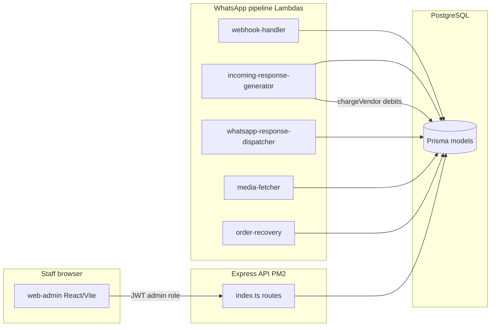

# Admin portal — staff build brief

## Executive summary

ChatLogix sells **WhatsApp-native order assistance**: customers chat with a shop; a multi-stage AI pipeline (`chatlogix-incoming-response-generator` → `backend/src/conversation/*`) answers, builds carts, and places orders. Vendors run day-to-day business in **web-vendor**; **web-admin** is how ChatLogix staff protect revenue, control unit economics, and keep the pipeline healthy without logging in as every shop.

The admin app (`frontend_v2/apps/web-admin`) is intentionally small today: **Vendors** and **Billing** are live; **Dashboard**, **Templates**, and **Logs** are stubs. This documentation set is the product + engineering contract for the next five modules—what to build, what already exists in Postgres and Express, and what must be **proposed** (new tables or routes) before screens ship.

**Business outcomes the portal must enable**

| Outcome | Primary module | How we measure it |
|---|---|---|
| Shops go live with correct WhatsApp + wallet | Vendors | Time from signup to first successful AI reply; % shops with `WhatsAppNumber.connectStatus = live` |
| Unit economics stay visible | Usage and billing | Daily `CreditUsage.chargedMilli` vs summed `WalletTransaction.metadata.aiCostMilli`; gross margin after markup |
| Customers are not silently ignored | Reliability | Count of `Message.status = failed`; time-to-triage for failed replies |
| Support load stays bounded | Support | Cases opened vs resolved; repeat failures per shop |
| Staff actions are accountable | Controls | Audit coverage for money and chat reads; alert MTTA |

**Personas**

- **Ops / support** — triages failed replies, credits wallets, reads chats under audit, nudges vendors on WhatsApp connect.
- **Founder / finance** — watches platform spend vs vendor charges, trial grants, absorbed Meta cost, FX freshness.
- **Engineering** — uses reliability queues + Lambda names; does not expect CloudWatch inside the app.

Staff authenticate with phone OTP. **Admin access is not the `Admin` Prisma table** — it is `AUTH_ADMIN_PHONES` resolved in `backend/src/services/roleService.ts`. Vendors never use web-admin.

**Architecture (read path vs write path)**



Customer messages **do not** flow through the Express process in production; they flow SQS → Lambdas → same database. Admin screens therefore read **durable rows** (`Message`, `CreditUsage`, `Order`) rather than live worker memory. Exceptions called out in this doc: `GET /api/usage` (cost monitor) and `GET /api/errors/stats` (API process only).

**Money rules (every screen)** — full authority: [BILLING_AND_PRICING.md](../BILLING_AND_PRICING.md).

| Surface | Stored unit | Example ₹50 | Format helper (web-admin) |
|---|---|---|---|
| Wallet, charges, ledger | millirupees (`*Milli`) | `50000` | `formatWalletAmount` in `src/lib/money.ts` |
| Orders, catalog prices | paise | `5000` | `formatPaiseAsRupees` |
| Platform settings form | paise on wire; rupees in UI | `5000` paise typed as `50` | `lib/settings.ts` converts |

**Debits:** only `chargeVendor` in `backend/src/services/pricing/pricingService.ts` writes `Vendor.walletBalanceMilli`. Formula: `chargeMilli = ceil((aiCostMilli + whatsappCostMilli + platformFeeMilli) × (1 + markupPercent/100))`. **Credits:** signup trial in `vendorSignupService.ts`; manual staff credit via `POST /api/vendors/:id/recharge-wallet` → `creditWalletFromTopUp` in `walletTopUpService.ts` — never a direct balance patch.

Meta WhatsApp conversation fees are **not billed to vendors yet** (`whatsappCostMilli` is 0); usage screens show absorbed cost as an estimate, not `chargedMilli`.

## What is on screen today

| Surface | Route | State | Code |
|---|---|---|---|
| Login | `/login` | Built | `pages/Login.tsx`, `ProtectedRoute.tsx` (`admin` role) |
| Dashboard | `/dashboard` | Stub | Hardcoded zeros in `pages/Dashboard.tsx` |
| Vendors | `/vendors` | Partial | `pages/Vendors.tsx`, `lib/vendors.ts`, vendor components |
| Billing | `/billing` | Built | `pages/Billing.tsx` → `GET/PATCH /api/admin/settings`, `POST .../refresh-fx` |
| Templates | `/templates` | Stub | `App.tsx` placeholder |
| Logs | `/logs` | Stub | Becomes Reliability module |

Sidebar: `components/layout/Sidebar.tsx`.

## API with no admin screen yet

Mounted from `backend/src/index.ts`. Admin calls use `requireRole('admin')` or `requireVendorAccess` (admin bypass in `middleware/authorize.ts`).

| Method / path | Role | Purpose |
|---|---|---|
| `GET /api/vendors` | admin, vendor | List; `vendorListSelect` omits `registrationStatus` today |
| `POST /api/vendors/:id/recharge-wallet` | admin | Body: `{ amount: int milli, idempotencyKey? }` → `creditWalletFromTopUp` |
| `PATCH /api/vendors/:id/billing-config` | admin | `{ markupPercent: 0–500 }` |
| `GET/PATCH /api/vendors/:id/feature-flags` | admin | Only `conversation_turn_audit` |
| `GET /api/vendors/:id/wallet-transactions` | admin | `?limit=` ledger |
| `POST /api/vendors/:id/map-wa-number` | admin | `{ phoneNumberId, wabaId }` |
| `GET /api/vendors/:id/usage-analytics` | vendor access | All-time `chargedMilli` sum only |
| `GET /api/vendors/:id/dashboard-stats` | vendor access | Orders, billing windows — vendor app pattern |
| `GET /api/products`, `/orders`, `/customer-queries` | vendor access | `?vendorId=` for admin read-as-vendor |
| `GET /api/conversations/:id/messages` | vendor access | Admin allowed; PII — audit required (proposed) |
| `GET /api/errors/stats` | admin | In-memory — **not** Lambda errors |
| `GET /api/usage` | — | **Do not use for billing** — `costMonitor` in API memory |

Pipeline walkthrough: [INCOMING_RESPONSE_GENERATOR_FLOW.md](../INCOMING_RESPONSE_GENERATOR_FLOW.md). Vendor-facing roadmap (do not duplicate vendor Support here): [VENDOR_PORTAL_ROADMAP.md](../VENDOR_PORTAL_ROADMAP.md).

## Five modules — build order

| # | Module | Staff job | Depends on |
|---|---|---|---|
| 1 | [Vendors](./vendors/01-overview.md) | Shops, onboarding, wallet credit, WhatsApp map, flags | — |
| 2 | [Usage and billing](./usage-and-billing/01-overview.md) | Spend vs cost; link to `/billing` | Vendor detail links |
| 3 | [Reliability](./reliability/01-overview.md) | Failed replies, pauses, stuck orders | Vendor + usage context |
| 4 | [Support](./support/01-overview.md) | Cases + audited chat read | Reliability → case |
| 5 | [Controls](./controls/01-overview.md) | Audit, alerts, trials, look-inside | All writers |

Each module: `01-overview.md` (scope), `02-instructions.md` (runbook), `03-ui-plan.md` (screens).

## Glossary

| Term | Meaning |
|---|---|
| **Vendor** | Shop tenant; `Vendor` row |
| **Customer** | WhatsApp end user; `Customer.phone` |
| **Turn** | One billable conversation reply path; charge source `conversation_turn` |
| **Charge source** | String on `CreditUsage.source` / `chargeVendor` input — see BILLING §4 |
| **Millirupee (milli)** | Wallet unit; 1 INR = 1000 milli |
| **Trial grant** | `trialGrantedMilli` + `WalletTransaction` with `metadata.source = trial_grant` |
| **Turn audit** | `Vendor.featureFlags.conversation_turn_audit` — verbose logging, PII |
| **Look-inside** | Admin read of catalog/orders/queries without vendor password |
| **Failed reply** | `Message` where `senderType = assistant` and `status = failed` |
| **Wallet-empty skip** | Pipeline sends template; no debit; **often not persisted** today |

## Cross-module navigation map

```
Dashboard ──waiting count──► Vendors?status=pending_approval
Vendors ──wallet──► recharge form (same page)
Vendors ──link──► Usage /:vendorId
Reliability failed row ──► Support/new?vendorId&conversationId
Support ──Adjust wallet──► Vendors/:id
Support ──Read chat──► conversation route + audit (Controls)
Controls alert low_wallet ──► Vendors/:id
Usage ──Edit fees──► /billing (existing page, not duplicated)
```

## Implementation phases

| Phase | Deliverables | Exit criteria |
|---|---|---|
| **P1 — Vendors complete** | Dashboard counts API; `registrationStatus` on list; approve/reject routes + onboarding change; recharge UI with idempotency + reason metadata; WhatsApp read card | Staff can credit ₹50 with one ledger row; pending queue honest if auto-approve still on |
| **P2 — Usage** | `GET /api/admin/usage` aggregates on `CreditUsage` + ledger AI cost; `/usage` screens | Platform charged total matches SQL sum for a test day |
| **P3 — Reliability** | `/reliability` queues; `/logs` redirect; **`WalletBlockEvent`** table + pipeline writer ([DECISIONS.md](./DECISIONS.md) #2) | Failed `Message` visible within 60s of DB write |
| **P4 — Support** | `StaffCase` + notes APIs; conversation read with **`StaffAuditLog`** gate ([DECISIONS.md](./DECISIONS.md) #3) | Cannot load messages if audit insert fails |
| **P5 — Controls** | **`StaffAuditLog`** UI (`full_controls` scope); **computed** alerts on load; trials list; look-inside route; header badge; **`StaffAlert`** + dismiss **Phase 2** | Markup save appears in audit within one refresh |

## Rules for every screen

**Rupees in the UI.** Staff type rupees; convert at API boundary.

**No direct `walletBalanceMilli` edits.** Credits → `recharge-wallet`; debits → pipeline `chargeVendor`.

**Platform settings** — only `/billing`; paise on wire.

**Four UI states:** loading, empty, error, populated — full-sentence copy (Vendors/Billing pattern).

**Audit** when money, flags, settings, approval, or **customer chat read** changes.

**Desktop first** — document `lg` stacking; shell in `Layout.tsx`.

**One app** — routes in `App.tsx`, nav in `Sidebar.tsx`.

## Templates stay a stub

`/templates` remains undecided (WhatsApp template messages vs canned replies vs catalog templates). See VENDOR_PORTAL_ROADMAP P0.3 and [Controls templates note](./controls/03-ui-plan.md).

## Document index

**Product decisions (locked / open):** [DECISIONS.md](./DECISIONS.md)

| Module | Overview | Instructions | UI plan |
|---|---|---|---|
| Vendors | [01](./vendors/01-overview.md) | [02](./vendors/02-instructions.md) | [03](./vendors/03-ui-plan.md) |
| Money and usage | [01](./usage-and-billing/01-overview.md) | [02](./usage-and-billing/02-instructions.md) | [03](./usage-and-billing/03-ui-plan.md) |
| Reliability | [01](./reliability/01-overview.md) | [02](./reliability/02-instructions.md) | [03](./reliability/03-ui-plan.md) |
| Support | [01](./support/01-overview.md) | [02](./support/02-instructions.md) | [03](./support/03-ui-plan.md) |
| Controls | [01](./controls/01-overview.md) | [02](./controls/02-instructions.md) | [03](./controls/03-ui-plan.md) |
