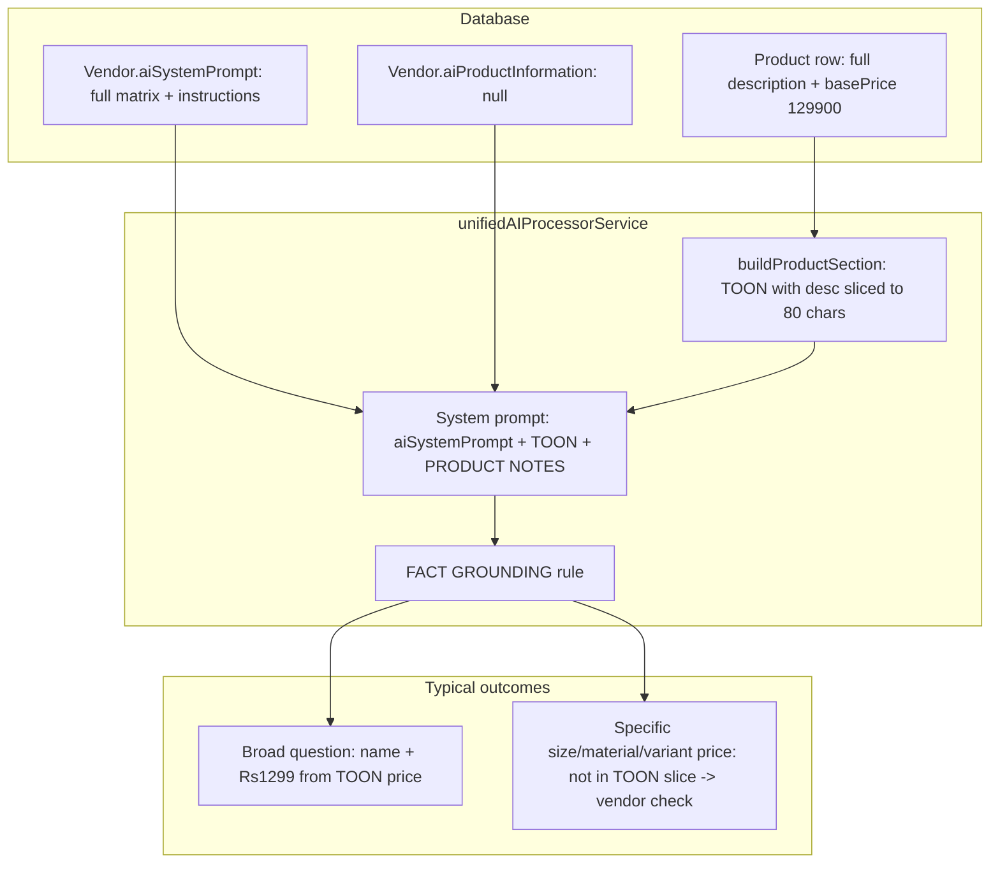

# Case study: Baking tin product questions and unified AI responses (Ibell Creations)

**Date:** 2026-04-15  
**Scope:** End-to-end analysis of why the AI sometimes answered baking-tin questions well, sometimes deferred to “check with the vendor,” and sometimes quoted a single price (₹1299) despite a full price matrix in vendor and product text.  
**Vendor:** `vendor_ibell_001` (Ibell Creations)  
**Related code:** `backend/src/services/unifiedAIProcessorService.ts`

---

## 1. Issue summary

Customers asked detailed questions about a **Premium Baking Tin** (sizes such as 10×10, materials such as Kadai vs stainless steel, and variant pricing). The business had **rich content** in both:

- The **`Product.description`** field in PostgreSQL, and  
- The **`Vendor.aiSystemPrompt`** field in PostgreSQL.

Despite that, the WhatsApp assistant sometimes:

1. Replied with a **generic** line: *“Let me check with the vendor and get back to you.”*  
2. Quoted **₹1299** as if it were the universal price, while the documented policy is **per size and per material** (e.g. 10×10 Kadai ₹1750, SS ₹2250).  
3. Asked again for information (e.g. delivery address) that conversation memory already held.

This document explains **why** that happened from a **product + prompt + code** perspective, with examples and remediation ideas.

---

## 2. Example conversation (real export)

Source: `backend/exports/customer-9790690170-conversations-orders.json` (conversation `0b6baec5-0a1c-4508-a26b-cbc98cb07fca`).

| Turn | Customer | Assistant |
|------|-----------|------------|
| 1 | “is baking tin availale?” | Named **Premium Baking Tin with Adjustable Divider Set**, **Rs 1299**, “multiple sizes,” offered to order. |
| 2 | “10x10 size?” | **“Let me check with the vendor and get back to you.”** |
| 3 | “What is the price for 10x10 tin size” | Same vendor fallback. |
| 4 | “What is the price for 10x10 tin size in Kadai material” | Same vendor fallback. |
| 5 | “Is there baking tray available” | Again product name + **Rs 1299**. |
| 6 | “Yes I need it in 10inch size” | Rs 1299 + **“I’ll confirm that with the vendor”** + asked for delivery address again. |

**Pattern:** Broad questions (“available?”, “baking tray?”) got catalog-style answers. **Specific** questions (exact size, material, variant price) triggered **escalation** or **price mismatch** with the matrix the business intended.

---

## 3. What the database actually contained (ground truth)

Values below were read from the live database (Prisma) for **Ibell Creations** and the **Premium Baking Tin** product row. They are the authoritative source the app *could* use.

### 3.1 `Vendor.aiProductInformation`

**Value:** `null`

Implication: The unified AI path injects optional **`PRODUCT NOTES:`** from `vendorConfig.aiProductInformation`. For this vendor, that block was **empty**, so there was **no second channel** for long structured facts beyond the system prompt and the per-product TOON row.

### 3.2 `Vendor.aiSystemPrompt` (excerpt — baking tin section)

The full `aiSystemPrompt` is long (brownies, classes, delivery, tone). The **baking tin** portion in production included, among other things:

- Product positioning: multi-purpose tin + precision divider.  
- Highlights: adjustable divider, multiple pieces in one bake, Kadai vs Stainless Steel.  
- **Explicit size × price grid** (example rows):  
  - 7×7, 8×8, 9×9, **10×10**, 10×12 inches with **separate Kadai and SS prices**.  
- Divider behavior and **8×8-specific** divider fit.  
- Instructions for **how the AI should respond**: ask size, material, whether using vendor tin or customer tin, guide measurement.  
- Delivery / pickup address and shipping notes.

So at the **vendor prompt** level, the information to answer 10×10 and Kadai **was present** in the database.

### 3.3 `Product` row — Premium Baking Tin (catalog)

**Product id (actual baking tin SKU):** `bf2432ed-18b1-42ac-a5e0-9e7ac538dd8f`  

**Name:** `Premium Baking Tin with Adjustable Divider Set | Stainless Steel & Kadai Finish | Multiple Sizes Available`

**`basePrice`:** `129900` (integer minor units) → displayed as **₹1299**

**`baseUnit`:** `unit`

**`description` (full text as stored)** — this is the complete DB string (newlines preserved):

```text
Introducing our multi-purpose baking tin with precision divider set, designed for perfect portioning and professional baking results.

🧁 Product Highlights
Comes with adjustable divider system
Ideal for making multiple cake pieces in one bake
Suitable for home bakers & professionals
Available in two premium materials:
Kadai (Traditional Finish)
Stainless Steel (SS)
📏 Available Sizes & Pricing
Size,Kadai Price,Stainless Price
7x7 inches,₹1299,₹1799
8x8 inches,₹1299,₹1799
9x9 inches,₹1600,₹2100
10x10 inches,₹1750,₹2250
10x12 inches,₹1950,₹2450
🔲 Divider Functionality

Using our 8-divider setup, you can create multiple grid patterns:

9 pieces
12 pieces
15 pieces
16 pieces
20 pieces
25 pieces

Perfect for even slicing and consistent portion sizes.

⚠️ Important Note (Very Important for Customers)
Our dividers are precisely designed for 8x8 tins
For other sizes or existing tins:
👉 Please measure your tin carefully
👉 Ensure it matches our dimensions before ordering
Orders will be confirmed only after size compatibility is verified
💬 How AI Should Respond to Customers
Ask for size preference
Ask for material choice (Kadai/ Stainless Steel)
Confirm usage (with our tin or customer’s own tin)
Guide customer to measure if unsure
```

**Keywords (sample):** `brownie divider tray`, `cake divider tray`, `baking tin with divider`, `baking-tin`, `kadai`, `stainless-steel`, etc.

So the **product record** also contained the full matrix and AI behavior hints.

---

## 4. Why the issue still happened (technical chain)

The gap is not “missing copy in the DB.” The gap is **how** that copy is **selected, truncated, and governed** at runtime.

### 4.1 Unified AI only injects certain slices of data

`executeUnifiedAI` builds a system prompt that includes:

- `AVAILABLE PRODUCTS` — built by `buildProductSection(products)`  
- Optional `PRODUCT NOTES:` — from `vendorConfig.aiProductInformation` (was **null**)  
- Optional `DELIVERY INFO:` — from `vendorConfig.aiDeliveryInstructions`  
- The main vendor narrative — from `vendorConfig.aiSystemPrompt`

So the **full** `aiSystemPrompt` text **is** passed to the model. In principle, the size/material table **can** be visible there.

However, the model is also given strict **RESPONSE RULES**, including **FACT GROUNDING** (see §4.3). The model must reconcile **catalog table** (TOON), **PRODUCT NOTES**, **DELIVERY INFO**, and **free-form system prompt**. In practice, the **strongest** grounding rules emphasize **AVAILABLE PRODUCTS** and **PRODUCT NOTES** for product facts; long mixed prompts can still lead the model to treat **variant pricing** as “not safely in the product row” if the structured row shows a **single** price.

### 4.2 TOON row truncates `Product.description` to 80 characters

`buildProductSection` maps each product to a compact table and **truncates** `description`:

```84:99:backend/src/services/unifiedAIProcessorService.ts
function buildProductSection(products: any[]): string {
  if (!products || products.length === 0) return 'None available';
  const active = products.filter((p: any) => p.isActive !== false);
  if (active.length === 0) return 'None available';
  const rows = active.map((p: any) => {
    const priceRaw = p.basePrice ?? p.price;
    const minQty = p.minOrderQuantity ? String(p.minOrderQuantity) : '';
    return {
      name:     p.name || '',
      price:    priceRaw != null ? `Rs${(priceRaw / 100).toFixed(0)}` : '',
      unit:     p.baseUnit || '',
      baseQty:  p.baseQuantity != null ? String(p.baseQuantity) : '1',
      minQty,
      desc:     p.description ? String(p.description).slice(0, 80).replace(/,/g, ';') : '',
      keywords: Array.isArray(p.keywords) ? p.keywords.slice(0, 3).join(' ') : ''
    };
  });
  return toonTable(rows);
}
```

For the baking tin, the **first 80 characters** of the description are only the opening sentence — **not** the size/price table. So the **`AVAILABLE PRODUCTS`** block **does not** carry 10×10 or Kadai prices in structured form.

The **`basePrice`** in the row is a **single** integer: **129900** → **Rs1299**, which aligns with **entry-level** Kadai sizes in the matrix (7×7 / 8×8) but **not** with 10×10. The TOON row therefore **signals** “one price” for the SKU.

**Effect:** When the user asks “price for 10×10 Kadai,” the **structured** catalog snippet does **not** clearly encode that answer; the model falls back to **FACT GROUNDING** (next section).

### 4.3 FACT GROUNDING rule

The same service instructs:

```256:259:backend/src/services/unifiedAIProcessorService.ts
    `• FACT GROUNDING: only state facts that appear in AVAILABLE PRODUCTS, PRODUCT NOTES,`,
    `  or DELIVERY INFO. If the customer asks about pack size, piece count, ingredients,`,
    `  shelf life, weight, or anything not in the catalog, respond:`,
    `  "Let me check with the vendor and get back to you." DO NOT invent facts.`,
```

Questions about **dimensions**, **material variants**, and **non-default pricing** are easy to classify as “not clearly in the **truncated** catalog row.” The safe output is exactly what was observed: **defer to the vendor**.

So: **rich DB description** + **truncated injection** + **strict grounding** → **vendor check** for specific questions, even when the **same** facts exist **later** in the full description string or in `aiSystemPrompt`.

### 4.4 `aiProductInformation` was null

Because **`PRODUCT NOTES:`** was empty, there was no **redundant, prompt-friendly** block dedicated to “baking tin matrix” that the FACT GROUNDING rule explicitly names alongside `AVAILABLE PRODUCTS`.

### 4.5 `Vendor.aiProducts` JSON did not list the baking tin

The vendor’s `aiProducts` field (separate JSON string) described **brownies and cookies** only. Any logic or habit that relied on that blob would **omit** bakeware entirely (e.g. some “list products” style answers might skip the tin).

### 4.6 Separate bug: wrong `matchedProductId` on an order line

In the export, a pending order line for the baking tin showed:

`matchedProductId`: `95a7cb9e-3e4f-4b0b-a3d2-fe5da5e861a6`

In the database, that UUID is **`Multi Grain Pista Cookies`**, **not** the baking tin (`bf2432ed-18b1-42ac-a5e0-9e7ac538dd8f`).

That does not by itself generate the “check with vendor” phrase, but it **does** break trust in extraction, order reconciliation, and debugging (“which product did the system think this was?”). It should be investigated in **order extraction / product matching** code paths.

---

## 5. End-to-end flow (conceptual)



---

## 6. Remediation checklist (recommended)

1. **First line of `Product.description` (≤80 chars):** State that **price depends on size and material**, and what **₹1299** represents (e.g. smallest Kadai tier), so the TOON `desc` field is **self-consistent** with questions about variants.  
2. **Populate `Vendor.aiProductInformation`** with a short, structured duplicate of the baking-tin matrix (or link to clear bullets) so **`PRODUCT NOTES:`** satisfies FACT GROUNDING without relying on truncation.  
3. **Catalog modeling:** Consider **separate products or variants** per size/material with correct **`basePrice`** each, if the business sells discrete SKUs — aligns TOON **price** column with reality.  
4. **Fix `matchedProductId` mismatches** for orders where the line item is baking tin but the FK points to cookies.  
5. **Optional:** Extend `aiProducts` JSON to include bakeware or remove reliance on it for “full catalog” lists so product lists are not brownie-only.

---

## 7. References

- Unified AI: `backend/src/services/unifiedAIProcessorService.ts` (`buildProductSection`, `executeUnifiedAI`, RESPONSE RULES).  
- Export example: `backend/exports/customer-9790690170-conversations-orders.json`.  
- Vendor / product rows: PostgreSQL `Vendor` and `Product` tables for `vendor_ibell_001`.

---

## Document history

| Version | Date | Notes |
|---------|------|--------|
| 1.0 | 2026-04-15 | Initial case study from DB inspection and code review |
