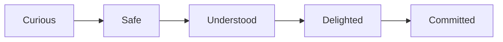

# Public Signup & Trial Onboarding (Page-by-Page Spec)

**Status:** Implemented (P2a–P2f, 2026-09-05); **intake-first funnel (P3b–P3e)** frontend shipped 2026-09-06  
**Last updated:** 2026-09-07  
**App:** `frontend_v2/apps/web-vendor` (vendor portal only)  
**Related:** [Authentication](../../authentication/guides/authentication.md), [Vendor Onboarding Requirements](../requirements/VENDOR_ONBOARDING_REQUIREMENTS.md), [WhatsApp onboarding workflow](../../../whatsapp-integration/guides/vendor-onboarding-workflow.md)

---

## Executive summary

New vendors sign up in the **vendor portal** with **real phone OTP**. They receive a **₹100 one-time trial wallet** to explore catalog import, AI sandbox chat, and voice-note simulation **before** admin approval. Until approved, they stay inside **onboarding routes only** (even on re-login). After manual admin approval, the trial wallet resets; the vendor loads prepaid balance (OpenAI-style: pay ₹1,000 → show ₹1,000). **WhatsApp connection** happens **after approval**, not during trial.

This document captures product decisions from the 2026-09-05 planning discussion and maps them **page by page** for implementation.

> **Business-critical:** Onboarding is our primary conversion surface. A micro-vendor who lands from marketing must feel *understood*, *safe*, and *delighted* within the first 60 seconds — before they ever connect WhatsApp. There is **no room for confusing errors, dead ends, or “tech product” language**. See [Trust, reliability & conversion](#trust-reliability--conversion-expert-plan) below.

### Intake-first funnel (P3 — current UI)

After OTP, vendors **upload catalog first**. We extract products and shop facts, ask structured follow-up questions until ≥80% completeness (or they tap **That’s enough**), then show a **pre-filled confirm** screen (shop + greeting). The **demo** runs inside a customer-facing **WhatsApp mobile shell** (`WhatsAppDemoPhone`). Email is optional until **submit**.

| Step | Route | Label | Purpose |
| --- | --- | --- | --- |
| 1 | `/onboarding/catalog` | Catalog | Upload menu / spreadsheet; review extracted products |
| 2 | `/onboarding/clarify` | Details | One gap question at a time (chips + text); auto-skip if already ≥80% |
| 3 | `/onboarding/confirm` | Confirm | Pre-filled shop + AI greeting; email optional |
| 4 | `/onboarding/demo-chat` | Demo | WhatsApp phone demo (sandbox pipeline); wallet cost outside bubbles |
| 5 | `/onboarding/review` | Submit | Summary + email if still empty → submit for approval |

**Legacy redirects:** `/onboarding/welcome` → catalog (or confirm if products exist); `/onboarding/ai-setup` → `/onboarding/confirm`.

**Client API (GET `/api/vendors/me/onboarding`):** returns `completeness`, `nextQuestions`, `demoPrompts`, `extractedProfile` from the intake service. Clarify auto-skips to confirm when `nextQuestions` is empty.

**Funnel events (client):** `intake_question_answered`, `intake_skipped` (dev console in `logClientFunnelEvent`).

---

## Trust, reliability & conversion (expert plan)

### Why this screen is the business

ChatLogix wins customers **through vendors**. Every rupee of GMV starts with a home baker, tailor, or shop owner who asks: *“Will this actually answer my customers on WhatsApp?”* If onboarding fails — OTP timeout, cryptic error, slow demo, empty AI reply — they leave and never come back. **Competitors lose vendors at Meta signup; we must not lose them earlier.**

**North-star for onboarding:**

| Metric | Target (v1 launch) |
| --- | --- |
| Signup → completes step 1 (business basics) | ≥ 85% |
| Step 1 → sends ≥1 sandbox message | ≥ 70% |
| Sandbox → submit for approval | ≥ 55% |
| Submit → admin approved → returns within 7 days | ≥ 80% |
| Support tickets during onboarding | < 5% of signups |

---

### Audience: non-IT vendors (design for trust)

Our vendors are **not developers**. Many use WhatsApp Business on a phone only. Assume:

- First time hearing “API”, “JWT”, “catalog import”, “tokens”
- Fear of **losing money** on wrong clicks
- Fear of **spamming customers** or breaking their WhatsApp
- Low patience for forms with no visible progress
- Hindi/Tamil/English mix — plain language beats perfect grammar

**Language rules (all UI copy):**

| Do | Don't |
| --- | --- |
| “Your shop”, “customers on WhatsApp”, “automatic replies” | “Pipeline”, “webhook”, “LLM”, “API” |
| “₹0.38 for this reply” (transparent) | “1 credit deducted” |
| “We’re reviewing your shop” | “Pending_approval status” |
| “Try asking what a customer would ask” | “Sandbox test-message endpoint” |
| Short sentences, one idea per line | Long paragraphs, legal tone |

**Trust signals to show (subtle, not salesy):**

- “Your phone is verified — only you can log in”
- “Trial uses **₹100 free balance** — no card required”
- “Demo chat does **not** message your real customers”
- “Same AI that will reply on WhatsApp” (after sandbox uses production pipeline)
- Optional: “Used by shops in [city]” when we have social proof

---

### Emotional journey (what the vendor should feel)



| Stage | Screen | Feeling we must create |
| --- | --- | --- |
| **Curious** | Signup / marketing landing | “This is for people like me, not big companies” |
| **Safe** | OTP + trial created | “They verified me; I’m not being charged” |
| **Understood** | Catalog + clarify | “It read my menu and only asked what it needed” |
| **Delighted** | Demo chat (WhatsApp phone) | “It actually answered like a human!” |
| **Committed** | Submit + waiting | “I’ve done my part; they’ll approve soon” |

**The “aha moment” must happen on Step 4 (demo chat)** — not after Meta WhatsApp setup. If the sandbox reply is generic, slow, or wrong, we lose the sale.

---

### Page-by-page: trust copy & explainers

Each step includes a **“Why we ask this”** panel (collapsible on mobile) and **progress that never lies** (only mark complete when saved server-side).

#### Signup — `/signup`

> **Layout & marketing copy (pending UI):** See **[Signup Page — Marketing Copy & Layout Spec](./signup-page-marketing-copy.md)** for the approved 65%/35% split, SEO meta tags, problem/solution copy, ₹100 offer block, FAQ, and implementation checklist. The strings below remain the **form-side and post-submit** copy.

**Layout (target):** 65% marketing panel (trust + problem/solution + ₹100 offer) | 35% phone/OTP form — same shell as `/login`. Current implementation is single-column until that spec is built.

**Form headline (phone step):** “Start free — WhatsApp shop assistant trial”

**Form explainer:**
> Enter your mobile number. We’ll send a one-time OTP. You get **₹100 free credit** to test automatic replies — no card required.

**Marketing H1 (left panel):** “Stop losing orders on WhatsApp — let an AI shop assistant reply for you”

**Legacy headline (superseded on form):** ~~“Start free — see your WhatsApp shop assistant in minutes”~~

**Success:**
> **Your trial shop is ready.** You have ₹100.00 to test how ChatLogix answers customer questions. Nothing is sent to your real WhatsApp yet.

**Failure copy (never show stack traces):**

| Situation | User sees |
| --- | --- |
| Phone already registered | “This number already has an account. [Log in instead]” |
| OTP wrong | “That code didn’t match. Check the SMS and try again.” |
| Firebase rate limit | “Too many tries. Please wait {N} minutes, then try again.” + visible countdown |
| Network offline | “You’re offline. Check your internet and try again.” |

---

#### Step 1 — Business basics

**Headline:** “Tell us about your shop”

**Explainer:**
> This helps your assistant introduce your business correctly when customers message you — like your shop name on a signboard.

**Field help (examples):**
- **Business name:** “What customers know you as (e.g. Priya’s Home Bakery)”
- **Category:** “So we suggest the right reply style”
- **Language:** “Customers often write in Tamil/Hindi — your assistant can match”

**Trust line:** “You can change this anytime after approval.”

---

#### Step 2 — Catalog

**Headline:** “Add what you sell (optional but recommended)”

**Explainer:**
> Upload a product list or a photo of your menu. Your assistant uses this to answer “How much is…?” and “Do you have…?” — **without you typing every product by hand.**

**If skip:** “No problem — you can add products later. Demo answers may be limited until you add items.”

**During upload:** Progress bar + “Reading your menu… usually under a minute.”

**Failure:** “We couldn’t read this file. Try a clearer photo or CSV — or skip and add products manually later.” (Never blame the vendor.)

---

#### Step 3 — AI setup

**Headline:** “How should your assistant sound?”

**Explainer:**
> Think of this as training a helpful shop staff member — friendly, clear, and honest about prices and delivery.

**Live preview (ideal):** Show greeting updating as they type.

**Defaults:** Pre-fill sensible greeting so empty submit still works.

---

#### Step 4 — Demo chat (critical)

**Headline:** “Try it — ask like a real customer”

**Explainer:**
> This is the **same smart reply system** we use for live WhatsApp. Your real customers are **not** messaged during this trial.

**Suggested prompts (chips):** “What are your prices?”, “I want to order 2 kg”, “Do you deliver?”

**Per-reply:** Show bot message + small line “This reply cost ₹0.42 from your trial balance.”

**Quality bar:** Must use **production `conversation/pipeline.ts`** (LLM-1 + CartEngine + LLM-2) — **not** the retired multi-stage orchestrator. Vendor must experience **live quality**.

**Loading:** “Your assistant is thinking…” (never blank > 3s without feedback)

**Empty wallet:** “Your ₹100 trial is used up. You can still **submit for approval** — our team will review your shop.”

**Slow / error:** “Something went wrong. Your message was saved — [Try again]. If this keeps happening, [contact us].” (Log full error server-side; user never sees `500` or `RATE_LIMIT_429`.)

---

#### Step 5 — Review & submit

**Headline:** “Ready for us to review?”

**Explainer:**
> A ChatLogix team member checks your shop details (usually 1–2 business days). After approval, you can connect WhatsApp and go live.

**Submit CTA:** “Submit my shop for approval” (not “Complete onboarding workflow”)

---

#### Submitted — waiting

**Headline:** “We’re reviewing your shop”

**Copy:**
> Thanks, {businessName}! We’ll notify you on **{phone}** when you’re approved. You can still **edit your details** below.

**Anxiety reducer:** Show submitted date + “What happens next” 3-step list.

---

### Zero-failure reliability plan (engineering)

**Principle:** *The vendor never hits a dead end.* Every error has a human next step.

#### 1. Graceful degradation layers

| Layer | If it fails | Vendor experience |
| --- | --- | --- |
| Firebase OTP | Dev OTP in non-prod; rate-limit UI in prod | Countdown + “Log in” fallback link |
| Catalog import AI | Partial extract | “We imported X products; review the rest later” |
| Sandbox LLM | Timeout after 45s | Cached fallback: “I’m having trouble right now — try again in a moment” + retry button; **alert ops** |
| Save onboarding step | Network blip | Auto-retry 2×; local draft in sessionStorage; “Saved locally — we’ll sync when you’re back online” |
| Session expired | Refresh token fails | “Please log in again — your progress is saved” (server-side step) |

#### 2. Never show raw errors

- Map all API errors to **vendor-safe messages** in one frontend `onboardingErrors.ts`
- Log `operationId` only in “Contact support” expandable (optional)
- No red stack traces, no JSON, no HTTP codes in UI

#### 3. Idempotency & resume

- Every step **autosaves** on continue (server is source of truth)
- Re-login → exact step + partial form data restored
- Sandbox messages **deduct once** per successful reply (idempotent on retry)

#### 4. Sandbox = production pipeline

| Requirement | Rationale |
| --- | --- |
| Call `processMessage()` from `conversation/pipeline.ts` with `sandbox: true` | Same CartEngine + LLM-2 as live WhatsApp |
| Skip WhatsApp send + RESPONSE_QUEUE publish | No accidental customer messages |
| Still persist conversation for coherent multi-turn demo | “I want 2 kg” after “which product?” must work |
| Debit trial wallet in **actual paise** from token usage | Transparent, matches live billing |

**Do not ship** onboarding demo on `multiStageOrchestrator` — quality mismatch destroys trust.

#### 5. Performance budgets (perceived speed)

| Action | Target |
| --- | --- |
| OTP send → SMS received | < 15s (show spinner + “Code sent to …”) |
| Step save | < 500ms (optimistic UI + toast “Saved”) |
| Catalog import (small CSV) | First feedback < 5s |
| Sandbox first reply | < 12s p95 (show typing indicator at 1s) |
| Full page load (onboarding) | LCP < 2.5s on 4G |

#### 6. Mobile-first

- 90%+ of vendors will use phone browser
- Large tap targets, single column, sticky “Continue” button
- OTP input with numeric keyboard
- Demo chat full-screen on mobile

#### 7. Observability (we catch failures before vendors complain)

- Funnel events: `signup_started`, `otp_verified`, `step_N_completed`, `sandbox_message_sent`, `submitted`, `approved`
- Alert if sandbox error rate > 2% or p95 latency > 20s
- Daily ops digest: pending approvals count

---

### Pre-launch quality gate (no go-live without this)

**Product / UX**

- [ ] Every step has headline + “Why we ask this” in plain language
- [ ] Hindi/Tamil copy review for step 1 & 4 (even if UI is English-first)
- [ ] Tested on Android Chrome + low-end device
- [ ] Zero raw API errors in 50 manual test runs

**Reliability**

- [ ] Signup → sandbox → submit works 10× in a row on staging
- [ ] Re-login resume works mid-flow at each step
- [ ] Firebase rate-limit shows countdown (not generic error)
- [ ] Sandbox uses production pipeline; side-by-side reply quality check vs live webhook path

**Trust**

- [ ] “Demo does not message real customers” visible on step 4
- [ ] Wallet widget always shows ₹X of ₹100 and per-action cost
- [ ] Submit works at ₹0 balance

**Ops**

- [ ] Manual approval runbook + notification template tested
- [ ] Support WhatsApp number for “Need help?” on every onboarding screen

---

### “Need help?” — human escape hatch

Sticky footer on all onboarding pages:

> **Questions?** WhatsApp us at {support_number} — we help shops set up every day.

This alone converts anxious vendors who would otherwise bounce on any friction.

---


## Product decisions (locked)

| Topic | Decision |
| --- | --- |
| Host app | Vendor portal (`web-vendor`) only |
| Login phone vs WhatsApp number | **Different** — WhatsApp Business number connected **after approval** |
| Accounts per phone | **One vendor account per phone** globally |
| Multiple businesses per person | **No** |
| Auth | Real Firebase OTP (same as login); dev OTP `123456` when `FIREBASE_API_KEY` unset |
| Until admin approves | **Onboarding screens only** — no dashboard, orders, conversations |
| Re-login while pending | Resume onboarding or land on “submitted” screen |
| Admin approval v1 | **Manual DB update** (`registrationStatus`, `approvedAt`, `approvedBy`) |
| Edit while pending | **Yes** — vendor can return to wizard steps |
| Approval notification | **Yes** — WhatsApp or SMS to login phone |
| Trial grant | **₹100** (10,000 paise) one-time per phone |
| Trial expiry | **N days** — hardcode/env in v1; admin portal setting later |
| Demo / test chat | **Browser sandbox only** — uses **production `conversation/pipeline.ts`** (same quality as live WhatsApp; no customer messages sent) |
| Submit for approval at ₹0 | **Allowed** |
| After approval | Trial balance **not** carried over; wallet **reset to ₹0** until payment |
| Paid wallet | Prepaid like OpenAI: client pays ₹X → balance shows **₹X** |
| Usage deduction | **Actual AI cost in paise** (not flat “1 credit per message”) |
| Usage UI | Breakdown by feature so vendors see cost per reply / import |
| WhatsApp Embedded Signup | **After approval** (separate slice; not part of trial onboarding) |

---

## Competitor context (why this flow)

Platforms like Wati, Interakt, AiSensy, Gallabox, and DoubleTick all use **Meta Embedded Signup** for WhatsApp — the hard part is identical everywhere. ChatLogix differentiates by front-loading **catalog + AI demo** before Meta signup:

```
Account + OTP → Business profile → Catalog + AI setup → Sandbox demo → Submit → Admin approve → Pay → WhatsApp connect → Go live
```

Competitors often push Meta signup or payment first; we let micro-vendors **see AI value on ₹100 trial** before approval and WhatsApp.

---

## Vendor lifecycle states

Use `Vendor.registrationStatus` (field exists in schema; wiring TBD):

| Status | Meaning | Vendor can access |
| --- | --- | --- |
| `onboarding` | Filling wizard steps | `/onboarding/*` only |
| `pending_approval` | Submitted, waiting for ops | `/onboarding/submitted` + edit wizard |
| `approved` | Admin approved | Full vendor portal |
| `rejected` | Admin declined | `/onboarding/rejected` (optional v1) |

Additional fields (recommended):

| Field | Purpose |
| --- | --- |
| `registeredAt` | Signup timestamp (exists) |
| `approvedAt`, `approvedBy` | Manual approval audit (exist) |
| `trialGrantedPaise` | Original trial amount (10,000) for “₹72 of ₹100” UI |
| `trialExpiresAt` | Trial wallet expiry |
| `onboardingStep` or JSON `onboardingData` | Resume last incomplete step |
| `submittedAt` | When vendor clicked “Submit for approval” |
| `rejectionReason` | Shown on rejected screen |

---

## Billing model (OpenAI-style prepaid wallet)

### Storage

- `Vendor.walletBalance` — **integer paise** (e.g. ₹100 = `10000`)
- `WalletTransaction` — every top-up and deduction with `balanceBefore` / `balanceAfter`
- Optional transaction metadata JSON: `{ source, tokens, model, jobId, conversationId }`

### Display

Always show **rupees** in UI: `formatRupee(paise) => ₹${(paise/100).toFixed(2)}`

### Trial (on signup)

```text
walletBalance     = 10000   // ₹100.00
trialGrantedPaise = 10000
trialExpiresAt    = now + N days   // e.g. TRIAL_EXPIRY_DAYS=30 in env
registrationStatus = onboarding
```

### Deductions (actual AI paise)

| Feature | How cost is calculated |
| --- | --- |
| Catalog import | `CatalogImportJob.tokenUsage.totalPaise` → `recordCatalogImportSpend()` (already implemented) |
| Sandbox test chat | LLM token cost per reply via `catalogImportSandboxService` / conversation pipeline with `sandbox: true` |
| Sandbox voice notes | Whisper + LLM cost in paise |
| Live WhatsApp (post-approval) | Same paise-based deduction per message |

**Refactor note:** `billingService.deductCredits()` today uses flat per-message credits (`text=1`, `audio=3`). Implementation should move to **paise-from-tokens** for sandbox and live traffic to match this spec.

### After approval

1. Ops sets `registrationStatus = 'approved'`, `approvedAt`, `approvedBy`.
2. **Reset** `walletBalance = 0` (trial not carried over).
3. Vendor pays ₹X (Razorpay later) → `walletBalance += X * 100` paise.
4. Send approval notification with login / payment instructions.

### Trial expiry

When `now > trialExpiresAt` and status is not `approved`:

- Block catalog import and sandbox chat (even if balance &gt; 0), **or**
- Zero out remaining trial balance (product choice at implement time)

Recommend: **block AI-paid actions** and show “Trial expired — submit for approval or contact support.”

---

## Route protection matrix

| Route pattern | `onboarding` | `pending_approval` | `approved` |
| --- | --- | --- | --- |
| `/signup`, `/login` | Public | Public | Public |
| `/onboarding/*` | ✅ | ✅ | Redirect → `/dashboard` |
| `/dashboard`, `/orders`, `/conversations`, `/catalog`, … | ❌ → onboarding | ❌ → `/onboarding/submitted` | ✅ |
| `/settings/whatsapp` (future) | ❌ | ❌ | ✅ |

**Implementation:** Extend `ProtectedRoute` + backend middleware to read `registrationStatus` from JWT payload or `GET /api/vendors/me`.

---

## Global onboarding shell

All `/onboarding/*` pages share:

### Progress stepper

Steps 1–5 (see pages below). Persist current step server-side for resume on re-login.

### Trial wallet widget (sticky header or sidebar)

```
Trial balance: ₹72.40 of ₹100.00
Expires: 4 Oct 2026

Usage breakdown
  Sandbox replies        −₹18.20
  Sandbox voice          −₹6.00
  Catalog import (1 job) −₹9.40
───────────────────────────────
Total used:              −₹27.60
```

**API (proposed):** `GET /api/vendors/me/trial-wallet`

```json
{
  "balancePaise": 7240,
  "grantedPaise": 10000,
  "expiresAt": "2026-10-05T00:00:00.000Z",
  "breakdown": [
    { "source": "sandbox_chat", "label": "Sandbox replies", "paise": 1820, "count": 12 },
    { "source": "sandbox_audio", "label": "Sandbox voice", "paise": 600, "count": 2 },
    { "source": "catalog_import", "label": "Catalog import", "paise": 940, "jobs": 1 }
  ]
}
```

**UX thresholds:**

- ≤ ₹20 remaining: warning banner
- ₹0.00: disable import + sandbox input; message: “Trial balance used — you can still submit for approval”
- Expired: disable paid actions; show expiry message

---

## Page-by-page specification

### Page 0 — `/signup` (Sign up)

**Purpose:** First-time entry; distinct from login.

**Full UI/copy spec:** [Signup Page — Marketing Copy & Layout Spec](./signup-page-marketing-copy.md)

**UI elements:**

- **65% / 35% split** on desktop (marketing left, form right) — match `Login.tsx` shell
- Marketing panel: problem, solution, ₹100 offer, trust strip, optional FAQ
- Form panel: phone + OTP (reuse login components)
- Per-route SEO meta title + description on `/signup`
- Legal: terms / privacy links (optional v1)
- Mobile: hide marketing panel; show trial pill above form

**Flow:**

1. User enters phone → `POST /api/auth/send-code`
2. User enters OTP → `POST /api/auth/signup/verify` (or extended verify-code)
3. If phone **already registered** → error: “This number already has an account. [Log in]”
4. If phone **new** → create `Vendor` + issue JWT + refresh cookie

**Backend (signup create):**

```text
Vendor.create({
  phone: normalized E.164,
  businessName: '',           // filled step 1
  email: '',                  // filled step 1
  subscriptionPlan: 'Trial',
  subscriptionStatus: 'trial',
  registrationStatus: 'onboarding',
  walletBalance: 10000,
  trialGrantedPaise: 10000,
  trialExpiresAt: now + N days,
  registeredAt: now,
  onboardingStep: 1
})
```

**Success message (modal or inline):**

> Your trial account was created. You have **₹100.00** to try AI replies, catalog import, and test chat.

**Redirect:** `/onboarding/catalog`

**Credits consumed:** None

---

### Page 0b — `/login` (Log in)

**Purpose:** Returning users (trial, pending, or approved).

**UI:** Phone + OTP only (no business fields).

**Post-OTP routing:**

| `registrationStatus` | Redirect |
| --- | --- |
| `onboarding` | Last saved step (`onboardingStep`) or `/onboarding/catalog` |
| `pending_approval` | `/onboarding/submitted` |
| `approved` | `/dashboard` |
| `rejected` | `/onboarding/rejected` |

**Note:** Approved vendors who hit `/signup` should redirect to `/login` or dashboard.

---

### Step 1 — `/onboarding/catalog` (Catalog — first step)

**Purpose:** Upload menu/brochure/CSV first so extraction can pre-fill later steps.

**Progress:** Step 1 of 5 · **Catalog**

**Extract:** Vision (`gpt-4.1`) copies products plus shop name, address, city, hours, and delivery notes from the header/footer. Enrichment (`gpt-4.1-mini`) writes a 5–10 line description per product. Shop facts are written onto the vendor immediately after analyze so Confirm is prefilled. The review grid shows a “From your catalog” summary; the vendor can edit any wrong product line.

**Actions:** Save products → clarify (if `nextQuestions`) or confirm; Skip → clarify or confirm.

**Legacy:** `/onboarding/welcome` redirects here.

---

### Step 2 — `/onboarding/clarify` (Gap questions)

**Purpose:** Structured intake until ≥80% store+product completeness (or vendor taps **That’s enough**).

**Progress:** Step 2 of 5 · **Details**

**UI:** One question, `ChoiceChips` or short text, progress line, ghost “That’s enough”, primary Continue.

**PATCH:** `{ step: 2, data: { intake: { answers, askedIds } } }`

**Auto-skip:** If `nextQuestions` is empty → redirect to confirm.

---

### Step 3 — `/onboarding/confirm` (Shop + AI — pre-filled)

**Purpose:** Vendor **corrects** auto-filled shop name, address, delivery, greeting, personality. Email optional.

**Progress:** Step 3 of 5 · **Confirm**

**Prefill:** `extractedProfile` + existing `Vendor` columns + saved `onboardingData.step1`.

**Actions:** Save & try demo chat → step 4.

**On save:** PATCH writes a short shop brief into `aiContentImportantInstructions` (name, category, area, hours, fulfillment) and expands product descriptions that are still shorter than ~200 characters. Longer vendor-edited listings are left alone.

**Legacy:** `/onboarding/ai-setup` redirects here.

---

### Step 4 — `/onboarding/demo-chat` (WhatsApp phone demo)

**Purpose:** Customer-facing WhatsApp mobile demo using production sandbox pipeline.

**Progress:** Step 4 of 5 · **Demo** (stepper hidden on mobile)

**UI:** `WhatsAppDemoPhone` — desktop ~390×844 bezel; mobile full-screen. Trial wallet + Continue **outside** the phone. Typing indicator, outgoing ticks, hold-to-record voice, product-specific suggestion chips. **No reply cost inside bubbles.**

**Credits consumed:** Per sandbox text/voice message

**Demo grounding:** Vision extraction stays on `gpt-4.1`. Product descriptions/keywords are enriched with `gpt-4.1-mini` using brochure `vendorProfile` (shop name, city, hours, delivery). Catalog commit fills empty greeting/address/delivery fields. Confirm then persists the shop brief so LLM-1 can quote hours and area, not just product names.

---

### Step 5 — `/onboarding/review` (Submit)

**Purpose:** Summary cards, email field if empty, submit for approval.

**Progress:** Step 5 of 5 · **Submit**

---

### Deprecated steps (P2 — replaced by P3)

<details>
<summary>Old Step 1 welcome form and Step 3 AI-only screen (historical)</summary>

#### Step 1 — `/onboarding/welcome` (Business basics) — **deprecated**

**Purpose:** Collect identity and business context (not WhatsApp number).

**Progress:** Step 1 of 5

**Fields:**

| Field | Required | Notes |
| --- | --- | --- |
| Business name | Yes | 3–100 chars |
| Owner name | Yes | 2–50 chars |
| Email | Yes | Valid, unique among vendors |
| Business category | Yes | Food, Retail, Services, Healthcare, Education, Other |
| Preferred language | Yes | English, Hindi, Tamil (+ others later) |
| City / address | No | Optional v1 |

**Not collected:** WhatsApp Business number (post-approval).

**Actions:**

- **Save & continue** → `PATCH /api/vendors/me/onboarding` → step 2
- Auto-save on blur (optional)

**Validation:**

- Email not already used by another vendor
- All required fields before advancing

**Credits consumed:** None

---

#### Step 2 — `/onboarding/catalog` (Catalog setup) — **now step 1**

**Purpose:** Let vendor import products so sandbox AI has catalog context.

**Progress:** Step 2 of 5

**Options (tabs or cards):**

1. **Upload CSV** — existing catalog import pipeline
2. **Upload brochure / PDF / images** — vision extraction path
3. **Skip for now** — proceed with empty catalog; can import later after approval

**UI:**

- Drag-and-drop upload
- Progress / job status polling
- Product count preview after commit
- Link to deferred review if low-confidence products

**Backend:**

- Reuse `/api/catalog-import/*` routes
- Gate: `registrationStatus` in (`onboarding`, `pending_approval`)
- Pre-check: `walletBalance > 0` and trial not expired
- Deduct `totalPaise` on job completion (existing `recordCatalogImportSpend`)

**At ₹0 balance:** Upload disabled; **Skip** still enabled

**Credits consumed:** Actual AI paise per import job

**Reuse:** `CatalogImport`, `CatalogImportPhoto`, etc. — may be embedded in onboarding layout rather than full nav.

---

#### Step 3 — `/onboarding/ai-setup` (Bot personality) — **merged into confirm**

**Purpose:** Configure how the AI represents the business in sandbox and (later) live chat.

**Progress:** Step 3 of 5

**Fields (maps to existing `Vendor` AI columns):**

| Field | Maps to |
| --- | --- |
| Bot name | `aiBotName` |
| Greeting | `aiGreeting` |
| Personality / tone | `aiPersonality` |
| Closing message | `aiClosing` (optional) |
| Delivery vs pickup hint | `aiDeliveryInstructions` / `aiPickupDeliveryAddress` (optional) |

**Actions:** Save & continue → step 4

**Credits consumed:** None (no LLM call on save)

</details>

<!-- Removed duplicate Step 2/3/4 sections below — see P3 steps above -->

---

<!-- Legacy Step 4 sandbox card UI superseded by WhatsAppDemoPhone — see P3 Step 4 above -->

---

### Step 5 — `/onboarding/review` (Review & submit) — detail

**Purpose:** Confirm details and request admin approval.

**Progress:** Step 5 of 5 · **Submit**

**Email:** If empty, inline email field is shown (required before submit). Edit links point to `/onboarding/confirm` and `/onboarding/catalog`.

**UI sections:**

1. **Business info** summary (from step 1) — Edit link
2. **Catalog** summary — N products imported, or “Skipped” — Edit link
3. **AI settings** summary — Edit link
4. **Trial usage** summary — ₹X used of ₹100
5. Checkbox: “I understand full access requires admin approval”
6. **Submit for approval** button (enabled even at **₹0.00** balance)

**Backend:**

- `POST /api/vendors/me/submit-for-approval`
- Set `registrationStatus: pending_approval`, `submittedAt: now`
- Optional: notify ops (email/Slack) — future

**Redirect:** `/onboarding/submitted`

**Credits consumed:** None

---

### Page — `/onboarding/submitted` (Waiting for approval)

**Purpose:** Terminal holding state until ops approves.

**UI:**

- Status illustration + copy: “We’re reviewing your application”
- Expected timeline (e.g. 1–2 business days)
- Summary card (business name, phone, submitted date)
- Trial wallet widget (read-only if exhausted)
- **Edit application** → returns to wizard (status stays `pending_approval`; edits allowed per product decision)
- Log out

**Re-login behavior:** Always lands here until `approved`.

**Credits consumed:** None (unless user edits and uses sandbox/import again)

---

### Page — `/onboarding/rejected` (Optional v1)

**Purpose:** Admin declined application.

**UI:**

- `rejectionReason` from DB
- Contact support / re-apply policy TBD (same phone blocked unless ops resets)

---

## Post-approval experience

### Manual approval (v1)

Ops runs SQL or the approval script:

```bash
cd backend && npx tsx scripts/approve-vendor.ts +919876543210 ops@chatlogix.in
```

Or SQL:

```sql
UPDATE "Vendor"
SET
  "registrationStatus" = 'approved',
  "approvedAt" = NOW(),
  "approvedBy" = 'ops@chatlogix.in',
  "subscriptionStatus" = 'active',
  "walletBalance" = 0          -- trial not carried over
WHERE phone = '+919876543210';
```

Then call notification (logged stub until WhatsApp template wired):

```typescript
// backend/src/services/vendorApprovalNotificationService.ts — notifyVendorApproved()
```

### Approval notification

Send WhatsApp template or SMS to **login phone**:

> Your ChatLogix account is approved. Log in at {url} to load your wallet and connect WhatsApp.

(Implementation: `whatsappTemplateService` or SMS provider — future ticket.)

### First login after approval

- Redirect → `/dashboard`
- Onboarding routes no longer accessible
- Wallet shows **₹0.00** until top-up
- Prompt: “Load wallet to enable live AI” / “Connect WhatsApp”

### Wallet top-up (future slice)

- Pay ₹1,000 → `walletBalance += 100000` paise
- `WalletTransaction` type `topup`
- UI shows **₹1,000.00** balance

### WhatsApp connection (after approval, separate slice)

- Route: `/settings/whatsapp` or dedicated connect wizard
- Meta **Embedded Signup** (same flow as Wati/AiSensy)
- Login phone ≠ WhatsApp number — vendor enters business WA number during Meta flow
- See [vendor-onboarding-workflow.md](../../../whatsapp-integration/guides/vendor-onboarding-workflow.md)

---

## API endpoints (proposed summary)

| Method | Path | Purpose |
| --- | --- | --- |
| `POST` | `/api/auth/signup/send-code` | OTP for new phones (or reuse send-code with signup flag) |
| `POST` | `/api/auth/signup/verify` | Verify OTP + create vendor + ₹100 trial |
| `POST` | `/api/auth/verify-code` | Existing login path for known vendors |
| `GET` | `/api/vendors/me` | Profile incl. `registrationStatus`, onboarding step |
| `PATCH` | `/api/vendors/me/onboarding` | Save step data + advance step |
| `GET` | `/api/vendors/me/trial-wallet` | Balance + breakdown |
| `POST` | `/api/vendors/me/submit-for-approval` | `pending_approval` |
| `POST` | `/api/catalog-import/...` | Existing; gated for trial vendors |
| `POST` | `/api/vendors/me/sandbox/chat` | Sandbox chat via **production pipeline** (`sandbox: true`); deduct paise; return reply + cost |

---

## Auth integration notes

- Signup and login both use **refresh token cookie** + access JWT (see [authentication.md](../../authentication/guides/authentication.md)).
- JWT payload should include `vendorId`, `registrationStatus` (or fetch on each `/vendors/me` call).
- Unknown phone on **login** today returns **403** — change to redirect client to **signup** flow.
- One account per phone: unique constraint or application check on `Vendor.phone`.

---

## Implementation phases (suggested)

| Phase | Scope |
| --- | --- |
| **P2a** | Signup API + vendor create (₹100 trial) + login/signup routing by status |
| **P2b** | Onboarding shell, step 1–2 pages, route guards |
| **P2c** | Steps 3–4 (AI setup + sandbox) + paise deduction + wallet widget |
| **P2d** | Step 5 + submitted page + submit API |
| **P2e** | Paise-based billing refactor (replace flat credits for sandbox/live) |
| **P2f** | Approval notification + ops runbook |
| **P2g** | Post-approval wallet top-up (Razorpay) |
| **P2h** | WhatsApp Embedded Signup (settings) |

---

## Environment variables (proposed)

| Variable | Default | Description |
| --- | --- | --- |
| `TRIAL_GRANT_PAISE` | `10000` | ₹100 trial on signup |
| `TRIAL_EXPIRY_DAYS` | `30` | Days until trial AI actions blocked |
| `CORS_ALLOWED_ORIGINS` | — | Required for auth cookies (existing) |

Add to `backend/.env.example` when implemented.

---

## Manual test checklist

1. **Signup new phone** → “trial account created”, ₹100 balance, onboarding step 1.
2. **Signup same phone again** → blocked; directed to login.
3. **Complete steps 1–3** → resume on re-login at correct step.
4. **Catalog import** → balance decreases by job paise cost.
5. **Sandbox chat** → per-reply paise shown and deducted.
6. **Balance ₹0** → sandbox/import blocked; submit still works.
7. **Submit** → `pending_approval`; re-login → submitted page.
8. **Edit while pending** → wizard accessible; changes saved.
9. **Manual approve in DB** → login → dashboard; balance ₹0.
10. **Approved vendor** → `/onboarding/*` redirects to dashboard.

---

## Open items (future)

- Admin portal: approval queue, trial expiry days setting, rejection with reason
- Razorpay wallet top-up
- Re-apply flow after rejection
- Email notification in addition to WhatsApp/SMS
- `needs_changes` status with admin notes

---

## Document history

| Date | Change |
| --- | --- |
| 2026-09-05 | Trust, reliability & conversion expert plan; sandbox must use production pipeline |
| 2026-09-05 | Initial spec from product planning session (competitor analysis, billing model, page-by-page flow) |
