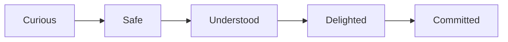

# Public Signup & Trial Onboarding (Page-by-Page Spec)

**Status:** Implemented (P2a–P2f, 2026-09-05); **intake-first funnel (P3b–P3e)** frontend shipped 2026-09-06; **P4 conversion UX overhaul** shipped and browser-verified 2026-09-11; **millirupee billing rework + ₹50 trial grant** shipped 2026-09-16. **Phase A frontend (Finish setup → dashboard)** shipped 2026-09-18; **Phase A backend** (`POST .../complete-onboarding`, auto-approve, wallet carry-forward on approve script) may still be in flight — see [Implementation gaps](#implementation-gaps-doc-vs-code-2026-09-17). **Funnel policy locked 2026-09-18:** auto-complete on **Finish setup**, trial carry-forward, **no min top-up to go live** (wallet gate only), P2h on **mock wallet first**.
**Last updated:** 2026-09-18  
**App:** `frontend_v2/apps/web-vendor` (vendor portal only)  
**Related:** [Billing and Pricing](../../../../../docs/BILLING_AND_PRICING.md) (**authority** for money), [Authentication](../../authentication/guides/authentication.md), [Vendor Onboarding Requirements](../requirements/VENDOR_ONBOARDING_REQUIREMENTS.md), [WhatsApp onboarding workflow](../../../whatsapp-integration/guides/vendor-onboarding-workflow.md)

---

## Executive summary

New vendors sign up in the **vendor portal** with **real phone OTP**. They receive a **₹50 one-time trial wallet** to explore catalog import, AI sandbox chat, and voice-note simulation **during onboarding only**. When they **finish onboarding** (primary CTA: **“Finish setup”** / **Complete onboarding** — not “Submit for approval”), they continue **immediately — including at midnight** — with **no human approval queue**. They land on the **dashboard** with **whatever trial balance remains** (carry forward, not reset). **Live WhatsApp + AI** work when they have **wallet balance** (carried trial counts); there is **no separate minimum top-up rule to go live**. Optional top-up at `/wallet` when balance runs low (mock wallet today; Razorpay later). **WhatsApp connect** (P2h) is self-serve after onboarding; build P2h against **mock wallet first**. ChatLogix ops does not set up the number.

This document captures product decisions from the 2026-09-05 planning discussion and maps them **page by page** for implementation.

### End-to-end funnel (locked 2026-09-17)

| # | Step | 24/7? | Wallet |
| --- | --- | --- | --- |
| 1 | Signup OTP | Yes | Grant **₹50** trial (`50000` milli) |
| 2 | Catalog → clarify → confirm → demo | Yes | Debits trial (sandbox / import) |
| 3 | **Finish setup** (complete onboarding) | Yes | **Auto-`approved`** → dashboard; **carry forward** remaining trial |
| 4 | **Top up** (optional) | Yes (**mock wallet first**; Razorpay later) | Not required to go live if carried trial still covers the wallet gate |
| 5 | **Connect WhatsApp** (P2h) | Yes (Meta popup) | Connect at ₹0 OK; **live** = connect + **wallet balance** for AI + test inbound |
| 6 | Customers message shop number | Yes | AI/outbound gated on wallet |

**Not in the default path:** waiting on ops SQL approval, GST/document upload to ChatLogix, resetting trial to ₹0, or ops pasting WhatsApp tokens.

**Ops still:** suspend / `rejected` for abuse; optional legacy manual approve script for exceptions only — see [approval-runbook.md](./approval-runbook.md).

> **Business-critical:** Onboarding is our primary conversion surface. A micro-vendor who lands from marketing must feel *understood*, *safe*, and *delighted* within the first 60 seconds — before they ever connect WhatsApp. There is **no room for confusing errors, dead ends, or “tech product” language**. See [Trust, reliability & conversion](#trust-reliability--conversion-expert-plan) below.

### Intake-first funnel (P3 — current UI)

After OTP, vendors **upload catalog first**. We extract products and shop facts, ask structured follow-up questions until ≥80% completeness (or they tap **That’s enough**), then show a **pre-filled confirm** screen (shop + greeting). The **demo** runs inside a customer-facing **WhatsApp mobile shell** (`WhatsAppDemoPhone`). Email is optional until **submit**.

| Step | Route | Label | Purpose |
| --- | --- | --- | --- |
| 1 | `/onboarding/catalog` | Catalog | Upload menu / spreadsheet; review extracted products |
| 2 | `/onboarding/clarify` | Details | One gap question at a time (chips + text); auto-skip if already ≥80% |
| 3 | `/onboarding/confirm` | Confirm | Pre-filled shop + AI greeting; email optional |
| 4 | `/onboarding/demo-chat` | Demo | WhatsApp phone demo (sandbox pipeline); wallet cost outside bubbles |
| 5 | `/onboarding/review` | Finish setup | Summary + email if still empty → **complete onboarding** (auto-approve) |

**Legacy redirects:** `/onboarding/welcome` → catalog (or confirm if products exist); `/onboarding/ai-setup` → `/onboarding/confirm`.

**Client API (GET `/api/vendors/me/onboarding`):** returns `completeness`, `nextQuestions`, `demoPrompts`, `extractedProfile` from the intake service. Clarify auto-skips to confirm when `nextQuestions` is empty.

**Funnel events (client):** `intake_question_answered`, `intake_skipped` (dev console in `logClientFunnelEvent`).

### P4 conversion UX overhaul (2026-09-11)

Shipped in `d16210b` after a full browser verification pass (1280 desktop + 390 mobile):

| Area | Change |
| --- | --- |
| **Signup / login** | Job-first headline ("Try it on your catalog"); ₹50 as helper line only; trust lines visible on mobile (`SignupTrustLines`); login split aligned with returning-user copy |
| **OTP** | Autosubmit on sixth digit; specific error text for wrong codes (`@chatlogix/auth` now unwraps `{ error: { message } }`) |
| **Catalog** | Equal "Take photo" / "Upload file" actions; one-line product rows; production-parity editor (unit dropdown, `isDivisible`, min/max qty, `PriceCalculator` preview) |
| **Demo chat** | Catalog-aware suggested chips (`getProducts` allowed for unapproved vendors); pricing Q&A fixed via `baseQty` in compact catalog (see `docs/INCOMING_RESPONSE_GENERATOR_FLOW.md` §7) |
| **Review / submitted** | Single submit, no legal-checkbox trap; approval timeline; "Edit application" routes to confirm/catalog, not welcome |
| **Extraction** | Fixed `g`/`ml` packs (e.g. 350g truffle) normalize to `piece/1` with pack size in description (`normalizeFixedPackDraft`) |

---

## Trust, reliability & conversion (expert plan)

### Why this screen is the business

ChatLogix wins customers **through vendors**. Every rupee of GMV starts with a home baker, tailor, or shop owner who asks: *“Will this actually answer my customers on WhatsApp?”* If onboarding fails — OTP timeout, cryptic error, slow demo, empty AI reply — they leave and never come back. **Competitors lose vendors at Meta signup; we must not lose them earlier.**

**North-star for onboarding:**

| Metric | Target (v1 launch) |
| --- | --- |
| Signup → completes step 1 (business basics) | ≥ 85% |
| Step 1 → sends ≥1 sandbox message | ≥ 70% |
| Sandbox → submit for approval | ≥ 55% |
| Submit → admin approved → returns within 7 days | ≥ 80% |
| Support tickets during onboarding | < 5% of signups |

---

### Audience: non-IT vendors (design for trust)

Our vendors are **not developers**. Many use WhatsApp Business on a phone only. Assume:

- First time hearing “API”, “JWT”, “catalog import”, “tokens”
- Fear of **losing money** on wrong clicks
- Fear of **spamming customers** or breaking their WhatsApp
- Low patience for forms with no visible progress
- Hindi/Tamil/English mix — plain language beats perfect grammar

**Language rules (all UI copy):**

| Do | Don't |
| --- | --- |
| “Your shop”, “customers on WhatsApp”, “automatic replies” | “Pipeline”, “webhook”, “LLM”, “API” |
| “₹0.39 for this reply” (transparent) | “1 credit deducted” |
| “We’re reviewing your shop” | “Pending_approval status” |
| “Try asking what a customer would ask” | “Sandbox test-message endpoint” |
| Short sentences, one idea per line | Long paragraphs, legal tone |

**Trust signals to show (subtle, not salesy):**

- “Your phone is verified — only you can log in”
- “Trial uses **₹50 free balance** — no card required”
- “Demo chat does **not** message your real customers”
- “Same AI that will reply on WhatsApp” (after sandbox uses production pipeline)
- Optional: “Used by shops in [city]” when we have social proof

---

### Emotional journey (what the vendor should feel)



| Stage | Screen | Feeling we must create |
| --- | --- | --- |
| **Curious** | Signup / marketing landing | “This is for people like me, not big companies” |
| **Safe** | OTP + trial created | “They verified me; I’m not being charged” |
| **Understood** | Catalog + clarify | “It read my menu and only asked what it needed” |
| **Delighted** | Demo chat (WhatsApp phone) | “It actually answered like a human!” |
| **Committed** | Submit + waiting | “I’ve done my part; they’ll approve soon” |

**The “aha moment” must happen on Step 4 (demo chat)** — not after Meta WhatsApp setup. If the sandbox reply is generic, slow, or wrong, we lose the sale.

---

### Page-by-page: trust copy & explainers

Each step includes a **“Why we ask this”** panel (collapsible on mobile) and **progress that never lies** (only mark complete when saved server-side).

#### Signup — `/signup`

> **Layout & marketing copy (pending UI):** See **[Signup Page — Marketing Copy & Layout Spec](./signup-page-marketing-copy.md)** for the approved 65%/35% split, SEO meta tags, problem/solution copy, ₹50 offer block, FAQ, and implementation checklist. The strings below remain the **form-side and post-submit** copy.

**Layout (target):** 65% marketing panel (trust + problem/solution + ₹50 offer) | 35% phone/OTP form — same shell as `/login`. Current implementation is single-column until that spec is built.

**Form headline (phone step):** “Start free — WhatsApp shop assistant trial”

**Form explainer:**
> Enter your mobile number. We’ll send a one-time OTP. You get **₹50 free trial balance** to test automatic replies — no card required.

**Marketing H1 (left panel):** “Stop losing orders on WhatsApp — let an AI shop assistant reply for you”

**Legacy headline (superseded on form):** ~~“Start free — see your WhatsApp shop assistant in minutes”~~

**Success:**
> **Your trial shop is ready.** You have ₹50.00 to test how ChatLogix answers customer questions. Nothing is sent to your real WhatsApp yet.

**Failure copy (never show stack traces):**

| Situation | User sees |
| --- | --- |
| Phone already registered | “This number already has an account. [Log in instead]” |
| OTP wrong | “That code didn’t match. Check the SMS and try again.” |
| Firebase rate limit | “Too many tries. Please wait {N} minutes, then try again.” + visible countdown |
| Network offline | “You’re offline. Check your internet and try again.” |

---

#### Step 1 — Business basics

**Headline:** “Tell us about your shop”

**Explainer:**
> This helps your assistant introduce your business correctly when customers message you — like your shop name on a signboard.

**Field help (examples):**
- **Business name:** “What customers know you as (e.g. Priya’s Home Bakery)”
- **Category:** “So we suggest the right reply style”
- **Language:** “Customers often write in Tamil/Hindi — your assistant can match”

**Trust line:** “You can change this anytime after approval.”

---

#### Step 2 — Catalog

**Headline:** “Add what you sell (optional but recommended)”

**Explainer:**
> Upload a product list or a photo of your menu. Your assistant uses this to answer “How much is…?” and “Do you have…?” — **without you typing every product by hand.**

**If skip:** “No problem — you can add products later. Demo answers may be limited until you add items.”

**During upload:** Progress bar + “Reading your menu… usually under a minute.”

**Failure:** “We couldn’t read this file. Try a clearer photo or CSV — or skip and add products manually later.” (Never blame the vendor.)

---

#### Step 3 — AI setup

**Headline:** “How should your assistant sound?”

**Explainer:**
> Think of this as training a helpful shop staff member — friendly, clear, and honest about prices and delivery.

**Live preview (ideal):** Show greeting updating as they type.

**Defaults:** Pre-fill sensible greeting so empty submit still works.

---

#### Step 4 — Demo chat (critical)

**Headline:** “Try it — ask like a real customer”

**Explainer:**
> This is the **same smart reply system** we use for live WhatsApp. Your real customers are **not** messaged during this trial.

**Suggested prompts (chips):** “What are your prices?”, “I want to order 2 kg”, “Do you deliver?”

**Per-reply:** Show bot message + small line “This reply cost ₹0.42 from your trial balance.”

**Quality bar:** Must use **production `conversation/pipeline.ts`** (LLM-1 + CartEngine + LLM-2) — **not** the retired multi-stage orchestrator. Vendor must experience **live quality**.

**Loading:** “Your assistant is thinking…” (never blank > 3s without feedback)

**Empty wallet:** “Your trial balance is used up. You can still **finish setup** and go to your dashboard — add money anytime to reply to customers.”

**Slow / error:** “Something went wrong. Your message was saved — [Try again]. If this keeps happening, [contact us].” (Log full error server-side; user never sees `500` or `RATE_LIMIT_429`.)

---

#### Step 5 — Review & submit

**Headline:** “Ready for us to review?”

**Explainer:**
**Finish setup CTA:** “Finish setup” / “Go to dashboard” (not “Submit my shop for approval”)

---

#### Submitted — waiting

**Headline:** “We’re reviewing your shop”

**Copy:**
> Thanks, {businessName}! We’ll notify you on **{phone}** when you’re approved. You can still **edit your details** below.

**Anxiety reducer:** Show submitted date + “What happens next” 3-step list.

---

### Zero-failure reliability plan (engineering)

**Principle:** *The vendor never hits a dead end.* Every error has a human next step.

#### 1. Graceful degradation layers

| Layer | If it fails | Vendor experience |
| --- | --- | --- |
| Firebase OTP | Dev OTP in non-prod; rate-limit UI in prod | Countdown + “Log in” fallback link |
| Catalog import AI | Partial extract | “We imported X products; review the rest later” |
| Sandbox LLM | Timeout after 45s | Cached fallback: “I’m having trouble right now — try again in a moment” + retry button; **alert ops** |
| Save onboarding step | Network blip | Auto-retry 2×; local draft in sessionStorage; “Saved locally — we’ll sync when you’re back online” |
| Session expired | Refresh token fails | “Please log in again — your progress is saved” (server-side step) |

#### 2. Never show raw errors

- Map all API errors to **vendor-safe messages** in one frontend `onboardingErrors.ts`
- Log `operationId` only in “Contact support” expandable (optional)
- No red stack traces, no JSON, no HTTP codes in UI

#### 3. Idempotency & resume

- Every step **autosaves** on continue (server is source of truth)
- Re-login → exact step + partial form data restored
- Sandbox messages **deduct once** per successful reply (idempotent on retry)

#### 4. Sandbox = production pipeline

| Requirement | Rationale |
| --- | --- |
| Call `processMessage()` from `conversation/pipeline.ts` with `sandbox: true` | Same CartEngine + LLM-2 as live WhatsApp |
| Skip WhatsApp send + RESPONSE_QUEUE publish | No accidental customer messages |
| Still persist conversation for coherent multi-turn demo | “I want 2 kg” after “which product?” must work |
| Debit trial wallet with the **real marked-up cost** from token usage | Transparent, matches live billing |

**Do not ship** onboarding demo on `multiStageOrchestrator` — quality mismatch destroys trust.

#### 5. Performance budgets (perceived speed)

| Action | Target |
| --- | --- |
| OTP send → SMS received | < 15s (show spinner + “Code sent to …”) |
| Step save | < 500ms (optimistic UI + toast “Saved”) |
| Catalog import (small CSV) | First feedback < 5s |
| Sandbox first reply | < 12s p95 (show typing indicator at 1s) |
| Full page load (onboarding) | LCP < 2.5s on 4G |

#### 6. Mobile-first

- 90%+ of vendors will use phone browser
- Large tap targets, single column, sticky “Continue” button
- OTP input with numeric keyboard
- Demo chat full-screen on mobile

#### 7. Observability (we catch failures before vendors complain)

- Funnel events: `signup_started`, `otp_verified`, `step_N_completed`, `sandbox_message_sent`, `submitted`, `approved`
- Alert if sandbox error rate > 2% or p95 latency > 20s
- Daily ops digest: pending approvals count

---

### Pre-launch quality gate (no go-live without this)

**Product / UX**

- [ ] Every step has headline + “Why we ask this” in plain language
- [ ] Hindi/Tamil copy review for step 1 & 4 (even if UI is English-first)
- [ ] Tested on Android Chrome + low-end device
- [ ] Zero raw API errors in 50 manual test runs

**Reliability**

- [ ] Signup → sandbox → submit works 10× in a row on staging
- [ ] Re-login resume works mid-flow at each step
- [ ] Firebase rate-limit shows countdown (not generic error)
- [ ] Sandbox uses production pipeline; side-by-side reply quality check vs live webhook path

**Trust**

- [ ] “Demo does not message real customers” visible on step 4
- [ ] Wallet widget always shows ₹X of ₹50 and per-action cost
- [ ] Submit works at ₹0 balance

**Ops**

- [ ] Manual approval runbook + notification template tested
- [ ] Support WhatsApp number for “Need help?” on every onboarding screen

---

### “Need help?” — human escape hatch

Sticky footer on all onboarding pages:

> **Questions?** WhatsApp us at {support_number} — we help shops set up every day.

This alone converts anxious vendors who would otherwise bounce on any friction.

---


## Product decisions (locked)

| Topic | Decision |
| --- | --- |
| Host app | Vendor portal (`web-vendor`) only |
| Login phone vs WhatsApp number | **Different** — WhatsApp Business number connected **after onboarding** (P2h) |
| Accounts per phone | **One vendor account per phone** globally |
| Multiple businesses per person | **No** |
| Auth | Real Firebase OTP (same as login); dev OTP `123456` when `FIREBASE_API_KEY` unset |
| Until onboarding complete | **Onboarding screens only** — no dashboard, orders, conversations |
| After submit (target) | **Auto-approve** → `/dashboard` **same session**, any hour — **no ops queue** |
| Human admin approval | **Not required** for go-live. Ops **suspend/reject** only for abuse. Legacy SQL approve script remains for exceptions |
| `pending_approval` | **Legacy** — shipped code still uses it; remove when auto-approve is implemented |
| Trial grant | **₹50** (`PlatformSettings.trialGrantPaise = 5000`, i.e. `50000` millirupees) one-time per phone |
| Trial after onboarding complete | **Carry forward** remaining balance. **Do not** reset `walletBalanceMilli` to 0 |
| Trial expiry | **During onboarding only** — once `approved`, remaining balance is normal wallet money (clear or stop enforcing `trialExpiresAt` on portal AI) |
| Demo / test chat | **Browser sandbox only** — uses **production `conversation/pipeline.ts`** (same quality as live WhatsApp; no customer messages sent) |
| Pay to go live | **No minimum top-up rule.** Live when `walletBalanceMilli` covers the existing wallet gate (`canProcessMessage` worst-case turn). Carried trial is enough if balance remains |
| Top-up when adding money | Voluntary `/wallet`; **₹100 minimum per transaction** when they top up (`minWalletTopUpPaise`) — not a go-live threshold |
| Finish onboarding CTA | **“Finish setup”** / **Complete onboarding** — avoid “Submit for approval”. API target: `POST .../complete-onboarding` (alias legacy `submit-for-approval` until renamed) |
| Paid wallet | Prepaid like OpenAI: pay ₹X → balance shows **₹X** (plus any carried trial) |
| Usage deduction | **Actual AI cost × the vendor's `markupPercent`** (default 50%), in millirupees — not flat “1 credit per message” |
| Usage UI | Breakdown by feature so vendors see cost per reply / import |
| WhatsApp Embedded Signup | **After onboarding complete** (not during trial wizard). Plan: [whatsapp-connect-p2h.md](./whatsapp-connect-p2h.md) |
| Meta partnership | **ChatLogix owns** Meta **Solution Partner** status + **line of credit** (no long-term upstream BSP for billing) |
| Vendor Meta assets | Vendor connects **their** Business Manager / WABA via Embedded Signup; the flow **creates** portfolio + WABA if they have none. Number is **not** mapped onto a ChatLogix WABA |
| Who pays Meta (API usage) | **ChatLogix** via **credit line sharing** on the vendor’s WABA (`waba_currency=INR`); vendor does **not** add a Meta payment method |
| Vendor commercial model | **Wallet-only** — one ChatLogix balance for **AI + WhatsApp** (no separate subscription line for WA in v1) |
| WhatsApp message pricing | Meta INR base rate + **per-vendor % markup**. The markup shipped (`Vendor.markupPercent`, admin-editable); the Meta base rate has **not** — WhatsApp conversation fees are absorbed by ChatLogix until P2h |
| WhatsApp connect paths | **Both** supported: **Cloud API** (new/dedicated number) and **Coexistence** (existing WhatsApp Business App + QR) |
| Low wallet balance (live) | **Block AI processing and all outbound** sends; **do not** block Meta connect or inbound message storage; vendor tops up to resume |

---

## Competitor context (why this flow)

Platforms like Wati, Interakt, AiSensy, Gallabox, and DoubleTick all use **Meta Embedded Signup** for WhatsApp — the hard part is identical everywhere. ChatLogix uses the same Meta connect mechanics but bills through **our** Solution Partner credit line so vendors see **one ChatLogix wallet**, not a separate Meta invoice. We differentiate by front-loading **catalog + AI demo** before Meta signup:

```
Account + OTP → Catalog + demo → Finish setup → Dashboard → (optional top-up) → WhatsApp connect → Go live
```

Competitors often push Meta signup or payment first; we let micro-vendors **see AI value on a ₹50 trial**, then connect WhatsApp when they have **balance**, without waiting for ops or business hours.

---

## Vendor lifecycle states

Use `Vendor.registrationStatus` (field exists in schema; wiring TBD):

| Status | Meaning | Vendor can access (target) |
| --- | --- | --- |
| `onboarding` | Filling wizard steps | `/onboarding/*` only |
| `pending_approval` | **Legacy (shipped today)** — submitted, waiting for ops | `/onboarding/submitted` — **remove from happy path** |
| `approved` | Onboarding complete | Full vendor portal (`/dashboard`, `/wallet`, future `/settings/whatsapp`) |
| `rejected` | Ops suspended / declined | Block portal; show reason |

Additional fields (recommended):

| Field | Purpose |
| --- | --- |
| `registeredAt` | Signup timestamp (exists) |
| `approvedAt`, `approvedBy` | Set on auto-approve at submit (`approvedBy: system` or null); ops override still possible |
| `trialGrantedMilli` | Original trial amount (`50000`) for “₹32 of ₹50” UI |
| `trialExpiresAt` | Trial wallet expiry |
| `onboardingStep` or JSON `onboardingData` | Resume last incomplete step |
| `submittedAt` | When vendor clicked “Submit for approval” |
| `rejectionReason` | Shown on rejected screen |

---

## Billing model (OpenAI-style prepaid wallet)

**Shipped 2026-09-16.** Canonical reference: **[BILLING_AND_PRICING.md](../../../../../docs/BILLING_AND_PRICING.md)** — go there for the formula, all charge sources, and env vars. This section covers only what onboarding needs.

### Storage

- `Vendor.walletBalanceMilli` — **integer millirupees**, 1 rupee = 1000 milli (e.g. ₹50 = `50000`)
- `Vendor.markupPercent` — per-vendor markup, default **50**, admin-editable
- `WalletTransaction` — every top-up and deduction with `amountMilli` / `balanceBeforeMilli` / `balanceAfterMilli`, plus a `metadata` JSON carrying the full cost breakdown and the `markupPercent` snapshot
- `CreditUsage` — one row per charge with the required `source` and `chargedMilli`; this is what every vendor-facing spend number is derived from

Order and product money stays in **paise** — a different unit. Do not mix them.

### Display

Always show **rupees** in UI: `formatWalletAmount(milli) => ₹${(milli/1000).toFixed(2)}` (`src/utils/currency.ts`).

### Trial (on signup)

```text
walletBalanceMilli = 50000   // ₹50.00, from PlatformSettings.trialGrantPaise
trialGrantedMilli  = 50000
trialExpiresAt     = now + PlatformSettings.trialExpiryDays   // default 30
registrationStatus = onboarding
```

> **Changed:** the trial grant was **lowered from ₹100 to ₹50**. At roughly ₹0.20 per reply that is about **250 replies**.

### Deductions (real cost × the vendor's markup)

Every debit goes through the one function, `pricingService.chargeVendor`:

```
chargeMilli = ceil((aiCostMilli + whatsappCostMilli + platformFeeMilli) × (1 + markupPercent/100))
```

| Feature | `source` | How cost is calculated |
| --- | --- | --- |
| Catalog import | `catalog_import` | `CatalogImportJob.tokenUsage.totalMilli`, then markup |
| Catalog import fast path | `catalog_import` | Extraction **plus** the enrichment pass, then markup |
| Sandbox test chat | `sandbox_chat` | Real LLM token cost from the production pipeline run with `sandbox: true`, then markup |
| Sandbox voice notes | `sandbox_transcribe` (+ `sandbox_chat` for the reply) | Whisper priced **per second of audio**, then markup |
| Live WhatsApp reply (post-approval) | `conversation_turn` | LLM-1 + LLM-2 tokens + any inbound transcription, then markup |
| Outbound product media | `outbound_media` | Platform fee only — **₹0 today** |

Trial and sandbox charges are floored at zero so a trial wallet never goes negative.

> **No flat credits.** The old `text=1 / audio=3 / image=2` weights and `billingService.deductCredits()` are deleted. There is also no monthly plan quota — `Vendor.subscriptionPlan` is bookkeeping only.

### Live WhatsApp + AI (single wallet, post-approval)

After go-live, **all** billable usage debits the same `Vendor.walletBalanceMilli` through the same formula.

- **WhatsApp conversation fees are not billed yet.** `whatsappCostMilli` and `PlatformSettings.platformFeePerTurnPaise` are both `0` until the P2h Meta rate card lands, so **ChatLogix absorbs Meta conversation costs today**. This is a known gap, not an oversight.
- The per-vendor markup that P2h was going to introduce **already exists** as `Vendor.markupPercent` (`PATCH /api/vendors/:id/billing-config`). P2h only has to supply the WhatsApp base rate for it to multiply.
- Vendors are **not** asked to add a credit card in Meta for API usage; Meta invoices **ChatLogix** as Bill To Party on shared credit lines ([share credit lines](https://developers.facebook.com/docs/whatsapp/embedded-signup/manage-accounts/share-and-revoke-credit-lines)).
- When WhatsApp billing lands, it should populate `whatsappCostMilli` on the existing charge rather than introduce a parallel debit path, so the breakdown stays in one `WalletTransaction.metadata`.
- **Low balance:** the wallet gate requires enough to cover a **worst-case turn at the vendor's markup**, not merely a non-zero balance. Inbound messages are still persisted to the inbox; the AI pipeline sends `WALLET_EMPTY_TEMPLATE` and runs no LLM and no debit. Vendor copy: “Top up to reply to customers.”

### After onboarding complete (auto-approve — target)

1. On successful **complete onboarding**: `registrationStatus = 'approved'`, `approvedAt = now`, `submittedAt = now`. **Do not** change `walletBalanceMilli` except what onboarding already debited.
2. Redirect to `/dashboard` with banner: remaining trial balance + **Connect WhatsApp** when ready. If balance is 0: “Add money to reply to customers” (not a fixed ₹100 go-live rule).
3. Optional notification to login phone: “You’re in — connect WhatsApp when ready.”
4. Top-up via [P2g](./wallet-top-up-p2g.md) **mock wallet first**; Razorpay does not block P2h.

**Live WhatsApp (P2h):** status `live` when connect succeeded, credit attached (prod), **`walletBalanceMilli` > 0** and passes **`canProcessMessage`** for a worst-case turn (same gate as live pipeline today), and test inbound received. No `minWalletTopUpPaise` check for go-live. See [whatsapp-connect-p2h.md](./whatsapp-connect-p2h.md).

### Trial expiry (during onboarding only)

While `registrationStatus === 'onboarding'` and `now > trialExpiresAt`:

- Block catalog import and sandbox chat; show “Finish setup or contact support.”

Once **approved**, do **not** zero trial or block the portal solely on `trialExpiresAt` — remaining balance is prepaid wallet.

---

## Route protection matrix

| Route pattern | `onboarding` | `pending_approval` | `approved` |
| --- | --- | --- | --- |
| `/signup`, `/login` | Public | Public | Public |
| `/onboarding/*` | ✅ | ✅ | Redirect → `/dashboard` |
| `/dashboard`, `/orders`, `/conversations`, `/catalog`, … | ❌ → onboarding | ❌ → `/onboarding/submitted` | ✅ |
| `/settings/whatsapp` (future) | ❌ | ❌ | ✅ |

**Implementation:** Extend `ProtectedRoute` + backend middleware to read `registrationStatus` from JWT payload or `GET /api/vendors/me`.

---

## Global onboarding shell

All `/onboarding/*` pages share:

### Progress stepper

Steps 1–5 (see pages below). Persist current step server-side for resume on re-login.

### Trial wallet widget (sticky header or sidebar)

```
Trial balance: ₹32.40 of ₹50.00
Expires: 4 Oct 2026

Usage breakdown
  Sandbox replies        −₹18.20
  Sandbox voice          −₹6.00
  Catalog import (1 job) −₹9.40
───────────────────────────────
Total used:              −₹27.60
```

**API (as implemented):** `GET /api/vendors/me/trial-wallet`

```json
{
  "balanceMilli": 32400,
  "grantedMilli": 50000,
  "expiresAt": "2026-10-05T00:00:00.000Z",
  "breakdown": [
    { "source": "sandbox_chat", "label": "Sandbox replies", "milli": 18200, "count": 12 },
    { "source": "sandbox_transcribe", "label": "Voice transcription", "milli": 6000, "count": 2 },
    { "source": "catalog_import", "label": "Catalog import", "milli": 9400, "jobs": 1 }
  ]
}
```

Amounts are **millirupees**. `source` values come from the `ChargeSource` union in `pricingService.ts` and the labels from `billingService.labelForSource` — see [BILLING_AND_PRICING.md](../../../../../docs/BILLING_AND_PRICING.md) §4 for the full list.

**UX thresholds:**

- ≤ ₹20 remaining: warning banner
- ₹0.00: disable import + sandbox input; message: “Trial balance used — you can still submit for approval”
- Expired: disable paid actions; show expiry message

---

## Page-by-page specification

### Page 0 — `/signup` (Sign up)

**Purpose:** First-time entry; distinct from login.

**Full UI/copy spec:** [Signup Page — Marketing Copy & Layout Spec](./signup-page-marketing-copy.md)

**UI elements:**

- **65% / 35% split** on desktop (marketing left, form right) — match `Login.tsx` shell
- Marketing panel: problem, solution, ₹50 offer, trust strip, optional FAQ
- Form panel: phone + OTP (reuse login components)
- Per-route SEO meta title + description on `/signup`
- Legal: terms / privacy links (optional v1)
- Mobile: hide marketing panel; show trial pill above form

**Flow:**

1. User enters phone → `POST /api/auth/send-code`
2. User enters OTP → `POST /api/auth/signup/verify` (or extended verify-code)
3. If phone **already registered** → error: “This number already has an account. [Log in]”
4. If phone **new** → create `Vendor` + issue JWT + refresh cookie

**Backend (signup create):**

```text
Vendor.create({
  phone: normalized E.164,
  businessName: '',           // filled step 1
  email: '',                  // filled step 1
  subscriptionPlan: 'Trial',
  subscriptionStatus: 'trial',
  registrationStatus: 'onboarding',
  walletBalanceMilli: 50000,     // PlatformSettings.trialGrantPaise
  trialGrantedMilli: 50000,
  trialExpiresAt: now + PlatformSettings.trialExpiryDays,
  registeredAt: now,
  onboardingStep: 1
})
```

**Success message (modal or inline):**

> Your trial account was created. You have **₹50.00** to try AI replies, catalog import, and test chat.

**Redirect:** `/onboarding/catalog`

**Credits consumed:** None

---

### Page 0b — `/login` (Log in)

**Purpose:** Returning users (trial, pending, or approved).

**UI:** Phone + OTP only (no business fields).

**Post-OTP routing:**

| `registrationStatus` | Redirect |
| --- | --- |
| `onboarding` | Last saved step (`onboardingStep`) or `/onboarding/catalog` |
| `pending_approval` | `/onboarding/submitted` |
| `approved` | `/dashboard` |
| `rejected` | `/onboarding/rejected` |

**Note:** Approved vendors who hit `/signup` should redirect to `/login` or dashboard.

---

### Step 1 — `/onboarding/catalog` (Catalog — first step)

**Purpose:** Upload menu/brochure/CSV first so extraction can pre-fill later steps.

**Progress:** Step 1 of 5 · **Catalog**

**Extract:** Vision (`gpt-4.1`) copies products plus shop name, address, city, hours, and delivery notes from the header/footer. Enrichment (`gpt-4.1-mini`) writes a 5–10 line description per product. Shop facts are written onto the vendor immediately after analyze so Confirm is prefilled. The review grid shows a “From your catalog” summary; the vendor can edit any wrong product line.

**Actions:** Save products → clarify (if `nextQuestions`) or confirm; Skip → clarify or confirm.

**Legacy:** `/onboarding/welcome` redirects here.

---

### Step 2 — `/onboarding/clarify` (Gap questions)

**Purpose:** Structured intake until ≥80% store+product completeness (or vendor taps **That’s enough**).

**Progress:** Step 2 of 5 · **Details**

**UI:** One question, `ChoiceChips` or short text, progress line, ghost “That’s enough”, primary Continue.

**PATCH:** `{ step: 2, data: { intake: { answers, askedIds } } }`

**Auto-skip:** If `nextQuestions` is empty → redirect to confirm.

---

### Step 3 — `/onboarding/confirm` (Shop + AI — pre-filled)

**Purpose:** Vendor **corrects** auto-filled shop name, address, delivery, greeting, personality. Email optional.

**Progress:** Step 3 of 5 · **Confirm**

**Prefill:** `extractedProfile` + existing `Vendor` columns + saved `onboardingData.step1`.

**Actions:** Save & try demo chat → step 4.

**On save:** PATCH writes a short shop brief into `aiContentImportantInstructions` (name, category, area, hours, fulfillment) and expands product descriptions that are still shorter than ~200 characters. Longer vendor-edited listings are left alone.

**Legacy:** `/onboarding/ai-setup` redirects here.

---

### Step 4 — `/onboarding/demo-chat` (WhatsApp phone demo)

**Purpose:** Customer-facing WhatsApp mobile demo using production sandbox pipeline.

**Progress:** Step 4 of 5 · **Demo** (stepper hidden on mobile)

**UI:** `WhatsAppDemoPhone` — desktop ~390×844 bezel; mobile full-screen. Trial wallet + Continue **outside** the phone. Typing indicator, outgoing ticks, hold-to-record voice, product-specific suggestion chips. **No reply cost inside bubbles.**

**Credits consumed:** Per sandbox text/voice message

**Demo grounding:** Vision extraction stays on `gpt-4.1`. Product descriptions/keywords are enriched with `gpt-4.1-mini` using brochure `vendorProfile` (shop name, city, hours, delivery). Catalog commit fills empty greeting/address/delivery fields. Confirm then persists the shop brief so LLM-1 can quote hours and area, not just product names.

---

### Step 5 — `/onboarding/review` (Submit)

**Purpose:** Summary cards, email field if empty, **finish setup** (complete onboarding).

**CTA:** **Finish setup** → auto-approve → `/dashboard`.

**Target API:** `POST /api/vendors/me/complete-onboarding` (alias `submit-for-approval` until renamed).

**Progress:** Step 5 of 5 · **Submit**

---

### Deprecated steps (P2 — replaced by P3)

<details>
<summary>Old Step 1 welcome form and Step 3 AI-only screen (historical)</summary>

#### Step 1 — `/onboarding/welcome` (Business basics) — **deprecated**

**Purpose:** Collect identity and business context (not WhatsApp number).

**Progress:** Step 1 of 5

**Fields:**

| Field | Required | Notes |
| --- | --- | --- |
| Business name | Yes | 3–100 chars |
| Owner name | Yes | 2–50 chars |
| Email | Yes | Valid, unique among vendors |
| Business category | Yes | Food, Retail, Services, Healthcare, Education, Other |
| Preferred language | Yes | English, Hindi, Tamil (+ others later) |
| City / address | No | Optional v1 |

**Not collected:** WhatsApp Business number (post-approval).

**Actions:**

- **Save & continue** → `PATCH /api/vendors/me/onboarding` → step 2
- Auto-save on blur (optional)

**Validation:**

- Email not already used by another vendor
- All required fields before advancing

**Credits consumed:** None

---

#### Step 2 — `/onboarding/catalog` (Catalog setup) — **now step 1**

**Purpose:** Let vendor import products so sandbox AI has catalog context.

**Progress:** Step 2 of 5

**Options (tabs or cards):**

1. **Upload CSV** — existing catalog import pipeline
2. **Upload brochure / PDF / images** — vision extraction path
3. **Skip for now** — proceed with empty catalog; can import later after approval

**UI:**

- Drag-and-drop upload
- Progress / job status polling
- Product count preview after commit
- Link to deferred review if low-confidence products

**Backend:**

- Reuse `/api/catalog-import/*` routes
- Gate: `registrationStatus` in (`onboarding`, `pending_approval`)
- Pre-check: `assertVendorWalletForAi` (balance must cover a worst-case turn) and trial not expired; failure is a **402**. Plus the `PlatformSettings.catalogImportDailyPaiseCap` daily cap (429)
- Charge `tokenUsage.totalMilli × (1 + markupPercent/100)` on job completion via `chargeVendor` (`source: 'catalog_import'`)

**At ₹0 balance:** Upload disabled; **Skip** still enabled

**Wallet consumed:** the marked-up AI cost of the import job. This rose ~50% at the millirupee cutover — import previously billed at cost with no markup, and the fast path's enrichment pass was not billed at all.

**Reuse:** `CatalogImport`, `CatalogImportPhoto`, etc. — may be embedded in onboarding layout rather than full nav.

---

#### Step 3 — `/onboarding/ai-setup` (Bot personality) — **merged into confirm**

**Purpose:** Configure how the AI represents the business in sandbox and (later) live chat.

**Progress:** Step 3 of 5

**Fields (maps to existing `Vendor` AI columns):**

| Field | Maps to |
| --- | --- |
| Bot name | `aiBotName` |
| Greeting | `aiGreeting` |
| Personality / tone | `aiPersonality` |
| Closing message | `aiClosing` (optional) |
| Delivery vs pickup hint | `aiDeliveryInstructions` / `aiPickupDeliveryAddress` (optional) |

**Actions:** Save & continue → step 4

**Credits consumed:** None (no LLM call on save)

</details>

<!-- Removed duplicate Step 2/3/4 sections below — see P3 steps above -->

---

<!-- Legacy Step 4 sandbox card UI superseded by WhatsAppDemoPhone — see P3 Step 4 above -->

---

### Step 5 — `/onboarding/review` (Review & submit) — detail

**Purpose:** Confirm details and request admin approval.

**Progress:** Step 5 of 5 · **Submit**

**Email:** If empty, inline email field is shown (required before submit). Edit links point to `/onboarding/confirm` and `/onboarding/catalog`.

**UI sections:**

1. **Business info** summary (from step 1) — Edit link
2. **Catalog** summary — N products imported, or “Skipped” — Edit link
3. **AI settings** summary — Edit link
4. **Trial usage** summary — ₹X used of ₹50
5. Checkbox: “I understand full access requires admin approval”
6. **Submit for approval** button (enabled even at **₹0.00** balance)

**Backend:**

- `POST /api/vendors/me/submit-for-approval`
- Set `registrationStatus: pending_approval`, `submittedAt: now`
- Optional: notify ops (email/Slack) — future

**Redirect:** `/onboarding/submitted`

**Credits consumed:** None

---

### Page — `/onboarding/submitted` (Legacy — pending ops approval)

**Status:** Shipped today; **not** the target happy path after 2026-09-17. Remove when submit auto-approves.

**Purpose (legacy):** Holding state until ops approves.

**UI:**

- Status illustration + copy: “We’re reviewing your application”
- Expected timeline (e.g. 1–2 business days) — **this blocks midnight signup; avoid in target funnel**
- Summary card (business name, phone, submitted date)
- Trial wallet widget (read-only if exhausted)
- **Edit application** → returns to wizard
- Log out

**Target behavior:** Submit → `/dashboard` immediately; this page unused.

---

### Page — `/onboarding/rejected` (Optional v1)

**Purpose:** Admin declined application.

**UI:**

- `rejectionReason` from DB
- Contact support / re-apply policy TBD (same phone blocked unless ops resets)

---

## Post-onboarding experience (dashboard)

### Auto-approve on finish setup

**Target API:** `POST /api/vendors/me/complete-onboarding` (alias `submit-for-approval` until renamed). Sets `registrationStatus = 'approved'`, preserves `walletBalanceMilli`, sets `approvedAt` / `submittedAt`.

**Frontend (shipped 2026-09-18):** Review step CTA **Finish setup** → `completeOnboarding()` → `refreshAuth()` → `/dashboard` with next-steps banner (Connect WhatsApp → `/settings/whatsapp`, low balance → `/wallet`).

**Backend (pending until Phase A backend PR):** Handler still sets `pending_approval` on the legacy route — finish setup will 404 or behave incorrectly until `completeOnboarding` is wired. Legacy `/onboarding/submitted` remains for in-flight `pending_approval` vendors.

### Legacy manual approval (exceptions only)

For ops overrides (e.g. unstick a vendor), use the script **without zeroing wallet** once carry-forward is implemented:

```bash
cd backend && npx tsx scripts/approve-vendor.ts +919876543210 ops@chatlogix.in
```

**Shipped script today still sets `walletBalanceMilli: 0`** — change when implementing carry-forward.

Or SQL (do **not** zero wallet in target model):

```sql
UPDATE "Vendor"
SET
  "registrationStatus" = 'approved',
  "approvedAt" = NOW(),
  "approvedBy" = 'ops@chatlogix.in',
  "subscriptionStatus" = 'active'
  -- do NOT set walletBalanceMilli = 0; carry forward trial
WHERE phone = '+919876543210';
```

See [approval-runbook.md](./approval-runbook.md).

### Completion notification (optional)

WhatsApp template or SMS to **login phone**:

> You’re set up on ChatLogix. Connect WhatsApp when you’re ready — keep wallet balance so customers get replies.

(Stub: `vendorApprovalNotificationService`.)

### First visit after onboarding complete

- Redirect → `/dashboard`
- Onboarding routes redirect away
- Wallet shows **carried trial** (e.g. ₹32 of ₹50)
- Primary CTAs: **Connect WhatsApp** (P2h) and **Add money** (`/wallet`) when balance is low — mock top-up today

### Wallet top-up (P2g shipped)

- Minimum **₹100 per top-up transaction** when they choose to add money (`minWalletTopUpPaise`) — not required to go live if carried trial suffices
- Mock provider v1; Razorpay v2 when credentials exist — [wallet-top-up-p2g.md](./wallet-top-up-p2g.md)

### WhatsApp connection (P2h — planned)

- Route: `/settings/whatsapp` or dedicated connect wizard
- Meta **Embedded Signup** (same popup flow as Wati/Interakt); if vendor has no Business Manager, the flow **creates** portfolio / WABA inside Embedded Signup with step-by-step UI copy before/after the Meta popup
- **Two connect paths:** (1) **Cloud API** — dedicated number, SMS/voice OTP; (2) **Coexistence** — existing WhatsApp Business App, QR scan
- Login phone ≠ WhatsApp number — business WA number entered during Meta flow
- **Server-side after signup:** exchange token → register number → subscribe app webhooks → **`whatsapp_credit_sharing_and_attach`** with `waba_currency=INR` → verify `primary_funding_id` → store encrypted token + `WhatsAppNumber` row
- Vendor messaging: *“WhatsApp message charges are deducted from your ChatLogix balance; you don’t pay Meta separately.”*
- **Full plan (authority):** [whatsapp-connect-p2h.md](./whatsapp-connect-p2h.md) — vendor-owned WABA, no ChatLogix ops setup, conversion/risks, slices P2h-a–i. The older [vendor-onboarding-workflow.md](../../../whatsapp-integration/guides/vendor-onboarding-workflow.md) §6 still describes Graph call order.

---

## API endpoints (proposed summary)

| Method | Path | Purpose |
| --- | --- | --- |
| `POST` | `/api/auth/signup/send-code` | OTP for new phones (or reuse send-code with signup flag) |
| `POST` | `/api/auth/signup/verify` | Verify OTP + create vendor + ₹50 trial |
| `POST` | `/api/auth/verify-code` | Existing login path for known vendors |
| `GET` | `/api/vendors/me` | Profile incl. `registrationStatus`, onboarding step |
| `PATCH` | `/api/vendors/me/onboarding` | Save step data + advance step |
| `GET` | `/api/vendors/me/trial-wallet` | Balance + breakdown |
| `POST` | `/api/vendors/me/submit-for-approval` | **Shipped:** `pending_approval`. **Target:** `approved` + carry trial |
| `POST` | `/api/catalog-import/...` | Existing; gated for trial vendors |
| `POST` | `/api/vendors/me/sandbox/chat` | Sandbox chat via **production pipeline** (`sandbox: true`); charge the wallet in millirupees; return reply + `costMilli` |

---

## Auth integration notes

- Signup and login both use **refresh token cookie** + access JWT (see [authentication.md](../../authentication/guides/authentication.md)).
- JWT payload should include `vendorId`, `registrationStatus` (or fetch on each `/vendors/me` call).
- Unknown phone on **login** today returns **403** — change to redirect client to **signup** flow.
- One account per phone: unique constraint or application check on `Vendor.phone`.

---

## Implementation phases (suggested)

| Phase | Scope |
| --- | --- |
| **P2a** | Signup API + vendor create (₹50 trial) + login/signup routing by status |
| **P2b** | Onboarding shell, step 1–2 pages, route guards |
| **P2c** | Steps 3–4 (AI setup + sandbox) + wallet deduction + wallet widget |
| **P2d** | Step 5 + submitted page + submit API |
| **P2e** | Cost-based billing refactor (replace flat credits for sandbox/live). **Superseded 2026-09-16** by the millirupee + per-vendor-markup model — [BILLING_AND_PRICING.md](../../../../../docs/BILLING_AND_PRICING.md) |
| **P2f** | Completion notification + ops runbook (legacy approve path) |
| **P2f+** | **Auto-approve on submit**, trial carry-forward, dashboard CTA for min top-up — [gaps](#implementation-gaps-doc-vs-code-2026-09-17) |
| **P2g** | Post-approval wallet top-up — **mock provider v1**, [detailed plan](./wallet-top-up-p2g.md); Razorpay v2 when credentials exist |
| **P2h** | WhatsApp Embedded Signup onto a **vendor-owned WABA** (Cloud API + Coexistence), INR credit attach, per-vendor tokens, live gating, WhatsApp rate card — [detailed plan](./whatsapp-connect-p2h.md). Markup already shipped. |

---

## Environment variables

| Variable | Default | Description |
| --- | --- | --- |
| `TRIAL_GRANT_MILLI` | `50000` | ₹50 trial on signup — **seed/fallback only**, live value is `PlatformSettings.trialGrantPaise` |
| `TRIAL_EXPIRY_DAYS` | `30` | Days until trial AI actions blocked — **seed/fallback only**, live value is `PlatformSettings.trialExpiryDays` |
| `CORS_ALLOWED_ORIGINS` | — | Required for auth cookies (existing) |

The two trial knobs are edited in production on the web-admin `/billing` page, not in `.env`.

---

## Manual test checklist

1. **Signup new phone** → “trial account created”, ₹50 balance, onboarding step 1.
2. **Signup same phone again** → blocked; directed to login.
3. **Complete steps 1–3** → resume on re-login at correct step.
4. **Catalog import** → balance decreases by the marked-up job cost.
5. **Sandbox chat** → per-reply cost (`costMilli`) shown and deducted.
6. **Balance ₹0** → sandbox/import blocked; finish setup still works.
7. **Finish setup** → **target:** `approved` + dashboard with carried balance; **frontend shipped:** `POST .../complete-onboarding`, `refreshAuth()`, `/dashboard`; **backend:** wire `completeOnboarding` service (legacy `pending_approval` until merged).
8. **Optional top-up** adds to carried trial (min **₹100 per txn** when topping up — not a go-live rule).
9. **Approved vendor** → `/onboarding/*` redirects to dashboard.

---

## Implementation gaps (doc vs code, 2026-09-17)

Docs now reflect the **target funnel**. The repo still implements parts of the **old** funnel.

| Gap | Target | Shipped today | Fix |
| --- | --- | --- | --- |
| Submit outcome | Auto-`approved`, dashboard | **Frontend:** Finish setup copy, `completeOnboarding()` → `POST .../complete-onboarding`, `refreshAuth()` + `/dashboard`. **Backend:** still `pending_approval` on legacy handler until Phase A backend merges | Land `completeOnboarding` in `vendorOnboardingService` + route alias |
| Trial wallet | Carry forward on complete | `approve-vendor.ts` zeros wallet; runbook SQL zeros wallet | Stop resetting on approve; auto-approve never zeros |
| 24/7 go-live | No ops queue | Ops SQL / script required for legacy rows; new vendors blocked on backend until auto-approve | Auto-approve backend |
| Min top-up to go live | **No** — live when wallet gate passes | Top-up exists; dashboard banner links to `/wallet`; go-live should use `canProcessMessage`, not `minWalletTopUpPaise` | P2h live gate |
| P2h WhatsApp | Self-serve `/settings/whatsapp` | Dashboard CTA links to route; wizard **not built** | P2h-a–i (not P2h-h in Phase A) |
| Razorpay | Real payments | Mock stub | P2g v2 |
| Meta credit line (INR) | Production attach | Not in app | Meta ops + P2h-e |
| `whatsappCostMilli` | Bill Meta usage | Always 0 | P2h-h |
| Completion SMS/WhatsApp | Optional nurture | Stub logs only | Wire template |
| Per-vendor Graph token | Tenant send | Global `WHATSAPP_ACCESS_TOKEN` | P2h-f |
| Admin approval queue UI | Not required | web-admin lists vendors; no queue | Optional suspend only |

**Not gaps (working):** OTP signup, intake onboarding, sandbox pipeline, millirupee billing, `/wallet` mock top-up, webhook routing by `phoneNumberId` for ops-mapped numbers.

---

## Open items (future)

### Decision log (funnel)

| Date | Decision |
| --- | --- |
| 2026-09-18 | **No minimum top-up to go live** — only existing wallet balance / `canProcessMessage` gate. ₹100 min applies to voluntary top-up txns only. |
| 2026-09-18 | **Finish setup** wording + `complete-onboarding` API; auto-approve on that action (not “submit for approval”). |
| 2026-09-18 | **Build P2h on mock wallet first** — Razorpay does not block P2h. |

- Admin portal: **suspend/reject** vendor (not approval queue for happy path)
- Razorpay wallet top-up
- Re-apply flow after rejection
- Email notification in addition to WhatsApp/SMS
- `needs_changes` status with admin notes

---

## Document history

| Date | Change |
| --- | --- |
| 2026-09-11 | P4 conversion UX overhaul shipped; browser verification pass; demo catalog pricing (`baseQty`); production-parity product editor |
| 2026-09-07 | Intake-first funnel (P3) documented |
| 2026-09-05 | Trust, reliability & conversion expert plan; sandbox must use production pipeline |
| 2026-09-05 | Initial spec from product planning session (competitor analysis, billing model, page-by-page flow) |
