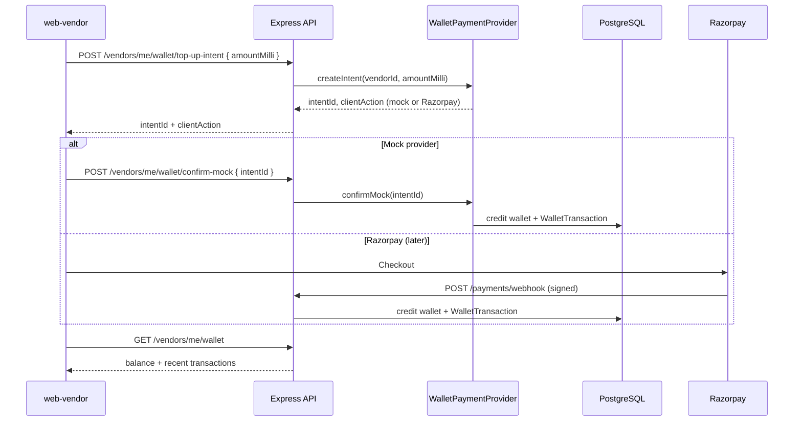

# P2g — Post-approval wallet top-up (implementation plan)

**Status:** Shipped (mock v1)  
**Last updated:** 2026-09-16  
**Depends on:** P2a–P2f (shipped)  
**Blocks:** P2h (WhatsApp Embedded Signup + live wallet gating) for self-serve vendors  

**Related specs:** [BILLING_AND_PRICING.md](../../../../../docs/BILLING_AND_PRICING.md) (**authority** for the money unit and charge formula), [public-signup-onboarding.md](./public-signup-onboarding.md) (trial wallet in the signup flow), [meta-partnership README](../../../../requirements/meta-partnership/README.md) (roadmap), [vendor-onboarding-workflow.md](../../../whatsapp-integration/guides/vendor-onboarding-workflow.md) (post-approval flow).

> **Unit note (2026-09-16):** this plan was written in **paise**. Wallet money is now **millirupees** (1 rupee = 1000 milli), and the shipped code uses `amountMilli` / `*_MILLI` throughout. The text below has been converted; if you find a stray `Paise` name here, the code is right and this doc is wrong.

---

## 1. Context (discussion summary)

After **P2a–P2f**, vendors can sign up, use a **₹50 trial wallet** during onboarding, submit for approval, and be approved by ops. On approval, the product spec **resets `walletBalanceMilli` to ₹0** — the trial balance is not carried over. Approved vendors need a **self-serve way to add prepaid balance** (OpenAI-style: pay ₹1,000 → UI shows ₹1,000) before live AI and (later) WhatsApp usage.

**Engineering priority:** Implement **P2g before P2h**. Live WhatsApp connect and wallet gating assume vendors can fund the same `Vendor.walletBalanceMilli` without admin SQL or `POST /api/vendors/:id/recharge-wallet` (admin-only today).

**Payment gateway decision (2026-09-16):**

| Phase | Approach |
| --- | --- |
| **P2g v1 (now)** | **Mock payment provider** — simulates successful top-up in dev/staging (and optionally production behind a feature flag) so wallet UI, APIs, and ledger behavior can ship without Razorpay credentials. |
| **P2g v2 (later)** | **Razorpay** — real Orders/Checkout + signed webhook when account credentials are available. Swap implementation behind a small `WalletPaymentProvider` interface; do not rewrite wallet credit logic. |

---

## 2. Current codebase (baseline)

| Piece | Location | Notes |
| --- | --- | --- |
| Balance storage | `Vendor.walletBalanceMilli` (millirupees) | `backend/prisma/schema.prisma` |
| Ledger | `WalletTransaction` | Types: `recharge`, `deduction`, `refund`; `amountMilli` / `balanceBeforeMilli` / `balanceAfterMilli`; optional `metadata` JSON |
| Debit path | `pricingService.chargeVendor` | The **only** writer of `walletBalanceMilli` besides the top-up credit path |
| Trial summary | `getTrialWalletSummary()` | `backend/src/services/billingService.ts` — onboarding/trial only |
| Admin recharge | `POST /api/vendors/:id/recharge-wallet` | `requireRole('admin')` — keep for ops; not vendor self-serve |
| Payments routes | `backend/src/routes/payments.ts` | Placeholder 501; mounted under `/api` **with** `authenticate` in `index.ts` |
| Dashboard UI | `WalletBalanceCard`, `QuickActionsPanel` | Shows balance; recharge navigates to `/wallet` (the old `CreditsCard` and its `alert` are gone) |
| Go-live checklist | `CatalogImportGoLive.tsx` | “Top up wallet” step |

**Not in scope for P2g:** WhatsApp message debits, Meta markup %, Embedded Signup (P2h). Note that **per-vendor `Vendor.markupPercent` already shipped** with the pricing rework and is admin-editable via `PATCH /api/vendors/:id/billing-config` — what P2h still owes is the WhatsApp **base rate** to apply it to.

---

## 3. Goals and non-goals

### Goals

1. **Approved vendors only** can add funds to `walletBalanceMilli`.
2. Every top-up creates an immutable **`WalletTransaction`** with `transactionType: recharge`, `balanceBeforeMilli` / `balanceAfterMilli`, and structured **metadata** (provider, idempotency key, amount).
3. Vendor can **view balance** and **recent recharge history** in `web-vendor`.
4. **Mock provider** enables full E2E testing without Razorpay.
5. Code structured so **Razorpay** plugs in as a second provider with the same credit path.

### Non-goals (P2g v1)

- GST invoices, tax lines, or email receipts
- Subscriptions, auto-recharge, refunds UI
- Replacing admin `recharge-wallet` (ops escape hatch stays)
- Razorpay live keys or production card processing until credentials exist

---

## 4. Product rules (locked)

| Rule | Detail |
| --- | --- |
| Currency | INR only; store **millirupees** (integer) |
| Display | UI shows rupees: `formatWalletAmount(milli)` → `(milli / 1000).toFixed(2)` |
| Who can top up | `registrationStatus === 'approved'` |
| Trial / onboarding | Continue using trial wallet APIs; **no** mock/Razorpay top-up on onboarding routes |
| Preset amounts | ₹500, ₹1,000, ₹2,000, ₹5,000 (`PlatformSettings.walletTopUpPresetsPaise`) |
| Minimum top-up | ₹100 (`minWalletTopUpPaise`, `10000` paise) |
| Maximum top-up | ₹50,000 (`maxWalletTopUpPaise`, `5000000` paise) |
| After approval | Balance already `0` per approval runbook; first top-up is vendor-initiated |

---

## 5. Architecture



**Single credit function:** All providers call one internal method — `creditWalletFromTopUp({ vendorId, amountMilli, idempotencyKey, metadata })` in `backend/src/services/wallet/walletTopUpService.ts` — inside a Prisma transaction. Admin recharge in `vendors.ts` routes through it too.

---

## 6. Implementation phases (detailed steps)

Deliver in order; stop for review after each slice if using the P2 review gate.

### P2g-a — Provider abstraction + credit service

**Backend**

1. Add `backend/src/services/wallet/walletTopUpService.ts`:
   - `creditWalletFromTopUp(input)` — transaction: update `Vendor.walletBalanceMilli`, insert `WalletTransaction` (`recharge`), reject duplicate `idempotencyKey` (unique column on `WalletTopUpIntent`).
   - `assertVendorCanTopUp(vendorId)` — vendor exists, `registrationStatus === 'approved'`.
2. Add `backend/src/services/wallet/paymentProviders/types.ts`:
   - `WalletPaymentProvider` interface: `createIntent`, `handleWebhook?`, `confirmMock?` (mock only).
3. Add `backend/src/services/wallet/paymentProviders/mockProvider.ts`:
   - Creates pending intent in DB (TTL 30 min): `intentId`, `vendorId`, `amountMilli`, `status: pending`.
   - `confirmMock(intentId)` marks paid and calls `creditWalletFromTopUp`.
4. Add `backend/src/services/wallet/paymentProviders/index.ts`:
   - Select provider from `WALLET_PAYMENT_PROVIDER=mock|razorpay` (default `mock` until Razorpay exists).
5. Add `backend/src/services/wallet/paymentProviders/razorpayProvider.ts` (stub):
   - Throws `NotImplemented` or returns 501 — documents future entry points only in v1, or skeleton with TODO comments.

**Schema (optional but recommended for mock intents)**

6. Migration `WalletTopUpIntent` — **shipped and applied** as `20250916120000_wallet_top_up_intent`:
   - `id`, `vendorId`, `amountMilli`, `status` (`pending` \| `completed` \| `failed` \| `expired`), `provider`, `idempotencyKey @unique`, `createdAt`, `completedAt`, `expiresAt`.

**Tests**

7. Vitest: duplicate idempotency does not double-credit; non-approved vendor rejected; balance math.

---

### P2g-b — Vendor wallet API

**Routes** — prefer `backend/src/routes/vendorWallet.ts` (or extend `vendorOnboarding.ts` only if small; dedicated router is clearer for approved vendors).

| Method | Path | Auth | Purpose |
| --- | --- | --- | --- |
| `GET` | `/api/vendors/me/wallet` | Vendor | `balanceMilli`, `registrationStatus`, `provider`, `mockTopUpEnabled`, `presetsMilli`, `recentTransactions[]` (20 most recent, no pagination) |
| `POST` | `/api/vendors/me/wallet/top-up-intent` | Vendor | Body: `{ amountMilli }` (Zod); returns `{ intentId, provider, clientAction }`, status **201** |
| `POST` | `/api/vendors/me/wallet/confirm-mock` | Vendor | Body: `{ intentId }` (uuid); mock only; **403** if provider !== mock or `mockWalletTopUpEnabled` is off |

**Validation (Zod)**

- `amountMilli`: integer, min `minWalletTopUpPaise`, max `maxWalletTopUpPaise` (converted with `paiseToMilli`).

**Knobs** — live values are the `PlatformSettings` singleton (stored in **paise**), editable on the web-admin `/billing` page, which displays rupees. The env vars below are seed + last-resort fallback only, except the provider. See [BILLING_AND_PRICING.md](../../../../../docs/BILLING_AND_PRICING.md) §9.

| Setting (env fallback) | Default | Description |
| --- | --- | --- |
| `WALLET_PAYMENT_PROVIDER` (**env only**) | `mock` | `mock` \| `razorpay` |
| `minWalletTopUpPaise` (`MIN_WALLET_TOPUP_MILLI`) | `10000` paise | ₹100 |
| `maxWalletTopUpPaise` (`MAX_WALLET_TOPUP_MILLI`) | `5000000` paise | ₹50,000 cap per txn |
| `walletTopUpPresetsPaise` (`WALLET_TOPUP_PRESETS_MILLI`) | `50000,100000,200000,500000` | ₹500 / ₹1,000 / ₹2,000 / ₹5,000 |
| `mockWalletTopUpEnabled` (`MOCK_WALLET_TOPUP_ENABLED`) | `true` | Set `false` in production when Razorpay is live |

**OpenAPI** — update `backend/src/docs/openapi.ts` for new endpoints.

---

### P2g-c — Frontend wallet page

**web-vendor**

1. Route `/wallet` (protected; approved only — reuse `ProtectedRoute` + status).
2. Page contents:
   - Current balance via `formatWalletAmount(milli)` from `src/utils/currency.ts` — **not** `formatAmountWithSymbol`, which is the paise formatter for orders.
   - Preset amount chips from the API's `presetsMilli`.
   - Custom amount input (rupees → milli via `rupeesToMilli`).
   - **Mock flow:** “Pay (simulated)” → `top-up-intent` → `confirm-mock` → refresh balance + success toast.
3. Wire **QuickActionsPanel** recharge CTA → `navigate('/wallet')`.
4. Wire **WalletBalanceCard** primary CTA.
5. **CatalogImportGoLive** “Top up wallet” → link to `/wallet`.

**Copy (plain language)**

- “Add money to your wallet. Usage for AI (and later WhatsApp) is deducted automatically.”
- Mock banner in non-prod: “Payments are simulated until Razorpay is connected.”

**API client** — add methods in `frontend_v2` api-client or `web-vendor` lib mirroring trial-wallet pattern in `lib/onboarding.ts`.

---

### P2g-d — Ledger metadata contract

Every `recharge` row should use consistent metadata for Razorpay migration:

```json
{
  "source": "wallet_topup",
  "provider": "mock",
  "intentId": "uuid",
  "idempotencyKey": "intent:uuid",
  "amountMilli": 1000000,
  "currency": "INR"
}
```

Admin recharge uses the same shape with `source: "admin_recharge"`, `provider: "admin"` and `adminUserId`.

Razorpay (later) adds: `razorpay_order_id`, `razorpay_payment_id`, `razorpay_signature_verified: true`.

**GET /wallet** response shape (as shipped):

```typescript
{
  balanceMilli: number;
  registrationStatus: string;
  provider: 'mock' | 'razorpay';
  mockTopUpEnabled: boolean;
  presetsMilli: number[];
  recentTransactions: Array<{
    id: string;
    transactionType: 'recharge' | 'deduction' | 'refund';
    amountMilli: number;
    balanceAfterMilli: number;
    transactionDate: string;
    metadata?: Record<string, unknown>;
  }>;
}
```

`deduction` rows carry the full charge breakdown in `metadata` — `source`, `markupPercent`, `aiCostMilli`, `baseMilli`, `markupMilli`, `chargeMilli`. See [BILLING_AND_PRICING.md](../../../../../docs/BILLING_AND_PRICING.md) §4.

---

### P2g-e — QA and ops

**Manual checklist**

1. Approved vendor: top-up ₹1,000 mock → balance `1000000` milli; transaction appears in history.
2. Onboarding vendor: top-up intent returns **403**.
3. Duplicate `confirm-mock` on same intent: second call no-op or 409; balance unchanged.
4. Admin `recharge-wallet` still works and appears in history (metadata `source: admin_recharge` if extended).
5. Dashboard low-balance warning clears after top-up above threshold.

**Ops**

- Document in [approval-runbook.md](./approval-runbook.md): “Vendor self-serve top-up via `/wallet` (mock until Razorpay).”

---

## 7. Razorpay migration (P2g v2 — when credentials exist)

Implement without changing `creditWalletFromTopUp`.

| Step | Work |
| --- | --- |
| 1 | Env: `RAZORPAY_KEY_ID`, `RAZORPAY_KEY_SECRET`, `RAZORPAY_WEBHOOK_SECRET` |
| 2 | `razorpayProvider.createIntent` — create Order, return Checkout options to client |
| 3 | Frontend — load Razorpay Checkout script; on success, poll `GET /wallet` or optional `GET /wallet/intents/:id` |
| 4 | **Webhook** — `POST /api/payments/razorpay/webhook` **without** JWT; mount in `index.ts` **before** `authenticate` (today `/api/payments/webhook` is behind auth — fix when implementing) |
| 5 | Verify signature, map `payment.captured` → `creditWalletFromTopUp` with `idempotencyKey = payment.id`. Razorpay amounts arrive in **paise** — convert with `paiseToMilli()` from `utils/money.ts`, do not pass them through raw |
| 6 | Set `WALLET_PAYMENT_PROVIDER=razorpay` in env, and turn off `mockWalletTopUpEnabled` on the web-admin `/billing` page |
| 7 | Razorpay dashboard: configure webhook URL, events `payment.captured` / `order.paid` per chosen integration |

**Do not** credit wallet on client-side success callback alone — webhook (or server-side payment fetch) is source of truth.

---

## 8. Security notes

| Topic | Mock v1 | Razorpay v2 |
| --- | --- | --- |
| Auth | All vendor wallet routes require vendor JWT + `vendorId` match | Same |
| Mock confirm | Disable in prod by turning off `mockWalletTopUpEnabled` on web-admin `/billing` | N/A |
| Webhook | N/A | Public route, HMAC verify, idempotent |
| Rate limit | Apply per-IP / per-vendor on intent creation (reuse rate-limit middleware patterns) | Same |

---

## 9. File checklist (expected touch list)

| Area | Files |
| --- | --- |
| Services | `backend/src/services/wallet/*` |
| Routes | `backend/src/routes/vendorWallet.ts`, register in `index.ts` |
| Config | `backend/src/config/env.ts`, `backend/.env.example` |
| Tests | `backend/src/services/wallet/__tests__/walletTopUpService.test.ts` |
| Frontend | `frontend_v2/apps/web-vendor/src/pages/Wallet.tsx`, `src/lib/wallet.ts`, `App.tsx` routes, `QuickActionsPanel.tsx`, `WalletBalanceCard.tsx` |
| Schema | `WalletTopUpIntent` — migration `20250916120000_wallet_top_up_intent` (applied) |
| Docs | This file, runbook, phase table in `public-signup-onboarding.md` |

---

## 10. What comes after P2g

**P2h** — WhatsApp Embedded Signup, per-vendor tokens, INR credit attach, WhatsApp debits, inbound-always / outbound gated on wallet. See [vendor-onboarding-workflow.md](../../../whatsapp-integration/guides/vendor-onboarding-workflow.md) §5–6.

The admin markup % originally bundled into P2h **already shipped** (`Vendor.markupPercent`, `PATCH /api/vendors/:id/billing-config`). What P2h still owes billing is populating `whatsappCostMilli` from the Meta rate card — `PlatformSettings.platformFeePerTurnPaise` is `0` today and ChatLogix absorbs Meta conversation fees.

Optional parallel small ticket: wire [vendorApprovalNotificationService.ts](../../../../backend/src/services/vendorApprovalNotificationService.ts) to a real template (not part of P2g unless bundled).

---

## 11. Decision log

| Date | Decision |
| --- | --- |
| 2026-09-16 | P2g is next engineering epic after P2f; precedes P2h. |
| 2026-09-16 | Ship wallet top-up with **mock payment provider** first; **Razorpay** when account credentials are available. |
| 2026-09-16 | Single internal `creditWalletFromTopUp` for mock, admin recharge (optional refactor), and Razorpay webhook. |
| 2026-09-16 | Wallet money converted from **paise to millirupees** (1 rupee = 1000). All amounts, env vars and API fields renamed `*Milli`. Order/product money stays in paise. Authority: [BILLING_AND_PRICING.md](../../../../../docs/BILLING_AND_PRICING.md). |
