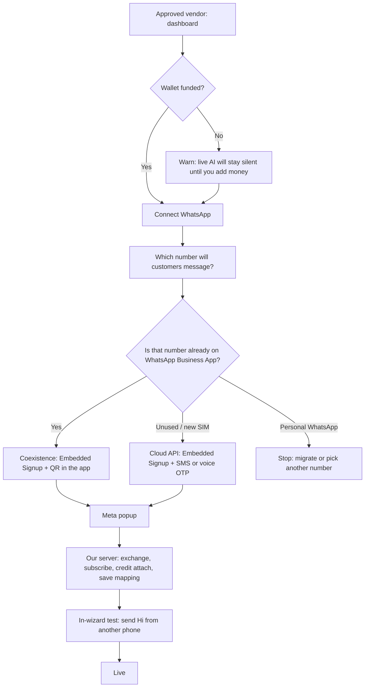

# P2h — WhatsApp connect (implementation plan)

**Status:** Planned (not shipped)  
**Last updated:** 2026-09-17  
**Depends on:** P2a–P2f (signup / trial / onboarding) and **P2g v1** (mock wallet top-up) — both shipped  
**Blocks:** Self-serve vendors going live on their own WhatsApp number; billing Meta conversation fees (`whatsappCostMilli`)

**Related specs:** [public-signup-onboarding.md](./public-signup-onboarding.md) (funnel, auto-approve, trial carry-forward, [implementation gaps](./public-signup-onboarding.md#implementation-gaps-doc-vs-code-2026-09-17)), [wallet-top-up-p2g.md](./wallet-top-up-p2g.md) (wallet before live AI), [BILLING_AND_PRICING.md](../../../../../docs/BILLING_AND_PRICING.md) (charge formula — authority), [meta-partnership README](../../../../requirements/meta-partnership/README.md) (Solution Partner + credit line), [vendor-onboarding-workflow.md](../../../whatsapp-integration/guides/vendor-onboarding-workflow.md) (older Meta playbook — **this file is the P2h product authority**; see §0).

---

## 0. How to read this vs older docs

| Doc | Role after this plan |
| --- | --- |
| **This file** | Product + engineering plan for P2h. Journey, WABA mapping, no-support constraint, conversion risks, implementation slices. |
| [vendor-onboarding-workflow.md](../../../whatsapp-integration/guides/vendor-onboarding-workflow.md) | Historical Meta API playbook. Graph call sequence in §6 is still useful. **§5 C–D (document upload / GST wizard) and §8 (ops-assisted default)** are **not** P2h v1. |
| [meta-partnership README](../../../../requirements/meta-partnership/README.md) | Partnership application + credit-line ops. Not the vendor UI spec. |
| [BILLING_AND_PRICING.md](../../../../../docs/BILLING_AND_PRICING.md) | How a connected number is charged. P2h-h fills `whatsappCostMilli`; do not invent a second debit path. |

---

## 1. Context (discussion summary)

After **P2a–P2g**, an approved vendor can fund a ChatLogix wallet via **mock top-up (P2g v1)** — **build and test P2h on mock wallet first**; Razorpay is not a prerequisite. They still cannot put **their own** WhatsApp number on the production pipeline without Embedded Signup (P2h).

**P2h is the self-serve connect epic.** The vendor finishes Meta Embedded Signup in the portal. ChatLogix never creates their WABA, never pastes a token, and never SQL-inserts their number as a setup step.

**Locked billing model (unchanged):** ChatLogix is (or will be) a Meta **Solution Partner** with an **INR line of credit**. Vendors connect **their** WABA. We **share our credit line** onto that WABA so Meta bills **ChatLogix**. The vendor pays **only** the ChatLogix wallet (AI + WhatsApp). The Tech Provider path (vendor adds a Meta payment method) is **not** the product default.

**What already shipped that P2h must reuse, not rebuild:**

- Webhook routing by `WhatsAppNumber.phoneNumberId` → `vendorId` (`webhookEventProcessor.ts`, `conversation/identity.ts`).
- Production Lambda pipeline (webhook → text/media queues → conversation processor → dispatcher).
- Wallet gate `canProcessMessage` in `pipeline.ts` (skip AI when balance cannot cover a turn).
- Single charge path `pricingService.chargeVendor` with a `whatsappCostMilli` slot that is **always 0** today.
- Per-vendor `Vendor.markupPercent` (admin-editable). P2h only has to supply the Meta **base rate**.

**Razorpay (P2g v2)** stays parked until credentials exist. It does not block P2h engineering.

---

## 2. Who owns what (WABA mapping)

This is the question that decides the whole design: **the vendor’s shop number is registered on the vendor’s WABA, not on a ChatLogix WABA.**

| Asset | Owner | ChatLogix role |
| --- | --- | --- |
| Meta **App** (one) | ChatLogix | Embedded Signup host; one production webhook URL |
| **Extended credit line (INR)** | ChatLogix | Attach (and later revoke) onto each vendor WABA |
| **Business Portfolio** | Vendor (created inside Embedded Signup if they have none) | None — we never log into their Facebook |
| **WABA** | Vendor | Subscribe our app; attach our credit line |
| **WhatsApp Business number** | Vendor | Persist `phoneNumberId` + encrypted business token |
| ChatLogix **login phone** (`Vendor.phone`) | ChatLogix | OTP login only. **Not** the customer-facing WhatsApp number |

### Mapping we persist

```
Customer WhatsApp → Meta Cloud API
  → webhook payload.phone_number_id
    → WhatsAppNumber.phoneNumberId  (unique)
      → WhatsAppNumber.vendorId
      → WhatsAppNumber.wabaId          (vendor's WABA)
      → encrypted tenant access token  (new in P2h)
```

Inbound already follows this. P2h’s job is to **create the row from Embedded Signup** and to **send/fetch media with the tenant token**.

### What we will not do

- Put new self-serve vendors onto a **shared ChatLogix WABA**. That looks easier (no Facebook login) and then fails Meta policy, display-name isolation, billing, and offboarding.
- Lease ChatLogix phone numbers as the production path. Trial value stays the **browser sandbox**, not a shared live number.
- Ask the vendor to paste a token, WABA ID, or webhook verify token.

### Today vs P2h (existing live vendors)

| | Today (Ibell, Lush, …) | P2h self-serve |
| --- | --- | --- |
| WABA | ChatLogix-controlled | **Vendor-owned** |
| Graph token | Global `WHATSAPP_ACCESS_TOKEN` | Encrypted **per-number** business token |
| How the row gets there | Ops / SQL | Embedded Signup complete-connect API |
| Send path | `whatsappClient.ts` always uses the global token | Tenant token if present, **else** global fallback |

P2h **must not** break existing mapped numbers. Dual send path is required until those vendors are migrated (not v1).

---

## 3. Vendor journey (after onboarding complete)

WhatsApp connect stays **after** catalog + sandbox + **onboarding submit (auto-approve)**. Meta is the second conversion cliff; we only open it once the vendor has seen the AI work. **No ops approval queue** — signup at midnight must reach dashboard the same night.

**Prerequisites before connect (target):**

| Step | Required? |
| --- | --- |
| Onboarding complete (`approved`) | Yes |
| Carried trial on wallet | Yes (any remainder from ₹50 grant) |
| Minimum top-up **₹100** for **live** | **No** — live when wallet passes **`canProcessMessage`** (carried trial OK). `minWalletTopUpPaise` applies only when they **choose** to top up |
| Connect Meta at low balance | Allowed with warning |



### Screens (v1)

Copy is shop-owner language. Never “WABA”, “Cloud API”, “credit attach”, or “phone number ID” in the UI.

1. **Why this step** — “Customers will WhatsApp *your* shop number. Message charges come from your ChatLogix wallet; you don’t pay Meta separately.”
2. **Pick the number** — not the login phone. Empty by default. Optional hint if onboarding stored a business phone.
3. **One routing question** — “Is this number already logged into WhatsApp Business App (the green one)?”
   - Yes → Coexistence (keep the app, scan QR).
   - No / new SIM → Cloud API (OTP).
   - Personal WhatsApp (blue/white icon) → **do not open Meta yet.** Show migrate-or-other-number copy.
4. **30-second preflight** — Facebook account ready, phone nearby, don’t close the popup, allow popups.
5. **Connect** — Meta Embedded Signup v4 (their UI).
6. **We finish silently** — human status strings: “Saving your number…” → “Turning on messages…” → “Linking billing…”
7. **Prove it works** — `wa.me` link + “Send Hi from another phone.” First inbound + first AI reply (wallet permitting) = **live**.

### Connect vs live (deliberate split)

| | Connect allowed | Status `live` |
| --- | --- | --- |
| Wallet ₹0 | **Yes** (don’t block Meta popup) | **No** — CTA to `/wallet`; inbound stored, no AI until balance covers gate |
| Wallet > 0 but below worst-case turn | **Yes** | **No** for AI — same as live pipeline today |
| Mapping + token + webhook subscribed | Required | Required |
| Credit attached | Required in production; skippable in dev if credit-line id unset | Required in production |
| Test inbound received | Optional | **Required** for the wizard to say “You’re live” |

A vendor who connects at ₹0 must not look live. Inbound is still stored (existing pipeline rule); AI/outbound stay gated. A silent shop after “success” is the worst conversion outcome.

### When this journey starts

- First dashboard visit after onboarding: **Connect WhatsApp** + **Add money** only if balance is low. Top-up uses **mock wallet (P2g v1)** while building P2h; Razorpay later.
- Optional completion SMS/WhatsApp to login phone — nurture, not setup.

---

## 4. Vendor has no WABA (majority path)

They should not create a Business Manager, WABA, or Cloud API app beforehand. Embedded Signup **creates** the stack:

1. Facebook login (create a Facebook account if needed — this is Meta’s screen).
2. Business Portfolio (Meta’s folder for the business).
3. A **new WABA** inside that portfolio.
4. WhatsApp profile (display name).
5. Phone:
   - **Cloud API** — number not on WhatsApp Business App; SMS or voice OTP.
   - **Coexistence** — number already on WhatsApp Business App; QR scan in the app.

That WABA is **theirs**. We never see their Facebook password. After the popup, Meta returns a one-time code plus `waba_id` / `phone_number_id`. Our server exchanges the code, subscribes **the existing production webhook** to that WABA, attaches **our** INR credit line, and inserts `WhatsAppNumber`.

v1: **one live WhatsApp number per vendor.** A WABA can hold more numbers later; don’t build that now.

---

## 5. Vendor already has a WABA

Same popup. They **select** the existing portfolio / WABA instead of creating one.

Risks (handle with copy + idempotent complete-connect, not ops):

- Number already connected to **another BSP** — Meta may require disconnecting the previous partner first. Error copy: “This number is still connected to another WhatsApp provider. Remove ChatLogix’s competitor in Meta Business Manager, then tap Connect again.”
- Display name already set / previously rejected.
- Old Meta payment method on the WABA — credit attach should make ChatLogix the Bill To Party; verify `primary_funding_id`.
- Number already mapped to **another ChatLogix vendor** — `phoneNumberId` is unique; return a clear 409, do not steal the row.

---

## 6. Phone number states (preflight)

The login phone and the shop WhatsApp number are **different** (already locked in public-signup-onboarding). The shop number can be in one of three states:

| State | Path | Vendor action before Meta |
| --- | --- | --- |
| Unused SIM / never on WhatsApp | Cloud API | Have the SIM for OTP |
| WhatsApp **Business App** (green) | Coexistence | Keep the app; scan QR when Meta asks |
| **Personal** WhatsApp | Not Cloud API until migrated | Delete from personal WhatsApp and wait Meta’s cooldown, **or** use a different number, **or** if they actually use the Business App, use CoEx |

Opening Embedded Signup before this question is the #1 conversion killer in India. The wizard asks it **before** the Connect button.

---

## 7. No ChatLogix human support (v1 constraint)

**ChatLogix ops must not**, as the default path:

- Create a Business Manager or WABA for the vendor
- Add or OTP a phone in Meta
- Paste a token or webhook secret
- SQL-insert `WhatsAppNumber`
- Screen-share through Facebook as the advertised setup

**We cannot remove Meta’s own screens.** Facebook login, 2FA, OTP/QR, and display-name review are Meta. Every Indian BSP hits the same wall. Conversion work is **preflight so the popup succeeds first try**, and **error screens with one next action**, not a support ticket.

| Event | Who unblocks it |
| --- | --- |
| Facebook login / 2FA | Vendor |
| Number on personal WhatsApp | Vendor (migrate / other SIM / CoEx) |
| Display name rejected | Vendor retries with a cleaner shop name |
| Meta Business Verification (later, for limits) | Vendor + Meta — **not** a ChatLogix KYC queue |
| ChatLogix **INR credit line** not approved | **Us, once, with Meta** — not per vendor |

The last row is the only platform-level blocker. Until the credit line exists, production attach fails for **everyone**. Engineering can build token exchange and subscribe against a Meta test app; production self-serve attach cannot ship without it.

**Out of P2h v1 (contradicts this constraint):**

- GST / PAN / address document upload to ChatLogix
- Ops-assisted default path / Calendly
- ChatLogix-hosted / leased numbers
- In-app Meta Business Verification automation

Need-help footer (WhatsApp us) stays as **nurture**, not as the way the account gets connected.

---

## 8. Conversion and risks

### Why people drop

Embedded Signup is the hardest step in the product. Typical SMB completion after “Connect” is poor unless we pre-flight.

1. **Personal WhatsApp on the shop number** — largest drop. Opening Meta first loses them.
2. **Facebook login** — no account, forgotten password, 2FA on someone else’s phone.
3. **Cloud vs CoEx as jargon** — one question, not two products.
4. **Popup blocked / closed** — mobile browsers, in-app browsers.
5. **Connect succeeds, wallet is ₹0** — customer messages, we store inbound, AI does not reply. Feels broken.
6. **Display name** — slogans and emoji fail; a plain shop name usually passes.

### Product rules that protect conversion

- WhatsApp **after** catalog + sandbox (already locked).
- Preflight **before** the Meta button.
- One routing question, shop-owner words.
- In-wizard test message before “You’re live.”
- Every Meta / Graph error maps to **one** next action. No “Contact support to complete setup.”
- Approval notification to login phone with the connect link (P2h+ / parallel).

### Platform risks

| Risk | Mitigation |
| --- | --- |
| ChatLogix absorbs Meta conversation fees until `whatsappCostMilli` is filled | Ship **P2h-h (rate card) before a marketing push**, after connect works on a test WABA |
| Global token still used for Ibell / Lush | Dual send: tenant token if present, else `WHATSAPP_ACCESS_TOKEN` |
| Token leak | Encrypt at rest; never return the token to the browser |
| Two vendors claim one number | Unique `phoneNumberId`; 409 with human copy |
| Credit attach fails | `connectStatus = error`, retry button, automated; not an ops ticket |
| Wrong CoEx vs Cloud path | Preflight question; Meta also rejects the mismatch |
| Many WABAs, one webhook | Already true. Meta includes `phone_number_id`. No per-vendor webhook URL |
| Existing numbers break during client refactor | Fallback token + test on a **dedicated test WABA** before touching production `phoneNumberId`s |

### Cost risk (ChatLogix)

Until P2h-h, every live turn costs us Meta conversation fees and we only debit AI. Do not invite a large vendor cohort onto real numbers before the rate card. Connect engineering can proceed; **go-live marketing cannot**.

---

## 9. Product rules (locked 2026-09-17)

| Rule | Detail |
| --- | --- |
| Who can connect | `registrationStatus === 'approved'` |
| WABA | **Vendor-owned.** Created or selected in Embedded Signup. Never a shared ChatLogix WABA for new vendors |
| Login phone vs shop number | **Different.** Shop number is chosen in this wizard |
| Numbers per vendor (v1) | **One live** WhatsApp number |
| Connect at wallet ₹0 | **Allowed** |
| Status `live` at wallet ₹0 | **Not allowed** |
| Inbound at low/zero wallet | **Always persist.** Do not enqueue AI / outbound (existing `canProcessMessage`) |
| Who pays Meta | ChatLogix credit line on the vendor WABA (`waba_currency=INR`). Vendor does not add a Meta payment method |
| Vendor pays | One ChatLogix wallet. Formula stays `ceil((aiCost + whatsappCost + platformFee) × (1 + markupPercent/100))` |
| Markup | Existing `Vendor.markupPercent`. No separate WhatsApp markup field |
| ChatLogix KYC for Meta | **None.** We do not collect GST/PAN for this flow |
| Ops setup | **None** as the default path |
| Existing mapped numbers | Keep working on the global token until migrated |
| UI language | Shop-owner. No WABA / Cloud API / credit-line vocabulary |
| Route | `/settings/whatsapp` in `web-vendor`, approved-portal guard |

---

## 10. Current codebase (baseline)

| Piece | Location | Notes |
| --- | --- | --- |
| Mapping table | `WhatsAppNumber` | `id`, `vendorId`, `phoneNumberId` (unique), `wabaId`, `createdAt`. **No token, no connect status** |
| Inbound routing | `webhook.ts` / `webhookEventProcessor.ts` | Lookup by `phoneNumberId`; skip with warn if unmapped |
| Identity | `conversation/identity.ts` | Same lookup for the processor |
| Outbound send | `services/whatsappClient.ts` | **Always** `Bearer ${env.WHATSAPP_ACCESS_TOKEN}`; `phoneNumberId` only selects the Graph path |
| Media fetch | `services/mediaFetchProcessor.ts` | Same global token pattern |
| Wallet gate | `billingService.canProcessMessage` → `pipeline.ts` | Skip AI on `insufficient_balance`; message already persisted by webhook |
| Charge | `pricingService.chargeVendor` | `whatsappCostMilli` accepted, callers pass 0 |
| Markup | `Vendor.markupPercent` | Admin `PATCH /api/vendors/:id/billing-config` |
| Wallet UI | `/wallet` | P2g mock top-up |
| Connect UI | **None** | `CatalogImportGoLive` “Share your WhatsApp number” → `/settings`, always incomplete |
| Embedded Signup | **None** | No `FB.login`, no config_id, no complete-connect route |
| Credit attach | **None** | No `whatsapp_credit_sharing_and_attach` |
| Env today | `WHATSAPP_ACCESS_TOKEN`, `WHATSAPP_PHONE_NUMBER_ID`, `WHATSAPP_APP_SECRET`, verify tokens | Platform-level only; no per-vendor secrets |

---

## 11. Architecture

```mermaid
sequenceDiagram
  participant V as web-vendor
  participant Meta as Meta Embedded Signup
  participant API as Express API
  participant Graph as Graph API
  participant DB as PostgreSQL
  participant WA as Customer WhatsApp

  V->>V: Preflight + path question
  V->>Meta: Embedded Signup v4 popup
  Meta-->>V: code, waba_id, phone_number_id
  V->>API: POST /vendors/me/whatsapp/complete-connect
  API->>Graph: Exchange code → business token
  API->>Graph: Register phone / finish CoEx
  API->>Graph: Subscribe app to WABA webhooks
  API->>Graph: Credit share + attach INR
  API->>Graph: GET WABA primary_funding_id
  API->>DB: Upsert WhatsAppNumber + encrypted token
  API-->>V: connectStatus, displayPhone, waMeLink

  WA->>Graph: Customer inbound
  Graph->>API: Existing webhook URL
  API->>DB: Lookup phoneNumberId → vendorId
  Note over API: Persist always; AI only if wallet allows
  API->>Graph: Reply using tenant token
```

**Single webhook.** Production already uses one callback. New WABAs are subscribed to that same URL. No per-vendor webhook configuration in the UI.

**Single send helper.** All outbound (conversation dispatcher, templates, typing, media upload) go through `whatsappClient` after it learns to resolve a token by `phoneNumberId`.

**Single charge helper.** P2h-h only **populates** `whatsappCostMilli` on the existing `chargeVendor` call. No parallel WhatsApp ledger.

---

## 12. Implementation phases

Deliver in order. Each slice is a reviewable unit. Stop after P2h-f before pointing production numbers at new send code.

### P2h-a — Schema and connect state

Extend `WhatsAppNumber` (keep `phoneNumberId` unique, `vendorId` FK, `wabaId`):

| Field | Purpose |
| --- | --- |
| `accessTokenEncrypted` | Business token (or move to a secrets table if we want token rotation isolated) |
| `tokenExpiresAt` | If Meta returns an expiry; refresh is P2h+ |
| `connectStatus` | `not_started` \| `meta_in_progress` \| `credit_attached` \| `live` \| `disconnected` \| `error` |
| `connectPath` | `cloud` \| `coexistence` |
| `displayPhone` | E.164 for UI / `wa.me` |
| `displayName` | WhatsApp profile name as Meta returned it |
| `primaryFundingId` | Verified after attach |
| `lastErrorCode` / `lastErrorMessage` | Vendor-facing copy key + raw Meta body for logs |
| `connectedAt` / `liveAt` | Timestamps |
| `metaBusinessId` | Portfolio id, optional, for support logs only |

Rules:

- At most **one** row per vendor with `connectStatus` in (`meta_in_progress`, `credit_attached`, `live`). Enforce in application code (partial unique index if we can do it cleanly in Prisma).
- `phoneNumberId` remains globally unique.
- Do not store the raw token. Use a dedicated encryption key (see P2h-b).
- Migration only — no backfill required for existing rows (they keep working via global token fallback).

**Tests:** unique `phoneNumberId`; encrypt/decrypt round-trip helper.

---

### P2h-b — Platform secrets and Meta app config

Server-only. Never sent to `web-vendor` except `META_APP_ID` + Embedded Signup `config_id` (public by design).

| Env | Role |
| --- | --- |
| `META_APP_ID` | Embedded Signup + token exchange |
| `META_APP_SECRET` | Token exchange |
| `META_EMBEDDED_SIGNUP_CONFIG_ID` | Embedded Signup v4 configuration |
| `META_SYSTEM_USER_TOKEN` | Credit attach / revoke **only** — not for vendor sends |
| `META_EXTENDED_CREDIT_LINE_ID` | `whatsapp_credit_sharing_and_attach` |
| `WHATSAPP_TOKEN_ENCRYPTION_KEY` | Encrypt tenant tokens at rest |
| Existing `WHATSAPP_ACCESS_TOKEN` | Fallback for pre-P2h numbers |
| Existing webhook verify / app secret | Unchanged |

`META_EXTENDED_CREDIT_LINE_ID` unset → skip attach in non-production, persist `connectStatus = credit_attached` only when attach actually ran **or** when explicitly skipped with `connectStatus` staying `meta_in_progress` until attach. Do not silently mark production numbers `live` without attach.

Document in `.env.example`. No `PlatformSettings` row for these — they are infrastructure secrets, not admin billing knobs.

---

### P2h-c — Vendor UI (`/settings/whatsapp`)

**web-vendor**, approved-only (same guard as `/wallet`).

1. `GET /api/vendors/me/whatsapp` → current mapping + status + `waMeLink` + `mockAttachSkipped` (dev).
2. Wizard steps in §3. Use `@chatlogix/design-tokens` (navy / WhatsApp green). Follow `.cursor/rules/21st-mcp-design.mdc` for layout patterns.
3. Load Meta’s Embedded Signup script; launch with `config_id` + session logging.
4. On popup success, `POST .../complete-connect` with the code + ids Meta returned + the path the vendor chose (`cloud` | `coexistence`).
5. Status machine with human copy (see §13).
6. Test panel: `wa.me/{displayPhone}` , QR, “Waiting for your test message…” polled via GET (inbound already creates `Message` rows).
7. Wallet banner if `walletBalanceMilli === 0`: connect still enabled; live disabled.

Wire:

- Dashboard / Quick Actions “Connect WhatsApp”
- `CatalogImportGoLive` checklist item → `/settings/whatsapp`, `done` when live
- Sidebar if settings already exists; don’t add a dead nav item

**Not in this slice:** backend Graph calls (stub the POST if needed, but prefer landing P2h-d in the same PR if the UI would otherwise be fake).

---

### P2h-d — Complete-connect API

`POST /api/vendors/me/whatsapp/complete-connect`  
Auth: vendor JWT. Approved only.

Body (Zod): Embedded Signup payload (`code`, `waba_id`, `phone_number_id`, optional `business_id`) + `connectPath`.

Server, in order, idempotent on `(vendorId, phoneNumberId)`:

1. Set `connectStatus = meta_in_progress`.
2. Exchange `code` for a business-scoped token (app id + secret).
3. Fetch display phone / name from Graph.
4. **Cloud:** register the phone (`/register`) if Meta requires it for this number. **CoEx:** complete the Coexistence handshake Meta documents for the current Graph version.
5. `POST /{waba-id}/subscribed_apps` so the **existing** production webhook receives this WABA.
6. Encrypt and persist token + ids.
7. Return status. Attach is P2h-e (can be the same request if credit line id is present — prefer one atomic “finish” so the vendor doesn’t sit between subscribe and attach).

Failure: `connectStatus = error`, `lastErrorMessage` mapped through §13, HTTP 422 with `code` + `message` (vendor-safe). Log the raw Graph body.

**409** if `phoneNumberId` belongs to another vendor.

**OpenAPI** in `backend/src/docs/openapi.ts`.

**Tests:** mock Graph; happy path writes one row; retry does not duplicate; other-vendor 409; non-approved 403.

---

### P2h-e — Credit attach (INR)

After token + subscribe:

```
POST /{EXTENDED_CREDIT_LINE_ID}/whatsapp_credit_sharing_and_attach
  ?waba_currency=INR
  &waba_id={CUSTOMER_WABA_ID}
Authorization: Bearer {SYSTEM_USER_TOKEN}
```

Then `GET /{WABA_ID}?fields=primary_funding_id` and persist. Mismatch or missing id → `error`, retry endpoint `POST /vendors/me/whatsapp/retry-attach` (no Meta popup).

Dev: if `META_EXTENDED_CREDIT_LINE_ID` is unset, skip attach and **do not** call the vendor live in production config. A `CHATLOGIX_SKIP_CREDIT_ATTACH=true` flag for local/staging only, default false.

This slice is what makes Meta bill ChatLogix. Without it, we either absorb fees on the wrong party or Meta may reject sends depending on the WABA’s funding.

---

### P2h-f — Per-tenant Graph client

Change `whatsappClient.ts` (and media download/upload that today uses the global token):

```
resolveCredentials(phoneNumberId):
  row = WhatsAppNumber.findUnique(phoneNumberId)
  if row?.accessTokenEncrypted → decrypt, use that token + that phoneNumberId
  else → env.WHATSAPP_ACCESS_TOKEN + (phoneNumberId || env.WHATSAPP_PHONE_NUMBER_ID)
```

Missing tenant token on a P2h number in `live` / `credit_attached` is an error (don’t silently send as ChatLogix). Missing token on a **legacy** row (no encrypted token) is the fallback path.

**Which of a vendor's rows sends** — `services/whatsapp/vendorSendingNumber.ts` is the single ranking used everywhere outbound resolves a number from a `vendorId` (`responseQueuingService`, `messageProcessor`, `whatsappTemplateService`, `dataExtractionService`, `vendorConversationReply`, `customerQueryNotify`). Order: `live`/`credit_attached` → legacy row (no `connectStatus`, no token) → `meta_in_progress` → `error`/`disconnected`, newest `createdAt` first within a tier. Pre-P2h newest-wins would let a failed connect attempt (newer `error` row) hijack sends from the vendor's working number.

**Test plan (mandatory before production traffic):**

1. Send on a **new test WABA** with tenant token.
2. Send on an **existing** Ibell/Lush `phoneNumberId` and confirm fallback still works.
3. Media fetch for both.

This is the dangerous slice. Do not combine with UI-only PRs.

---

### P2h-g — Live gating + first-message proof

Reuse `canProcessMessage` — do not invent a second gate. **Do not** require `minWalletTopUpPaise` for `live`.

Wizard `live` when:

1. `connectStatus` reached `credit_attached` (or explicit dev skip documented in the GET payload).
2. **`canProcessMessage(vendorId, 'text', { assistantTurnWorstCaseMedia: true })` returns allowed** — carried trial counts; no mandatory top-up txn.
3. At least one **inbound** `Message` for that `phoneNumberId` after `connectedAt`.

GET endpoint includes `testInboundAt` so the UI can poll. Optional: send nothing outbound as a “test ping” from us — inbound from the vendor’s personal phone is the proof customers will experience.

If wallet is 0 after attach: status stays `credit_attached`, UI says “Add money to go live”, inbound stored, no AI.

---

### P2h-h — WhatsApp rate card (`whatsappCostMilli`)

Populate the existing slot from Meta’s INR rate card (category + destination). Apply **after** connect works on a test number, **before** inviting many vendors.

- Look up rate → `whatsappCostMilli` on `debitAfterEnqueue` / outbound media as appropriate.
- Still one `chargeVendor` call. Markup already applied inside it.
- Status webhooks’ pricing fields → reconciliation is **P2h+**, not v1. v1 is “best-effort base rate on send/turn.”
- Update [BILLING_AND_PRICING.md](../../../../../docs/BILLING_AND_PRICING.md) §7 in the **same change** (that file is the money authority).

Until this lands, ChatLogix absorbs Meta fees — known, documented, not an oversight.

---

### P2h-i — Later (not v1)

| Item | Why later |
| --- | --- |
| Disconnect + credit revoke | Needed for churn; not needed to connect the first vendor |
| Token refresh | If Meta tokens expire; monitor `tokenExpiresAt` |
| Extra numbers on one WABA | v1 is one live number |
| Webhook pricing reconciliation | Hardening after rate card |
| Approval notification with connect URL | Parallel small ticket (`vendorApprovalNotificationService`) |
| In-app template CRUD | Not required to receive/reply |
| Migrate Ibell/Lush onto tenant tokens | Deliberate follow-up once dual path is proven |
| Razorpay | P2g v2, credentials |

---

## 13. Vendor-facing errors (no support CTA as the setup path)

| Situation | Message | Next action |
| --- | --- | --- |
| Personal WhatsApp on that number | “This number is on personal WhatsApp. Cloud API can’t use it until you move it.” | Use another number, or delete personal WhatsApp and wait, or use WhatsApp Business App + Coexistence |
| Popup blocked | “Your browser blocked the Facebook window.” | Allow popups, try again |
| Facebook login cancelled | “Connection wasn’t finished.” | Connect again |
| Display name rejected | “WhatsApp didn’t accept that profile name.” | Try your shop name only, no slogan or emoji |
| Number already on ChatLogix | “This WhatsApp number is already connected to another shop.” | Use a different number |
| Number on another BSP | “This number is still connected to another WhatsApp provider.” | Remove the other provider in Meta, then retry |
| OTP failed | “We couldn’t verify that number.” | Check the SIM, try voice OTP, or another number |
| CoEx QR expired | “The QR timed out.” | Open WhatsApp Business App and scan again |
| Credit attach failed | “Your number is saved but billing isn’t linked yet.” | Retry (same screen). If it keeps failing, that is a **platform** credit-line issue, not a vendor setup task |
| Wallet ₹0 after connect | “Customers can message you, but the assistant won’t reply until you add money.” | Go to `/wallet` |
| Graph 5xx / timeout | “WhatsApp is taking too long. Nothing was lost — tap retry.” | Retry complete-connect / attach |

Log `lastErrorCode` internally. Do not dump Graph JSON in the UI.

---

## 14. Security

| Topic | Rule |
| --- | --- |
| Tenant token | Encrypted at rest; decrypt only in send/media/connect services |
| Token in API responses | Never |
| System user token | Credit attach/revoke only; not a send fallback |
| Complete-connect | Vendor JWT; bind WABA/phone to **that** `vendorId`; reject if phone mapped elsewhere |
| Webhook | Unchanged: app-secret signature, existing verify token |
| Encryption key | Env / KMS; rotate = re-encrypt job (P2h+) |
| Audit | Log connect/disconnect/attach with vendorId, wabaId, phoneNumberId — not the token |

---

## 15. File checklist (expected)

| Area | Files |
| --- | --- |
| Schema | `backend/prisma/schema.prisma` (`WhatsAppNumber`), new migration |
| Crypto | `backend/src/utils/whatsappTokenCrypto.ts` (or similar) |
| Connect service | `backend/src/services/whatsapp/whatsappConnectService.ts` |
| Graph helpers | Token exchange, subscribe, register, credit attach — keep next to connect service, not inside `whatsappClient.ts` |
| Send path | `backend/src/services/whatsappClient.ts`, `mediaFetchProcessor.ts` |
| Routes | `backend/src/routes/vendorWhatsApp.ts`, mount in `index.ts` |
| Config | `backend/src/config/env.ts`, `backend/.env.example` |
| Tests | connect service + whatsappClient credential resolution |
| Frontend | `frontend_v2/apps/web-vendor/src/pages/settings/WhatsAppConnect.tsx` (name flexible), `lib/whatsappConnect.ts`, `App.tsx`, `CatalogImportGoLive.tsx`, dashboard CTAs |
| OpenAPI | `backend/src/docs/openapi.ts` |
| Docs | This file; [BILLING_AND_PRICING.md](../../../../../docs/BILLING_AND_PRICING.md) §7 when P2h-h ships |

---

## 16. QA (v1 acceptance)

1. **Approved** vendor, funded wallet, unused test number, Cloud API path → mapping row, tenant send, inbound routed to that vendor, AI reply delivered.
2. Same vendor, **retry** complete-connect → one row, no duplicate.
3. **Onboarding** vendor → 403 on connect APIs.
4. **Wallet ₹0**, connect succeeds → inbound stored, no AI, UI not “live”, top-up then test message → live.
5. **Personal WhatsApp** preflight → Meta popup not opened.
6. **CoEx** path on a Business App number → QR, then same as (1).
7. `phoneNumberId` already on another vendor → 409, original owner unchanged.
8. **Legacy** Ibell/Lush send still uses global token.
9. New tenant send does **not** use the global token.
10. Unmapped inbound `phoneNumberId` still ignored (existing warn), no crash.
11. Credit attach skipped in local (flag) cannot mark production `live`.
12. Disconnect is **out of v1**; do not fail QA for missing revoke.

---

## 17. Ops / Meta prerequisites (not per-vendor work)

These are **one-time platform** tasks. They are not ChatLogix support tickets.

1. Meta App configured for Embedded Signup v4 (Cloud API + Coexistence).
2. Solution Partner status + **extended INR credit line** + Credit Allocation API terms.
3. System user with credit-sharing permission; credit line id in env.
4. Production webhook already lives on API Gateway — subscribe new WABAs to **that** URL.
5. Display-name / messaging-limit realities: first numbers may start on limited throughput until Meta verification. Product copy should not promise unlimited volume on day one.

If (2) is missing, P2h-a through P2h-d and P2h-f can still be built against a test app; **do not** market self-serve go-live.

---

## 18. What P2h does not include

- Razorpay (P2g v2)
- GST invoices, auto-recharge
- Meta ads, pixel, Commerce catalog sync
- In-app template library
- Outbound interactive/CTA productization
- ChatLogix KYC document vault
- Migrating existing production numbers off the global token (follow-up)
- Changing the conversation AI pipeline (except rate-card input to billing)

---

## 19. Decision log

| Date | Decision |
| --- | --- |
| 2026-09-16 | P2h follows P2g. Markup shipped early; WhatsApp **base rate** still P2h. |
| 2026-09-16 | Solution Partner + INR credit share is the billing model; Tech Provider (vendor pays Meta) is not default. |
| 2026-09-17 | **Vendor-owned WABA** for every self-serve number. No shared ChatLogix WABA, no leased numbers as the product path. |
| 2026-09-17 | Embedded Signup **creates** Portfolio + WABA when the vendor has none. No pre-created Meta assets required. |
| 2026-09-17 | ChatLogix ops does **not** set up the WhatsApp account. Preflight + error copy replace assisted onboarding as the default. |
| 2026-09-17 | One live number per vendor in v1. Login phone ≠ shop WhatsApp number. |
| 2026-09-17 | Connect allowed at ₹0; **live** requires wallet > 0 and a test inbound. Inbound always stored. |
| 2026-09-17 | Dual Graph credentials: tenant token if present, else global token, so Ibell/Lush keep working. |
| 2026-09-17 | Rate card (P2h-h) ships after connect works, **before** a large go-live push. |
| 2026-09-18 | **No min top-up to go live** — wallet gate only (`canProcessMessage`). |
| 2026-09-18 | **Finish setup** / `complete-onboarding`; not “submit for approval”. |
| 2026-09-18 | **P2h ships against mock wallet first** — Razorpay parallel, not blocking. |
| 2026-09-17 | **No required admin approval** — auto-complete onboarding 24/7; trial **carry forward**. |
| 2026-09-17 | GST/PAN/document wizard in the older workflow doc is **not** P2h v1. |

---

## 20. Suggested first build ticket

**P2h-a + P2h-b:** `WhatsAppNumber` fields + encryption helper + env. No UI, no production send change.

Then **P2h-c + P2h-d** on a Meta **test** app (skip attach if credit line id is missing). Then **P2h-f** with the dual-token fallback proven on a legacy number. Attach, live-proof, and rate card follow.

Official Meta references: [Embedded Signup](https://developers.facebook.com/docs/whatsapp/embedded-signup/), [Share and revoke credit lines](https://developers.facebook.com/docs/whatsapp/embedded-signup/manage-accounts/share-and-revoke-credit-lines).

---

## 21. Funnel + code gaps

Product funnel (auto-approve, trial carry-forward, min top-up) is documented in [public-signup-onboarding.md § Implementation gaps](./public-signup-onboarding.md#implementation-gaps-doc-vs-code-2026-09-17). P2h does not remove those gaps — it adds WhatsApp connect on top once onboarding completion and wallet rules match the target.
