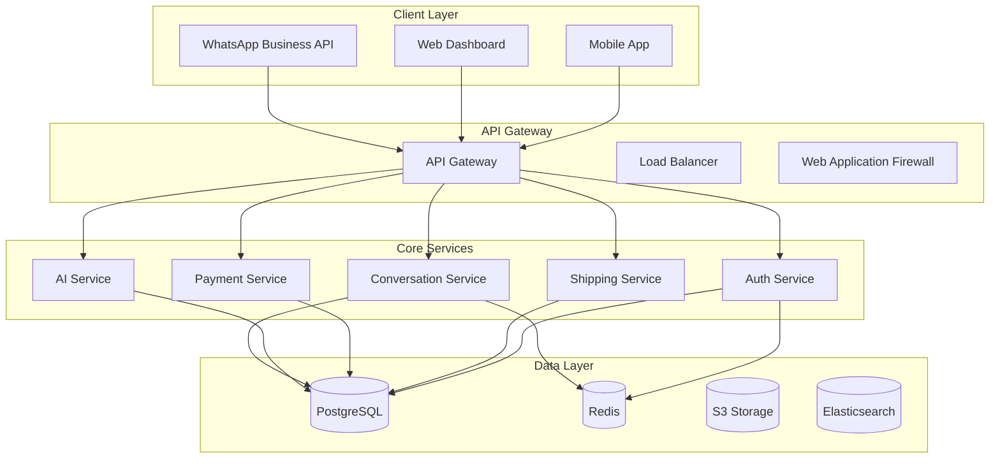

# 📚 Documentation Standards - ChatLogix

> Comprehensive documentation requirements and standards for enterprise-grade SaaS

## 🎯 Documentation Overview

ChatLogix requires **comprehensive, high-quality documentation** to support development, operations, and user adoption. This document outlines our documentation standards, templates, and requirements for creating maintainable, accessible, and professional documentation.

**Documentation Philosophy:** Clear, concise, comprehensive, and always up-to-date
**Quality Standards:** Professional, accurate, accessible, and searchable
**Maintenance:** Living documents that evolve with the product

---

## 📋 Documentation Categories

### **Documentation Types:**
```
┌─────────────────────────────────────────────────────────────────┐
│                    Documentation Categories                     │
├─────────────────────────────────────────────────────────────────┤
│ 1. Technical Documentation (API, Code, Architecture)          │
│ 2. User Documentation (Guides, Tutorials, FAQs)               │
│ 3. Operational Documentation (Deployment, Monitoring)         │
│ 4. Business Documentation (Requirements, Plans, Reports)       │
│ 5. Compliance Documentation (Security, Privacy, Standards)     │
└─────────────────────────────────────────────────────────────────┘
```

### **Documentation Hierarchy:**
- **Level 1:** Executive summaries and overviews
- **Level 2:** Detailed guides and specifications
- **Level 3:** Technical implementation details
- **Level 4:** Code examples and reference materials

---

## 📝 Documentation Standards

### **Writing Standards:**
- **Clarity:** Use simple, clear language
- **Consistency:** Follow established terminology and formats
- **Completeness:** Cover all necessary information
- **Accuracy:** Ensure information is current and correct
- **Accessibility:** Use inclusive language and clear structure

### **Documentation Template:**
```markdown
# Document Title

> Brief description of what this document covers

## 🎯 Overview

Brief overview of the document's purpose and scope.

**Key Points:**
- Point 1
- Point 2
- Point 3

---

## 📋 Table of Contents

- [Section 1](#section-1)
- [Section 2](#section-2)
- [Section 3](#section-3)

---

## Section 1

Content for section 1.

### Subsection 1.1

More detailed content.

**Important Note:** Highlight important information.

---

## Section 2

Content for section 2.

### Code Example

```typescript
// Example code
function example() {
  return "Hello World";
}
```

---

## 📚 Related Documents

- [Related Document 1](./related-doc-1.md)
- [Related Document 2](./related-doc-2.md)

---

## 🎯 Summary

Brief summary of key points covered.

---

**Last Updated:** [Date]
**Next Review:** [Date]
**Document Owner:** [Name/Team]
```

---

## 🔧 Technical Documentation

### **API Documentation Standards:**
- **OpenAPI/Swagger:** Standard API specification format
- **Interactive Examples:** Testable API endpoints
- **Error Codes:** Comprehensive error documentation
- **Rate Limits:** Clear usage guidelines
- **Authentication:** Security requirements and examples

### **API Documentation Template:**
```yaml
# OpenAPI 3.0 Specification
openapi: 3.0.3
info:
  title: ChatLogix API
  description: WhatsApp automation SaaS API for merchants
  version: 1.0.0
  contact:
    name: ChatLogix Support
    email: support@chatlogix.com
  license:
    name: Proprietary
    url: https://chatlogix.com/license

servers:
  - url: https://api.chatlogix.com/v1
    description: Production server
  - url: https://staging-api.chatlogix.com/v1
    description: Staging server

paths:
  /auth/register:
    post:
      summary: Register a new merchant
      description: Create a new merchant account with business information
      tags:
        - Authentication
      requestBody:
        required: true
        content:
          application/json:
            schema:
              $ref: '#/components/schemas/MerchantRegistration'
            examples:
              home_baker:
                summary: Home Baker Registration
                value:
                  business_name: "Priya's Home Bakery"
                  phone_number: "+919876543210"
                  email: "priya@bakery.com"
                  business_type: "Food & Beverage"
                  password: "SecurePass123!"
      responses:
        '201':
          description: Merchant registered successfully
          content:
            application/json:
              schema:
                $ref: '#/components/schemas/MerchantResponse'
        '400':
          description: Bad request - validation error
          content:
            application/json:
              schema:
                $ref: '#/components/schemas/ErrorResponse'
        '409':
          description: Conflict - phone number already exists
          content:
            application/json:
              schema:
                $ref: '#/components/schemas/ErrorResponse'

components:
  schemas:
    MerchantRegistration:
      type: object
      required:
        - business_name
        - phone_number
        - email
        - business_type
        - password
      properties:
        business_name:
          type: string
          minLength: 2
          maxLength: 100
          description: Name of the business
          example: "Priya's Home Bakery"
        phone_number:
          type: string
          pattern: '^\+[1-9]\d{1,14}$'
          description: International phone number
          example: "+919876543210"
        email:
          type: string
          format: email
          description: Business email address
          example: "priya@bakery.com"
        business_type:
          type: string
          enum: ["Food & Beverage", "Electronics", "Fashion", "Home & Garden", "Other"]
          description: Category of business
        password:
          type: string
          minLength: 8
          description: Secure password (min 8 characters)
          example: "SecurePass123!"

    MerchantResponse:
      type: object
      properties:
        merchant_id:
          type: string
          format: uuid
          description: Unique merchant identifier
        business_name:
          type: string
        phone_number:
          type: string
        email:
          type: string
        business_type:
          type: string
        subscription_plan:
          type: string
          default: "starter"
        token:
          type: string
          description: JWT authentication token
        created_at:
          type: string
          format: date-time

    ErrorResponse:
      type: object
      properties:
        error:
          type: string
          description: Error message
        code:
          type: string
          description: Error code
        details:
          type: object
          description: Additional error details
```

---

## 👥 User Documentation

### **User Guide Standards:**
- **Step-by-Step Instructions:** Clear, numbered steps
- **Screenshots:** Visual aids for complex processes
- **Video Tutorials:** For complex workflows
- **Troubleshooting:** Common issues and solutions
- **Glossary:** Technical terms explained

### **User Guide Template:**
```markdown
# Getting Started with ChatLogix

> Complete guide to set up and start using ChatLogix for your business

## 🎯 What You'll Learn

By the end of this guide, you'll be able to:
- ✅ Register your business on ChatLogix
- ✅ Connect your WhatsApp Business account
- ✅ Set up automated responses
- ✅ Handle your first customer conversation
- ✅ Create and manage orders

---

## 📱 Prerequisites

Before you begin, make sure you have:
- [ ] A WhatsApp Business account
- [ ] Your business phone number
- [ ] Business email address
- [ ] Basic business information ready

---

## 🚀 Step 1: Create Your Account

### 1.1 Visit ChatLogix

1. Open your web browser
2. Go to [https://chatlogix.com](https://chatlogix.com)
3. Click the **"Get Started"** button


### 1.2 Fill Registration Form

1. Enter your **business name**
2. Provide your **phone number** (with country code)
3. Add your **business email**
4. Select your **business type**
5. Create a **secure password**
6. Click **"Create Account"**

**Important:** Use the same phone number as your WhatsApp Business account.


---

## 🔗 Step 2: Connect WhatsApp

### 2.1 WhatsApp Business Setup

1. In your ChatLogix dashboard, click **"Connect WhatsApp"**
2. Follow the step-by-step instructions
3. Scan the QR code with your WhatsApp Business app
4. Verify the connection


### 2.2 Test Connection

1. Send a test message to your business number
2. Verify it appears in your ChatLogix dashboard
3. Confirm automated responses are working

---

## ⚙️ Step 3: Configure Automation

### 3.1 Set Up FAQ Responses

1. Go to **"Automation"** → **"FAQ Manager"**
2. Click **"Add New FAQ"**
3. Enter common questions and answers
4. Set response triggers

**Example FAQ:**
- **Question:** "What are your business hours?"
- **Answer:** "We're open Monday to Saturday, 9 AM to 7 PM. Closed on Sundays."

### 3.2 Create Welcome Message

1. Navigate to **"Automation"** → **"Welcome Messages"**
2. Write a friendly welcome message
3. Set it to send automatically to new customers

---

## 📊 Step 4: Monitor and Optimize

### 4.1 Check Dashboard

Your dashboard shows:
- 📱 Active conversations
- 📈 Response times
- 💰 Orders and revenue
- 🤖 Automation performance

### 4.2 Review Analytics

1. Check **"Analytics"** section weekly
2. Monitor customer satisfaction scores
3. Identify areas for improvement
4. Optimize automated responses

---

## 🆘 Troubleshooting

### Common Issues and Solutions

#### Issue: WhatsApp not connecting
**Solution:** 
1. Ensure you're using WhatsApp Business (not regular WhatsApp)
2. Check your internet connection
3. Try logging out and back in

#### Issue: Automated responses not working
**Solution:**
1. Verify FAQ rules are properly configured
2. Check if responses are within WhatsApp limits
3. Ensure your account is active

#### Issue: Dashboard not loading
**Solution:**
1. Clear browser cache and cookies
2. Try a different browser
3. Check your internet connection

---

## 📞 Need Help?

### Support Channels

- **Email:** support@chatlogix.com
- **Phone:** +91-98765-43210 (Mon-Fri, 9 AM-6 PM IST)
- **Live Chat:** Available in your dashboard
- **Documentation:** [docs.chatlogix.com](https://docs.chatlogix.com)

### Community

- **Facebook Group:** [ChatLogix Merchants](https://facebook.com/groups/chatlogix)
- **WhatsApp Community:** Join our merchant community
- **YouTube Channel:** [ChatLogix Tutorials](https://youtube.com/chatlogix)

---

## 🎯 Next Steps

Now that you're set up:

1. **Explore Advanced Features:**
   - Payment integration
   - Shipping automation
   - Advanced analytics

2. **Join Training Sessions:**
   - Weekly webinars
   - One-on-one consultations
   - Group training sessions

3. **Connect with Other Merchants:**
   - Share best practices
   - Learn from experiences
   - Build your network

---

**Congratulations! You're now ready to automate your WhatsApp business with ChatLogix! 🎉**

---

**Last Updated:** December 2024
**Next Review:** March 2025
**Document Owner:** Product Team
```

---

## 🏗️ Architecture Documentation

### **System Architecture Standards:**
- **High-Level Diagrams:** System overview and components
- **Detailed Diagrams:** Component interactions and data flow
- **Technology Stack:** Tools, frameworks, and versions
- **Deployment Architecture:** Infrastructure and deployment
- **Security Architecture:** Security measures and compliance

### **Architecture Documentation Template:**
```markdown
# ChatLogix System Architecture

> Comprehensive system architecture documentation

## 🏗️ System Overview

ChatLogix is a microservices-based SaaS platform designed to handle millions of WhatsApp conversations daily.

### High-Level Architecture



## 🔧 Technology Stack

### Backend Technologies
- **Runtime:** Node.js 18+ with TypeScript
- **Framework:** Express.js with middleware stack
- **Database:** PostgreSQL 15+ with TypeORM
- **Cache:** Redis 7+ with Bull for queues
- **Search:** Elasticsearch 8+ for analytics

### Frontend Technologies
- **Framework:** React 18+ with TypeScript
- **State Management:** Redux Toolkit
- **Styling:** Tailwind CSS with design system
- **Testing:** Jest, React Testing Library

### Infrastructure
- **Cloud:** AWS (EC2, RDS, ElastiCache, S3)
- **Containerization:** Docker with Kubernetes
- **CI/CD:** GitHub Actions with automated testing
- **Monitoring:** Prometheus, Grafana, ELK Stack

## 📊 Data Flow

### Conversation Processing Flow

1. **Message Reception**
   - WhatsApp webhook receives message
   - API Gateway validates and routes
   - Conversation Service processes

2. **AI Processing**
   - Message sent to AI Service
   - Intent classification performed
   - Response generation initiated

3. **Response Delivery**
   - AI response validated
   - Message queued for delivery
   - WhatsApp API sends response

## 🔐 Security Architecture

### Security Layers
1. **Network Security:** VPC, Security Groups, WAF
2. **Application Security:** JWT, Rate Limiting, Input Validation
3. **Data Security:** Encryption at rest and in transit
4. **Access Control:** RBAC, MFA, Audit Logging

### Compliance
- **GDPR:** Data protection and privacy
- **PCI DSS:** Payment security
- **SOC 2:** Security and availability
- **ISO 27001:** Information security

## 📈 Scalability

### Horizontal Scaling
- **Auto-scaling:** Kubernetes HPA based on CPU/memory
- **Load Balancing:** Multiple API instances behind ALB
- **Database Scaling:** Read replicas and connection pooling
- **Cache Scaling:** Redis cluster for high availability

### Performance Targets
- **Response Time:** < 200ms for 95% of API requests
- **Throughput:** 1,000+ messages per second
- **Uptime:** 99.9% availability
- **Concurrent Users:** 10,000+ merchants

---

## 📚 Related Documents

- [API Documentation](./api-documentation.md)
- [Deployment Guide](./deployment-guide.md)
- [Security Policy](./security-policy.md)
- [Performance Guidelines](./performance-guidelines.md)

---

**Last Updated:** December 2024
**Next Review:** March 2025
**Document Owner:** Engineering Team
```

---

## 📖 Code Documentation

### **Code Documentation Standards:**
- **Inline Comments:** Explain complex logic
- **Function Documentation:** Purpose, parameters, return values
- **Class Documentation:** Purpose, responsibilities, usage
- **API Documentation:** Endpoints, parameters, responses
- **README Files:** Project setup and usage

### **Code Documentation Template:**
```typescript
/**
 * ChatLogix AI Service
 * 
 * Handles all AI-related operations including:
 * - OpenAI integration for response generation
 * - Intent classification for customer messages
 * - Sentiment analysis for conversation quality
 * - Knowledge base management
 * 
 * @author ChatLogix Engineering Team
 * @version 1.0.0
 * @since 2024-01-01
 */

import { OpenAI } from 'openai';
import { IntentClassifier } from './intent-classifier';
import { SentimentAnalyzer } from './sentiment-analyzer';
import { KnowledgeBase } from './knowledge-base';

/**
 * Configuration interface for AI Service
 */
interface AIServiceConfig {
  /** OpenAI API key for GPT-4 access */
  openaiApiKey: string;
  /** Maximum tokens for response generation */
  maxTokens: number;
  /** Temperature for response creativity (0-2) */
  temperature: number;
  /** Model to use for generation */
  model: 'gpt-4' | 'gpt-3.5-turbo';
}

/**
 * Response generation options
 */
interface GenerateResponseOptions {
  /** Customer message content */
  message: string;
  /** Conversation context */
  context: ConversationContext;
  /** Business rules and constraints */
  businessRules: BusinessRules;
  /** Response tone and style */
  tone: 'professional' | 'friendly' | 'casual';
}

/**
 * AI Service for intelligent conversation handling
 * 
 * This service provides the core AI capabilities for ChatLogix,
 * enabling automated responses that feel natural and helpful.
 * 
 * @example
 * ```typescript
 * const aiService = new AIService(config);
 * const response = await aiService.generateResponse({
 *   message: "What are your business hours?",
 *   context: conversationContext,
 *   businessRules: businessRules,
 *   tone: 'friendly'
 * });
 * ```
 */
export class AIService {
  private openai: OpenAI;
  private intentClassifier: IntentClassifier;
  private sentimentAnalyzer: SentimentAnalyzer;
  private knowledgeBase: KnowledgeBase;
  private config: AIServiceConfig;

  /**
   * Creates a new AI Service instance
   * 
   * @param config - Configuration object for the AI service
   * @throws {Error} If OpenAI API key is invalid
   */
  constructor(config: AIServiceConfig) {
    this.validateConfig(config);
    this.config = config;
    
    this.openai = new OpenAI({
      apiKey: config.openaiApiKey
    });
    
    this.intentClassifier = new IntentClassifier();
    this.sentimentAnalyzer = new SentimentAnalyzer();
    this.knowledgeBase = new KnowledgeBase();
  }

  /**
   * Generates an intelligent response to customer messages
   * 
   * This method analyzes the customer message, determines intent,
   * generates an appropriate response, and ensures it aligns with
   * business rules and conversation context.
   * 
   * @param options - Response generation options
   * @returns Promise resolving to generated response
   * 
   * @example
   * ```typescript
   * const response = await aiService.generateResponse({
   *   message: "I want to order a cake",
   *   context: { customerId: "123", previousMessages: [] },
   *   businessRules: { allowOrders: true, requirePayment: true },
   *   tone: 'friendly'
   * });
   * ```
   * 
   * @throws {AIServiceError} If response generation fails
   * @throws {ValidationError} If input options are invalid
   */
  async generateResponse(options: GenerateResponseOptions): Promise<string> {
    try {
      // Validate input options
      this.validateGenerateOptions(options);
      
      // Classify customer intent
      const intent = await this.intentClassifier.classify(options.message);
      
      // Analyze sentiment
      const sentiment = await this.sentimentAnalyzer.analyze(options.message);
      
      // Generate response using OpenAI
      const response = await this.generateOpenAIResponse(options, intent, sentiment);
      
      // Validate and sanitize response
      const sanitizedResponse = this.sanitizeResponse(response);
      
      // Log response generation
      await this.logResponseGeneration(options, intent, sentiment, sanitizedResponse);
      
      return sanitizedResponse;
    } catch (error) {
      // Log error and fallback to default response
      await this.handleResponseError(error, options);
      return this.getFallbackResponse(options);
    }
  }

  /**
   * Validates service configuration
   * 
   * @param config - Configuration to validate
   * @throws {Error} If configuration is invalid
   * @private
   */
  private validateConfig(config: AIServiceConfig): void {
    if (!config.openaiApiKey || config.openaiApiKey.length < 10) {
      throw new Error('Invalid OpenAI API key');
    }
    
    if (config.maxTokens < 1 || config.maxTokens > 4000) {
      throw new Error('Max tokens must be between 1 and 4000');
    }
    
    if (config.temperature < 0 || config.temperature > 2) {
      throw new Error('Temperature must be between 0 and 2');
    }
  }

  /**
   * Gets a fallback response when AI generation fails
   * 
   * @param options - Original generation options
   * @returns Fallback response string
   * @private
   */
  private getFallbackResponse(options: GenerateResponseOptions): string {
    // Implementation details...
    return "Thank you for your message. I'm currently experiencing technical difficulties. Please try again in a few minutes or contact our support team.";
  }
}
```

---

## 📊 Operational Documentation

### **Operational Documentation Standards:**
- **Deployment Procedures:** Step-by-step deployment guides
- **Monitoring Setup:** Monitoring configuration and alerts
- **Troubleshooting:** Common issues and solutions
- **Maintenance:** Regular maintenance procedures
- **Incident Response:** Incident handling procedures

### **Deployment Guide Template:**
```markdown
# ChatLogix Deployment Guide

> Complete guide for deploying ChatLogix to production

## 🎯 Overview

This guide covers the complete deployment process for ChatLogix, from infrastructure setup to application deployment.

---

## 📋 Prerequisites

### Required Tools
- [ ] AWS CLI configured with appropriate permissions
- [ ] Terraform 1.0+ installed
- [ ] kubectl configured for EKS
- [ ] Docker installed and configured
- [ ] GitHub access for CI/CD

### Required Accounts
- [ ] AWS account with EKS permissions
- [ ] GitHub repository access
- [ ] Docker Hub or ECR access
- [ ] Domain registrar access

---

## 🏗️ Phase 1: Infrastructure Setup

### 1.1 Clone Infrastructure Repository

```bash
git clone https://github.com/chatlogix/infrastructure.git
cd infrastructure
```

### 1.2 Configure Terraform Variables

1. Copy the example variables file:
   ```bash
   cp terraform.tfvars.example terraform.tfvars
   ```

2. Edit `terraform.tfvars` with your values:
   ```hcl
   project_name = "chatlogix"
   environment = "production"
   aws_region = "ap-south-1"
   domain_name = "chatlogix.com"
   ```

### 1.3 Deploy Infrastructure

```bash
# Initialize Terraform
terraform init

# Plan deployment
terraform plan

# Apply changes
terraform apply
```

**Expected Output:**
- VPC with public/private subnets
- EKS cluster with node groups
- RDS PostgreSQL instance
- ElastiCache Redis cluster
- S3 buckets for storage
- Load balancers and security groups

---

## 🚀 Phase 2: Application Deployment

### 2.1 Build Application Image

```bash
# Build Docker image
docker build -t chatlogix/api:latest .

# Tag for ECR
docker tag chatlogix/api:latest $ECR_REGISTRY/chatlogix/api:latest

# Push to ECR
docker push $ECR_REGISTRY/chatlogix/api:latest
```

### 2.2 Deploy to Kubernetes

```bash
# Update kubeconfig
aws eks update-kubeconfig --region ap-south-1 --name chatlogix-cluster

# Deploy application
kubectl apply -f k8s/namespace.yaml
kubectl apply -f k8s/deployment.yaml
kubectl apply -f k8s/service.yaml
kubectl apply -f k8s/ingress.yaml
```

### 2.3 Verify Deployment

```bash
# Check pod status
kubectl get pods -n chatlogix

# Check service status
kubectl get services -n chatlogix

# Check ingress status
kubectl get ingress -n chatlogix
```

---

## 📊 Phase 3: Monitoring Setup

### 3.1 Deploy Monitoring Stack

```bash
# Deploy Prometheus
kubectl apply -f monitoring/prometheus/

# Deploy Grafana
kubectl apply -f monitoring/grafana/

# Deploy AlertManager
kubectl apply -f monitoring/alertmanager/
```

### 3.2 Configure Dashboards

1. Access Grafana at `http://your-domain/grafana`
2. Import dashboard templates from `monitoring/dashboards/`
3. Configure data sources and alerts

---

## 🔐 Phase 4: Security Configuration

### 4.1 SSL Certificate Setup

```bash
# Request SSL certificate
aws acm request-certificate \
  --domain-name api.chatlogix.com \
  --validation-method DNS
```

### 4.2 Security Group Configuration

Verify security groups are properly configured:
- API servers: Only accessible through ALB
- Database: Only accessible from API servers
- Redis: Only accessible from API servers

---

## ✅ Verification Checklist

### Infrastructure Verification
- [ ] VPC and subnets created
- [ ] EKS cluster running
- [ ] RDS instance accessible
- [ ] Redis cluster accessible
- [ ] S3 buckets created

### Application Verification
- [ ] Pods running successfully
- [ ] Services accessible
- [ ] Ingress configured
- [ ] SSL certificate active
- [ ] Health checks passing

### Monitoring Verification
- [ ] Prometheus collecting metrics
- [ ] Grafana dashboards working
- [ ] Alerts configured
- [ ] Logs being collected

---

## 🚨 Troubleshooting

### Common Issues

#### Issue: Pods stuck in Pending
**Solution:**
1. Check node group capacity
2. Verify resource requests/limits
3. Check for taints and tolerations

#### Issue: Database connection failed
**Solution:**
1. Verify security group rules
2. Check RDS endpoint
3. Validate credentials

#### Issue: SSL certificate not working
**Solution:**
1. Verify DNS validation
2. Check certificate status
3. Verify ingress configuration

---

## 📞 Support

### Getting Help
- **Documentation:** [docs.chatlogix.com](https://docs.chatlogix.com)
- **GitHub Issues:** [github.com/chatlogix/infrastructure/issues](https://github.com/chatlogix/infrastructure/issues)
- **Email:** devops@chatlogix.com
- **Slack:** #devops channel

---

**Last Updated:** December 2024
**Next Review:** March 2025
**Document Owner:** DevOps Team
```

---

## 📋 Documentation Maintenance

### **Maintenance Schedule:**
- **Weekly:** Review and update user-facing documentation
- **Monthly:** Update technical documentation
- **Quarterly:** Comprehensive documentation review
- **As Needed:** Update for major changes or releases

### **Version Control:**
- **Git-based:** All documentation in version control
- **Branch Strategy:** Feature branches for major updates
- **Review Process:** Pull request reviews for changes
- **Release Tags:** Version tags for major releases

---

## 🎯 Documentation Success Criteria

### **Quality Standards:**
- ✅ Clear and understandable content
- ✅ Accurate and up-to-date information
- ✅ Consistent formatting and structure
- ✅ Accessible to target audience
- ✅ Searchable and navigable

### **Maintenance Standards:**
- ✅ Regular review and updates
- ✅ Version control and change tracking
- ✅ Feedback collection and incorporation
- ✅ Performance monitoring and optimization

---

## 🚀 Ready to Document?

### **Immediate Next Steps:**
1. **Review documentation standards** and templates
2. **Set up documentation structure** and organization
3. **Create initial documentation** for existing features
4. **Establish review process** and maintenance schedule
5. **Train team** on documentation standards

### **Documentation Checklist:**
- [ ] Standards and templates defined
- [ ] Documentation structure created
- [ ] Initial content written
- [ ] Review process established
- [ ] Maintenance schedule set
- [ ] Team training completed
- [ ] Quality metrics defined
- [ ] Feedback system implemented

---

**Great documentation is the foundation of great software. Let's create ChatLogix with exceptional documentation! 📚**

*From requirements to production - we've got the documentation covered every step of the way.*
